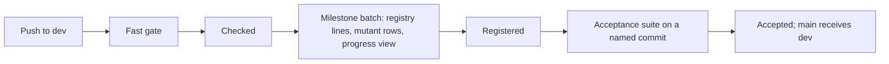

# Checking a verification claim

A green build says that the modules compile and that Lean's kernel checked every proof in them.
It does not say which statements about zlib are proved. This page says which level a result has,
what each check runs, what it establishes and where its limit is.

To run the checks, read [contributing](contributing.md). To add a mutant, read
[proof mutants](proof-mutants.md). What the registries mean is in [public goals](goals.md).
Which result is at which level, and the commit of each acceptance run, is recorded only in
[progress, Scope](../progress.md#scope).

## Three levels

Each level includes the one before it. The definitions are those of the
[glossary](../glossary.md#status), in the same words.

| Level | What is true | Where you see it |
| --- | --- | --- |
| **Checked** | The theorem is on the integration branch `dev`, and the fast gate is green on that commit. Lean's kernel has checked the proof. | The results `build` and `no-sorry` of the workflow `lean` on that commit. |
| **Registered** | The theorem is checked, its name is listed in `tests/audit/theorems.txt`, and the goal it proves is listed in `tests/audit/proved-goals.txt`. The two lines are a claim; the acceptance suite is the check that the theorem's type is exactly the goal. | The two files at that commit. The generated tables in [progress, Target evidence](../progress.md#target-evidence) show the theorem of each goal. |
| **Accepted** | The theorem is registered, and the acceptance suite is green on a named commit: axiom gate, exact goal match, self tests and differential tests. Only an accepted result is reported as final, and always with that commit. | The results `audit` and `difftest` of the workflow `lean` on that commit, and the record of the run in [progress, Scope](../progress.md#scope). |

Acceptance belongs to a commit. A goal whose statement changes after an acceptance run is
accepted only in the form it had on the accepted commit; in its new form it is registered until
a later run is green. A goal added after a run is registered and not accepted until a later run.

A goal with no registered theorem of its type is **open**.

Proof mutants are not part of any level. They are additional evidence: they run only on request,
a run is reported separately with its commit, and it gates no merge, no acceptance and no
milestone ([below](#proof-mutants-on-request)).

## Two sets of checks, and the mutants

The fast gate and the acceptance suite are jobs of the workflow `.github/workflows/lean.yml`. So
is the mutant stage, which belongs to neither set.

### Fast gate

It runs on every push to `dev` or `main` and on every pull request. It is the only gate for merging.

| Job | Step | What fails it |
| --- | --- | --- |
| `build` | Build the library and the audit tools | A module of `ZlibF` that does not compile. A proof that the kernel rejects. |
| `build` | Build the differential drivers | A driver of `tests/list.txt` that does not compile against the translation. The drivers are built here and run only in the acceptance suite. |
| `build` | Forbidden constructs | `native_decide`, `bv_decide`, `implemented_by`, `axiom`, `partial`, `unsafe`, `opaque` or `extern` in the source text of `ZlibF`. |
| `build` | No unsafe or partial declaration (`tests/audit/PartialCheck.lean`) | A compiled declaration marked unsafe or partial that is not a listed compiler helper (`tests/audit/compiler-helpers.txt`). |
| `build` | Patches apply | A file of `patches/` that does not apply to a copy of the pinned `zlib/`. |
| `no-sorry` | `scripts/check-sorry.sh` | A `sorry` in `ZlibF.lean` or under `ZlibF/`. |
| `no-sorry` | `scripts/check-strlit.py` | A string literal of a translation that is missing from the runtime's string table. |
| `no-sorry` | `scripts/check-spec-layers.py` | A module under `ZlibF/Spec/Safety/` or `ZlibF/Spec/Public/` that imports, even transitively, a functional specification (`ZlibF/Spec/Functional/` or the old paths `ZlibF/Spec/Api*`, `ZlibF/Spec/Format*`). The script holds a list of the edges still allowed; an entry may be removed from that list and none may be added. |

The fast gate does not read the registries. A green fast gate says nothing about which goals are proved.

### Acceptance suite

It runs every night on `main` and on request (the manual trigger of the `lean` workflow, on any
branch). It has two required results, `audit` and `difftest`. Each one fails when any worker of
the table below fails, is skipped or is cancelled.

| Result | Worker | What it runs |
| --- | --- | --- |
| `audit` | `audit_core` | `python3 scripts/verification.py specs`: the inventory, a fresh-kernel recheck of the whole library, the declaration audit and the registry rules below. Then the tests of the auditor and of the scripts under `tests/verification/`, and `scripts/proof-progress.py --check`, which fails on a stale progress view. |
| `audit` | `audit_selftest`, two shards | `tests/audit/selftest.sh`: each file of `tests/audit/cheats/` (a `sorry`, an axiom, `native_decide`, `implemented_by`, an opaque constant, a partial or unsafe definition, a classical trick) must be rejected by the auditor. |
| `difftest` | `diff_core` | `tests/run.sh`: the translation and the patched C on the same inputs. Then the same with the C built under AddressSanitizer and UndefinedBehaviorSanitizer. |
| `difftest` | `diff_harness`, eight shards | `tests/selftest.sh`: a mutated translation must make the differential test report a difference. |

A red nightly run is fixed before new acceptance work. It does not block proof work.
Acceptance work is done in batches at a milestone, not for each change.

### Proof mutants, on request

The [proof mutants](proof-mutants.md) are additional evidence, not part of acceptance: a full run
takes several hours. The job `audit_mutants` (twenty shards, each running
`python3 scripts/verification.py mutants --shard-count 20 --shard-index N`) starts only when the
manual trigger of the `lean` workflow is used with its `mutants` option. The nightly run and a
manual run without the option skip it, and `audit` is green without it. When the option is set,
`audit` also requires every mutant shard to pass. A mutant run is reported separately, with its
commit. It gates no merge, no acceptance and no milestone.

The audit still checks, without running any mutant, that the rows exist
([item 6 below](#what-verificationpy-specs-decides)): a later mutant run then covers every
proved goal.

### The one-process run

`python3 scripts/verification.py final` runs these parts in one process, from a clean build, and
prints the commit:

- the checks of `specs`;
- `scripts/check-sorry.sh` and the audit self-test;
- the kernel replay of every keyed mutant;
- the differential tests, plain and sanitised, and the self-test of the differential harness;
- every mutant list of the three list directories, in strict mode.

It runs the mutants, so it is more than the acceptance suite. It does not run the Python tests under `tests/verification/`, the check of the progress view, or
the fast-gate steps other than `check-sorry.sh` (string literals, specification layers, forbidden
constructs, `PartialCheck.lean`, patches apply). The workflow `verification-final` starts it by
hand for a named commit. The nightly suite does not run it.

## What `verification.py specs` decides

The script reads the registries under `tests/audit/`. [Public goals](goals.md) describes them.

1. **Inventory.** The functions of `public-api.json` are exactly the exported functions of the
   pinned `zlib.h`. Each function of the default build has a manual section, a translated entry
   and a functional goal. `gzopen_w`, which exists only on Windows, has only its manual section
   and a reason. Each documented function has a safety goal. The goal groups of the manifest equal the lists pinned in
   the script. The source pin equals the submodule commit, and the submodule has no local change.
2. **Fresh kernel.** `leanchecker --fresh ZlibF` rechecks the compiled proof terms.
3. **Declaration audit.** The auditor (`tests/audit/Audit.lean`) reads the compiled modules. It
   rejects an axiom, an opaque constant, `implemented_by`, `extern`, and an unsafe or partial
   declaration outside the listed compiler helpers. Every definition and theorem may depend only on
   `propext`, `Classical.choice` and `Quot.sound`. Every theorem of `theorems.txt` exists, is a
   theorem and has a doc string. Every `Goal.*` proposition is listed in `goals.txt`. A goal is
   PROVED only when a listed theorem has exactly the goal as its type.
4. **Registries agree.** `proved-goals.txt` equals the set of goals the auditor finds PROVED. Every
   required goal is PROVED or listed in `open_safety` of the manifest; a goal in `open_safety` is
   not PROVED.
5. **Nothing disappears silently.** Along the commit chain, no registered theorem, proved goal,
   mutant reference or frozen mutant row disappears without a reasoned entry in
   `registry-removals.json`. A goal closed once is not open again. [Public goals](goals.md#shrink-only-rules)
   gives the rules.
6. **Mutant rows exist.** Every proved goal of one public function has function mutants. Every
   proved required goal has a key in `public-mutants.json` or pinned evidence
   ([proof mutants](proof-mutants.md#which-goals-need-which-evidence)). This item reads the
   lists; it does not run a mutant.

## What the checks establish

| Check | Evidence and limit |
| --- | --- |
| Kernel replay and axiom audit | Check the proof terms and dependencies. Only `propext`, `Classical.choice` and `Quot.sound` are allowed. A correct proof can still answer an incomplete question. |
| Exact goal matching | A registered theorem has the fixed goal as its type. Extra premises, a similar name or a theorem about an abstract model do not count. Whether the goal says enough is decided by review. |
| No-placeholder check | Rejects `sorry` and the other forbidden constructs listed in `AGENTS.md`. |
| Differential tests | Compare translated execution with real C, including errors and allocation failure. They are finite evidence of fidelity, not proof. Sanitizer runs extend that evidence. |
| Audit and differential self-tests | Deliberately break their inputs and require the checking mechanisms to detect the change. |
| Proof mutants (on request, not part of acceptance) | Change the behaviour of a translated function and require the function's proof to reject it. Sensitivity to one edit does not prove that every error is covered. |

## Known limits

- **The checkers are trusted.** The auditor (`tests/audit/*.lean`), `scripts/`, `tests/audit/proofmut.sh`,
  `tests/audit/selftest.sh` and the mutator scripts (`tests/proof-mutants/*.py`) are protected by
  review of their diffs, not by another check.
- **A reasoned removal is the reviewed escape.** An entry with a reason in
  `tests/audit/registry-removals.json` lifts a removal rule for one name. It is visible in the
  diff. An entry that excuses nothing is rejected as stale.
- **The commit chain starts at pinned floors.** The removal rules read the history after two
  commits pinned in the script. A force-push that rewrites the history after a floor escapes them.
  Branch protection against force-push is the defence.
- **A `script:` mutant row is checked by reading it.** The runner's guard against a bad mutant
  compares the first error with the row's file, which for a script row is the script. See
  [proof mutants](proof-mutants.md#known-limits).
- **There are no lock files.** A definition, a specification or a theorem statement is tracked by
  git alone, so a change to one is visible only in the diff. Review decides whether a statement
  says enough, whether the runtime represents C, and whether the translation matches the source.

[The verification policy](../anti-cheating.md) says what the acceptance suite defends against and
what it does not. A statement that is wrong is corrected, not worked around: see `AGENTS.md`.

## Pages in this folder

| Page | Purpose |
| --- | --- |
| [Contributing](contributing.md) | Numbered steps and commands: every change, registering a result, running acceptance. |
| [Public goals](goals.md) | The registries, the required set of goals and the rules against silent removal. |
| [Proof mutants](proof-mutants.md) | What a mutant is, with one worked example; how to add, run and read one; the limits. |
| [Mutant evidence record](mutant-evidence.md) | Dated record: which rows carry the evidence of each group of goals, and where they are killed. |

Three pages are dated records of source reviews. They are evidence about the statements and the
runtime at the time of the review. They are not the process and not a list of present defects.
Each starts with a note that says when it was written, and the two runtime records start with a
table of the state of each finding.

| Record | Content |
| --- | --- |
| [Public contract review](contract-review.md) | Corrections and counterexamples found by reading the functional contracts against the C. |
| [Runtime review](runtime-review.md) | Findings R1–R13 and translation questions U1–U5 about the runtime model. |
| [Heap-table review](runtime-tables-review.md) | Findings F1–F6 about array-backed tables and in-place updates. |

Three older records describe a process with lock files, which the project does not have. They are
kept under `docs/history/`:
[registration checks](../history/registration-review.md),
[query registration review](../history/query-registration-review.md) and
[compiler helper review](../history/compiler-helper-review.md).
