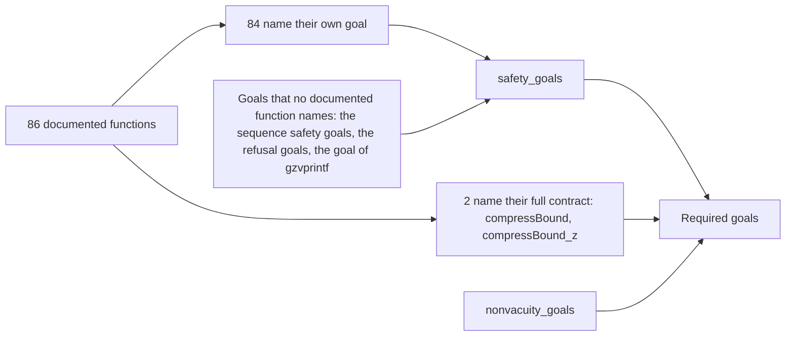

# Public verification goals

A goal is a Lean proposition named `Goal.<something>`; a result exists when a registered theorem
has exactly that proposition as its type. This page says which goals are required, what
registering a proved goal needs, and which rules stop a registered result from disappearing.

What a safety goal says is in [safety claims](../spec/safety.md). The status of each goal, and
the number of goals in each group, are only in [progress](../progress.md).

## The claim the goals add up to

Every documented public function of zlib is safe: no undefined behaviour, no memory error, no
leak, and termination, over call sequences. The target is the default x86_64 Linux static build
with the default allocator. Allocation failure is in scope. Functional correctness and other
build configurations are not required for this claim ([scope](../progress.md#scope)).

## The registries

All of them are under `tests/audit/`. The acceptance suite reads them; the fast gate does not.

| File | Content | Who checks it |
| --- | --- | --- |
| `goals.txt` | Every goal: a definition of type `Prop` whose name contains `Goal`. | The auditor rejects a `Goal.*` proposition of the library that is not listed. |
| `theorems.txt` | The registered theorems, one fully qualified name per line. | The auditor: each exists, is a theorem, has a doc string and depends only on the allowed axioms. |
| `proved-goals.txt` | The goals that a registered theorem proves. | The auditor rejects any difference from the set it finds PROVED. So the scripts decide on this file, never on report text. |
| `public-api.json` | The manifest: every exported function of the pinned `zlib.h` with its manual section, translated entry, functional goal and safety goal (`gzopen_w`, which exists only on Windows, has only its manual section and a reason); the goal groups; `open_safety`; `not_planned`. | `scripts/verification.py` (`coverage`). |
| `public-mutants.json` | For each keyed goal, the mutant rows that its exact proof must reject. | `scripts/verification.py` checks that the rows exist; a mutant run, which is on request, runs them. See [proof mutants](proof-mutants.md). |
| `registry-removals.json` | Reasoned removals from the registries and the mutant tables. | `scripts/verification.py`: a stale entry is rejected. |

A goal is PROVED only when a theorem of `theorems.txt` has exactly the goal as its type. A theorem
with extra premises, or about an abstract model, proves nothing here. An entry of the manifest is
a requirement, not a proof.

## The required set

The manifest has 96 functions: 95 of the default build and the Windows-only `gzopen_w`. zlib.h
lists ten of the 96 as undocumented (nine of the default build, and `gzopen_w`); the manifest names
them under `undocumented`, and the script compares that list with the header. Their goals are not
required, with one exception: the safety goal of `gzvprintf` is in the group `safety_goals`,
because `gzprintf` goes through that function. Their registered theorems stay audited. That
leaves 86 documented functions.

The required goals are computed by `required_public_goals` in `scripts/verification.py`. The set
is the union of three parts:

- the safety goal that each of the 86 documented functions names;
- the goals of the group `safety_goals`;
- the goals of the group `nonvacuity_goals`.

The group `safety_goals` holds the own goals, the sequence safety goals (`inflate`, `deflate`,
`inflateBack` and gz), the refusal goals and `Goal.gzvprintf_safety`. The two full contracts are
not in any group. The command `python3 scripts/verification.py coverage` prints the size of each
group and of the required set; [progress, Scope](../progress.md#scope) lists the set result by
result.

The non-vacuity goals show that the premises of the sequence goals can be met: the init
function establishes the representation invariant on its parameter domain.

Two rules stop a manifest edit from making the set smaller.

**The groups are pinned in the script.** `coverage` compares `sequence_goals`, `nonvacuity_goals`
and `safety_goals` of the manifest with lists written in the script. A group that differs is
rejected. So a goal leaves the required set only through a change to `scripts/`, which is reviewed.

**Each function's safety goal is fixed by the script** (`check_safety_binding`). A documented
function names exactly one of:

1. its own goal `Goal.<function>_safety` (or `_safe`), when that goal is in the pinned group;
2. its full contract, only for `compressBound` and `compressBound_z` (pure functions with no heap;
   the manifest carries a `safety_note`);
3. a shared goal, only for the functions the script lists for it (`SHARED_SAFETY_GOALS`). The
   list is empty: no function shares a safety goal.

An undocumented function names no safety goal, or exactly its own `Goal.<function>_safety` when
that goal is in the pinned group (`check_api_safety_goal`). `gzvprintf` is the only one that
names a goal.

The functional goals (`Goal.<function>` and the group `sequence_goals`) are not required. A proved
one is audited in full. An unproved one is reported as open and fails nothing.

### `open_safety` and `not_planned`

- `open_safety` lists the required goals that have no registered theorem, each with an owner.
  [Progress](../progress.md#scope) says whether any goal is open. A required goal is PROVED or
  listed in `open_safety`; a listed goal is not PROVED.
  `verification.py final` rejects a list that is not empty.
- `not_planned` lists public goals that stay defined and stay in `goals.txt` as open goals, but
  that the project does not work on, each with a reason. It is not a way out of the required set:
  the pinned groups decide what is required. An entry is in no group, is named by no function,
  and is not proved. Its one entry is `Goal.gz_initialisation_domain`, the functional contract of
  `gzopen`.

## What a registration needs

A goal is registered when all of these hold on one commit. [Contributing](contributing.md#register-a-result)
gives the steps, with real registry lines and commands.

1. The theorem has exactly the goal as its type, and it has a doc string. The doc string states
   any precondition narrower than zlib.h; the same precondition has a row in
   [deviations](../deviations.md).
2. The theorem's name is in `tests/audit/theorems.txt`.
3. The goal's name is in `tests/audit/proved-goals.txt`.
4. The goal is not in `open_safety` of `tests/audit/public-api.json`.
5. The goal has mutant rows: a key in `tests/audit/public-mutants.json`, or pinned evidence
   for a goal that is not about one function ([proof mutants](proof-mutants.md#which-goals-need-which-evidence)).
   The audit checks that the rows exist. Running them is not part of registration or of
   acceptance.
6. The progress view in `docs/progress.md` is regenerated. The audit fails on a stale view.

A new goal also has a line in `goals.txt`. A new required goal has its name in the manifest
group and in the pinned list of the script, in one reviewed change.

Registered is not accepted. The result is accepted when the acceptance suite (axiom gate, exact
goal match, self tests, differential tests) is green on that commit, and a report names the
commit ([the three levels](README.md#three-levels)).

## Rules against silent removal {#shrink-only-rules}

A result that was registered once does not vanish quietly. The audit compares the present files
with every earlier commit of a chain. The scripts call these the shrink-only rules: the list of
open goals and the list of waivers may only shrink, and a registry or a frozen mutant table may
only grow.

**The chain.** It holds the base, the pinned floors, and every commit after the floors that `HEAD`
contains, through all parents of a merge. The base is the pull request's base branch, or
`origin/main`, or the first parent when `HEAD` is that commit; the environment variable
`ZLIBF_BASE_REF` overrides it. The two floors are fixed commits written in the script
(`CHAIN_FLOORS`), one on `dev` and one on `main`. At least one floor is an ancestor of `HEAD`, or
the audit rejects the run. A floor moves forward only by an edit to the script.

| Rule | What the audit rejects along the chain | Reviewed way out |
| --- | --- | --- |
| Open list | A required goal that was closed (required and not in `open_safety`) at some commit is in `open_safety` at `HEAD`. A goal that is new to the required set may enter the list. | None. |
| Registries | A name of `theorems.txt` or `proved-goals.txt` at some commit is missing at `HEAD`. | An entry `{name, reason}` under `theorems` or `proved_goals`. |
| Mutant references | A reference (goal, list, row) of a goal that is proved at `HEAD` is missing, or the referenced row has a different file, old text or new text. | An entry `{goal, list, name, reason}` under `mutant_references`. |
| Frozen rows | A row of a frozen mutant list is missing or differs in any field, or the mutator script of a `script:` row has different content. | An entry `{list, name, reason}` under `mutant_rows`. |
| Mutant waivers | The script's list of proved goals without function mutants (`MUTANT_COVERAGE_PENDING`, which is empty) has a new entry. | None. |

The entries are in `tests/audit/registry-removals.json`. Each has a reason that is not empty. An
entry that excuses nothing (the name was never registered on the chain, or is registered at
`HEAD`) is stale, and the audit rejects it. An example: the file holds `mutant_rows` entries for
rows of `api-boundary.tsv` whose specification file moved when the specifications were split into
safety and functional parts.

## What a safety goal says, and what it assumes

These are the subject of other pages. The table gives the place of each part.

| Question | Short answer | Full account |
| --- | --- | --- |
| Which calls does a goal cover? | Every call that zlib.h permits. A parameter the library rejects has a specified error path. Bounds of internal helpers are established by the implementation, not added as caller requirements. A premise narrower than zlib.h has a row in the deviations page. | [Deviations](../deviations.md) |
| What does it say about the run? | The translated entry returns without a fault, fuel exhaustion included, for every permitted initial heap and every pattern of allocation failure. An empty execution relation cannot satisfy the goal. | [Safety claims, one call](../spec/safety.md#1-what-a-function-theorem-must-say) |
| What about memory the call does not own? | Memory outside the call's footprint is unchanged, and unrelated live objects are kept. Init and copy establish ownership; a failed init or copy releases its partial allocations; end and close release owned storage exactly once. | [Safety claims, frames and the allocation account](../spec/safety.md#frames) |
| How do calls compose? | The init function establishes the representation invariant, and every permitted call preserves it. No registered theorem assumes an unproved contract of a callee. | [Safety claims, calls and sequences](../spec/safety.md#2-calls-and-sequences) |
| What does the caller owe? | Live objects with the ranges the API requires, sequential calls on one stream, no change to library-owned state, and disjoint buffers where the statement says so. Undefined behaviour in a permitted call is a defect to resolve, not a new restriction on the caller. | [Safety claims, caller obligations](../spec/safety.md#4-caller-obligations) |
| What is assumed about callbacks and system calls? | Their documented memory contracts, that they return, and that callback input is finite where an unlimited stream could continue forever. The claim is not a theorem about arbitrary caller code or the operating system. | [Trusted base](../trusted-base.md) |
| What is outside the claim? | Compiler and operating-system correctness, performance, constant-time behaviour, and resource bounds against decompression bombs. Malformed compressed data is inside the claim. | [Safety claims, outside safety](../spec/safety.md#outside-safety) |

The goal definitions are in `ZlibF/Spec/Safety/` and, for the gz interface and `inflateBack`, in
`ZlibF/Spec/Public/`; the layout is in [the split design](../design/safety-functional-split.md).
