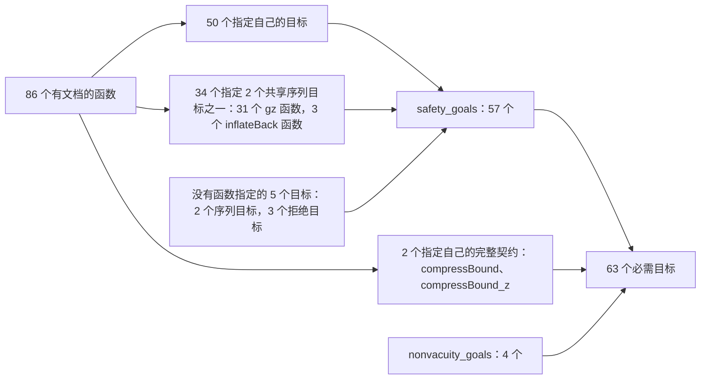

<!-- source-sha256: 64c253da32b0e1a21c4e87da0a9085c7ff4109ae1d8b979628f58a61c16f6c3e -->

# 公开验证目标

一个目标是名为 `Goal.<名称>` 的 Lean 命题；当某个已登记定理的类型恰好是这个命题时，才有一个结果。本页说明哪些目标是必需的（63 个），登记一个已证明的目标需要什么，以及哪些规则防止已登记的结果消失。

安全目标说的是什么，见[安全结论](../spec/safety.md)。每个目标的状态只写在[进度页](../progress.md)。

## 这些目标合起来的结论

zlib 每个有文档的公开函数都是安全的：没有未定义行为，没有内存错误，没有泄漏，并且终止；这对调用序列也成立。对象是使用默认分配器的默认 x86_64 Linux 静态构建。分配失败在范围内。这一结论不要求功能正确性，也不要求其他构建配置（见[范围](../progress.md#scope)）。

## 登记表

它们都在 `tests/audit/` 下。验收套件读取它们；快速关卡不读。

| 文件 | 内容 | 由谁检查 |
| --- | --- | --- |
| `goals.txt` | 每个目标：类型为 `Prop`、名字中含 `Goal` 的定义。 | 库中的 `Goal.*` 命题若没有列出，审计器拒绝。 |
| `theorems.txt` | 已登记的定理，每行一个完全限定名。 | 审计器：每个定理都存在，确实是定理，有文档字符串，并且只依赖允许的公理。 |
| `proved-goals.txt` | 已有登记定理证明的目标。 | 它与审计器判定为 PROVED 的集合有任何出入，审计器都拒绝。所以脚本依据这个文件作判断，从不依据报告文字。 |
| `public-api.json` | 清单：固定版本 `zlib.h` 的每个导出函数，连同它的手册小节、翻译后的入口、功能目标和安全目标；目标分组；`open_safety`；`not_planned`。 | `scripts/verification.py`（`coverage`）。 |
| `public-mutants.json` | 对每个带键的目标，列出它的精确证明必须拒绝的变异体行。 | `scripts/verification.py`；见[证明变异体](proof-mutants.md)。 |
| `registry-removals.json` | 从登记表和变异体列表中删除条目时写下的理由。 | `scripts/verification.py`：过时的条目会被拒绝。 |

只有当 `theorems.txt` 中某个定理的类型恰好是这个目标时，目标才算 PROVED。多出前提的定理，或关于抽象模型的定理，在这里什么也不证明。清单中的条目是一项要求，不是一个证明。

## 必需目标集合

清单有 96 个函数：默认构建的 95 个，加上只在 Windows 上存在的 `gzopen_w`。zlib.h 把这 96 个中的十个列为无文档函数（默认构建中九个，加上 `gzopen_w`）；清单把它们列在 `undocumented` 下，脚本把这份列表与头文件相比较。它们的目标不是必需的。它们已登记的定理继续接受审计。这样剩下 86 个有文档的函数。

必需目标由 `scripts/verification.py` 中的 `required_public_goals` 计算。这个集合是三部分的并集：

- 86 个有文档的函数各自指定的安全目标；
- 分组 `safety_goals` 中的目标（57 个）；
- 分组 `nonvacuity_goals` 中的目标（4 个）。

所以总数是 57 + 4 + 2 = 63。这 57 个是 50 个函数自己的目标、四个序列安全目标（`inflate`、`deflate`、`inflateBack` 和 gz）和三个拒绝目标。两个共享目标就在这四个序列目标之中，所以指定它们的 34 个函数不增加总数。两个完整契约不在任何分组里，它们就是那个 2。

四个非空性目标说明序列目标的前提可以被满足：初始化函数在它的参数定义域上建立表示不变量。

有两条规则防止通过编辑清单把这个集合变小。

**分组固定在脚本里。**`coverage` 把清单中的 `sequence_goals`、`nonvacuity_goals` 和 `safety_goals` 与脚本中写明的列表相比较。有出入的分组会被拒绝。所以，一个目标只有通过对 `scripts/` 的改动才能离开必需集合，而这种改动要经过审查。

**每个函数的安全目标由脚本固定**（`check_safety_binding`）。一个有文档的函数恰好指定下列之一：

1. 它自己的目标 `Goal.<function>_safety`（或 `_safe`），前提是该目标在固定的分组中；
2. 它的完整契约，只适用于 `compressBound` 和 `compressBound_z`（不涉及堆的纯函数；清单中带有 `safety_note`）；
3. 一个共享的序列目标，只适用于脚本为它列出的函数：31 个有文档的 gz 函数指定 `Goal.gz_sequence_safety`，`inflateBack`、`inflateBackInit_` 和 `inflateBackEnd` 指定 `Goal.inflate_back_sequence_safety`。

第 3 种情况的 34 个函数通过它们的序列目标被证明是安全的。它们还没有各自单独的单函数安全目标（见[进度页](../progress.md)）。

功能目标（`Goal.<function>` 和分组 `sequence_goals`）不是必需的。已证明的功能目标接受完整审计。未证明的功能目标被报告为未证明，但不导致任何检查失败。

### `open_safety` 和 `not_planned`

- `open_safety` 列出还没有已登记定理的必需目标，每个都写明负责人。它是空的。必需目标要么是 PROVED，要么列在这里；列在这里的目标不是 PROVED。列表不为空时，`verification.py final` 拒绝。
- `not_planned` 列出这样的公开目标：它们保留定义，仍作为未证明的目标留在 `goals.txt` 中，但项目不在它们上面投入工作；每个都写明理由。它不是离开必需集合的出口：什么是必需的，由固定的分组决定。其中的条目不在任何分组里，没有函数指定它，它也没有被证明。它只有一个条目：`Goal.gz_initialisation_domain`，即 `gzopen` 的功能契约。

## 登记需要什么

下列各项在同一个提交上全部成立时，一个目标就是已登记的。[参与贡献](contributing.md#register-a-result)给出步骤，附有真实的登记行和命令。

1. 定理的类型恰好是这个目标，并且有文档字符串。文档字符串写明任何比 zlib.h 更窄的前置条件；同一前置条件在[偏离记录](../deviations.md)中有一行。
2. 定理的名字在 `tests/audit/theorems.txt` 中。
3. 目标的名字在 `tests/audit/proved-goals.txt` 中。
4. 目标不在 `tests/audit/public-api.json` 的 `open_safety` 中。
5. 目标有变异体证据：在 `tests/audit/public-mutants.json` 中有键；不针对单个函数的目标则有固定证据（见[证明变异体](proof-mutants.md#which-goals-need-which-evidence)）。
6. `docs/progress.md` 中的进度视图已重新生成。视图过时时审计失败。

新目标还在 `goals.txt` 中有一行。新的必需目标，其名字同时在清单的分组和脚本固定的列表中，两处在同一个经过审查的改动里加入。

已登记不等于已验收。验收套件在该提交上全部通过，并且报告写出这个提交，结果才是已验收的（见[三个层级](README.md#three-levels)）。

## 防止悄悄删除的规则 {#shrink-only-rules}

登记过的结果不会悄悄消失。审计把现在的文件与一条提交链上更早的每个提交相比较。脚本把这些规则叫作 shrink-only 规则：未证明目标的列表和豁免列表只能变短，登记表和冻结的变异体列表只能变长。

**提交链。**它包含基线、固定的起点，以及 `HEAD` 所含的、起点之后的每个提交，合并提交的所有父提交都算在内。基线是拉取请求的基线分支，或 `origin/main`；当 `HEAD` 就是那个提交时，取它的第一个父提交；环境变量 `ZLIBF_BASE_REF` 可以覆盖它。两个起点是写在脚本里的固定提交（`CHAIN_FLOORS`），一个在 `dev` 上，一个在 `main` 上。至少有一个起点是 `HEAD` 的祖先，否则审计拒绝这次运行。起点只能通过修改脚本向前移动。

| 规则 | 审计沿提交链拒绝什么 | 经过审查的出口 |
| --- | --- | --- |
| 未完成列表 | 某个必需目标在某个提交上已经完成（是必需的且不在 `open_safety` 中），在 `HEAD` 上却在 `open_safety` 中。新加入必需集合的目标可以进入这个列表。 | 无。 |
| 登记表 | `theorems.txt` 或 `proved-goals.txt` 在某个提交上有的名字，在 `HEAD` 上没有了。 | `theorems` 或 `proved_goals` 下的条目 `{name, reason}`。 |
| 变异体引用 | 一个在 `HEAD` 上已证明的目标，它的某个引用（目标、列表、行）不见了，或被引用行的文件、旧文本或新文本变了。 | `mutant_references` 下的条目 `{goal, list, name, reason}`。 |
| 冻结的行 | 冻结的变异体列表中有一行不见了，或任何字段有变化，或 `script:` 行的变异脚本内容变了。 | `mutant_rows` 下的条目 `{list, name, reason}`。 |
| 变异体豁免 | 脚本中“已证明但没有函数变异体的目标”列表（`MUTANT_COVERAGE_PENDING`，它是空的）多了一个条目。 | 无。 |

这些条目在 `tests/audit/registry-removals.json` 中。每个条目都有非空的理由。什么也不豁免的条目（该名字在提交链上从未登记过，或在 `HEAD` 上仍然登记着）是过时的，审计会拒绝它。该文件有九个 `mutant_rows` 条目，都针对 `api-boundary.tsv` 中的行：规格拆分为安全部分和功能部分时，这些行的规格文件移动了位置。

## 安全目标说什么，假设什么

这些是其他页面的主题。下表给出每一部分所在的位置。

| 问题 | 简短回答 | 完整说明 |
| --- | --- | --- |
| 目标覆盖哪些调用？ | zlib.h 允许的每一次调用。库拒绝的参数有规定的出错路径。内部辅助函数的界限由实现建立，不作为对调用者的要求加进来。比 zlib.h 更窄的前提在偏离记录中有一行。 | [偏离记录](../deviations.md) |
| 关于执行，它说了什么？ | 对每个允许的初始堆和每一种分配失败的模式，翻译后的入口都无故障地返回，燃料耗尽也算故障。空的执行关系不能满足目标。 | [安全结论：一次调用](../spec/safety.md#1-what-a-function-theorem-must-say) |
| 不属于这次调用的内存怎么样？ | 调用足迹之外的内存不变，无关的存活对象得以保留。初始化和复制建立所有权；失败的初始化或复制释放已做的部分分配；结束和关闭把拥有的存储恰好释放一次。 | [安全结论：帧性质与分配账本](../spec/safety.md#frames) |
| 多次调用怎样组合？ | 初始化函数建立表示不变量，每一次允许的调用都保持它。没有哪个已登记的定理假设被调用函数的某个未经证明的契约。 | [安全结论：调用与序列](../spec/safety.md#2-calls-and-sequences) |
| 调用者要保证什么？ | 存活的对象及 API 要求的范围，对同一个流的调用依次进行，不改动库拥有的状态，以及在命题写明之处缓冲区互不重叠。允许的调用中出现未定义行为，是必须解决的缺陷，不能靠给调用者再加一条限制来回避。 | [安全结论：调用者义务](../spec/safety.md#4-caller-obligations) |
| 对回调和系统调用假设了什么？ | 它们文档规定的内存契约，它们会返回，以及在无限的流可能永远继续的地方，回调提供的输入是有限的。这个结论不是关于任意调用者代码或操作系统的定理。 | [可信基础](../trusted-base.md) |
| 结论之外有什么？ | 编译器和操作系统的正确性、性能、常数时间行为，以及针对解压炸弹的资源上界。畸形的压缩数据在结论之内。 | [安全结论：安全性之外](../spec/safety.md#outside-safety) |

目标的定义在 `ZlibF/Spec/Safety/` 中；gz 接口和 `inflateBack` 的在 `ZlibF/Spec/Public/` 中。目录布局见[拆分设计](../design/safety-functional-split.md)。
