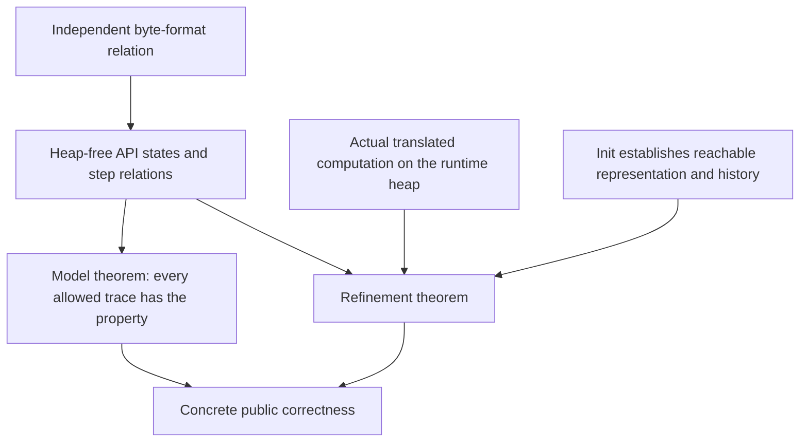

# API models

The API models are heap-free descriptions of what the public calls compute: relations over
histories of bytes, with no pointers and no memory. They are functional material. No safety goal
uses them, and they are not required for the safety results; the models and the theorems
already proved about them stay ([scope](../progress.md#scope)).
[The families in detail](api-model-details.md) describes each model.

## Two kinds of statement

| Kind | Where | About |
| --- | --- | --- |
| Model relation | `ZlibF/Spec/Functional/Api/` | Histories of bytes and the results a call may give. No heap. |
| Concrete goal | `ZlibF/Spec/Safety/`, `ZlibF/Spec/Functional/`, `ZlibF/Spec/Public/` | A translated call run on the runtime heap, and its effects. |

A theorem about a model relation is not a theorem about a C function. For example,
`ZlibF.Spec.Api.Goal.roundtrip` is a registered statement about the model only. The planned round
trip of the default zlib stream is a different statement: it is about runs of the translated
`deflate` and `inflate`. Its conditional form, `deflate_inflate_roundtrip`
(`ZlibF/Proof/public-deflate-inflate-roundtrip.lean`), is checked, not registered and not
accepted; completeness and the unconditional form are open
([architecture](architecture.md#the-layers)).

To say something about the C, a functional claim needs three connections:

The refinement theorem is the substantive part: every actual execution is a step the model
allows. A model theorem alone shows a property of the model.

The check `scripts/check-spec-layers.py`, in the fast gate, rejects an import of these models by
a safety goal ([layout of the specifications](safety-functional-split.md)). One listed edge
remains: `Public/GzState` imports the gz mode decoder.

## Where the definitions live

Paths are relative to `ZlibF/Spec/Functional/Api/`. The old paths under `ZlibF/Spec/Api/` are
one-line modules that re-export these files.

| Module | Content |
| --- | --- |
| `Basic.lean` | The decoding relation `Layer.Decodes` selected by the wrapper and window, and format viability. The parameter decoders (return codes, flush values, window and wrapper selection) are in `ZlibF/Spec/Public/Parameters.lean` |
| `Header.lean` | Gzip header requests, output records and header bytes |
| `Inflate.lean` | Inflate state, step relations, dictionaries, recovery and callback decoding |
| `InflateAccepted.lean` | `Api.Layer.InflateAccepted`: the streams default `inflate` accepts, used by the functional sequence goal |
| `Deflate.lean` | Deflate state, step relations, flush history, dictionaries and bounds |
| `Compress.lean` | One-call compression and decompression relations and numeric bounds |
| `Gz.lean` | File-handle state machines over abstract file contents |
| `Run.lean` | Operation datatypes, family dispatch and traces |
| `Iface.lean` | The abstract interface `HeapApi` that the refinement goals are stated over |
| `Concrete.lean` | Direct execution on the runtime heap, correctness of successful runs, and selected compressor goals |
| `Goals.lean` | Named propositions about the models and about refinement |
| `Examples.lean` | Small model witnesses and computable checks |

## Reading the goal names of `Goals.lean`

| Family | Property |
| --- | --- |
| `format_deterministic`, `format_prefix_free` | A complete format stream has one decoding and no complete proper extension |
| `inflate_decodes`, `inflate_completes`, `inflate_rejects_invalid` | Output prefixes, completion and rejection under the model's exactness, window and detection clauses |
| `deflate_valid`, `deflate_completes`, `deflate_full_flush_resync` | Valid completed output, finishing within the assumed bound, and raw resynchronisation |
| `roundtrip`, `roundtrip_completes`, `dict_roundtrip`, `header_roundtrip` | Composition through the independent format relation |
| `deflate_bound_adequate`, `compress_bound_adequate`, `compress_roundtrip` | Utility and bound consequences of the corresponding model clauses |
| `gz_roundtrip`, `gz_seek_read` | Abstract file round trip and the specified position cases |
| `*_refines` | Actual execution is an allowed model step, under a concrete instance of `HeapApi` |

`Examples.lean` gives small witnesses and arithmetic checks. A witness shows that an example is
possible. It does not show universal correctness or refinement.

[The families in detail](api-model-details.md) covers states and histories, the evidence a
decoder needs before it may emit output, the deflate history flags, the one-call utilities, the
gz position model, and what an instance of `HeapApi` has to mean (the interface and the concrete
boundary).

[Design](README.md) · [Documentation home](../README.md)
