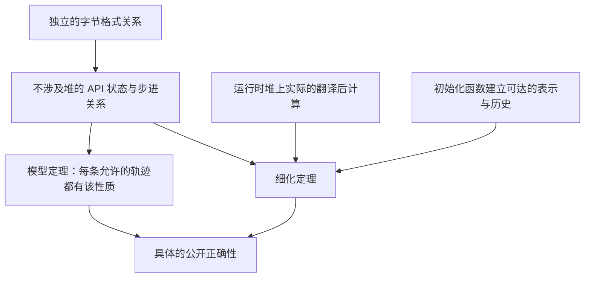

<!-- source-sha256: 56ae227820c794246dba828a5fe267af624da1cd9ee9bb594bdfde26c6948fdb -->
# API 模型

API 模型不涉及堆，它们描述公开调用计算什么：它们是字节历史上的关系，没有指针，也没有内存。它们属于功能性材料。没有安全目标使用它们，它们也不是安全结论所必需的；这些模型以及已经证明的关于它们的定理都保留（[范围](../progress.md#scope)）。[各族详解](api-model-details.md)逐个说明每个模型。

## 两类命题

| 种类 | 位置 | 讲的是什么 |
| --- | --- | --- |
| 模型关系 | `ZlibF/Spec/Functional/Api/` | 字节历史，以及一次调用可以给出的结果。没有堆。 |
| 具体目标 | `ZlibF/Spec/Safety/`、`ZlibF/Spec/Functional/`、`ZlibF/Spec/Common/` | 在运行时堆上运行的一次翻译后的调用，以及它的效果。 |

关于模型关系的定理不是关于 C 函数的定理。例如，`ZlibF.Spec.Api.Goal.roundtrip` 是一条已证明的命题，但它只关于模型。计划中的默认 zlib 流往返是另一条命题：它说的是翻译后的 `deflate` 和 `inflate` 的运行。它的条件形式 `deflate_inflate_roundtrip`（`ZlibF/Proof/public-deflate-inflate-roundtrip.lean`）的内容见[架构](architecture.md#the-layers)；完备性和无条件形式排在它之后（这项工作进行到哪一步，见[进度，范围](../progress.md#scope)）。

一个功能性的结论要对 C 有所断言，需要三个联系：

细化定理是实质性的部分：每次实际执行都是模型允许的一步。单有模型定理，只说明模型的一个性质。

快速关卡中的检查 `scripts/check-spec-layers.py` 拒绝安全目标导入这些模型（[规格的布局](safety-functional-split.md)）。还剩一条列出的边：`Public/GzState` 导入 gz 模式解码器。

## 定义的位置

路径相对于 `ZlibF/Spec/Functional/Api/`。`ZlibF/Spec/Api/` 下的旧路径是只有一行的模块，它们再导出这些文件。

| 模块 | 内容 |
| --- | --- |
| `Basic.lean` | 由封装和窗口选定的解码关系 `Layer.Decodes`，以及格式的可延续性。参数解码器（返回码、flush 值、窗口和封装的选择）在 `ZlibF/Spec/Common/Parameters.lean` 中 |
| `Header.lean` | gzip 头请求、输出记录和头部字节 |
| `Inflate.lean` | inflate 的状态、步进关系、字典、恢复和回调解码 |
| `InflateAccepted.lean` | `Api.Layer.InflateAccepted`：默认的 `inflate` 接受的流，供功能序列目标使用 |
| `Deflate.lean` | deflate 的状态、步进关系、刷新历史、字典和上界 |
| `Compress.lean` | 单次调用的压缩和解压关系，以及数值上界 |
| `Gz.lean` | 抽象文件内容上的文件句柄状态机 |
| `Run.lean` | 操作的数据类型、按族分派和轨迹 |
| `Iface.lean` | 抽象接口 `HeapApi`，细化目标以它为基础写出 |
| `Concrete.lean` | 在运行时堆上的直接执行、成功运行的正确性，以及选定的压缩器目标 |
| `Goals.lean` | 关于模型和关于细化的具名命题 |
| `Examples.lean` | 小型的模型见证和可计算的检查 |

## 阅读 `Goals.lean` 中的目标名

| 族 | 性质 |
| --- | --- |
| `format_deterministic`, `format_prefix_free` | 完整的格式流只有一种解码，并且没有完整的真扩展 |
| `inflate_decodes`, `inflate_completes`, `inflate_rejects_invalid` | 在模型的精确性、窗口和检测子句之下的输出前缀、完成和拒绝 |
| `deflate_valid`, `deflate_completes`, `deflate_full_flush_resync` | 有效的完成输出、在假定的上界内完成，以及裸流重新同步 |
| `roundtrip`, `roundtrip_completes`, `dict_roundtrip`, `header_roundtrip` | 经由独立的格式关系进行组合 |
| `deflate_bound_adequate`, `compress_bound_adequate`, `compress_roundtrip` | 对应的模型子句在工具函数和上界方面的推论 |
| `gz_roundtrip`, `gz_seek_read` | 抽象文件的往返，以及指定的位置情形 |
| `*_refines` | 在 `HeapApi` 的一个具体实例之下，实际执行是模型允许的一步 |

`Examples.lean` 给出小型见证和算术检查。见证说明某个例子是可能的。它不说明全称的正确性，也不说明细化。

[各族详解](api-model-details.md)讲述状态和历史、解码器在可以输出之前需要的证据、deflate 的历史标志、单次调用的工具函数、gz 的位置模型，以及 `HeapApi` 的一个实例必须表达什么（接口和具体边界）。

[设计](README.md) · [文档首页](../README.md)
