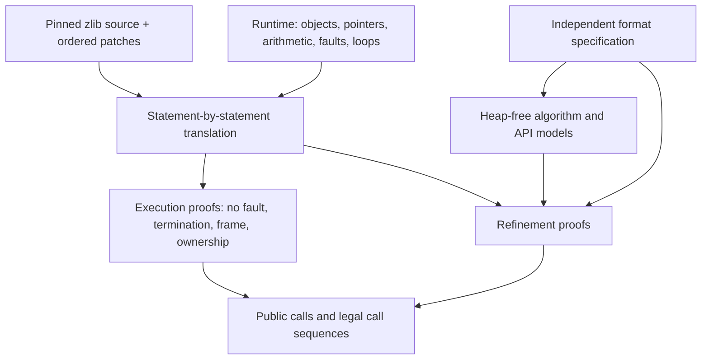
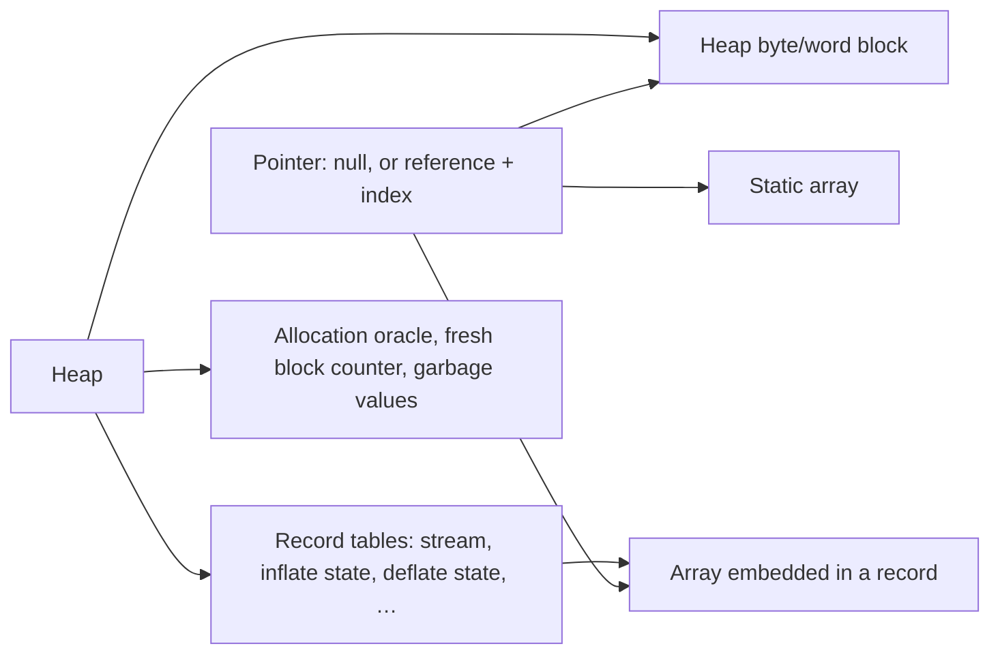

# From C to a checked theorem

A theorem of this project is about a Lean program, not about the C text. This page shows what
that program is made of, so that a reader can judge the two connections the kernel does not
check: the runtime represents the C operations, and the translation matches the selected C
source. [Trusted base](../trusted-base.md) lists everything that rests on review.

## The layers



| Layer | Its job | What justifies it |
| --- | --- | --- |
| Selected C | Fix the program being verified | The pinned `zlib/` submodule plus `patches/*.patch`, applied in name order |
| Runtime | Give translated operations executable semantics | Review and semantic regression tests |
| Translation | Preserve the C statements and their order | Source review and differential tests; tests are evidence, not proof |
| Models and specifications | State what the program does without committing to its implementation | Review of definitions, domains and their relation to `zlib.h` and the data formats |
| Proofs | Connect the computation to those statements | Lean kernel checking and the [acceptance checks](../checking/README.md) |

Only the path through *Execution proofs* is required for the safety results: no fault,
termination, frame and ownership, composed over call sequences. The path through *Refinement
proofs* gives functional correctness. It is not required for the safety results; a functional
fact is in scope when a planned safety proof depends on it, and the refinement results already
proved stay ([scope](../progress.md#scope)).

## The model in a few definitions

These are the definitions every translated function is built from. They are quoted from
`ZlibF/Runtime/Monad.lean` and `ZlibF/Runtime/Space.lean`, without their `deriving` lines.

```lean
/-- Why a C computation did not produce a value. -/
inductive Fault where
  /-- undefined behaviour, with a short reason -/
  | ub (what : String)
  /-- a loop used up its fuel (a termination theorem rules this out) -/
  | outOfFuel

/-- A C computation: the heap in, a value and the heap out, or a fault. -/
def M (α : Type) : Type := Heap → Except Fault (α × Heap)

/-- Loop fuel. Large enough that no zlib loop over in-memory data can exhaust it. -/
def fuel : Nat := 2 ^ 64

/-- `while (cond) body` over the loop-carried locals `σ`. The condition may update them (`while (len--)`):
its update happens on every evaluation, including the last, false one, as in C. -/
def cwhile {σ : Type} (cond : σ → M (Bool × σ)) (body : σ → M σ) (s : σ) : M σ :=
  go fuel s
where
  go : Nat → σ → M σ
    | 0, _ => fun _ => .error .outOfFuel
    | n + 1, s => do
      let (c, s) ← cond s
      if c then go n (← body s) else pure s
```

How to read them:

- A translated C function of return type `T` has Lean type `M T`: given a heap it returns
  `.ok (value, new heap)` or `.error fault`. There is no other outcome.
- `Fault.ub` is the model's undefined behaviour. An operation of the runtime returns it where the
  C operation is undefined: a read outside an object, a signed overflow, a double free.
- `Fault.outOfFuel` is not a C behaviour. `cwhile` tests its condition at most `2^64` times; if
  the condition is still true at the last test, the run ends in `Fault.outOfFuel`. A loop never
  leaves quietly because the fuel ran out. A termination proof shows that the fault does not
  occur. `cdoWhile` is the same for `do … while`.
- A safety theorem has the shape "for every heap that meets the premises, the run is `.ok`, and
  the new heap differs from the old one only as stated".

A pointer into an array has no address:

```lean
/-- A pointer into an array: null, or the array (`R` says where it lives: a heap block, an array inside a
struct, a static table) and an index. There is no address. One past the end is a valid pointer. -/
inductive Ptr (R : Type) where
  | null
  | ref (r : R) (off : Nat)
```

A read through such a pointer is checked (`ZlibF/Runtime/Ptr.lean`; `Space.get h r` is the
array that `r` names in heap `h`, if it is live):

```lean
/-- `*p`. Faults if `p` is null, dangling, or outside its array (one past the end is not readable). -/
def Ptr.load (p : Ptr R) : M T := fun h =>
  match p with
  | .null => .error (.ub "null dereference")
  | .ref r off =>
    match Space.get h r with
    | none => .error (.ub "read through a dangling pointer")
    | some a => if hk : off < a.size then .ok (a[off], h) else .error (.ub "read outside its object")
```

So an out-of-bounds read, a read through `NULL` and a read after `free` are each `Fault.ub`.
A theorem that says "the run is `.ok`" excludes all three. `Ptr.store`, `Ptr.add` (pointer
arithmetic), `Ptr.diff` and `Ptr.lt` have the same form. A byte pointer is `BPtr`; `load8`,
`index8` and `store8` are the byte versions used in the translations. A pointer to a struct
is `none` for `NULL` or a reference to an entry of that struct's table.

[Translation](translation.md) shows a C function beside its Lean text and reads it line by
line.

## Selected source and module layout

The target is the default x86_64 Linux static build with LP64 widths and the default
allocator. Allocation failure is in scope. Other build configurations and custom allocator
implementations are not planned; [deviations](../deviations.md) records the limit.
The source submodule is never edited. A patch is permitted only for a confirmed upstream bug,
under the rules in the repository's `AGENTS.md` and `patches/README.md`.

| Location | Responsibility |
| --- | --- |
| `ZlibF/Runtime/` | Heap, pointers, faults, loops and modelled C library operations |
| `ZlibF/Zlib/X.c.lean` | Translation of `zlib/X.c`; it holds no proofs. `deflate.c` is split over `deflate_base.c.lean`, `deflate_strategies.c.lean` and `deflate.c.lean` |
| `ZlibF/Zlib/X.h.lean` | Translation of `zlib/X.h` |
| `ZlibF/Zlib/gzfs.lean` | The model of files, `errno` and formatting for the gz translations ([external I/O](external-io.md)) |
| `ZlibF/Spec/Safety/` | The required safety goals |
| `ZlibF/Spec/Functional/` | Functional goals, and the heap-free format and API models; not required for the safety results |
| `ZlibF/Spec/Public/` | Definitions both kinds of goal use: calls, histories, frames, parameters; also the gz and `inflateBack` goals ([layout of the specifications](safety-functional-split.md)) |
| `ZlibF/Spec/*.lean` | Statements about internal functions. Each is proved for the translated function before a caller uses it ([below](#composing-calls-without-assuming-their-answers)) |
| `ZlibF/Proof/X.c.<topic>.lean` | Proofs about `zlib/X.c` |
| `ZlibF/Proof/public-<name>.lean` | Proofs of public goals |
| `ZlibF/Math/` | Heap-free facts shared by the proofs |
| `tests/` | Differential evidence, regressions and acceptance checks |

Function names are the C names. A function's docstring begins with its C signature.

## Where the trusted semantics is

Everything in this section is trusted: a mistake here is not found by the kernel.

| File in `ZlibF/Runtime/` | Content |
| --- | --- |
| `Space.lean` | Heap tables, the pointer type `Ptr`, function pointers, the value of an uninitialised integer |
| `Monad.lean` | `Fault`, `M`, `fuel`, `cwhile`, `cdoWhile` |
| `Ptr.lean` | Pointer arithmetic, load, store, difference, comparison |
| `Address.lean` | The low three address bits of a byte pointer, which the CRC alignment test reads |
| `Libc.lean`, `LibcStrings.lean` | `malloc`, `free`, `memcpy`, `memmove`, `memset`, `strlen`, string literals, the `strerror` texts |
| `Schema.lean` (generated) | The record of every struct, the reference types, the static tables, the heap |
| `Tables.lean`, `LibcTables.lean` (generated) | Load, store, `malloc`, `free` and whole-record `memcpy` for each struct kind |
| `Alloc.lean` | A re-export of `Libc.lean`; no content |

The generated files are written by `scripts/gen_schema.py` from the C headers.
[Runtime schema](../runtime-schema.md) lists every field.

Some semantic helpers are not in `ZlibF/Runtime/`. They are defined in the translation files
that use them, and they are trusted in the same way:

| Helper | Where | What it models |
| --- | --- | --- |
| Checked signed arithmetic: `chkI32`, `chkI64`; `chk32`, `chk64`, `iadd`, `isub`, `ineg`, `ishl`; `ck`, `shl1`; `i64chk`, `i64add`, `i64sub`, `i64neg` | `inflate.c.lean`; `deflate_base.c.lean`, `inftrees.c.lean`, `inffast.c.lean`; `trees.c.lean`; `gzguts.h.lean` | A signed result outside its type is `Fault.ub` |
| Checked shifts: `shl32`, `shr32`, `shl64`, `shr64`, `shl1i32`, `shlUs`, `shrUs` | `inflate.c.lean`, `inftrees.c.lean`, `inffast.c.lean`, `crc32.c.lean`, `trees.c.lean` | A shift count outside the operand width is `Fault.ub` |
| The mode monad `X` and its loops `xwhileBrk`, `xwhile`, `xdoWhile`, `xloopBrk` | `inflate.c.lean` (also used by `infback.c.lean`) | `break`, `goto inf_leave` and `return` inside the big `switch` of `inflate`; built on `cwhile` |
| `gwhile`, `gdoWhile` | `gzfs.lean` | `cwhile` and `cdoWhile` for computations that also carry the file-system world; same fuel |
| Automatic storage: `allocLocalB`, `allocLocal`, `allocLocalZ` | `inflate.c.lean`, `gzguts.h.lean`, `compress.c.lean`, `uncompr.c.lean` | A local array or a local `z_stream`: a fresh object that does not consume a call of the allocation-failure oracle |
| The external world: `Fs`, `open`, `read`, `write`, `lseek`, `close`, `snprintf`, `vsnprintf`, `strerror` | `gzfs.lean` | [External I/O](external-io.md) |

Each translation file states its preprocessor choices and its modelling decisions in its header
comment.

## Why an object heap

A C struct is represented by a Lean record. A heap (`Heap` in `Schema.lean`) has:

- one table of byte blocks (`unsigned char` arrays: buffers, windows, strings), with a table of
  read-only flags for them;
- one table of blocks of 16-bit words (`head`, `prev`);
- one table per struct kind: `z_stream`, `gz_header`, `deflate_state`, `inflate_state`,
  `gz_state`;
- the static tables;
- the allocation state: the next unused block number, the number of allocation calls so far, the
  failure oracle (`allocOk n` says whether call `n` succeeds) and the content of fresh memory
  (`garbage`).

Other arrays are fields of a record or static tables. A pointer names a heap block, an array
inside a record or a static array, plus an element index.



This makes field updates and framing direct. A record field is a projection; changing it is a
record update. A byte store cannot change a record in another table. Copying a whole record
also copies its embedded arrays.

The representation has no ABI byte offsets. So it cannot give a byte view of a struct, and it
cannot represent every alias between a scalar cell and a buffer. The record type does not
enforce the length of an array field: `WellFormed`, `Heap.RecordsWellFormed` and
`Statics.WellFormed` state those lengths, and a proof carries them or derives them from its
representation invariant.

## Execution and faults

| Operation | Represented behaviour |
| --- | --- |
| Pointer arithmetic | Stays in one live array, including its one-past position; dereferencing one past faults |
| Loads and stores | Check liveness and bounds; stores also check read-only status |
| Pointer difference and order | Require the same live array and valid offsets; a difference must fit `ptrdiff_t` |
| Pointer equality | Structural equality; different reference constructors compare unequal |
| Unsigned arithmetic | Wraps at the C width |
| Signed arithmetic and shifts | Checked by the helpers of the table above, in the translation files |
| Copy and fill | Check ranges and writability; `memcpy` also checks non-overlap |
| Allocation | `malloc` asks the failure oracle and refuses a request of `2^63` bytes or more; success gives a fresh block number. It faults on a heap that is not `Fresh` |
| Free | Accepts NULL; otherwise requires the start of a live writable block |
| Loops | At most `2^64` tests of the condition; exhaustion is a fault, never an ordinary exit |

The [safety definition](../spec/safety.md) says what a theorem states about these outcomes.

## Where the model differs from C

These are limits of the model, not extra claims about C. The authoritative details are in
[trusted base](../trusted-base.md) and [deviations](../deviations.md).

| Difference | Consequence for a proof |
| --- | --- |
| Fresh integer cells have arbitrary values | A theorem quantifies over every `garbage` function; it never assumes zero |
| Each fresh cell keeps one value throughout a run | A proof does not rely on repeated uninitialised reads agreeing |
| Fresh pointer fields are NULL | A proof shows that a pointer field was written before it is read; a NULL comparison alone does not show this |
| `NULL + 0` succeeds; the general `NULL - NULL` faults | The one translation that allows `NULL - NULL` is reviewed separately ([buffers](../proof/buffers.md)) |
| Equality has no adjacent-object address cases | No C branch is justified by equality of pointers from different objects |
| No general addresses, alignment or type tags | Casts and address-sensitive paths are reviewed explicitly; structs have no general byte view |
| CRC observes low address bits | Heap byte blocks have aligned origins; static and embedded byte arrays have arbitrary stable origin residues. General ABI layout and the strict-aliasing reading of the word cast are outside the model |
| Read-only status covers byte blocks and static objects | A heap record or a word block is never read-only in the model |
| Block numbers are never reused | Allocating code carries `Fresh`; the initial heap has distinct object identities |
| Library copies count elements | A C byte count is converted; a whole-record `memcpy` uses the overlap-checking record copy |

Automatic storage keeps its C lifetime and does not consume an allocation-failure index. A
local whose address is passed to a call is a represented object and is released on every
return. No proof repairs a representation gap by silently restricting the public domain.

## Design decisions

Older notes call these decisions D1 to D6. The table gives each decision and its consequence.

| | Decision | Consequence |
| --- | --- | --- |
| 1 | An object heap with one table per record kind | The represented operations rest on review; aliasing between a record and a byte buffer is not expressible |
| 2 | Proof automation is local | Every generated proof term is checked by the kernel; no assumed verification-condition generator replaces a proof |
| 3 | The C is translated by hand, statement by statement | The correspondence rests on review; differential tests are evidence |
| 4 | The compressor's overlapping pending and symbol storage is modelled as in C | Its lifetime and non-overwrite conditions are proved for every admitted memory level ([trees](../proof/trees.md)) |
| 5 | Fresh integer cells have arbitrary values and fresh pointers are NULL | Theorems quantify over integer garbage; proofs show that pointers are written before they are read |
| 6 | Records have no ABI byte layout | A byte view of a record, and an alias between a scalar and a buffer, are outside the model |

## Composing calls without assuming their answers

A helper theorem is about the translated helper itself. Its caller proves the helper's
precondition and then uses that theorem. No helper contract is an assumption that replaces
execution. [Internal obligations](../spec/internal-contracts.md) names the conditions callers
establish.

One representation invariant per state record carries bounds, ownership and the history that
later calls need. The init function establishes it, later calls preserve it, and the end
function releases the owned storage. Because init establishes it, the invariant can hold.
The sequence theorems compose these function theorems, including refusals and failed
allocations. See the [proof guide](../proof/README.md) for the method and
[checking](../checking/README.md) for the levels checked, registered and accepted.

[Design](README.md) · [Documentation home](../README.md)
