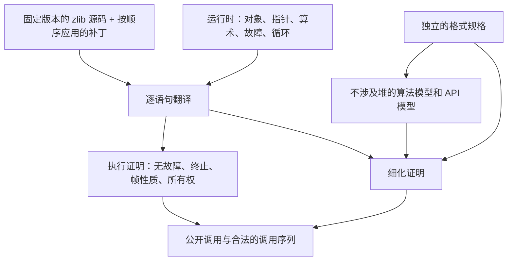
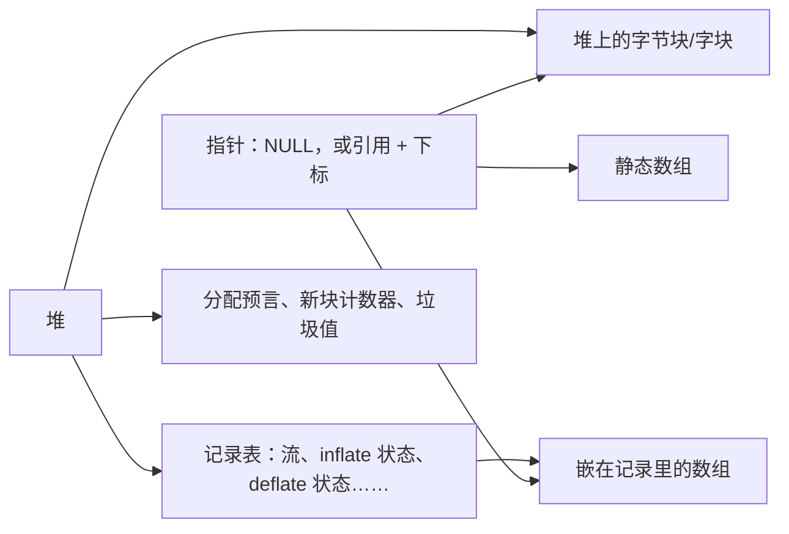

<!-- source-sha256: 40f0de032dff902a87095ae19612676ba832ab1766fc0f403de360c69a7f17b1 -->
# 从 C 到已检查的定理

本项目的定理说的是一个 Lean 程序，不是 C 的文本。本页展示这个程序由什么构成，让读者能够判断内核不检查的两个联系：运行时表示了 C 的操作，翻译与选定的 C 源码一致。[可信基础](../trusted-base.md)列出所有依靠审查的东西。

## 各层



| 层 | 它的职责 | 它的依据 |
| --- | --- | --- |
| 选定的 C | 确定被验证的是哪个程序 | 固定版本的 `zlib/` 子模块，加上按文件名顺序应用的 `patches/*.patch` |
| 运行时 | 给翻译后的操作以可执行的语义 | 审查和语义回归测试 |
| 翻译 | 保留 C 的语句及其顺序 | 源码审查和差分测试；测试是证据，不是证明 |
| 模型与规格 | 说明程序做什么，而不限定它的实现方式 | 审查各个定义、定义域，以及它们与 `zlib.h` 和数据格式的关系 |
| 证明 | 把计算与这些命题联系起来 | Lean 内核的检查和[验收检查](../checking/README.md) |

安全结论只需要经过*执行证明*的那条路径：无故障、终止、帧性质和所有权，并在调用序列上组合。经过*细化证明*的路径给出功能正确性。它不是安全结论所必需的。

安全结论之后计划做一项功能结果：默认 zlib 流的往返。它的条件形式有一条定理。定理 `deflate_inflate_roundtrip`（`ZlibF/Proof/public-deflate-inflate-roundtrip.lean`）说的是翻译后函数的两次运行。编码器的运行是按默认级别调用 `deflateInit_`，随后是若干次 `deflate` 调用，flush 值任意。解码器的运行是以 `windowBits` 15 调用 `inflateInit2_`，随后是若干次 `inflate` 调用。同一次运行的两次调用之间，调用者可以改动缓冲区字段（`Rebuffer`）。每次运行的前提如下：

- 初始化调用从 `InitDomain` 出发（堆良构，`version` 指向 `'1'`，`zalloc` 和 `zfree` 各自是 `NULL` 或默认函数，`state` 字段是 `NULL`），并且返回了 `Z_OK`。
- 每次数据调用都是一个 `DataStep`：它满足 `StreamBuffers` 和 `ActiveHeader`，并且返回了。定理假设这些调用会返回，并不证明这一点。
- 只在解码器的运行上，每次 `inflate` 调用时的堆和每次调用者修改之后的堆都满足平台前提 `ByteObjectsFit`。

当两次运行都已返回 `Z_STREAM_END`，并且解码器消耗的字节是编码器写出的字节的前缀时，解码器写出的字节就是编码器消耗的字节。这条定理是带条件的：它假设两次运行都到达 `Z_STREAM_END`。完备性（空间足够时，两次运行确实到达 `Z_STREAM_END`）和无条件的往返排在它之后，在计划内。其他已经证明的细化结果保留；哪些功能结果在计划内、往返性质进行到哪一步，见[范围](../progress.md#scope)。

## 用几个定义看模型

每个翻译后的函数都由下面这些定义搭成。它们引自 `ZlibF/Runtime/Monad.lean` 和 `ZlibF/Runtime/Space.lean`，略去了 `deriving` 行。

```lean
/-- Why a C computation did not produce a value. -/
inductive Fault where
  /-- undefined behaviour, with a short reason -/
  | ub (what : String)
  /-- a loop used up its fuel (a termination theorem rules this out) -/
  | outOfFuel

/-- A C computation: the heap in, a value and the heap out, or a fault. -/
def M (α : Type) : Type := Heap → Except Fault (α × Heap)

/-- Loop fuel. Large enough that no zlib loop over in-memory data can exhaust it. -/
def fuel : Nat := 2 ^ 64

/-- `while (cond) body` over the loop-carried locals `σ`. The condition may update them (`while (len--)`):
its update happens on every evaluation, including the last, false one, as in C. -/
def cwhile {σ : Type} (cond : σ → M (Bool × σ)) (body : σ → M σ) (s : σ) : M σ :=
  go fuel s
where
  go : Nat → σ → M σ
    | 0, _ => fun _ => .error .outOfFuel
    | n + 1, s => do
      let (c, s) ← cond s
      if c then go n (← body s) else pure s
```

怎样读这些定义：

- 返回类型为 `T` 的 C 函数，翻译后的 Lean 类型是 `M T`：给它一个堆，它返回 `.ok (value, new heap)` 或 `.error fault`。没有别的结果。
- `Fault.ub` 是模型里的未定义行为。凡是 C 操作未定义的地方，运行时的对应操作就返回它：读到对象之外、有符号溢出、重复释放。
- `Fault.outOfFuel` 不是 C 的行为。`cwhile` 至多检验条件 `2^64` 次；如果最后一次检验时条件仍为真，这次运行以 `Fault.outOfFuel` 结束。循环绝不会因为燃料用完而悄悄退出。终止证明表明这个故障不会发生。`cdoWhile` 对 `do … while` 也是这样。
- 安全定理的形状是：“对每个满足前提的堆，这次运行是 `.ok`，并且新堆与旧堆的差别只限于定理写明的那些”。

指向数组内部的指针没有地址：

```lean
/-- A pointer into an array: null, or the array (`R` says where it lives: a heap block, an array inside a
struct, a static table) and an index. There is no address. One past the end is a valid pointer. -/
inductive Ptr (R : Type) where
  | null
  | ref (r : R) (off : Nat)
```

通过这种指针的读取是带检查的（`ZlibF/Runtime/Ptr.lean`；`Space.get h r` 是 `r` 在堆 `h` 中所指的数组，前提是它还存活）：

```lean
/-- `*p`. Faults if `p` is null, dangling, or outside its array (one past the end is not readable). -/
def Ptr.load (p : Ptr R) : M T := fun h =>
  match p with
  | .null => .error (.ub "null dereference")
  | .ref r off =>
    match Space.get h r with
    | none => .error (.ub "read through a dangling pointer")
    | some a => if hk : off < a.size then .ok (a[off], h) else .error (.ub "read outside its object")
```

所以越界读取、通过 `NULL` 的读取和 `free` 之后的读取，都是 `Fault.ub`。一个说“这次运行是 `.ok`”的定理把这三种情况都排除了。`Ptr.store`、`Ptr.add`（指针算术）、`Ptr.diff` 和 `Ptr.lt` 形式相同。字节指针是 `BPtr`；`load8`、`index8` 和 `store8` 是翻译中使用的字节版本。指向结构体的指针，要么是表示 `NULL` 的 `none`，要么是对该结构体的表中某一项的引用。

[翻译](translation.md)把一个 C 函数与它的 Lean 文本并排列出，并逐行解读。

## 选定的源码与模块布局

目标是默认的 x86_64 Linux 静态构建，使用 LP64 位宽和默认分配器。分配失败在范围内。其他构建配置和自定义分配器实现不在计划内；[偏离记录](../deviations.md)记有这一限制。源码子模块绝不改动。只有针对已确认的上游缺陷才允许打补丁，并须遵守仓库的 `AGENTS.md` 和 `patches/README.md` 中的规则。

| 位置 | 职责 |
| --- | --- |
| `ZlibF/Runtime/` | 堆、指针、故障、循环，以及建模的 C 库操作 |
| `ZlibF/Zlib/X.c.lean` | `zlib/X.c` 的翻译；其中没有证明。`deflate.c` 拆成 `deflate_base.c.lean`、`deflate_strategies.c.lean` 和 `deflate.c.lean` 三个文件 |
| `ZlibF/Zlib/X.h.lean` | `zlib/X.h` 的翻译 |
| `ZlibF/Zlib/gzfs.lean` | 供 gz 翻译使用的文件、`errno` 和格式化的模型（[外部 I/O](external-io.md)） |
| `ZlibF/Spec/Safety/` | 必需的安全目标 |
| `ZlibF/Spec/Functional/` | 功能目标，以及不涉及堆的格式模型和 API 模型；不是安全结论所必需的 |
| `ZlibF/Spec/Common/` | 两类目标共用的定义：调用、历史、帧、参数；gz 和 `inflateBack` 的序列目标、拒绝目标和非空性目标，以及它们的功能目标，也在这里（[规格的布局](safety-functional-split.md)） |
| `ZlibF/Spec/*.lean` | 关于内部函数的命题。每一条都先对翻译后的函数证明，调用者才使用它（[见下文](#composing-calls-without-assuming-their-answers)） |
| `ZlibF/Proof/X.c.<topic>.lean` | 关于 `zlib/X.c` 的证明 |
| `ZlibF/Proof/public-<name>.lean` | 公开目标的证明 |
| `ZlibF/Math/` | 各证明共用的、不涉及堆的事实 |
| `tests/` | 差分证据、回归和验收检查 |

函数名就是 C 的名字。函数的文档字符串以它的 C 签名开头。

## 可信语义在哪里

本节中的一切都是被信任的：这里的错误内核发现不了。

| `ZlibF/Runtime/` 中的文件 | 内容 |
| --- | --- |
| `Space.lean` | 堆的各张表、指针类型 `Ptr`、函数指针、未初始化整数的值 |
| `Monad.lean` | `Fault`、`M`、`fuel`、`cwhile`、`cdoWhile` |
| `Ptr.lean` | 指针算术、读取、写入、相减、比较 |
| `Address.lean` | 字节指针地址的低三位，CRC 的对齐检验要读它 |
| `Libc.lean`、`LibcStrings.lean` | `malloc`、`free`、`memcpy`、`memmove`、`memset`、`strlen`、字符串字面量、`strerror` 的文本 |
| `Schema.lean`（生成） | 每个结构体的记录、引用类型、静态表、堆 |
| `Tables.lean`、`LibcTables.lean`（生成） | 每种结构体的读取、写入、`malloc`、`free` 和整记录 `memcpy` |
| `Alloc.lean` | `Libc.lean` 的再导出；没有内容 |

生成的文件由 `scripts/gen_schema.py` 根据 C 头文件写出。[运行时结构定义](../runtime-schema.md)列出每个字段。

有些语义辅助定义不在 `ZlibF/Runtime/` 里。它们定义在使用它们的翻译文件中，被信任的方式相同。下面各表按种类列出它们。

这份列表是这样得到的：把 `ZlibF/Zlib/*.lean` 中每个顶层的 `def`、`abbrev`、`structure` 和 `inductive` 连同它的文档字符串列出来（这些文件里没有 `instance`、`macro` 或 `notation`）。其中每一个都放进某张表，除非它是某个 C 函数的翻译，是某个 C 函数的一部分（循环体、循环条件、`switch` 的一个 `case`）的翻译，是 C 宏、C 常量或 C 表的翻译，或者是只把某个函数的局部变量或参数归在一起的记录。出现在两个文件里的同一个名字，在两个文件里各自定义；这些定义并不共用。

**带检查的算术和移位。** C 未定义的结果就是 `Fault.ub`。

| 文件 | 辅助定义 | C 语义 |
| --- | --- | --- |
| `inflate.c.lean` | `chkI32`、`chkI64` | 放不下的 `int` 或 `long` 结果是故障 |
| `deflate_base.c.lean` | `chk32`、`chk64`、`iadd`、`isub`、`ineg`、`ladd`、`lsub` | 同上，加上 `int` 和 `long` 的 `+`、`-` 和一元 `-` |
| `inftrees.c.lean` | `chk32` | 同上，用于 `int` |
| `inffast.c.lean` | `chk64` | 同上，用于 `long` |
| `trees.c.lean` | `ck`、`iadd`、`isub` | 同上，用于 `int` |
| `gzguts.h.lean` | `i64chk`、`i64add`、`i64sub`、`i64neg` | 同上，用于 `z_off64_t` |
| `inflate.c.lean` | `shl32`、`shr32`、`shl64`、`shr64` | `unsigned` 或 `unsigned long` 的移位：计数不小于位宽是故障 |
| `inftrees.c.lean` | `shl32`、`shr32`、`shl1i32` | 同上，用于 `unsigned`；`int` 的 `1 << n` 从 `n = 31` 起是故障 |
| `inffast.c.lean` | `shl32`、`shl64`、`shr64` | 同上，用于 `unsigned` 和 `unsigned long` |
| `crc32.c.lean` | `shr64` | 同上，用于 `unsigned long` |
| `deflate_base.c.lean` | `ishl`、`ushl` | `int` 的 `a << n`（计数在 0..31 内，`a` 不为负，结果放得下）和 `unsigned` 的 `a << n` |
| `trees.c.lean` | `shl1`、`shlUs`、`shrUs` | `int` 的 `x << 1`；作为 `int` 移位、计数在 0..31 内的 `(ush)val << c` 和 `(ush)val >> c` |

**整数转换。**

| 文件 | 辅助定义 | C 语义 |
| --- | --- | --- |
| `inflate.c.lean` | `u2i`、`i2u`、`i2ul` | `(int)u`、`(unsigned)i`、`(unsigned long)i`：按位宽取模，最后一个先作符号扩展 |
| `trees.c.lean` | `u16i`、`u8i`、`i2u`、`u2i`、`i2ul`、`i2us` | `ush` 和 `uch` 转为 `int`；`int` 转为 `unsigned`、`unsigned long` 和 `ush`；`unsigned` 转为 `int` |
| `gzguts.h.lean` | `u32ToI64` | 对 `unsigned` 的 `(z_off64_t)u` |

**循环和控制流。** 它们都建立在 `cwhile` 和 `cdoWhile` 之上，燃料相同。

| 文件 | 辅助定义 | C 语义 |
| --- | --- | --- |
| `inflate.c.lean`（`infback.c.lean` 也使用） | 模式单子 `X`，退出方式 `Ex` 和 `Stop`，循环 `xwhileBrk`、`xwhile`、`xdoWhile`、`xloopBrk`；`IL.init` | 把 `inflate` 的局部变量作为状态；大 `switch` 内部的 `break`、`goto inf_leave` 和 `return`。`IL.init` 是这些局部变量在第一次赋值之前的值：零和 NULL，而其中一些在 C 里没有初始化 |
| `gzfs.lean` | 单子 `G`，`gub`、`gwhile`、`gdoWhile` | 同时携带文件系统世界的计算；其中的故障和两种循环 |
| `trees.c.lean` | `cfor` | `for (init; cond; step) body`；`continue` 就是循环体的末尾 |
| `deflate_strategies.c.lean` | `forever` | `for (;;)` 的条件：一直继续，直到 `break` 或 `return` |

**指针、字段和表下标。**

| 文件 | 辅助定义 | C 语义 |
| --- | --- | --- |
| `deflate_base.c.lean` | `rd`、`wr`、`zrd`、`zwr`；`padd`、`psub`、`store_at`、`freq_inc`；`config_at` | `s->f` 和 `strm->f` 作为一次读取，字段写入作为读取、记录更新、写回；`p + n`、`p - n`、`p[i] = v`、`tree[i].Freq++`；`configuration_table[level]`，下标在 0..9 之外是故障 |
| `inflate.c.lean` | `rdS`、`wrS`、`rdZ`、`wrZ`、`setMode`；`lensP`、`workP`、`codesP`；`orderAt` | 对 `*state` 和 `*strm` 的字段访问；指向数组字段 `lens`、`work`、`codes` 的指针；`order[i]`，下标在数组之外是故障 |
| `inffast.c.lean` | `subn` | 计数为 `unsigned` 的 `p - n` |
| `inftrees.c.lean` | `geta`、`seta`、`storeCode` | 局部数组的 `a[i]` 和 `a[i] = v`，下标在数组之外是故障；`code` 指针的 `p[i] = v` |
| `trees.c.lean` | `sid`、`rd`、`md`；`pLtree`、`pDtree`、`pBltree`、`pHeap`、`pDepth`、`pBlCount`、`pLdesc`、`pDdesc`、`pBldesc`；`setAt`、`heapAt`、`heapSet`、`getFc`、`getDl`、`setFc`、`setDl`、`blOrder` | 对 `*s` 的字段访问；指向 deflate 状态内部各数组和树描述符的指针；对这些数组和 `bl_order` 的元素读写 |
| `gzguts.h.lean` | `castState`、`castFile`、`strmOf`；`ldS`、`updS`、`updX`、`ldZ`、`updZ` | `(gz_statep)file`、`(gzFile)state`、`&(state->strm)`；对 gz 状态、`state->x` 和流的字段访问 |
| `crc32.c.lean` | `crcTab`、`x2nTab`、`idx1`、`idx2`、`wordAt` | 对 CRC 各表取下标，下标在表之外是故障；`words[i]` |
| `compress.c.lean` | `ptrDiff` | `p - q`，其中 `NULL - NULL` 允许，结果为 0 |
| `deflate.c.lean` | `Z_NULL_strm` | 类型为 `z_streamp` 的 `Z_NULL` |

**把标量单元当作字节，以及 CRC 的地址和字读取。**

| 文件 | 辅助定义 | C 语义 |
| --- | --- | --- |
| `gzguts.h.lean` | `load32`、`store32`、`load64`、`store64` | 字节块上的 `*(int *)p` 和 `*(uint64_t *)p`，小端 |
| `crc32.c.lean` | `addrOf` | `(z_size_t)buf`，只知道它的低三位 |
| `crc32.c.lean` | `loadWord` | 把字节缓冲区看作 `z_word_t` 时的 `words[i]`：八个字节，小端 |

**分配器分派和自动存储。**

| 文件 | 辅助定义 | C 语义 |
| --- | --- | --- |
| `inflate.c.lean` | `ZALLOCB`、`ZALLOCS`、`ZFREEB`、`ZFREES` | 经由 `strm->zalloc` 和 `strm->zfree` 的 `ZALLOC` 和 `ZFREE`：默认函数照常运行，任何其他函数指针是故障 |
| `deflate_base.c.lean` | `zalloc_default`、`zfree_default`、`ZALLOC_bytes`、`ZALLOC_words`、`ZFREE_bytes`、`ZFREE_words` | 同上，用于 deflate 一侧的字节块和 16 位字的块 |
| `deflate_base.c.lean` | `CompressFunc` | 函数指针 `config.func`，表示为各个局部压缩函数的枚举 |
| `inflate.c.lean`、`gzguts.h.lean` | `allocLocalB`、`allocLocal` | 局部数组：一个新分配的可写块，内容任意，不经过分配失败预言 |
| `compress.c.lean`、`uncompr.c.lean` | `allocLocalZ` | 局部 `z_stream`，不经过预言 |

**字符串字面量、静态数据和库函数的替身。**

| 文件 | 辅助定义 | C 语义 |
| --- | --- | --- |
| `zutil.c.lean`、`gzfs.lean` | `strLit` | 字符串字面量：指向源码字面量只读表的指针 |
| `inflate.c.lean` | `setMsg` | `strm->msg = "..."` |
| `gzfs.lean` | `strerrorText`、`libcStr`、`zstrerror` | `strerror(errno)`：一段借用的只读文本 |
| `crc32.c.lean`、`inftrees.c.lean`、`trees.c.lean` | `initStatics`（前两个文件各一个）；`trees_statics`、`install_trees` | 该文件各静态表的内容，放进堆的 `Statics` |
| `gzguts.h.lean` | `memchrB` | `memchr` |
| `gzfs.lean` | `cstring`、`storeBytes`、`loadBytes`、`heapStr` | 以 NUL 结尾的字符串的各字节；字节的整块写入和整块读取 |
| `gzfs.lean` | `snprintf`、`vsnprintf`、`formatBytes`，以及它们的组成部分 `VaArg`、`Spec`、`isDigit`、`readNumGo`、`readNum`、`parseFlags`、`parseSpec`、`natDigits`、`pad`、`fmtInt`、`argStr`、`formatGo` | 格式化器（[外部 I/O](external-io.md)） |

**操作系统和回调。**

| 文件 | 辅助定义 | C 语义 |
| --- | --- | --- |
| `gzfs.lean` | `Fs`、`OFile`、`Node`；`ReadChoice`、`WriteChoice`、`LseekChoice`；`fsOpen`、`fsRead`、`fsWrite`、`fsLseek`、`fsClose`、`fsFcntl`，以及普通文件部分 `fsOpenReg`、`fsReadReg`、`fsWriteReg`、`fsLseekReg`、`fsCloseReg`；`lowestFd`、`findName`、`tickW`、`okErrW`、`failErrno`、`readCap`、`debitW`、`relocateW` | 文件系统、描述符表，以及系统调用 `open`、`read`、`write`、`lseek`、`close`、`fcntl`，连同选择其结果的预言（[外部 I/O](external-io.md)） |
| `gzfs.lean` | `getErrno`、`setErrno`、`BLOCKED`，各个 `errno` 值（`ENOENT` 等），`open` 的各个标志（`O_WRONLY` 等），以及 `SEEK_SET`、`SEEK_CUR`、`SEEK_END` | `errno`，以及这些常量在 Linux x86_64 上的值 |
| `gzfs.lean` | `Fs.put`、`Fs.mkdir`、`Fs.get?`、`Fs.posOf?` | 不是 C 操作：它们为命题和测试构造并查看一个文件系统 |
| `infback.c.lean` | `InCb`、`OutCb` | `inflateBack` 的回调 `in_func` 和 `out_func` 的类型。回调是一个 Lean 函数 |

[可信基础](../trusted-base.md)指出了运行时的各个文件和 gz 文件世界。对其他翻译文件里的辅助定义，它的第 3 项引用上面这些表。

每个翻译文件都在文件头注释里写明它的预处理选择和建模决定。

## 为什么用对象堆

C 的结构体用 Lean 的记录表示。一个堆（`Schema.lean` 中的 `Heap`）有十五个字段：

- `bytes`：字节块的表（`unsigned char` 数组：缓冲区、窗口、字符串）；
- `words`：16 位字的块的表（`head`、`prev`）；
- `ro`：字节块只读标志的表；
- `streams`、`gzheaders`、`dstates`、`istates`、`gzstates`：每种结构体各一张表，分别用于 `z_stream`、`gz_header`、`deflate_state`、`inflate_state` 和 `gz_state`；
- `static`：静态表；
- 分配状态：`nextBlk` 是下一个未用的块编号；`nalloc` 是到目前为止的分配调用次数；`allocOk` 是失败预言（`allocOk n` 说明第 `n` 次调用是否成功）；`garbage` 是新分配的内存的内容；
- `byteBase`：每个静态字节数组或内嵌字节数组起点地址的低三位。CRC 的对齐检验通过 `Address.lean` 读它们；
- `libcErrorBorrow`：当前借出的是哪一段 `strerror` 文本，用一个计数器和一个 `errno` 值表示，或者没有借出。它不是堆上的对象。

其他数组是记录的字段或静态表。一个指针指明一个堆块、一个记录内的数组或一个静态数组，再加上元素下标。



这样，字段更新和帧性质都很直接。记录的字段是一个投影；改它就是一次记录更新。一次字节写入改不了另一张表里的记录。复制整个记录也复制它内嵌的数组。

这种表示没有 ABI 字节偏移。所以它给不出结构体的字节视图，也表示不了标量单元与缓冲区之间的每一种别名。记录类型不强制数组字段的长度：`WellFormed`、`Heap.RecordsWellFormed` 和 `Statics.WellFormed` 陈述这些长度，证明要么带着它们，要么从自己的表示不变量推出它们。

## 执行与故障

| 操作 | 表示出来的行为 |
| --- | --- |
| 指针算术 | 留在同一个存活数组之内，包括它的末尾后一位；解引用末尾后一位会发生故障 |
| 读取和写入 | 检查存活性和边界；写入还检查只读状态 |
| 指针相减和比较大小 | 要求同一个存活数组和有效的偏移；差值必须能放进 `ptrdiff_t` |
| 指针相等 | 结构相等；不同的引用构造子比较结果为不相等 |
| 无符号算术 | 按 C 的位宽回绕 |
| 有符号算术和移位 | 由上面各表中的辅助定义检查，它们在翻译文件里。符合[规范化 4](translation.md#the-accepted-normalisations)的有符号运算，以及按字面量计数的移位（[翻译，形式 4](translation.md#forms-not-covered-by-the-four-accepted-normalisations-the-owner-has-not-decided)），用普通运算符 |
| 复制和填充 | 检查范围和可写性；`memcpy` 还检查不重叠 |
| 分配 | `malloc` 询问失败预言，并拒绝 `2^63` 字节或更大的请求；成功时给出一个新的块编号。在不满足 `Fresh` 的堆上它发生故障 |
| 释放 | 接受 NULL；否则要求是一个存活可写块的起始位置 |
| 循环 | 至多检验条件 `2^64` 次；耗尽是故障，绝不是普通的退出 |

[安全性的定义](../spec/safety.md)说明定理对这些结果断言了什么。

## 模型与 C 不同的地方

这些是模型的限制，不是对 C 额外的断言。权威的细节在[可信基础](../trusted-base.md)和[偏离记录](../deviations.md)里。

| 差别 | 对证明的后果 |
| --- | --- |
| 新分配的整数单元取任意值 | 定理对每个 `garbage` 函数量化；绝不假设它为零 |
| 每个新分配的单元在一次运行中始终保持同一个值 | 证明不依赖重复的未初始化读取结果一致 |
| 新分配的指针字段是 NULL | 指针字段漏写一次，在模型里看不出来；单凭一次与 NULL 的比较，也表明不了字段已被写过。每个指针字段在被读之前已被写过，这一点**尚未确认**，须由源码审查确认；没有定理陈述它（[可信基础](../trusted-base.md#2-runtime-and-object-schema)） |
| `NULL + 0` 成功；一般的 `NULL - NULL` 发生故障 | 唯一允许 `NULL - NULL` 的那处翻译单独审查（[缓冲区](../proof/buffers.md)） |
| 相等比较没有相邻对象地址的情形 | 没有哪个 C 分支是靠来自不同对象的指针相等来论证的 |
| 没有一般的地址、对齐或类型标签 | 类型转换和对地址敏感的路径逐一明确审查；结构体没有一般的字节视图 |
| CRC 观察地址的低位 | 堆字节块的起点是对齐的；静态字节数组和内嵌字节数组的起点余数任意但稳定。一般的 ABI 布局，以及按严格别名规则对那处字转换的解读，都在模型之外 |
| 只读状态覆盖字节块和静态对象 | 堆记录或字块在模型里从不只读 |
| 块编号从不重用 | 做分配的代码带着 `Fresh`；初始堆中各对象的身份互不相同 |
| 库的复制操作按元素计数 | C 的字节数要换算；整记录的 `memcpy` 使用检查重叠的记录复制 |

自动存储保持它的 C 生命周期，不消耗分配失败的序号。地址被传给某次调用的局部对象是一个表示出来的对象，在每个返回处被释放。没有哪个证明靠悄悄收窄公开定义域来弥补表示上的缺口。

## 设计决定

较早的笔记把这些决定称为 D1 到 D6。下表给出每个决定及其后果。`compress.c.lean`、`uncompr.c.lean`、`deflate_base.c.lean` 和 `infback.c.lean` 的注释里的标签 `D-4`、`D-5`、`D-6` 和 `D3` 指的是这些文件各自的决定。它们不是下表中的行。

| | 决定 | 后果 |
| --- | --- | --- |
| 1 | 对象堆，每种记录一张表 | 表示出来的操作依靠审查；记录与字节缓冲区之间的别名无法表达 |
| 2 | 证明自动化是局部的 | 每个生成的证明项都由内核检查；不用任何被假定正确的验证条件生成器来代替证明 |
| 3 | C 由人工逐语句翻译 | 对应关系依靠审查；差分测试是证据 |
| 4 | 压缩器中相互重叠的待输出存储和符号存储按 C 的方式建模 | 它的生命周期和不被覆盖的条件，对每个允许的内存级别都作了证明（[trees](../proof/trees.md)） |
| 5 | 新分配的整数单元取任意值，新分配的指针是 NULL | 定理对整数垃圾值量化；指针在被读之前已被写过这一点留给源码审查，因为没有定理能陈述它 |
| 6 | 记录没有 ABI 字节布局 | 记录的字节视图，以及标量与缓冲区之间的别名，都在模型之外 |

## 组合调用而不假设其结果

辅助函数的定理说的是翻译后的辅助函数本身。它的调用者先证明该辅助函数的前置条件，再使用这条定理。辅助函数的契约都不是用来代替执行的假设。[内部义务](../spec/internal-contracts.md)列出调用者要建立的条件。

每种状态记录有一个表示不变量，它带着边界、所有权和后续调用需要的历史。初始化函数建立它，后续调用保持它，结束函数释放所拥有的存储。因为初始化函数建立了它，这个不变量是能够成立的。序列定理把这些函数定理组合起来，包括拒绝和分配失败的情形。方法见[证明指南](../proof/README.md)，已检查、已登记和已验收这三个级别见[检查](../checking/README.md)。

[设计](README.md) · [文档首页](../README.md)
