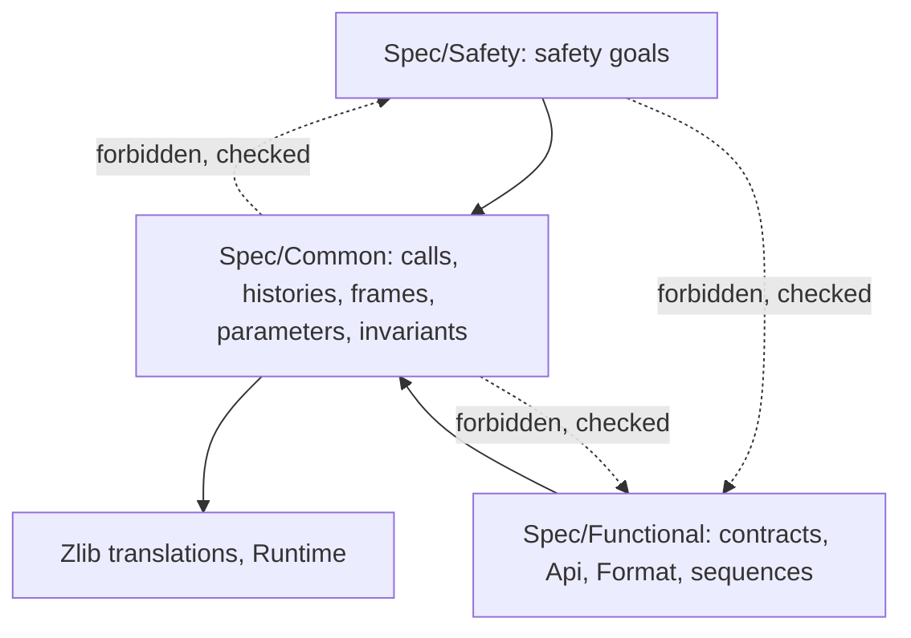

# Layout of the specifications: safety and functional

The required goals, the safety goals, are kept apart from the functional goals, so that a
reader can see the whole required target without reading any functional specification. This
page says where each kind of goal is, which import rules keep them apart, and how the rules are
checked. The plan that led to this layout, with its steps and status, is a
[history page](../history/safety-functional-split-plan.md).

## The three directories

| Directory | Content | Required |
| --- | --- | --- |
| `ZlibF/Spec/Safety/` | Safety goals: the call returns with no `Fault.ub` and no `Fault.outOfFuel`, writes only its frame, and leaks nothing, on the documented domain | Yes |
| `ZlibF/Spec/Common/` | The definitions both kinds of goal use: calls, histories, frames, parameters, the platform premise, and the invariants of the streams and of the gz handle (`Good`, `DGood`, `GzInv`). `Common/Inflate/` holds the invariants of the inflate tables and of the fast decoder. No goal about a public function is here | No goal of its own |
| `ZlibF/Spec/Functional/` | Result contracts (`Goal.<function>`), those of the gzip file interface included; the format and API models with their goals (`Format/`, `Api/`); the full sequence contracts (`Goal.inflate_sequence`, `Goal.deflate_sequence`, `Goal.inflate_back_sequence`, `Goal.gz_sequence`), which join the sequence safety with functional clauses. `Functional/Inflate/` holds statements about the decode tables and the fast decoder that use the format model | No, except `Goal.compressBound` and `Goal.compressBound_z` ([below](#two-goals-per-public-function)) |

Nothing else is directly under `ZlibF/Spec/`, except `Common.lean`, which imports every module
of `Common/`.

A goal about a public function has the Lean name `ZlibF.Spec.Public.Goal.<name>`, in each of
the three directories. The directory shows the kind; the namespace is the same. The manifest
`tests/audit/public-api.json` names only goals of this namespace.

A namespace does not follow its directory. `Public` was the name of the directory that is now
`Common/`; its modules kept the namespace `ZlibF.Spec.Public`, so no goal and no theorem changed
its name. The modules under `Functional/Api/` have the namespace `ZlibF.Spec.Api`, and so has
`Common/Parameters.lean`, which came from the API model.

Two groups of functional goals under `Spec/Functional/` have other namespaces. The first group
is `ZlibF.Spec.Api.Goal.<name>`, for example `ZlibF.Spec.Api.Goal.roundtrip`.
`tests/audit/goals.txt` lists 20 goals of it, defined under `Functional/Api/`: 17 in
`Goals.lean`, one in `Inflate.lean` and two in `Concrete.lean`. The two in `Concrete.lean`
(`compress_bound_value`, `compress2_z_first_alloc_failure`) are about the translated
`compress.c`; the other 18 are statements about the API model, not about the translated C. The
second group, the goals of the token format, is `ZlibF.Spec.Token.Goal.<name>`
(`Functional/Format/Token.lean`); they are statements about the format model.
`tests/audit/goals.txt` lists every goal under its full
name; it also lists the statements about internal functions and about heap-free mathematics,
each in the namespace of its own module.

The round trip of the default zlib stream has no goal definition in these directories yet. Its
conditional form is a theorem, `deflate_inflate_roundtrip` in
`ZlibF/Proof/public-deflate-inflate-roundtrip.lean`. Completeness and the unconditional round
trip come after it ([architecture](architecture.md#the-layers) states the theorem;
[progress, Scope](../progress.md#scope) says how far the work is).

The functional specifications are still built. A functional goal that has a
[registered](../checking/README.md) theorem is audited in full. A functional goal without one is
reported as open and fails no check. No statement was weakened or deleted to make this layout: a
full contract `Goal.X` is the functional goal of `X`, and the safety goal is stated beside it.

## The import rules

There are three rules about the modules under `ZlibF/Spec/`. Each holds for direct imports and
for imports through any chain of other modules.

1. A module under `Spec/Safety/` or `Spec/Common/` does not import a module under
   `Spec/Functional/`. So a reader of the required goals reads no functional specification.
2. A module under `Spec/Common/` does not import a module under `Spec/Safety/`. Common lies
   below both kinds of goal.
3. No module under `ZlibF/Spec/` imports a module under `ZlibF/Proof/`. So the statement of a
   goal is read in `ZlibF/Spec/` and in the translation, the runtime and the mathematics it
   names, never in a proof module. The definitions that goals name and that were once in proof
   modules are in `Spec/Common/`: `Good` in `InflateGood.lean`, `DGood` in `DeflateGood.lean`,
   `GzInv` in `GzInv.lean`. The lemmas about them stay in the proof modules.

A fourth rule is about definitions, not imports.

4. No goal that the manifest `tests/audit/public-api.json` names is defined under
   `Spec/Common/`. Such a goal is under `Spec/Safety/` or `Spec/Functional/`.

The script `scripts/check-spec-layers.py` walks the imports and fails on an import that breaks a
rule. For rule 4 it reads each line of a common module that starts with `def Goal.` or
`abbrev Goal.` and looks the full name up in the manifest. It also fails when anything other
than the three directories and their root import files is directly under `ZlibF/Spec/`. It runs
in the fast gate (job `no-sorry`). It has no list of exceptions to these four rules.

The script has one more rule, about `ZlibF/Math/`: a module there does not import a proof
module directly, except the imports in the list `MATH_PROOF_IMPORTS` of the script. The script
records that those Math modules import lemmas from proof modules, not definitions. The list may
only shrink: the script
fails on an import that is not listed and on a listed import that no longer exists. Rule 3
covers these Math modules too: no module under `ZlibF/Spec/` imports one of them.
[Progress](../progress.md#ordered-next-work) gives the size of the list.

Three more facts about imports:

- No module of `Spec/Common/` imports the gz model. The gz mode decoder and `GzLooksGzip` are in
  `Functional/Api/Gz.lean`; `Functional/GzState.lean` imports it, and `Common/GzState.lean`
  does not.
- The parameter decoders that safety goals need (return codes, flush values, window and wrapper
  selection) are in `Common/Parameters.lean`, which imports nothing.
- `Functional/Crc32ByteViews.lean` is functional because its statements name `crc32Update` of
  the format model.

## Two goals per public function

The manifest `tests/audit/public-api.json` gives each function of `zlib.h` a `safety_goal` and a
`functional_goal`. [Safety, "Where the goals are"](../spec/safety.md#where-the-goals-are) lists
the safety goal and its file for every function. The safety goals have three shapes.

- **Calls without a stream** (checksums, `zlibVersion`, `zlibCompileFlags`, `compress*`,
  `uncompress*`): on the documented domain the call returns without a fault, writes only the
  declared caller regions, and leaves the live blocks as they were.
- **Stream functions** (the inflate and deflate families): one goal per function. It states one
  more call of that function on every reachable history of a stream, and the refusal of a `NULL`
  or inconsistent stream. The four init functions need no history: their goals cover every call
  `zlib.h` allows (`InitArguments`). `Goal.inflate_refusal` and `Goal.deflate_refusal` state the
  refusals of several functions in one statement each.
- **The gzip file interface and `inflateBack`**: one goal per function as well
  (`Safety/GzCalls.lean`, `Safety/Back.lean`). Each restricts a clause of the sequence goal of its
  family, `Goal.gz_sequence_safety` or `Goal.inflate_back_sequence_safety`, to one function. It
  also has the refusals of that function: a `NULL` handle for a gz function that takes a handle;
  a `NULL` stream and a stream record with a `NULL` state for `inflateBack` and `inflateBackEnd`,
  and for `inflateBackEnd` also a `NULL` `zfree`. `Goal.inflateBackInit__safety` covers every
  call `zlib.h` allows, as the other init goals do. The two sequence goals stay required. No
  function shares a safety goal with another: the list `SHARED_SAFETY_GOALS` of
  `scripts/verification.py` is empty.

Special cases in the manifest:

- `compressBound` and `compressBound_z` name their full contracts as safety goals. Their
  translations are pure functions with no heap and no fault, so a separate safety goal would
  hold by definition.
- `safety_goal` is `null` for the functions `zlib.h` lists as undocumented, `gzopen_w` among
  them, which is not in the target build. The exception is `gzvprintf`: it names
  `Goal.gzvprintf_safety`, and that goal is required through the list `safety_goals`.
- The four `uncompress*` goals end in `_safe`; every other one-function safety goal ends in
  `_safety`. The manifest names each goal in full, so no check guesses a suffix.

A stream goal is only as strong as its set of reachable histories. Four non-vacuity goals give
a reachable witness for each family and are part of the required set:
`Goal.inflate_initialisation_domain`, `Goal.deflate_initialisation_domain`,
`Goal.inflate_back_initialisation_domain` and `Goal.gz_sequence_nonvacuity`.
`Goal.gz_initialisation_domain` is not required: it states the functional contract of `gzopen`,
and the manifest lists it under `not_planned`.

## How the required set is checked

The acceptance audit (`scripts/verification.py`) reads the required set from the manifest: the
safety goal of every documented function of the target build, plus the entries of
`safety_goals` and `nonvacuity_goals`. Each required goal needs a registered theorem of exactly
its type, with allowed axioms only. A required goal with no theorem must be named in the list
`open_safety` of the manifest, or the audit fails ([progress](../progress.md#scope) says whether
any is). [Goals](../checking/goals.md) gives the registries, the required set
and the [rules against silent removal](../checking/goals.md#shrink-only-rules) in full.

## What is not separated

- `Goal.compressBound` and `Goal.compressBound_z`, which the manifest names as safety goals, are
  in `Functional/Queries.lean`. That is by design ([above](#two-goals-per-public-function)).
- Statements about internal functions, which the manifest does not name, are in `Spec/Common/`
  (`ByteAddress.lean`, `Common/Inflate/`) when they do not use the format model, and in
  `Spec/Functional/` when they do. They also have the form `Goal.<name>`, each in the namespace
  of its own module.

[Design](README.md) · [Documentation home](../README.md)
