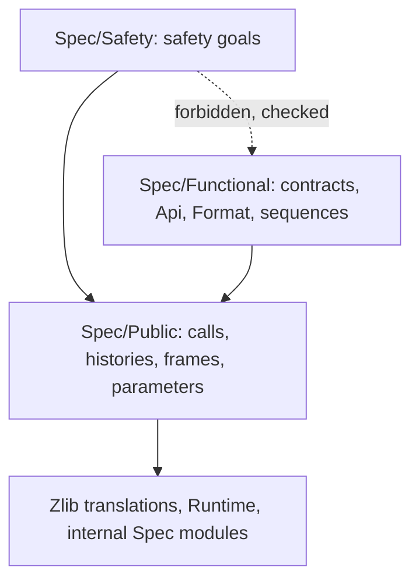

# Layout of the specifications: safety and functional

The required goals, the safety goals, are kept apart from the functional goals, so that a
reader can see the whole required target without reading any functional specification. This
page says where each kind of goal is, which import rule keeps them apart, and how the rule is
checked. The plan that led to this layout, with its steps and status, is a
[history page](../history/safety-functional-split-plan.md).

## The three directories

| Directory | Content | Required |
| --- | --- | --- |
| `ZlibF/Spec/Safety/` | Safety goals: the call returns with no `Fault.ub` and no `Fault.outOfFuel`, writes only its frame, and leaks nothing, on the documented domain | Yes |
| `ZlibF/Spec/Common/` | The definitions both kinds of goal use: calls, histories, frames, parameters. Also the sequence, refusal and non-vacuity goals of the gzip file interface and of `inflateBack`, and their functional goals | The safety goals in it: yes |
| `ZlibF/Spec/Functional/` | Result contracts (`Goal.<function>`), the format and API models with their goals (`Format/`, `Api/`), and the full sequence contracts `Goal.inflate_sequence` and `Goal.deflate_sequence`, which join the sequence safety with functional clauses | No |

A goal about a public function has the Lean name `ZlibF.Spec.Public.Goal.<name>`, in each of
the three directories. The directory shows the kind; the namespace is the same. The manifest
`tests/audit/public-api.json` names only goals of this namespace.

Two groups of functional goals under `Spec/Functional/` have other namespaces. The first group
is `ZlibF.Spec.Api.Goal.<name>`, for example `ZlibF.Spec.Api.Goal.roundtrip`.
`tests/audit/goals.txt` lists 20 goals of it, defined under `Functional/Api/`: 17 in
`Goals.lean`, one in `Inflate.lean` and two in `Concrete.lean`. The two in `Concrete.lean`
(`compress_bound_value`, `compress2_z_first_alloc_failure`) are about the translated
`compress.c`; the other 18 are statements about the API model, not about the translated C. The
second group, the goals of the token format, is `ZlibF.Spec.Token.Goal.<name>`
(`Functional/Format/Token.lean`); they are statements about the format model.
`tests/audit/goals.txt` lists every goal under its full
name; it also lists the statements about internal functions and about heap-free mathematics,
each in the namespace of its own module.

The round trip of the default zlib stream has no goal definition in these directories yet. Its
conditional form is a theorem, `deflate_inflate_roundtrip` in
`ZlibF/Proof/public-deflate-inflate-roundtrip.lean`. Completeness and the unconditional round
trip come after it ([architecture](architecture.md#the-layers) states the theorem;
[progress, Scope](../progress.md#scope) says how far the work is).

The functional specifications are still built. A functional goal that has a
[registered](../checking/README.md) theorem is audited in full. A functional goal without one is
reported as open and fails no check. No statement was weakened or deleted to make this layout: a
full contract `Goal.X` is the functional goal of `X`, and the safety goal is stated beside it.

## The import rule

A module under `Spec/Safety/` or `Spec/Common/` does not import a module under
`Spec/Functional/`, directly or through other modules. So `Spec/Safety/`, the safety goals in
`Spec/Common/`, and what they import are the whole required target.

The script `scripts/check-spec-layers.py` walks the imports and fails on such an edge. It runs
in the fast gate (job `no-sorry`). It holds a list of the edges still allowed. The list may only
shrink, and it has one entry:

- `Public/GzState.lean` imports `ZlibF/Spec/Functional/Api/Gz.lean`, the old path of the gz model, for the
  gz mode decoder and `GzLooksGzip`.

Three more facts about imports:

- The old paths `ZlibF/Spec/Api*` and `ZlibF/Spec/Format*` are one-line modules that re-export
  the files under `Spec/Functional/`. The check counts them as functional.
- The parameter decoders that safety goals need (return codes, flush values, window and wrapper
  selection) are in `Public/Parameters.lean`, which imports no format module.
- The check forbids only functional imports. Four modules of `Spec/Common/` import a proof
  module, and the check allows that: `GzState` imports `Proof.«gzlib.c.base»`; `GzSafety` imports
  `Proof.«gz.inv-model»`, which defines `GzInv`, `ReadsFinite` and `GzStepPost`; `Initialisation`
  and `Utilities` import `Proof.«inflate.c.base»` and `Proof.«deflate.c.base»`. So part of the
  statement of a goal is read from those proof modules.

The files at the top of `ZlibF/Spec/` (`Inflate*.lean`, `PlatformMemory.lean`,
`ByteAddress.lean`, `Crc32ByteViews.lean`) are statements about internal functions, not public
goals. Three of them import a functional module (`InflateDecodeTableSemantics`,
`InflateFastBodyToken`, `InflateOutputInvariant`). No safety goal imports those three; the check
would fail if one did.

## Two goals per public function

The manifest `tests/audit/public-api.json` gives each function of `zlib.h` a `safety_goal` and a
`functional_goal`. [Safety, "Where the goals are"](../spec/safety.md#where-the-goals-are) lists
the safety goal and its file for every function. The safety goals have three shapes.

- **Calls without a stream** (checksums, `zlibVersion`, `zlibCompileFlags`, `compress*`,
  `uncompress*`): on the documented domain the call returns without a fault, writes only the
  declared caller regions, and leaves the live blocks as they were.
- **Stream functions** (the inflate and deflate families): one goal per function. It states one
  more call of that function on every reachable history of a stream, and the refusal of a `NULL`
  or inconsistent stream. The four init functions need no history: their goals cover every call
  `zlib.h` allows (`InitArguments`). `Goal.inflate_refusal` and `Goal.deflate_refusal` state the
  refusals of several functions in one statement each.
- **The gzip file interface and `inflateBack`**: one goal per function as well
  (`Safety/GzCalls.lean`, `Safety/Back.lean`). Each restricts a clause of the sequence goal of its
  family, `Goal.gz_sequence_safety` or `Goal.inflate_back_sequence_safety`, to one function. It
  also has the refusals of that function: a `NULL` handle for a gz function that takes a handle;
  a `NULL` stream and a stream record with a `NULL` state for `inflateBack` and `inflateBackEnd`,
  and for `inflateBackEnd` also a `NULL` `zfree`. `Goal.inflateBackInit__safety` covers every
  call `zlib.h` allows, as the other init goals do. The two sequence goals stay required. No
  function shares a safety goal with another: the list `SHARED_SAFETY_GOALS` of
  `scripts/verification.py` is empty.

Special cases in the manifest:

- `compressBound` and `compressBound_z` name their full contracts as safety goals. Their
  translations are pure functions with no heap and no fault, so a separate safety goal would
  hold by definition.
- `safety_goal` is `null` for the functions `zlib.h` lists as undocumented, `gzopen_w` among
  them, which is not in the target build. The exception is `gzvprintf`: it names
  `Goal.gzvprintf_safety`, and that goal is required through the list `safety_goals`.
- The four `uncompress*` goals end in `_safe`; every other one-function safety goal ends in
  `_safety`. The manifest names each goal in full, so no check guesses a suffix.

A stream goal is only as strong as its set of reachable histories. Four non-vacuity goals give
a reachable witness for each family and are part of the required set:
`Goal.inflate_initialisation_domain`, `Goal.deflate_initialisation_domain`,
`Goal.inflate_back_initialisation_domain` and `Goal.gz_sequence_nonvacuity`.
`Goal.gz_initialisation_domain` is not required: it states the functional contract of `gzopen`,
and the manifest lists it under `not_planned`.

## How the required set is checked

The acceptance audit (`scripts/verification.py`) reads the required set from the manifest: the
safety goal of every documented function of the target build, plus the entries of
`safety_goals` and `nonvacuity_goals`. Each required goal needs a registered theorem of exactly
its type, with allowed axioms only. A required goal with no theorem must be named in the list
`open_safety` of the manifest, or the audit fails ([progress](../progress.md#scope) says whether
any is). [Goals](../checking/goals.md) gives the registries, the required set
and the [rules against silent removal](../checking/goals.md#shrink-only-rules) in full.

## What is not separated

- The sequence, refusal and non-vacuity goals of the gzip file interface and of `inflateBack`
  are in `Spec/Common/`, not in `Spec/Safety/`: `Public/GzSafety.lean`, `Public/GzRefusal.lean`,
  `Public/Sequences.lean` and `Public/Domains.lean` hold them; the `Public/Gz*.lean` files,
  `Public/Back.lean` and `Public/Sequences.lean` also hold the functional goals. Only the
  one-function goals of these two families are in `Spec/Safety/`.
- The one allowed import edge above.
- The imports of proof modules above.

[Design](README.md) · [Documentation home](../README.md)
