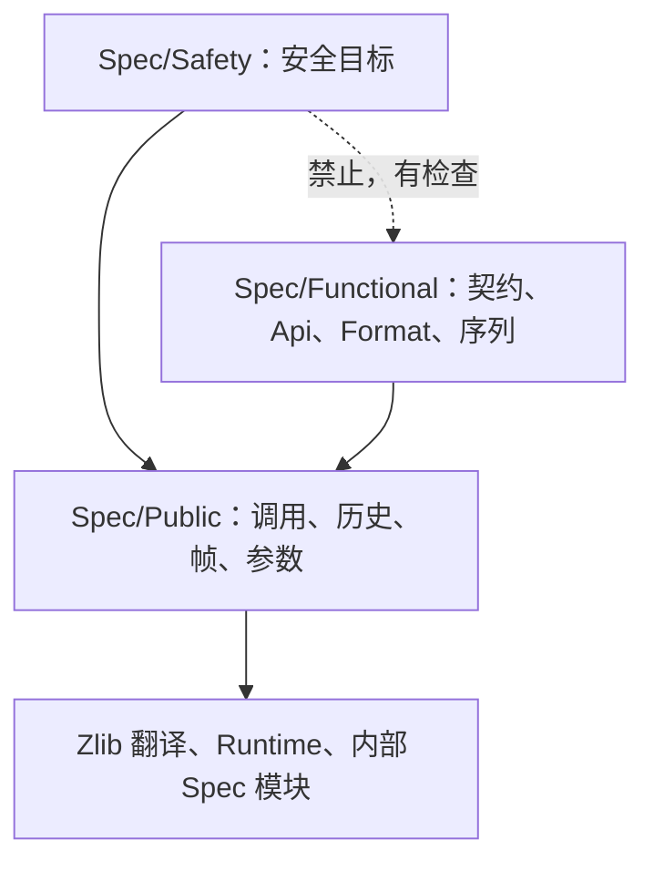

<!-- source-sha256: 666b7f47057890a2436d9e5d8e2d593e2823dc99c81fc550b0b5c29ee0fb4ec8 -->
# 规格的布局：安全与功能

必需的目标是安全目标。它们与功能目标分开存放，读者不读任何功能规格，就能看到全部必需的目标。本页说明每一类目标放在哪里，哪条导入规则把它们分开，以及这条规则怎样检查。形成这个布局的计划，连同它的步骤和状态，在一个[历史页面](../history/safety-functional-split-plan.md)中。

## 三个目录

| 目录 | 内容 | 是否必需 |
| --- | --- | --- |
| `ZlibF/Spec/Safety/` | 安全目标：在文档规定的定义域上，调用返回，没有 `Fault.ub`，没有 `Fault.outOfFuel`，只写自己的帧，不泄漏任何东西 | 是 |
| `ZlibF/Spec/Public/` | 两类目标共用的定义：调用、历史、帧、参数。还有 gzip 文件接口和 `inflateBack` 的序列目标、拒绝目标和非空性目标，以及它们的功能目标 | 其中的安全目标：是 |
| `ZlibF/Spec/Functional/` | 结果契约（`Goal.<function>`）、格式模型和 API 模型及它们的目标（`Format/`、`Api/`），以及完整的序列契约 `Goal.inflate_sequence` 和 `Goal.deflate_sequence`，它们把序列安全与功能子句合在一起 | 否 |

关于公开函数的目标，不论在三个目录中的哪一个，Lean 名字都是 `ZlibF.Spec.Public.Goal.<name>`。目录表明种类；命名空间相同。清单文件 `tests/audit/public-api.json` 只列这个命名空间里的目标。

`Spec/Functional/` 下有两组功能目标用的是别的命名空间。第一组是 `ZlibF.Spec.Api.Goal.<name>`，例如 `ZlibF.Spec.Api.Goal.roundtrip`。`tests/audit/goals.txt` 列出其中 20 个目标，都定义在 `Functional/Api/` 下：`Goals.lean` 里 17 个，`Inflate.lean` 里 1 个，`Concrete.lean` 里 2 个。`Concrete.lean` 里的两个（`compress_bound_value`、`compress2_z_first_alloc_failure`）说的是翻译后的 `compress.c`；其余 18 个是关于 API 模型的命题，不是关于翻译后的 C 的命题。第二组是记号格式的目标 `ZlibF.Spec.Token.Goal.<name>`（`Functional/Format/Token.lean`），它们是关于格式模型的命题。`tests/audit/goals.txt` 按完整名字列出每个目标；它还列出关于内部函数和关于不涉及堆的数学的命题，这些命题各自在所属模块的命名空间里。

默认 zlib 流的往返在这些目录里还没有目标定义。它的条件形式是一条已检查的定理，即 `ZlibF/Proof/public-deflate-inflate-roundtrip.lean` 中的 `deflate_inflate_roundtrip`：它尚未登记，也未验收。完备性和无条件的往返仍未证明（定理的内容见[架构](architecture.md#the-layers)）。

功能规格仍然参加构建。有[已登记](../checking/README.md)定理的功能目标接受完整的审计。没有已登记定理的功能目标报告为未证明，不使任何检查失败。形成这个布局时，没有削弱或删除任何命题：完整契约 `Goal.X` 是 `X` 的功能目标，安全目标写在它旁边。

## 导入规则

`Spec/Safety/` 或 `Spec/Public/` 下的模块不导入 `Spec/Functional/` 下的模块，直接导入和经由其他模块导入都不行。所以 `Spec/Safety/`、`Spec/Public/` 中的安全目标，以及它们导入的内容，就是全部必需的目标。

脚本 `scripts/check-spec-layers.py` 遍历导入关系，遇到这样的边就失败。它在快速关卡中运行（作业 `no-sorry`）。它带有一张仍被允许的边的列表。这张列表只能缩短，其中有一项：

- `Public/GzState.lean` 导入 `ZlibF/Spec/Api/Gz.lean`（gz 模型的旧路径），为的是 gz 模式解码器和 `GzLooksGzip`。

关于导入，还有三点：

- 旧路径 `ZlibF/Spec/Api*` 和 `ZlibF/Spec/Format*` 是只有一行的模块，它们再导出 `Spec/Functional/` 下的文件。检查把它们算作功能部分。
- 安全目标需要的参数解码器（返回码、刷新值、窗口和封装的选择）在 `Public/Parameters.lean` 中，它不导入任何格式模块。
- 检查只禁止功能方面的导入。`Spec/Public/` 中有四个模块导入了证明模块，检查允许这样做：`GzState` 导入 `Proof.«gzlib.c.base»`；`GzSafety` 导入 `Proof.«gz.inv-model»`，后者定义 `GzInv`、`ReadsFinite` 和 `GzStepPost`；`Initialisation` 和 `Utilities` 导入 `Proof.«inflate.c.base»` 和 `Proof.«deflate.c.base»`。所以一个目标的命题有一部分要到这些证明模块中去读。

`ZlibF/Spec/` 顶层的文件（`Inflate*.lean`、`PlatformMemory.lean`、`ByteAddress.lean`、`Crc32ByteViews.lean`）是关于内部函数的命题，不是公开目标。其中三个导入了功能模块（`InflateDecodeTableSemantics`、`InflateFastBodyToken`、`InflateOutputInvariant`）。没有安全目标导入这三个；如果有，检查会失败。

## 每个公开函数两个目标

清单文件 `tests/audit/public-api.json` 给 `zlib.h` 的每个函数一个 `safety_goal` 和一个 `functional_goal`。[安全性，“目标在哪里”](../spec/safety.md#where-the-goals-are)为每个函数列出安全目标及其所在文件。安全目标有三种形式。

- **不带流的调用**（校验和、`zlibVersion`、`zlibCompileFlags`、`compress*`、`uncompress*`）：在文档规定的定义域上，调用无故障地返回，只写声明的调用者区域，存活块保持原样。
- **流函数**（inflate 族和 deflate 族）：每个函数一个目标。它陈述的是：在一个流的每个可达历史上，再调用一次这个函数。四个初始化函数不需要历史：它们的目标覆盖 `zlib.h` 允许的每一次调用（`InitArguments`）。`NULL` 流或不一致的流由 `Goal.inflate_refusal` 和 `Goal.deflate_refusal` 覆盖。
- **gzip 文件接口和 `inflateBack`**：同样是每个函数一个目标（`Safety/GzCalls.lean`、`Safety/Back.lean`）。每个目标把所属一族的序列目标（`Goal.gz_sequence_safety` 或 `Goal.inflate_back_sequence_safety`）的一个子句限制到一个函数上。它还带有这个函数的拒绝：对接受句柄的 gz 函数是 `NULL` 句柄；对 `inflateBack` 和 `inflateBackEnd` 是 `NULL` 流和状态为 `NULL` 的流记录，对 `inflateBackEnd` 还有 `zfree` 为 `NULL`。`Goal.inflateBackInit__safety` 与其他初始化目标一样，覆盖 `zlib.h` 允许的每一次调用。两个序列目标仍然是必需的。没有函数与别的函数共用安全目标：`scripts/verification.py` 中的 `SHARED_SAFETY_GOALS` 列表是空的。

清单文件中的特殊情况：

- `compressBound` 和 `compressBound_z` 把它们的完整契约写作安全目标。它们的翻译是纯函数，没有堆，也没有故障，所以单独的安全目标会按定义成立。
- 对 `zlib.h` 列为未文档化的函数，`safety_goal` 为 `null`；其中包括不在目标构建中的 `gzopen_w`。例外是 `gzvprintf`：它写的是 `Goal.gzvprintf_safety`，这个目标通过 `safety_goals` 列表成为必需。
- 四个 `uncompress*` 目标以 `_safe` 结尾；其他每个单函数安全目标都以 `_safety` 结尾。清单文件写出每个目标的全名，所以任何检查都不必去猜后缀。

流目标的强度取决于它的可达历史集合。四个非空性目标为每一族给出一个可达的见证，它们属于必需集合：`Goal.inflate_initialisation_domain`、`Goal.deflate_initialisation_domain`、`Goal.inflate_back_initialisation_domain` 和 `Goal.gz_sequence_nonvacuity`。`Goal.gz_initialisation_domain` 不是必需的：它陈述的是 `gzopen` 的功能契约，清单文件把它列在 `not_planned` 之下。

## 必需集合怎样检查

验收审计（`scripts/verification.py`）从清单文件读出必需集合：目标构建中每个有文档的函数的安全目标，加上 `safety_goals` 和 `nonvacuity_goals` 的各项。每个必需的目标都需要一个类型恰好是它的已登记定理，并且只用允许的公理。清单文件的 `open_safety` 列表为空，所以缺少定理会使审计失败。各登记表、必需集合和[防止悄悄删除的规则](../checking/goals.md#shrink-only-rules)，完整内容见[目标](../checking/goals.md)。

## 没有分开的部分

- gzip 文件接口和 `inflateBack` 的序列目标、拒绝目标和非空性目标在 `Spec/Public/` 中，不在 `Spec/Safety/` 中：它们存放在 `Public/GzSafety.lean`、`Public/GzRefusal.lean`、`Public/Sequences.lean` 和 `Public/Domains.lean` 里；`Public/Gz*.lean` 各文件、`Public/Back.lean` 和 `Public/Sequences.lean` 还存放功能目标。这两族只有单函数目标在 `Spec/Safety/` 中。
- 上文那一条被允许的导入边。
- 上文所说的对证明模块的导入。

[设计](README.md) · [文档首页](../README.md)
