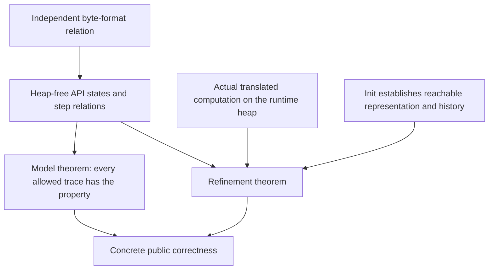

# API models

The API models are heap-free descriptions of what the public calls compute: relations over
histories of bytes, with no pointers and no memory. They are functional material, and they are
not required for the safety results ([progress](../progress.md)). No safety goal uses them, with
one exception: the goals of `compressBound` and `compressBound_z` say that the translated
function returns the model's bound formula `compressBound`
([safety goals and functional goals](safety-functional-split.md)).
[The families in detail](api-model-details.md) describes each model.

## Two kinds of statement

| Kind | About |
| --- | --- |
| Model relation | Histories of bytes and the results a call may give. No heap. |
| Concrete goal (a safety goal or a functional goal) | A translated call run on the runtime heap, and its effects. |

A theorem about a model relation is not a theorem about a C function. For example,
`ZlibF.Spec.Api.Goal.roundtrip` is a proved statement about the model only. The round
trip of the default zlib stream is a different statement: it is about runs of the translated
`deflate` and `inflate`. Its goals, among them `Goal.stream_roundtrip_total` and
`Goal.compress_uncompress_roundtrip`, are stated on [the round trip](../proof/roundtrip.md).

To say something about the C, a functional claim needs three connections:

The refinement theorem is the substantive part: every actual execution is a step the model
allows. A model theorem alone shows a property of the model.

## What the models contain

The models are in the Lean namespace `ZlibF.Spec.Api`.

| Part | Content |
| --- | --- |
| Format layer | The decoding relation `Layer.Decodes` selected by the wrapper and window, and format viability. The parameter decoders (return codes, flush values, window and wrapper selection) are shared with the safety goals and are not part of the models |
| Gzip headers | Gzip header requests, output records and header bytes |
| Inflate | Inflate state, step relations, dictionaries, recovery and callback decoding; `Layer.InflateAccepted`, the streams default `inflate` accepts, used by the functional sequence goal |
| Deflate | Deflate state, step relations, flush history, dictionaries and bounds |
| One-call utilities | One-call compression and decompression relations and numeric bounds |
| Gz files | File-handle state machines over abstract file contents |
| Runs | Operation datatypes, family dispatch and traces |
| `HeapApi` | The abstract interface that the refinement goals are stated over |
| `Concrete` | Direct execution on the runtime heap, correctness of successful runs, and selected compressor goals |
| `Goal` | Named propositions about the models and about refinement |
| Examples | Small model witnesses and computable checks |

## Reading the goal names

| Family | Property |
| --- | --- |
| `format_deterministic`, `format_prefix_free` | A complete format stream has one decoding and no complete proper extension |
| `inflate_decodes`, `inflate_completes`, `inflate_rejects_invalid` | Output prefixes, completion and rejection under the model's exactness, window and detection clauses |
| `deflate_valid`, `deflate_completes`, `deflate_full_flush_resync` | Valid completed output, finishing within the assumed bound, and raw resynchronisation |
| `roundtrip`, `roundtrip_completes`, `dict_roundtrip`, `header_roundtrip` | Composition through the independent format relation |
| `deflate_bound_adequate`, `compress_bound_adequate`, `compress_roundtrip` | Utility and bound consequences of the corresponding model clauses |
| `gz_roundtrip`, `gz_seek_read` | Abstract file round trip and the specified position cases |
| `*_refines` | Actual execution is an allowed model step, under a concrete instance of `HeapApi` |

The examples give small witnesses and arithmetic checks. A witness shows that an example is
possible. It does not show universal correctness or refinement.

[The families in detail](api-model-details.md) covers states and histories, the evidence a
decoder needs before it may emit output, the deflate history flags, the one-call utilities, the
gz position model, and what an instance of `HeapApi` has to mean (the interface and the concrete
boundary).
