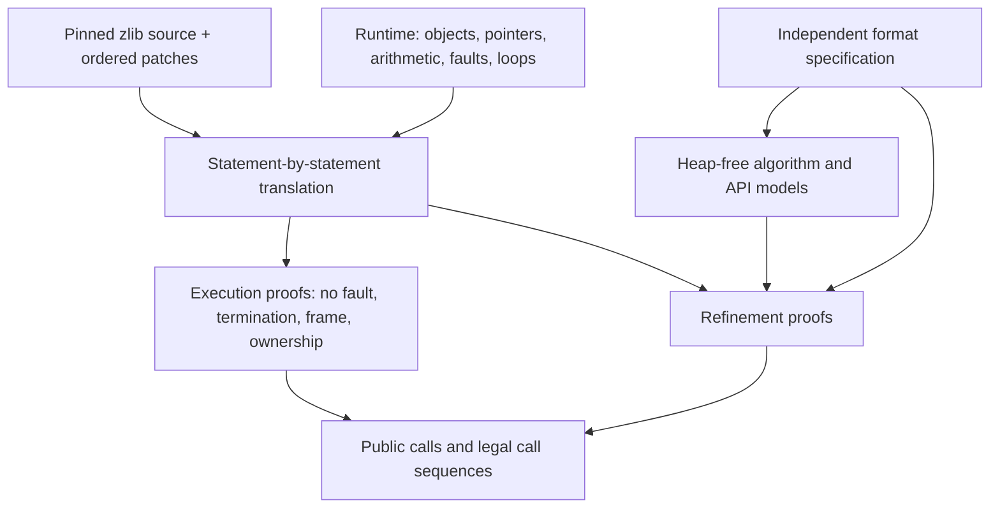
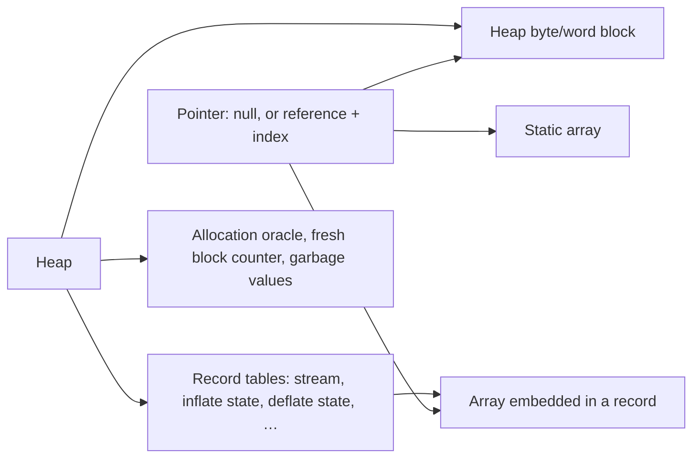

# From C to a kernel-checked theorem

A theorem of this project is about a Lean program, not about the C text. This page shows what
that program is made of, so that a reader can judge the two connections the kernel does not
check: the runtime represents the C operations, and the translation matches the selected C
source. [Trusted base](../trusted-base.md) lists everything that rests on review.

## The layers



| Layer | Its job | What justifies it |
| --- | --- | --- |
| Selected C | Fix the program being verified | The pinned upstream zlib source plus the project's patches, applied in name order |
| Runtime | Give translated operations executable semantics | Review and semantic regression tests |
| Translation | Preserve the C statements and their order | Source review and differential tests; tests are evidence, not proof |
| Models and specifications | State what the program does without committing to its implementation | Review of definitions, domains and their relation to `zlib.h` and the data formats |
| Proofs | Connect the computation to those statements | Lean kernel checking |

Only the path through *Execution proofs* is required for the safety results: no fault,
termination, frame and ownership, composed over call sequences. The path through *Refinement
proofs* gives functional correctness.

One functional result about the translated C is proved through this path: the round trip of the
default zlib stream. Its goals are about runs of the translated functions: a `deflate` run that
starts at `deflateInit_` with the default level, and an `inflate` run that starts at
`inflateInit_`. Between two calls of a run the caller may change the buffer fields (`Rebuffer`),
so the buffers may be cut into chunks in any way. `Goal.stream_roundtrip_total` says that, given
output room and the rest of the data, both runs reach `Z_STREAM_END` and the decoder writes the
bytes the encoder consumed. `Goal.compress_uncompress_roundtrip` says that
`uncompress(compress(x)) = x`. [The round trip](../proof/roundtrip.md) states the goals and
their premises.
Other refinement results have theorems as well; [progress](../progress.md) says which
functional results are planned.

## The model in a few definitions

These are the definitions every translated function is built from. They are quoted from
the runtime, without their `deriving` lines.

```lean
/-- Why a C computation did not produce a value. -/
inductive Fault where
  /-- undefined behaviour, with a short reason -/
  | ub (what : String)
  /-- a loop used up its fuel (a termination theorem rules this out) -/
  | outOfFuel

/-- A C computation: the heap in, a value and the heap out, or a fault. -/
def M (α : Type) : Type := Heap → Except Fault (α × Heap)

/-- Loop fuel. Large enough that no zlib loop over in-memory data can exhaust it. -/
def fuel : Nat := 2 ^ 64

/-- `while (cond) body` over the loop-carried locals `σ`. The condition may update them (`while (len--)`):
its update happens on every evaluation, including the last, false one, as in C. -/
def cwhile {σ : Type} (cond : σ → M (Bool × σ)) (body : σ → M σ) (s : σ) : M σ :=
  go fuel s
where
  go : Nat → σ → M σ
    | 0, _ => fun _ => .error .outOfFuel
    | n + 1, s => do
      let (c, s) ← cond s
      if c then go n (← body s) else pure s
```

How to read them:

- A translated C function of return type `T` has Lean type `M T`: given a heap it returns
  `.ok (value, new heap)` or `.error fault`. There is no other outcome.
- `Fault.ub` is the model's undefined behaviour. An operation of the runtime returns it where the
  C operation is undefined: a read outside an object, a signed overflow, a double free.
- `Fault.outOfFuel` is not a C behaviour. `cwhile` tests its condition at most `2^64` times; if
  the condition is still true at the last test, the run ends in `Fault.outOfFuel`. A loop never
  leaves quietly because the fuel ran out. A termination proof shows that the fault does not
  occur. `cdoWhile` is the same for `do … while`.
- A safety theorem has the shape "for every heap that meets the premises, the run is `.ok`, and
  the new heap differs from the old one only as stated".

A pointer into an array has no address:

```lean
/-- A pointer into an array: null, or the array (`R` says where it lives: a heap block, an array inside a
struct, a static table) and an index. There is no address. One past the end is a valid pointer. -/
inductive Ptr (R : Type) where
  | null
  | ref (r : R) (off : Nat)
```

A read through such a pointer is checked (`Space.get h r` is the array that `r` names in heap
`h`, if it is live):

```lean
/-- `*p`. Faults if `p` is null, dangling, or outside its array (one past the end is not readable). -/
def Ptr.load (p : Ptr R) : M T := fun h =>
  match p with
  | .null => .error (.ub "null dereference")
  | .ref r off =>
    match Space.get h r with
    | none => .error (.ub "read through a dangling pointer")
    | some a => if hk : off < a.size then .ok (a[off], h) else .error (.ub "read outside its object")
```

So an out-of-bounds read, a read through `NULL` and a read after `free` are each `Fault.ub`.
A theorem that says "the run is `.ok`" excludes all three. `Ptr.store`, `Ptr.add` (pointer
arithmetic), `Ptr.diff` and `Ptr.lt` have the same form. A byte pointer is `BPtr`; `load8`,
`index8` and `store8` are the byte versions used in the translations. A pointer to a struct
is `none` for `NULL` or a reference to an entry of that struct's table.

[Translation](translation.md) shows a C function beside its Lean text and reads it line by
line.

## The selected source and the parts of the development

The target is the default x86_64 Linux static build with LP64 widths and the default
allocator. Allocation failure is in scope. Other build configurations and custom allocator
implementations are not covered; [deviations](../deviations.md) records the limit.
The upstream source is never edited. A patch is permitted only for a confirmed upstream bug;
the [patch register](../../../patches/README.md) lists the patches.

The development has four parts:

- the runtime: heap, pointers, faults, loops and the modelled C library operations;
- the translation: one Lean file per C file, `X.c.lean` for `zlib/X.c` and `X.h.lean` for
  `zlib/X.h`. `deflate.c` is split over `deflate_base.c.lean`, `deflate_strategies.c.lean` and
  `deflate.c.lean`. The translation holds no proofs. The gz translations also use `gzfs.lean`,
  the model of files, `errno` and formatting ([external I/O](external-io.md));
- the specifications: the required safety goals; the functional goals with the heap-free format
  and API models, which are not required for the safety results; and the definitions both kinds
  of goal use (calls, histories, frames, parameters, invariants);
- the proofs, with the heap-free mathematical facts they share.

A statement about an internal function is proved for the translated function before a caller
uses it ([below](#composing-calls-without-assuming-their-answers)).

Function names are the C names. A function's docstring begins with its C signature.

## Where the trusted semantics is

Everything in this section is trusted: a mistake here is not found by the kernel.

The runtime defines:

- the heap tables, the pointer type `Ptr`, function pointers and the value of an uninitialised
  integer;
- `Fault`, `M`, `fuel`, `cwhile` and `cdoWhile`;
- pointer arithmetic, load, store, difference and comparison;
- the low three address bits of a byte pointer, which the CRC alignment test reads;
- `malloc`, `free`, `memcpy`, `memmove`, `memset`, `strlen`, string literals and the `strerror`
  texts;
- the record of every struct, the reference types, the static tables and the heap, and for each
  struct kind its load, store, `malloc`, `free` and whole-record `memcpy`. These definitions are
  generated from the C headers; [runtime schema](../runtime-schema.md) lists every field.

Some semantic helpers are not part of the runtime. They are defined in the translation files
that use them, and they are trusted in the same way. The tables below list them by kind.

The tables hold every top-level `def`, `abbrev`, `structure` and `inductive` of the translation
files (the files have no `instance`, `macro` or `notation`), except those that are the
translation of a C function, of a part of one (a loop body, a loop condition, a `case` of a
`switch`), of a C macro, of a C constant or of a C table, or a record that only groups a
function's locals or arguments. A name that occurs in two files is defined in each of them
separately; the definitions are not shared.

**Checked arithmetic and shifts.** A result that C leaves undefined is `Fault.ub`.

| File | Helpers | C semantics |
| --- | --- | --- |
| `inflate.c.lean` | `chkI32`, `chkI64` | An `int` or `long` result that does not fit is a fault |
| `deflate_base.c.lean` | `chk32`, `chk64`, `iadd`, `isub`, `ineg`, `ladd`, `lsub` | The same, with `+`, `-` and unary `-` for `int` and `long` |
| `inftrees.c.lean` | `chk32` | The same for `int` |
| `inffast.c.lean` | `chk64` | The same for `long` |
| `trees.c.lean` | `ck`, `iadd`, `isub` | The same for `int` |
| `gzguts.h.lean` | `i64chk`, `i64add`, `i64sub`, `i64neg` | The same for `z_off64_t` |
| `inflate.c.lean` | `shl32`, `shr32`, `shl64`, `shr64` | A shift of `unsigned` or `unsigned long`: a count not below the width is a fault |
| `inftrees.c.lean` | `shl32`, `shr32`, `shl1i32` | The same for `unsigned`; `1 << n` for `int` faults from `n = 31` on |
| `inffast.c.lean` | `shl32`, `shl64`, `shr64` | The same for `unsigned` and `unsigned long` |
| `crc32.c.lean` | `shr64` | The same for `unsigned long` |
| `deflate_base.c.lean` | `ishl`, `ushl` | `a << n` for `int` (count in 0..31, `a` not negative, result fits) and for `unsigned` |
| `trees.c.lean` | `shl1`, `shlUs`, `shrUs` | `x << 1` for `int`; `(ush)val << c` and `(ush)val >> c` as `int` shifts with a count in 0..31 |

**Integer conversions.**

| File | Helpers | C semantics |
| --- | --- | --- |
| `inflate.c.lean` | `u2i`, `i2u`, `i2ul` | `(int)u`, `(unsigned)i`, `(unsigned long)i`: reduction modulo the width, with sign extension for the last |
| `trees.c.lean` | `u16i`, `u8i`, `i2u`, `u2i`, `i2ul`, `i2us` | `ush` and `uch` to `int`; `int` to `unsigned`, `unsigned long` and `ush`; `unsigned` to `int` |
| `gzguts.h.lean` | `u32ToI64` | `(z_off64_t)u` for an `unsigned` |

**Loops and control flow.** All are built on `cwhile` and `cdoWhile`, with the same fuel.

| File | Helpers | C semantics |
| --- | --- | --- |
| `inflate.c.lean` (also used by `infback.c.lean`) | The mode monad `X`, the exits `Ex` and `Stop`, the loops `xwhileBrk`, `xwhile`, `xdoWhile`, `xloopBrk`; `IL.init` | The locals of `inflate` as state; `break`, `goto inf_leave` and `return` inside the big `switch`. `IL.init` is the value of the locals before their first assignment: zero and NULL, where C leaves some of them uninitialised |
| `gzfs.lean` | The monad `G`, `gub`, `gwhile`, `gdoWhile` | A computation that also carries the file-system world; a fault and the two loops in it |
| `trees.c.lean` | `cfor` | `for (init; cond; step) body`; `continue` is the end of the body |
| `deflate_strategies.c.lean` | `forever` | The condition of `for (;;)`: go on until `break` or `return` |

**Pointers, fields and table indexing.**

| File | Helpers | C semantics |
| --- | --- | --- |
| `deflate_base.c.lean` | `rd`, `wr`, `zrd`, `zwr`; `padd`, `psub`, `store_at`, `freq_inc`; `config_at` | `s->f` and `strm->f` as a load, and a field store as load, record update, store; `p + n`, `p - n`, `p[i] = v`, `tree[i].Freq++`; `configuration_table[level]`, a fault outside 0..9 |
| `inflate.c.lean` | `rdS`, `wrS`, `rdZ`, `wrZ`, `setMode`; `lensP`, `workP`, `codesP`; `orderAt` | Field access to `*state` and `*strm`; pointers to the array fields `lens`, `work`, `codes`; `order[i]`, a fault outside the array |
| `inffast.c.lean` | `subn` | `p - n` for an `unsigned` count |
| `inftrees.c.lean` | `geta`, `seta`, `storeCode` | `a[i]` and `a[i] = v` for a local array, a fault outside it; `p[i] = v` for a `code` pointer |
| `trees.c.lean` | `sid`, `rd`, `md`; `pLtree`, `pDtree`, `pBltree`, `pHeap`, `pDepth`, `pBlCount`, `pLdesc`, `pDdesc`, `pBldesc`; `setAt`, `heapAt`, `heapSet`, `getFc`, `getDl`, `setFc`, `setDl`, `blOrder` | Field access to `*s`; pointers to the arrays and tree descriptors inside the deflate state; element reads and writes of those arrays and of `bl_order` |
| `gzguts.h.lean` | `castState`, `castFile`, `strmOf`; `ldS`, `updS`, `updX`, `ldZ`, `updZ` | `(gz_statep)file`, `(gzFile)state`, `&(state->strm)`; field access to the gz state, to `state->x` and to the stream |
| `crc32.c.lean` | `crcTab`, `x2nTab`, `idx1`, `idx2`, `wordAt` | Indexing of the CRC tables, a fault outside the table; `words[i]` |
| `compress.c.lean` | `ptrDiff` | `p - q`, with `NULL - NULL` allowed as 0 |
| `deflate.c.lean` | `Z_NULL_strm` | `Z_NULL` at type `z_streamp` |

**Scalar cells as bytes, and the CRC address and word load.**

| File | Helpers | C semantics |
| --- | --- | --- |
| `gzguts.h.lean` | `load32`, `store32`, `load64`, `store64` | `*(int *)p` and `*(uint64_t *)p` over a byte block, little-endian |
| `crc32.c.lean` | `addrOf` | `(z_size_t)buf`, known only in its low three bits |
| `crc32.c.lean` | `loadWord` | `words[i]` for the `z_word_t` view of a byte buffer: eight bytes, little-endian |

**Allocator dispatch and automatic storage.**

| File | Helpers | C semantics |
| --- | --- | --- |
| `inflate.c.lean` | `ZALLOCB`, `ZALLOCS`, `ZFREEB`, `ZFREES` | `ZALLOC` and `ZFREE` through `strm->zalloc` and `strm->zfree`: the default functions run, any other function pointer is a fault |
| `deflate_base.c.lean` | `zalloc_default`, `zfree_default`, `ZALLOC_bytes`, `ZALLOC_words`, `ZFREE_bytes`, `ZFREE_words` | The same for the deflate side, for byte blocks and blocks of 16-bit words |
| `deflate_base.c.lean` | `CompressFunc` | The function pointer `config.func` as an enumeration of the local compression functions |
| `inflate.c.lean`, `gzguts.h.lean` | `allocLocalB`, `allocLocal` | A local array: a fresh writable block with arbitrary content, outside the allocation-failure oracle |
| `compress.c.lean`, `uncompr.c.lean` | `allocLocalZ` | A local `z_stream`, outside the oracle |

**String literals, static data and library stand-ins.**

| File | Helpers | C semantics |
| --- | --- | --- |
| `zutil.c.lean`, `gzfs.lean` | `strLit` | A string literal: a pointer into the read-only table of the source's literals |
| `inflate.c.lean` | `setMsg` | `strm->msg = "..."` |
| `gzfs.lean` | `strerrorText`, `libcStr`, `zstrerror` | `strerror(errno)`: a borrowed read-only text |
| `crc32.c.lean`, `inftrees.c.lean`, `trees.c.lean` | `initStatics` (in the first two); `trees_statics`, `install_trees` | The contents of the static tables of the file, put into the heap's `Statics` |
| `gzguts.h.lean` | `memchrB` | `memchr` |
| `gzfs.lean` | `cstring`, `storeBytes`, `loadBytes`, `heapStr` | The bytes of a NUL-terminated string; a block store and a block load of bytes |
| `gzfs.lean` | `snprintf`, `vsnprintf`, `formatBytes`, and their parts `VaArg`, `Spec`, `isDigit`, `readNumGo`, `readNum`, `parseFlags`, `parseSpec`, `natDigits`, `pad`, `fmtInt`, `argStr`, `formatGo` | The formatter ([external I/O](external-io.md)) |

**The operating system and callbacks.**

| File | Helpers | C semantics |
| --- | --- | --- |
| `gzfs.lean` | `Fs`, `OFile`, `Node`; `ReadChoice`, `WriteChoice`, `LseekChoice`; `fsOpen`, `fsRead`, `fsWrite`, `fsLseek`, `fsClose`, `fsFcntl` and the regular-file parts `fsOpenReg`, `fsReadReg`, `fsWriteReg`, `fsLseekReg`, `fsCloseReg`; `lowestFd`, `findName`, `tickW`, `okErrW`, `failErrno`, `readCap`, `debitW`, `relocateW` | The file system, the descriptor table and the system calls `open`, `read`, `write`, `lseek`, `close`, `fcntl`, with the oracle that chooses their outcomes ([external I/O](external-io.md)) |
| `gzfs.lean` | `getErrno`, `setErrno`, `BLOCKED`, the `errno` values (`ENOENT`, …), the `open` flags (`O_WRONLY`, …) and `SEEK_SET`, `SEEK_CUR`, `SEEK_END` | `errno` and the Linux x86_64 values of the constants |
| `gzfs.lean` | `Fs.put`, `Fs.mkdir`, `Fs.get?`, `Fs.posOf?` | Not C operations: they build and inspect a file system for statements and tests |
| `infback.c.lean` | `InCb`, `OutCb` | The types of the `in_func` and `out_func` callbacks of `inflateBack`. A callback is a Lean function |

[Trusted base](../trusted-base.md) names the runtime and the gz file world. For the
helpers of the other translation files its item 3 refers to the tables above.

Each translation file states its preprocessor choices and its modelling decisions in its header
comment.

## Why an object heap

A C struct is represented by a Lean record. A heap (`Heap`) has fifteen fields:

- `bytes`: the table of byte blocks (`unsigned char` arrays: buffers, windows, strings);
- `words`: the table of blocks of 16-bit words (`head`, `prev`);
- `ro`: the table of read-only flags of the byte blocks;
- `streams`, `gzheaders`, `dstates`, `istates`, `gzstates`: one table per struct kind, for
  `z_stream`, `gz_header`, `deflate_state`, `inflate_state` and `gz_state`;
- `static`: the static tables;
- the allocation state: `nextBlk`, the next unused block number; `nalloc`, the number of
  allocation calls so far; `allocOk`, the failure oracle (`allocOk n` says whether call `n`
  succeeds); and `garbage`, the content of fresh memory;
- `byteBase`: the low three bits of the origin address of each static or embedded byte array.
  The CRC alignment test reads them;
- `libcErrorBorrow`: which `strerror` text is currently borrowed, as a counter and an `errno`
  value, or nothing. It is not a heap object.

Other arrays are fields of a record or static tables. A pointer names a heap block, an array
inside a record or a static array, plus an element index.



This makes field updates and framing direct. A record field is a projection; changing it is a
record update. A byte store cannot change a record in another table. Copying a whole record
also copies its embedded arrays.

The representation has no ABI byte offsets. So it cannot give a byte view of a struct, and it
cannot represent every alias between a scalar cell and a buffer. The record type does not
enforce the length of an array field: `WellFormed`, `Heap.RecordsWellFormed` and
`Statics.WellFormed` state those lengths, and a proof carries them or derives them from its
representation invariant.

## Execution and faults

| Operation | Represented behaviour |
| --- | --- |
| Pointer arithmetic | Stays in one live array, including its one-past position; dereferencing one past faults |
| Loads and stores | Check liveness and bounds; stores also check read-only status |
| Pointer difference and order | Require the same live array and valid offsets; a difference must fit `ptrdiff_t` |
| Pointer equality | Structural equality; different reference constructors compare unequal |
| Unsigned arithmetic | Wraps at the C width |
| Signed arithmetic and shifts | Checked by the helpers of the tables above, in the translation files. The plain operator is used for a signed operation under [normalisation 4](translation.md#the-accepted-normalisations) and for a shift by a literal count ([translation, form 4](translation.md#forms-not-covered-by-the-four-accepted-normalisations)) |
| Copy and fill | Check ranges and writability; `memcpy` also checks non-overlap |
| Allocation | `malloc` asks the failure oracle and refuses a request of `2^63` bytes or more; success gives a fresh block number. It faults on a heap that is not `Fresh` |
| Free | Accepts NULL; otherwise requires the start of a live writable block |
| Loops | At most `2^64` tests of the condition; exhaustion is a fault, never an ordinary exit |

The [safety definition](../spec/safety.md) says what a theorem states about these outcomes.

## Where the model differs from C

These are limits of the model, not extra claims about C. The authoritative details are in
[trusted base](../trusted-base.md) and [deviations](../deviations.md).

| Difference | Consequence for a proof |
| --- | --- |
| Fresh integer cells have arbitrary values | A theorem quantifies over every `garbage` function; it never assumes zero |
| Each fresh cell keeps one value throughout a run | A proof does not rely on repeated uninitialised reads agreeing |
| Fresh pointer fields are NULL | A missing write of a pointer field does not show in the model, and a NULL comparison alone does not show that the field was written. That the C writes each pointer field before it reads it is **to confirm** by source review: no theorem states it, and none can in this model. What the proofs show is narrower: the invariant of each kind of state (`InflateInv`, `DInv`, `GzInv`) holds on every reachable stream and on every gz handle with a history, and the invariant says what the pointer fields it names hold ([trusted base](../trusted-base.md#2-runtime-and-object-schema)) |
| `NULL + 0` succeeds; the general `NULL - NULL` faults | The one translation that allows `NULL - NULL` is reviewed separately ([buffers](../proof/buffers.md)) |
| Equality has no adjacent-object address cases | No C branch is justified by equality of pointers from different objects |
| No general addresses, alignment or type tags | Casts and address-sensitive paths are reviewed explicitly; structs have no general byte view |
| CRC observes low address bits | Heap byte blocks have aligned origins; static and embedded byte arrays have arbitrary stable origin residues. General ABI layout and the strict-aliasing reading of the word cast are outside the model |
| Read-only status covers byte blocks and static objects | A heap record or a word block is never read-only in the model |
| Block numbers are never reused | Allocating code carries `Fresh`; the initial heap has distinct object identities |
| Library copies count elements | A C byte count is converted; a whole-record `memcpy` uses the overlap-checking record copy |

Automatic storage keeps its C lifetime and does not consume an allocation-failure index. A
local whose address is passed to a call is a represented object and is released on every
return. No proof repairs a representation gap by silently restricting the public domain.

## Design decisions

The table gives each decision and its consequence.

| | Decision | Consequence |
| --- | --- | --- |
| 1 | An object heap with one table per record kind | The represented operations rest on review; aliasing between a record and a byte buffer is not expressible |
| 2 | Proof automation is local | Every generated proof term is checked by the kernel; no assumed verification-condition generator replaces a proof |
| 3 | The C is translated by hand, statement by statement | The correspondence rests on review; differential tests are evidence |
| 4 | The compressor's overlapping pending and symbol storage is modelled as in C | Its lifetime and non-overwrite conditions are proved for every admitted memory level ([trees](../proof/trees.md)) |
| 5 | Fresh integer cells have arbitrary values and fresh pointers are NULL | Theorems quantify over integer garbage; a missing write of a pointer field does not show in the model ([above](#where-the-model-differs-from-c)) |
| 6 | Records have no ABI byte layout | A byte view of a record, and an alias between a scalar and a buffer, are outside the model |

## Composing calls without assuming their answers

A helper theorem is about the translated helper itself. Its caller proves the helper's
precondition and then uses that theorem. No helper contract is an assumption that replaces
execution. [Internal obligations](../spec/internal-contracts.md) names the conditions callers
establish.

One representation invariant per state record carries bounds, ownership and the history that
later calls need. The init function establishes it, later calls preserve it, and the end
function releases the owned storage. Because init establishes it, the invariant can hold.
The sequence theorems compose these function theorems, including refusals and failed
allocations. See the [proof guide](/proofs.html) for the method.
