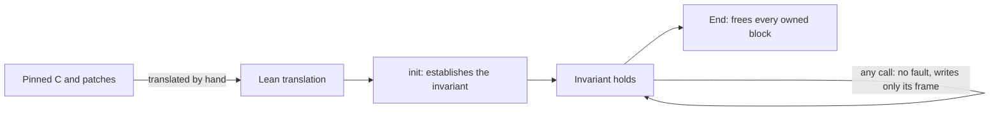

# Overview: what is proved about zlib

This page says what the project proves about zlib, what it assumes, and how the proof is built. The main point: every documented public function of the default x86_64 Linux
build is proved safe in every sequence of calls, for a Lean translation of the C, under premises
that each theorem states. The words in bold type are defined in the [glossary](glossary.md).

## The claim

**Proved.** Every documented public function of the default x86_64 Linux build of zlib is safe.
On every input that its premises admit, the translated call returns with no undefined behaviour
and no memory error, writes only the memory it is allowed to (its frame), leaks nothing, and
terminates. This holds over call sequences: for every history of an inflate stream, a deflate
stream, a callback decoder and a gzip file handle. Each of these statements is a goal, proved by
a theorem whose type is exactly the goal, and each is done: the theorem exists and passes every
check of the project. [Coverage by function](coverage.md) names the theorem of each function.

One functional result is proved as well: the round trip of the default zlib stream.
`uncompress(compress(x)) = x` when `compress` has `compressBound` room; and a stream written by
`deflate` after `deflateInit` at the default level, then read by `inflate` after `inflateInit`,
gives back the input under every call sequence. Its premises include that every allocation
succeeds and that no preset dictionary is used ([the round trip](proof/roundtrip.md)).

**Assumed.** The theorems are about a Lean translation that runs on a runtime model. Six things
are trusted and not proved ([trusted base](trusted-base.md)):

1. the Lean kernel, three standard axioms, and the programs that check which axioms a proof uses
   and that a theorem states exactly its goal;
2. the runtime model of memory, pointers, faults and loops;
3. the hand translation of the C;
4. the selected source: the pinned zlib plus the [patches](../../patches/README.md);
5. the build configuration, and the model of allocation, files and formatting;
6. the statements: that each goal says what it should.

Differential tests are evidence of fidelity, not proof. Compiler, operating-system and hardware
correctness are outside the proof. The premises that a theorem puts on the caller are in
[deviations](deviations.md), as a checklist by function.

**Not done.** Functional correctness beyond that round trip: the round trip in other
configurations, or what `inflate` does with a stream the format rejects. The safety
results do not need it; a functional fact is proved where a safety proof depends on it.
It is not planned, and neither are model-only statements (theorems about the abstract API model,
not about the translated C), other build configurations and the functions that `zlib.h` declares
undocumented.
[Progress](progress.md) lists every result as done or not done, and every group that is not
planned with its reason.

## Contents

- [The claim](#the-claim)
- [How the proof is built](#how-the-proof-is-built)
- [How to read a result](#how-to-read-a-result)
- [Where each rule is written](#where-each-rule-is-written)

## How the proof is built

The proof has four steps.

1. **Translate.** The pinned C, with the patches, is translated to Lean by hand,
   statement by statement. Every undefined behaviour the C can reach becomes the fault `Fault.ub`
   in the translation.
2. **Define an invariant.** For each kind of stream an invariant is defined: the facts about the
   stream's state that hold before every call. An example, for an inflate stream: the window is
   `NULL` or a writable block of exactly `2^wbits` bytes, and the count of valid bytes in it
   (`whave`) is at most its size (`WinInv`).
3. **Prove each function.** The init function is proved to establish the invariant. Every other
   function is proved to return without a fault when the invariant holds, to keep the invariant,
   to write only its frame, and to allocate and free exactly what its ledger says. No function's
   behaviour is assumed: each callee has its own theorem about its own translation.
4. **Compose.** Induction over the history of calls gives the sequence goal. The End function is
   proved to free every block the stream owns. A separate non-vacuity theorem exhibits one
   concrete heap on which init succeeds, so the premises are not empty.

The [common method](proof/method.md) gives the induction in detail, and the
[implementation arguments](/proofs.html) give the invariant of each C component.

## How to read a result

A result has four parts: the goal, its premises, the theorem that proves it, and its state. Here
they are for `inflate`.

| Part | For `inflate` |
| --- | --- |
| Goal | `Goal.inflate_safety` |
| What it says | Two clauses. The call: for every heap, every stream `r` and every `flush` value, if the premises hold, the call `inflate(r, flush)` returns without a fault, keeps the invariant, writes only the stream's own blocks, the stream record, an attached gzip header and the output range, and changes the set of live blocks exactly as its ledger says (`StreamCallSafe`). The refusal: on a `NULL` or inconsistent stream the call returns `Z_STREAM_ERROR`, writes no block that was live and leaves the set of live blocks as it was |
| Premises | Of the call clause, `StreamCallDomain`: the stream is reachable (some history starting at a successful init produces it); every byte object has fewer than 2^63 bytes; the buffers are as [deviations](deviations.md#stream-calls-inflate-and-deflate) describes (`StreamArguments`). Of the refusal clause: the stream is refused (`RefusedInflate`, [deviations, note 2](deviations.md#note-2-refused-streams)), and the model heap has no live block at or above its next unused block number (`Fresh`) |
| Theorem | `ZlibF.Spec.Public.StreamCallSafetyProof.inflate_safety` |
| State | Done ([glossary](glossary.md#status)) |

[Coverage by function](coverage.md) gives the same four parts for every function.

Two cautions apply when reading any result.

- A lemma about one branch, or a theorem about the abstract API model, does not establish a
  public function. Only a theorem whose type is exactly the goal does.
- A finite run of differential tests checks examples. It does not prove a statement about all
  inputs.

## Where each rule is written

| Question | Page |
| --- | --- |
| What exactly does "safe" mean: undefined behaviour, frame, termination, leaks? | [Safety](spec/safety.md) |
| Which platform is assumed? | [Platform](spec/platform.md): the default x86_64 Linux build; each byte object has fewer than `2^63` bytes, which does not bound the length of a stream |
| What must a caller's call satisfy? | [Deviations](deviations.md) |
| Which limits of the model can a caller not act on? | [Model limits](model-limits.md) |
| What is trusted and not proved? | [Trusted base](trusted-base.md) |
| Which theorem covers a function? | [Coverage by function](coverage.md) |
| Which results are done, and which are not? | [Progress](progress.md) |
| Which checks stand behind the word "done"? | [What a done result rests on](checking.md) |

A safety goal quantifies over every input, parameter, allocation outcome and history that its
premises admit. The narrower ranges in [input configurations](spec/input-configurations.md)
describe internal lemmas; they do not limit a safety goal.
