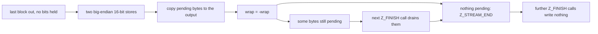
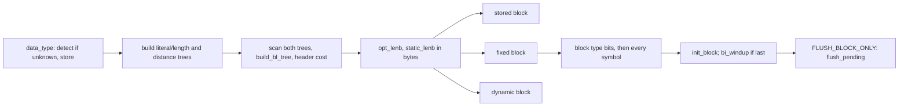

# The default-configuration engine of `deflate`

This page describes functional results about `deflate` for one configuration: the
stream that `deflateInit_(strm, Z_DEFAULT_COMPRESSION, ...)` creates (level 6, zlib wrapper,
`windowBits` 15, `memLevel` 8, default strategy), used only through `deflate` calls. For that
configuration the results say more than safety: a completed stream decodes to its input.

The word *engine* in the title is the name the Lean sources give to this body of proofs (the
namespace `Zlib.Deflate.Engine`). On this page "the engine proof" means the proof for the
default configuration.

Each result of this page has a theorem. None of them is required for the safety results. The
safety of `deflate` for every configuration is a separate proof, explained in
[stream compression](deflate.md); it uses lemmas from here.

## Results

| Result | Theorem |
| --- | --- |
| `DeflateCore.SafeEncodingAndCleanup`: the four clauses below | `DeflateCore.safe_encoding_and_cleanup` |
| `DeflateCore.Completes`: from a point of a history at which the stream has not ended, there is a continuation of `Z_FINISH` calls that reaches `Z_STREAM_END`; the premises and the form of the continuation are below | `DeflateCore.completes` |
| Both together | `DeflateCore.correct` |
| The conclusion of `Goal.deflate` on default histories | `generic_default_public_contract` |
| The premises can be met: concrete histories | `generic_default_request_trace_witness`, `default_public_full_contract_witness` and the other `*_witness` theorems |

The four clauses of `SafeEncodingAndCleanup`:

1. **Initialisation.** `deflateInit_` with the default level returns as `zlib.h` says, also
   for refusals and allocation failures, and frees what it allocated when it fails.
2. **Requests.** After any history of `deflate` calls, one more `deflate` call with any flush
   value returns, with exact output bytes, counters, frame and ownership.
3. **Completed encoding.** If a history ended with `Z_STREAM_END`, the output bytes are a valid
   zlib stream for the input bytes that were accepted (`Zlib.Valid`, the format specification).
4. **Cleanup.** After any history, `deflateEnd` frees exactly the five owned blocks.

`Completes` starts from a point of a history with these premises: no call has returned
`Z_STREAM_END` yet (`finished = false`); `StreamBuffers` holds; the output pointer is `NULL` or
points into a heap byte block; the input range `next_in`, `avail_in` is readable; and a stream
that is already in `FINISH_STATE` has no input. Call the bytes of that input range the
remaining input. The continuation is a sequence of `Z_FINISH` calls and caller edits. Each call
has an output pointer into a heap byte block and positive output room, and is offered the part
of the remaining input that no call has accepted yet. The continuation ends with
`Z_STREAM_END`, and all of the remaining input is accepted. The caller supplies no other input.

## Assumptions

- The history is `deflateInit_` with `Z_DEFAULT_COMPRESSION`, then `deflate` calls and caller
  edits of the buffer fields (`DeflateCore.Calls`, `DeflateCore.Trace`). No dictionary, no
  `deflateParams`, no priming, no gzip header.
- `StreamBuffers` holds at each call.
- The output pointer is `NULL` or points into a heap byte block (`DeflateCore.Output`).
- For completion: the premises of `Completes` given above.

These histories are a subset of those of the sequence goal. Nothing on this page widens a
safety result.

## The round trip built on these results

[The round trip of the default zlib stream](roundtrip.md) joins the completed-encoding fact of
clause 3 with the matching fact for `inflate`. Its `deflate` histories are those of this page,
without the restriction on the output pointer. It also proves that both sides reach
`Z_STREAM_END`; for `deflate` it needs no bound on the output room.

## What the proof for every configuration reuses

The proof for every configuration ([stream compression](deflate.md)) uses these parts of the
proof for the default configuration as they are:

- the hash-chain invariant and its lemmas (`chains_insert`, `chains_slide`,
  `chain_ok_of_chains`);
- `longest_match` (`longest_match_ok`);
- the symbol ledger (`SymbolLedger`);
- the overlay room for the two smallest buffers (`tinyOverlayAt_256`, `tinyOverlayAt_128`; see
  [trees](trees.md#the-overlay-lemma-f9)).

## How three parts of the engine proof work

The theorems named in this section are lemmas inside the proofs of the theorems above.

### Finishing the zlib wrapper

The end of `deflate` has two steps. It writes the four bytes of the Adler-32 checksum into the
pending buffer, and it copies as much pending output as the caller's buffer takes. `wrap` is
negated as soon as the trailer is written, also when the copy is partial. A later call first
drains what is pending and then returns through the branch for a negative `wrap`. That order is
what prevents a second trailer.

| Step | Theorem |
| --- | --- |
| The trailer bytes are stored, pending bytes are copied and `wrap` is negated, for any output capacity including zero | `zlib_trailer_publish` |
| A `Z_FINISH` call after the last block has drained writes the trailer and returns `Z_OK` for a short copy or `Z_STREAM_END` | `public_zlib_finish_ready` |
| A `Z_FINISH` call with trailer bytes still pending and more output room than pending bytes drains them and returns `Z_STREAM_END`, without a second trailer | `public_finished_pending_drained` |
| A call on a stream that is not finished, whose pending bytes fill the output, returns `Z_OK` without touching the input | `public_pending_exhausted` |

All four theorems assume a well-formed state (`DGood`), `StreamBuffers` and an output pointer
into a heap byte block. The first two also assume the well-formed tree state `TreesInvAt`. Their
other premises:

- `zlib_trailer_publish`: `wrap = 1` (a zlib stream whose trailer is not written), an empty
  pending buffer with its cursor at the start, and no held bits.
- `public_zlib_finish_ready`: the state that the strategies leave after the last block. That is
  `FINISH_STATE`, `wrap = 1`, no input, no lookahead, an empty pending buffer with its cursor at
  the start, no held bits, positive output room, and `last_flush` between -2 and 5.
- `public_finished_pending_drained`: `FINISH_STATE`, `wrap = -1` (the trailer is written), no
  input, no lookahead, at least one pending byte, `avail_out` greater than `pending`, and fewer
  than eight held bits.
- `public_pending_exhausted`: a status other than `FINISH_STATE`, a flush value from 0 to 5, an
  input pointer that is not `NULL` when `avail_in` is not 0, `0 < avail_out ≤ pending`, and
  fewer than eight held bits. The companion theorem `public_pending_exhausted_allowed` also
  covers a finished stream called with `Z_FINISH`.

The last two also take a name for the pending output (`PendingBits`: the pending bytes, readable
at `pending_out`, followed by the held bits); their conclusions say what becomes of it.

### Tree construction on the compressor heap

`build_tree_engine` and `source_trees_engine` run
`build_tree` for the literal/length and the distance alphabet on the compressor's heap. They
state exactly which fields change: the tree, the descriptor's `max_code`, the `heap` and `depth`
arrays, `bl_count` and the two cost fields. All arrays keep their sizes. Ownership, the caller's
ranges, the allocation count and the output bits already written are unchanged. After the two
calls the state has what `build_bl_tree` needs as input.

### Preparation and the fixed choice

At a positive level `_tr_flush_block` begins with the same steps for every block. The last
node of the diagram is outside it: `flush_pending` is called by the macro `FLUSH_BLOCK_ONLY`
of `deflate.c`, after `_tr_flush_block` has returned.

`block_prepare_engine` covers the preparation: the
`data_type` detection, which only reads the literal frequencies and writes one field of the
stream; the three tree constructions; and the cost store. Every field outside the trees, the
work arrays and the costs is unchanged.

`flush_fixed_prepared` and `flush_fixed_final_valid` then
take the case in which the computed costs select the fixed form: the static cost is at most the
dynamic cost, and the stored test before it failed. They do not force the strategy to
`Z_FIXED`. In that case the whole function runs, and the bits it writes decode to the recorded
symbols. For a last block that ends at a byte boundary, the published bytes are a complete raw
deflate stream.
