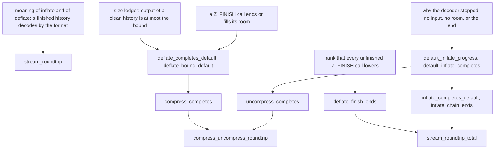

# The round trip of the default zlib stream

Compressing with zlib at the default level and then decompressing gives back the input. This
page states the fourteen goals that say so, with their premises, and gives the shape of the
proof. The result is done. It is a functional result: the safety results do not depend on it.

The goals are in [RoundTrip.lean](../../../ZlibF/Spec/Functional/RoundTrip.lean) and
[InflateCompletion.lean](../../../ZlibF/Spec/Functional/InflateCompletion.lean). Terms:
[glossary](../glossary.md).

## The setting

The *default stream* is the one `deflateInit(strm, Z_DEFAULT_COMPRESSION)` makes: zlib wrapper,
32 KiB window, `memLevel` 8, default strategy. The *default decoder* is the one `inflateInit`
makes: zlib wrapper, 32 KiB window. Neither side uses a preset dictionary.

A *history* is what a caller really does with one stream: the init call, then `deflate` (or
`inflate`) calls, and between two calls any change of the four buffer fields `next_in`,
`avail_in`, `next_out`, `avail_out`. So the input and the output may be cut into chunks in any
way. A history contains no dictionary call, no reset and no other operation. Each history keeps
a log: the input accepted so far, the output written so far, and the last return code.

A *clean* history is a `deflate` history whose calls all used `Z_NO_FLUSH` or `Z_FINISH`.

`Zlib.Decodes [] S D` is the format specification: the bytes `S` are a zlib stream that decodes
to `D` with no dictionary.

## What is proved

Each theorem proves its goal exactly as stated. The premises below are part of the goal
statements.

### Whole buffers

| Goal | Theorem | Statement |
| --- | --- | --- |
| `Goal.compress_completes`, `Goal.compress_z_completes` | `compress_completes`, `compress_z_completes_core` | With at least `compressBound(sourceLen)` bytes of room, the call returns `Z_OK` and stores the length `m` it wrote, at most `compressBound(sourceLen)`. The `m` bytes at `dest` are a zlib stream that decodes to the source and does not ask for a preset dictionary. |
| `Goal.uncompress_completes` | `uncompress_completes` | The source is a zlib stream that decodes to `D` and does not ask for a preset dictionary, and the destination has at least `|D|` bytes. Then `uncompress` returns `Z_OK`, writes `D` and stores `|D|` in `*destLen`. |
| `Goal.compress_uncompress_roundtrip` | `compress_uncompress_roundtrip` | `uncompress(compress(x)) = x`. `compress` with `compressBound` room returns `Z_OK` and stores `m`. The `m` bytes it wrote, given to `uncompress` on any second heap with a destination at least as long as the source, give `Z_OK`, the source and its length. |
| `Goal.compress_uncompress_roundtrip_witness` | `compress_uncompress_roundtrip_witness` | The premises of the goal above can be met. A concrete heap with the one-byte source `"a"` and a 14-byte destination meets the premises of the `compress` half. For every output `compress` can produce there, a concrete second heap meets the premises of the `uncompress` half. |

Premises of the `compress` goals:

- the caller heap is well formed and holds the library's static tables (`Fresh`, `Uniq`,
  `LibraryGlobals`), and every byte object has fewer than `2^63` bytes (`ByteObjectsFit`);
- every allocation succeeds (`NoAllocationFailure`);
- the source is readable for `sourceLen` bytes, the destination is writable for its capacity,
  and the two do not overlap;
- the arguments are not refused by the C's own checks (`compressRejected`).

Premises of `Goal.uncompress_completes`: the same heap premises and successful allocation;
`dest`, `source` and `destLen` are not `NULL`; `*destLen` holds the capacity; the destination is
writable for its capacity; source, destination and length cell do not overlap each other.

The premise that the stream does not ask for a preset dictionary (`¬ AsksDictionary`) is needed.
The format specification with the empty dictionary also accepts a stream whose header sets
`FDICT` and names the Adler-32 of the empty dictionary. `uncompress` turns the `Z_NEED_DICT` of
`inflate` into `Z_DATA_ERROR` (`uncompr.c`). **To confirm**: `uncompress` returns `Z_DATA_ERROR`
on every stream whose header sets `FDICT`; no theorem states it.

### Streams, one call

| Goal | Theorem | Statement |
| --- | --- | --- |
| `Goal.deflate_bound_default` | `deflate_bound_default` | The promise of `deflateBound` in `zlib.h`. On a clean history that has accepted no input and written no output, `deflateBound(strm, n)` returns `b`. One `deflate(Z_FINISH)` call given all `n` input bytes and at least `b` bytes of room returns `Z_STREAM_END`, accepts all the input, and writes a stream that decodes to the input. |
| `Goal.deflate_completes_default` | `deflate_completes_default` | After a clean history that has not ended, one `deflate(Z_FINISH)` call is given all the remaining input. Its room is more than the bound of the whole input minus the output written so far. Then it returns `Z_STREAM_END`, accepts all the input, and the whole output decodes to the whole input. |
| `Goal.inflate_completes_default` | `inflate_completes_default` | A default decoder has read a prefix of a complete default stream and has not ended. Given exactly the rest of the stream and room for the rest of the decoding, `inflate` returns `Z_STREAM_END` and writes exactly the rest of the encoder's input. |
| `Goal.default_inflate_completes` | `DefaultCompletes.completes` | The same for any stream `S` with `Zlib.Decodes [] S D`, not only one that `deflate` wrote. The call ends the stream with exactly `D` written, or returns `Z_NEED_DICT` with no output when `S` asks for a preset dictionary. |

Premises of the two `deflate` goals: the stream meets `StreamBuffers` (its buffer fields
describe readable and writable memory), `next_out` is not `NULL`, and `next_in` holds the input
offered. `Goal.deflate_completes_default` also asks for positive room, and that a caller whose
stream has begun its last block (`FINISH_STATE`) offers no new input, as `zlib.h` requires.

Three points about `Goal.deflate_completes_default`:

- **Clean histories only.** The other flush values make `deflate` write output without input.
  After them the output can be longer than any bound in terms of the input, and `zlib.h` says
  that the compressed size can then exceed `deflateBound`. The same holds for
  `Goal.deflate_bound_default`.
- **The room is strictly more than the rest of the bound.** The stream can be exactly as long as
  the bound. A `Z_FINISH` call first delivers output that is pending from earlier calls. When
  that uses all the room, the call returns `Z_OK`, not `Z_STREAM_END`, although every byte of the
  stream is written. So room equal to the rest is not enough after an earlier call. One call on
  a new stream needs only the bound itself: that is `Goal.deflate_bound_default`.
- **The bound is the unsaturated one.** `unsaturatedBound(m) = m + m/4096 + m/16384 +
  m/33554432 + 13`. It is `compressBound(m)` as long as `compressBound` does not saturate
  (`compressBound_eq_unsaturated`), and for the default stream before any output
  `deflateBound(strm, m)` is `compressBound(m)` (`bound_value_default`). `compressBound` stops at
  `2^64 - 1`, and a history can accept more input than that; the unsaturated sum keeps growing,
  so the goal says something for those histories as well.

Premises of the two `inflate` goals: `StreamBuffers`, `next_out` not `NULL`, `ByteObjectsFit`,
every allocation succeeds (in the history and in the call), and a flush value other than
`Z_BLOCK` and `Z_TREES`, which stop at block boundaries.

### Streams, every call sequence

| Goal | Theorem | Statement |
| --- | --- | --- |
| `Goal.stream_roundtrip` | `stream_roundtrip` | The conditional form. Take a `deflate` history of a default stream, with any flush values, and an `inflate` history of a default decoder. Both end with `Z_STREAM_END`, and the input the decoder consumed is a prefix of the output the encoder wrote. Then the output of the decoder is the input of the encoder. |
| `Goal.deflate_finish_ends` | `deflate_finish_ends` | The encoder ends. After any `deflate` history of a default stream that has not ended, with any flush values, the caller holds the remaining input. There is a number `N` such that every continuation by `deflate(Z_FINISH)` calls makes at most `N` calls while unfinished. Once it has ended it has accepted all the input, and its whole output decodes to its whole input. No bound on the room is asked. |
| `Goal.inflate_chain_ends` | `inflate_chain_ends` | The decoder ends. A default decoder has read a prefix of a complete default stream. There is a number `N` such that every continuation by `inflate` calls on the rest of the stream, in any chunks, makes at most `N` calls while unfinished. Once it has ended it has consumed the whole stream and written exactly the encoder's input. |
| `Goal.stream_roundtrip_total` | `stream_roundtrip_total` | The unconditional form: the two goals above together. |
| `Goal.default_inflate_progress` | `DefaultCompletes.progress` | Progress of the default decoder on any stream `S` with `Zlib.Decodes [] S D`. A call given more of `S` either returns `Z_STREAM_END` with exactly `S` consumed and `D` written; or returns `Z_OK` (`Z_BUF_ERROR` under `Z_FINISH`) having consumed input or written output, with the input consumed still a prefix of `S` and the output a prefix of `D`; or returns `Z_NEED_DICT` with no output when `S` asks for a preset dictionary. |

The calls of a finishing continuation (`DefaultFinishChain`) each have a non-`NULL` `next_out`
and positive room, offer the part of the input not yet accepted, and offer nothing new once the
last block is begun. The calls of a decoding continuation (`DefaultInflateChain`) each run where
`ByteObjectsFit` holds and every allocation succeeds, have a non-`NULL` `next_out`, have positive
room unless all output is written, offer a further piece of the stream that is not empty unless
the whole stream is consumed, and use a flush value other than `Z_BLOCK` and `Z_TREES`. In both,
the caller may change the buffer fields between calls.

In `Goal.stream_roundtrip` the two histories run on separate heaps, and every heap of the decoder
history meets `ByteObjectsFit`.

## How the argument goes

**The conditional round trip.** Two facts about finished histories meet. For `deflate`: the
output of a default history that returned `Z_STREAM_END` is a zlib stream that decodes to the
input accepted ([the default-configuration engine](deflate-default-engine.md)). For `inflate`:
the input a default decoder consumed up to `Z_STREAM_END` is a zlib stream that decodes to the
output written (`completed_inflate_decodes`, [stream decoding](inflate.md#functional-results)).
A complete zlib stream has one decoding, and no longer sequence of bytes that starts with it is
a complete stream (`Zlib.ext`). The decoder consumed a prefix of the encoder's output, and both
are complete streams. So they are the same bytes, and the two decodings are equal.

**The size ledger.** Along every clean history an invariant, `SizeLedger`, relates the output
written, the bytes held back inside the stream and the input accepted. It gives
`output ≤ n + 11 + 5·⌊n/16383⌋` for `n` accepted bytes, which is at most `unsaturatedBound(n)`
(`output_le_bound`). The ledger is kept by every `Z_NO_FLUSH` and `Z_FINISH` call, for an output
pointer in any memory (`clean_size_ledger`).

**A `Z_FINISH` call ends or fills its room.** A `deflate(Z_FINISH)` call that returns `Z_OK` has
used all of its output room (`finish_ok_fills`). With more room than the rest of the bound, the
ledger says the call cannot have used all of it, so it returned `Z_STREAM_END`; that return
accepts all the input offered (`stream_end_consumes`). For one call on a stream with no output
yet, a `Z_OK` return leaves output owed, so the output is strictly below the bound
(`first_ok_output_lt`), and room equal to the bound is enough.

**Every finishing schedule ends.** With no bound on the room, a natural number measures what is
left to do (`finishMeasure`). In `INIT_STATE` it is `(2^32 + unread) · 131078`. After that it is
`(lookahead + unread) · 131078`, plus `65541 + pending` in `BUSY_STATE`, or plus `pending` and
the 4 trailer bytes still owed once the last block is begun. Every `Z_FINISH` call with positive
room that returns `Z_OK` lowers it (`finish_call_measure`, from `finish_progress` and
`foreign_finish_progress`); a caller edit does not change it. Its value at the start is the `N`
of `Goal.deflate_finish_ends` (`chain_progress`). The stream that ends decodes to its input by the fact used in the
conditional round trip.

**The decoder makes progress and ends.** On a prefix of a valid stream, with allocation
succeeding, an `inflate` call returns only `Z_OK`, `Z_STREAM_END`, `Z_NEED_DICT` or
`Z_BUF_ERROR` (`call_codes`): the bytes so far have a valid completion, so there is no
`Z_DATA_ERROR`. `Z_NEED_DICT` comes only from a header that sets `FDICT` (`need_dict_zlib`). A
call that returns without ending left its decoding loop for a reason: no input, or no output
room. If input was left, the output is full and output is still due (`blocked_output_due`). If
the whole stream was read, the output is full and output is still due as well
(`stop_short_zlib`): a decoder that has read all of a valid stream and has room does not stop
short of the end. From these, a call given the rest of the stream and room for the rest of the
decoding ends, and a call given a piece consumes input or writes output. In a chunked
continuation the bytes of stream not yet consumed plus the bytes of decoding not yet written
fall by at least one at every unfinished call: after `k` calls of an unfinished continuation,
`k` plus that sum is at most the sum at the start. So the sum at the start bounds the number of
unfinished calls. A default stream never sets `FDICT`
(`default_no_dictionary_request`), so the `Z_NEED_DICT` case does not occur for it.

**`compress`.** `compress_z` runs `deflateInit` at the default level and then the loop of
`compress2_z`: refill the buffer fields, then one `deflate` call, with `Z_NO_FLUSH` while source
remains and `Z_FINISH` after. Its local stream follows a clean history whose input is the source
read so far and whose output is the destination written so far. The destination is never full
before the end. After a `Z_NO_FLUSH` call some source is unread, so the output is within the
bound of a shorter input. After a `Z_FINISH` call that returned `Z_OK`, the output is strictly
below the bound: by `first_ok_output_lt` when the destination has at most `UINT_MAX` bytes and
the call was the first, and by the ledger otherwise, which is strictly below the bound once the
output passes `UINT_MAX` bytes. So the loop ends with `Z_STREAM_END`, and the output decodes to
the source.

**`uncompress`.** The loop of `uncompress2_z` drives a default decoder; its refills are caller
edits. By `Goal.default_inflate_progress` each call either returns `Z_OK` with an output that is
still a prefix of `D`, or returns `Z_STREAM_END` with exactly `D` written. `Z_NEED_DICT` would
need `FDICT`, and `Z_BUF_ERROR` needs `Z_FINISH`; the loop calls `inflate` with `Z_NO_FLUSH`.
The goal asks only that the destination has at least `|D|` bytes. A destination with exactly
`|D|` bytes is covered, and so is an empty `D` with a non-`NULL` destination of zero bytes: the
progress goal admits a call with no output room once all of `D` is written.

**`uncompress(compress(x)) = x`** follows from the two completion goals
(`compress_uncompress_roundtrip_of`): the output of `compress` decodes to the source and does
not ask for a dictionary, which are the premises of `Goal.uncompress_completes`.

## Not covered

- Other compression levels, strategies, window sizes and `memLevel` values; raw and gzip
  wrappers; `deflateParams`, resets and `deflatePrime` inside a history.
- Preset dictionaries.
- The gzip file interface and `inflateBack` as the reading or writing side.
- `compress2` and `compress2_z`; `uncompress_z`, `uncompress2` and `uncompress2_z`.
- A failed allocation. The safety goals cover it; these goals assume that every allocation
  succeeds.
- That the output of `inflate` is what the format says for a stream in another configuration,
  and what `inflate` does with a stream the format rejects.
- Statements about the real C. The theorems are about the translation, on the same footing as
  the safety results ([trusted base](../trusted-base.md)).
