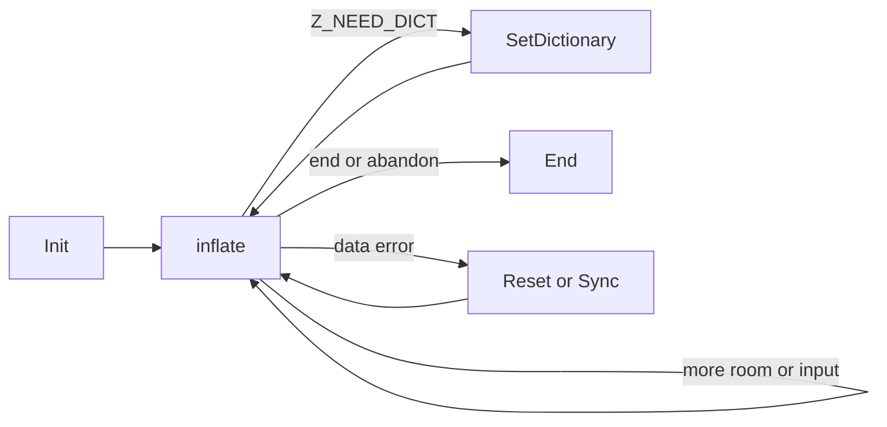

# Stream decompression

Use an `inflate` stream to decode input in pieces while controlling output space. Select zlib,
gzip or raw DEFLATE at initialization, then continue with more input or room until completion,
a dictionary request or an error. `inflateEnd` releases the decoder after any of those outcomes.
For whole-buffer zlib decoding, see [uncompress](utility.md#uncompress2_z).

| Task | Entries |
| --- | --- |
| Start or reuse | [Init](#inflateinit_), [configured init](#inflateinit2_), [reset](#inflatereset), [new configuration](#inflatereset2), [keep history](#inflateresetkeep) |
| Decode or provide metadata | [Inflate](#inflate), [set dictionary](#inflatesetdictionary), [read history](#inflategetdictionary), [gzip header](#inflategetheader) |
| Recover or inspect | [Sync search](#inflatesync), [sync point](#inflatesyncpoint), [mark](#inflatemark), [table use](#inflatecodesused) |
| Adjust or branch | [Prime bits](#inflateprime), [validation](#inflatevalidate), [distance option](#inflateundermine), [copy](#inflatecopy) |
| Release storage | [End](#inflateend) |

The contracts follow the pinned `inflate.c` with patch 0001 applied and `zlib.h`, in the default
LP64 Linux build, with gzip enabled and without the optional invalid-distance or strict-distance
modes. Patch 0001 changes `inflateCopy` only ([patches](../../../../patches/README.md)).
These are focused contracts: Pre describes ordinary correct use and is deliberately narrower than
what the function accepts. Cases outside Pre that the C still handles appear under Errors or Edges.
A call outside Pre is not thereby undefined, and it need not return an error code.
See [how to read a contract](contracts.md) for the labels.

**What is proved.** Safety only: each call returns without undefined behaviour or a memory error,
writes only what its goal names, and leaks nothing ([safety](../safety.md)). Each entry gives its
goal under **Proof goals**, in the five items and with the fixed phrases that
[Reading a Proof goals paragraph](contracts.md#reading-a-proof-goals-paragraph) defines: the goal and its theorem; the conditions under which it
applies, in the order of the Lean statement; what it covers for every value; what it guarantees
(returns, state, writes, allocations); and what it leaves to another goal. The proof assumes the
conditions listed there, not the documentary Pre. Post, the return tables and the notes describe
functional behaviour. They are read from the C, are **to confirm** where no theorem
states them, and are not required for the safety results. [Progress](../../progress.md) says which
goals are done.

## Common conditions

The caller and the decoder keep different things. The caller supplies the input and output
buffers of each call. The decoder keeps the current parsing stage, the bits not yet used, and the
history that later copies may need. Giving it a different output array does not start a new
decoding task.

`next_in` is the start of the unread input and `avail_in` the number of readable bytes. `next_out`
is the next output position and `avail_out` the number of writable bytes that remain from there.
For example, a 5-byte output array that returns with 2 bytes of room has received 3 bytes. Take
those bytes first, then set the pointer and the count to the next writable region.

All contracts below have a **Restricted domain**. A C pointer type alone does not
supply the storage, lifetime or call history required here.

- A **live stream** was successfully initialised or copied, has not been ended,
  retains its library-owned state, and is used without concurrent calls. Use the
  default allocator and free function. Init takes a writable, non-live stream with
  allocator fields set to NULL or the default functions.
- A readable or writable range has the stated capacity for the whole call. Caller
  ranges are separate from the stream and its owned storage. Input and output
  ranges do not overlap. Dictionary destinations, the registered header record
  and its destination buffers are separate from each other and from the stream.
  Registered header storage is also separate from input/output ranges on calls
  using it. These restrictions are part of Pre; each entry's **Proof goals** says
  which of them its goal assumes.
- The caller owns its stream object and buffers. The library owns the state and
  optional window. A call changes only its stream, owned storage, stated output
  ranges and any registered header destination. It never frees caller buffers.
- A rejected **stream check** returns `Z_STREAM_ERROR` without changes, unless a
  query or copy contract says otherwise. This covers NULL and safely readable
  records rejected by the check; it does not cover dangling or arbitrary pointers.
  The check requires allocators, state, the state's back-pointer and a valid mode.
- Counters use the C unsigned widths and wrap. No contract assumes allocation
  succeeds. End remains available after decoding, dictionary or allocation errors.
- The proof goals speak of a **reachable stream** where the contracts say live stream
  ([how to read a contract](contracts.md)). A call that a goal covers extends the
  stream's history: when it returns, with any code, the stream is reachable again
  and the goal of the next call applies. `inflateEnd` ends the history.
- **Result cells as values.** `inflateGetDictionary` reports a length through
  `uInt *dictLength`. The translation does not model that cell as memory: the
  function takes the cell's old value, or the fact that the pointer is NULL, and
  returns the new value. So the goal says nothing about the address of the cell,
  and a cell that overlaps another object cannot be expressed.



## inflateResetKeep

```c
int ZEXPORT inflateResetKeep(z_streamp strm);
```

Restart decoding while retaining history. This is an undocumented entry point.

### Return values and next calls {#api-inflateresetkeep-returns}

**Return type.** `int` — zlib status code

The result says whether decoding restarted while retaining the existing history.

| Returned value | Meaning and conditions | Caller’s next step |
| --- | --- | --- |
| `Z_OK`<br>**Restarted with history retained** | The live stream passed the check; counters, buffered bits and header registration are cleared while window history remains. | Continue when retained history is intended; use inflateReset for an independent stream. |
| `Z_STREAM_ERROR`<br>**Stream check failed** | The common stream check failed; nothing changes. | Establish a valid stream and its ownership before further operations. |

### Calling conditions and effects {#api-inflateresetkeep-contract}

**Domain.** Restricted domain: live streams in any mode.

**Effects.** Mutates state, no allocation or free.

**Pre.** The common live-stream conditions hold. The caller deliberately wants the
old window to remain usable by the next stream.

**Proof goals.**

- **Goal.** None of its own is required: `zlib.h` declares this function under "undocumented functions (not part of the zlib API)". A call on a reachable stream is covered all the same, as one step of the required sequence goal `Goal.inflate_sequence_safety` ([Safety/Sequences.lean](../../../../ZlibF/Spec/Safety/Sequences.lean); its statement is `StreamSequenceSafety` in [Common/Sequences.lean](../../../../ZlibF/Spec/Common/Sequences.lean)), second clause: `StreamOperation` lists this call. Theorem: `Zlib.Inflate.Proofs.inflate_sequence_safety_public` ([public-inflate-sequence-safety.lean](../../../../ZlibF/Proof/public-inflate-sequence-safety.lean)).
- **Applies when** (the premises of that clause; this call has no argument condition):
    1. `strm` is a reachable stream (`StreamReachable`);
    2. the platform size bound holds (`ByteObjectsFit`).
- **Covered without condition.** Every reachable stream, in every mode: before decoding, mid-block, at stream end, and after a data or memory error.
- **Guarantees** (the conclusion of that clause, which `StreamCallSafe` restates).
    - *Returns.* The call returns.
    - *State.* The stream keeps its invariant (`StreamInvariant`).
    - *Writes.* Only the stream record and the stream's own blocks.
    - *Allocations.* Exact allocation account (`LiveChange`).
- **Not in this goal.** A NULL or inconsistent stream: no required goal covers it for this function. The field values after the call: functional goal `Goal.inflateResetKeep` (not planned; a theorem proves it).

<details markdown="1" class="ar-return-exact" data-return-exact="inflateResetKeep"><summary>Complete return conditions and boundaries</summary>

**Post.** Returns `Z_OK`. Clears totals, message, `data_type`, buffered bits,
dictionary-set status and header registration. Restarts header/block decoding with
the current wrapper, retaining the window and its history. For a wrapper, `adler`
is 1 if zlib is accepted, otherwise 0; raw leaves `adler` unchanged.

**Edges.** Does not restore wrapper settings changed by recovery. A failed stream
check changes nothing. Use `inflateReset` to discard history.

</details>

## inflateReset

```c
int ZEXPORT inflateReset(z_streamp strm);
```

Start a new independent compressed stream using the existing configuration.

### Return values and next calls {#api-inflatereset-returns}

**Return type.** `int` — zlib status code

The result says whether the existing configuration is ready for a new independent stream.

| Returned value | Meaning and conditions | Caller’s next step |
| --- | --- | --- |
| `Z_OK`<br>**Ready for a new stream** | The live stream was reset; history and header registration are discarded and the requested wrapper and window size restored. | Set up the new input and output ranges and continue with inflate; eventually call inflateEnd. |
| `Z_STREAM_ERROR`<br>**Stream check failed** | The common stream check failed; nothing changes. | Establish a valid stream and its ownership before further operations. |

### Calling conditions and effects {#api-inflatereset-contract}

**Domain.** Restricted domain: live streams, including completed or failed ones.

**Effects.** Mutates state and may free the window, never allocates.

**Pre.** The common live-stream conditions hold.

**Proof goals.**

- **Goal.** `Goal.inflateReset_safety` ([Safety/Streams.lean](../../../../ZlibF/Spec/Safety/Streams.lean)); required. Theorem: `ZlibF.Spec.Public.StreamCallSafetyProof.inflateReset_safety` ([public-stream-call-safety.lean](../../../../ZlibF/Proof/public-stream-call-safety.lean)). The goal has two clauses: the refusal of a [refused stream](contracts.md#reading-a-proof-goals-paragraph), and one call on a reachable stream. `Goal.inflate_refusal` ([Safety/Refusals.lean](../../../../ZlibF/Spec/Safety/Refusals.lean)), also required, states the same refusal.
- **Applies when.** The refusal asks that `strm` is a refused stream (`RefusedInflate`). The call on a reachable stream asks (`StreamCallDomain`; this call has no argument condition):
    1. `strm` is a reachable stream (`StreamReachable`);
    2. the platform size bound holds (`ByteObjectsFit`).
- **Covered without condition.** Every reachable stream, in every mode: before decoding, mid-block, at stream end, and after a data or memory error. In the refusal: every refused stream.
- **Guarantees** (`StreamCallSafe` for the call on a reachable stream).
    - *Returns.* On a refused stream the call returns `Z_STREAM_ERROR`. On a reachable stream the call returns.
    - *State.* On a reachable stream, the stream keeps its invariant (`StreamInvariant`).
    - *Writes.* On a refused stream, nothing: the heap is unchanged. On a reachable stream, only the stream record and the stream's own blocks.
    - *Allocations.* On a reachable stream, the exact allocation account (`LiveChange`).
- **Not in this goal.** A stream record with `zalloc` and `zfree` set whose `state` is a garbage pointer, points to a freed state, or points to a deflate state: no goal covers this call on such a record ([deviations](../../deviations.md#note-2-refused-streams)). The return value and the field values after the call: functional goal `Goal.inflateReset` (not planned; a theorem proves it).

<details markdown="1" class="ar-return-exact" data-return-exact="inflateReset"><summary>Complete return conditions and boundaries</summary>

**Post.** Returns `Z_OK`. Restores the requested wrapper and window size, discards
history, then performs the reset described by `inflateResetKeep`. Input/output
pointers and available counts stay unchanged. A window of the same size may remain
allocated; an incompatible window is freed.

**Edges.** Clears header registration. Keeps the validation setting selected by
`inflateValidate`, while undoing temporary recovery wrapper changes. A failed
stream check changes nothing.

</details>

## inflateReset2

```c
int ZEXPORT inflateReset2(z_streamp strm, int windowBits);
```

Reset and select a new wrapper and maximum window size.

### Return values and next calls {#api-inflatereset2-returns}

**Return type.** `int` — zlib status code

The result says whether a new wrapper and window configuration took effect for a fresh decode.

| Returned value | Meaning and conditions | Caller’s next step |
| --- | --- | --- |
| `Z_OK`<br>**New configuration applied** | The stream check passed and windowBits was accepted; decoding resets, history and header registration are discarded, and validation is enabled for the new wrapper. | Provide input and output ranges for the new format, then call inflate. |
| `Z_STREAM_ERROR`<br>**Configuration or stream refused** | windowBits is invalid or the stream check failed; nothing changes. | If the original stream is valid, choose an accepted configuration; resolve invalid stream use before proceeding. |

**Reading the result.**

- Accepted values are -15..-8, 0, 8..15, 16, 24..31, 32 and 40..47; the full contract gives their wrapper meanings.

### Calling conditions and effects {#api-inflatereset2-contract}

**Domain.** Restricted domain: live streams and every signed `windowBits` value.

**Effects.** Mutates state and may free the window, never allocates.

**Pre.** The common live-stream conditions hold. Old decoding is being abandoned.

**Proof goals.**

- **Goal.** `Goal.inflateReset2_safety` ([Safety/Streams.lean](../../../../ZlibF/Spec/Safety/Streams.lean)); required. Theorem: `ZlibF.Spec.Public.StreamCallSafetyProof.inflateReset2_safety` ([public-stream-call-safety.lean](../../../../ZlibF/Proof/public-stream-call-safety.lean)). The goal has two clauses: the refusal of a [refused stream](contracts.md#reading-a-proof-goals-paragraph), and one call on a reachable stream. `Goal.inflate_refusal` ([Safety/Refusals.lean](../../../../ZlibF/Spec/Safety/Refusals.lean)), also required, states the same refusal.
- **Applies when.** The refusal asks that `strm` is a refused stream (`RefusedInflate`). The call on a reachable stream asks (`StreamCallDomain`; this call has no argument condition):
    1. `strm` is a reachable stream (`StreamReachable`);
    2. the platform size bound holds (`ByteObjectsFit`).
- **Covered without condition.** Every `windowBits`, accepted or not. Every reachable stream, in every mode: before decoding, mid-block, at stream end, and after a data or memory error. In the refusal: every refused stream and every value of the other arguments.
- **Guarantees** (`StreamCallSafe` for the call on a reachable stream).
    - *Returns.* On a refused stream the call returns `Z_STREAM_ERROR`. On a reachable stream the call returns.
    - *State.* On a reachable stream, the stream keeps its invariant (`StreamInvariant`).
    - *Writes.* On a refused stream, nothing: the heap is unchanged. On a reachable stream, only the stream record and the stream's own blocks.
    - *Allocations.* On a reachable stream, the exact allocation account (`LiveChange`).
- **Not in this goal.** A stream record with `zalloc` and `zfree` set whose `state` is a garbage pointer, points to a freed state, or points to a deflate state: no goal covers this call on such a record ([deviations](../../deviations.md#note-2-refused-streams)). Which `windowBits` are accepted, and the field values after the call: functional goal `Goal.inflateReset2` (not planned; a theorem proves it).

<details markdown="1" class="ar-return-exact" data-return-exact="inflateReset2"><summary>Complete return conditions and boundaries</summary>

**Post.** For an accepted value, returns `Z_OK` and has the effect of `inflateReset`
with the new request. Accepted values and meanings are listed under `inflateInit2_`.
Validation is enabled for the new wrapper request.

**Edges.** Invalid values return `Z_STREAM_ERROR` before changing anything. Changing
the requested size frees an incompatible window. Pending header registration and
history are discarded, even if the size stays the same.

</details>

## inflateInit2_

```c
int ZEXPORT inflateInit2_(z_streamp strm, int windowBits, const char *version, int stream_size);
```

Create a decoder with a selected wrapper and window.

The window holds the most recent decoded bytes; length and distance references copy old content
from it. "Window bits" in the table below is an exponent b that means at most `2^b` bytes: 15 means
32768 bytes. `windowBits` also selects raw, zlib, gzip or automatic detection, by its sign or by an
added constant, so the argument is not a byte count. The requests 0, 16 and 32 leave the size to
the header or to the default; the table gives each meaning.

### Return values and next calls {#api-inflateinit2_-returns}

**Return type.** `int` — zlib status code

The result says whether a decoder with the requested format was created. Only successful initialization requires a later end call.

| Returned value | Meaning and conditions | Caller’s next step |
| --- | --- | --- |
| `Z_OK`<br>**Decoder created** | The version and stream size match, state allocation succeeded, and windowBits was accepted. | Supply input and output ranges, call inflate, then call inflateEnd when finished or abandoning decoding. |
| `Z_VERSION_ERROR`<br>**Version or structure size mismatch** | version is NULL, its first byte mismatches, or stream_size is wrong; this returns before inspecting strm and changes nothing. | Correct the version and structure size before initializing again; this failed attempt needs no inflateEnd. |
| `Z_STREAM_ERROR`<br>**Stream or window request refused** | After the version check, strm is NULL; or state allocation succeeds but windowBits is invalid, so that state is freed and state becomes NULL. | Provide a writable non-live stream and accepted windowBits before initializing again; this failed attempt needs no end call. |
| `Z_MEM_ERROR`<br>**State allocation failed** | State allocation failed and the old state field is retained; msg is cleared and required default allocator fields may have been installed. | Initialization may be tried again when resources are available; this failure retained no new allocation and needs no inflateEnd. |

### Calling conditions and effects {#api-inflateinit2_-contract}

**Domain.** Restricted domain: fresh writable stream storage, default allocator,
and NULL or readable version pointer; all signed scalar arguments.

**Effects.** Allocates state.

**Pre.** The stream is not live. Allocator fields follow the common convention.
Only the first version byte must be readable; a whole string is not inspected.

**Proof goals.**

- **Goal.** `Goal.inflateInit2__safety` ([Safety/Initialisation.lean](../../../../ZlibF/Spec/Safety/Initialisation.lean)); required. Theorem: `ZlibF.Spec.Public.InitSafetyProof.inflateInit2__safety` ([public-init-safety.lean](../../../../ZlibF/Proof/public-init-safety.lean)).
- **Applies when** (`InitArguments`):
    1. the heap is a library heap (`Fresh`, `Uniq`, `LibraryGlobals`);
    2. `version` is NULL or its first byte is readable (`VersionValue`);
    3. `strm` is NULL, or points to a readable stream record whose `zalloc` and `zfree` are each NULL or the default function (`DefaultOrNull`).
- **Covered without condition.** Every `windowBits`; every `stream_size`; every value of the first byte of `version`; every value of the other fields of the record, `state` included; every allocation outcome. The goal is wider than Pre: it also covers a NULL `strm`, a wrong version or `stream_size`, and a record whose `state` is not NULL. If that record was a live stream, the call still returns, but the old state stays allocated and the record no longer points to it: the account records that leak, it does not exclude it.
- **Guarantees** (`InitResultSafe`).
    - *Returns.* The call returns. With a NULL `strm` the code is `Z_VERSION_ERROR` or `Z_STREAM_ERROR`.
    - *State.* With `Z_OK`, `strm` is a reachable stream.
    - *Writes.* With a NULL `strm`, nothing: the heap is unchanged. Otherwise only the stream record and blocks the call itself allocates.
    - *Allocations.* With `Z_OK`, every block the call allocated is one of the stream's own blocks, and nothing is freed (`LiveChange`). With any other code the allocated blocks are the same as before the call.
- **Not in this goal.** A stream whose `zalloc` or `zfree` is a custom function: outside every goal ([deviations](../../deviations.md)). Which code each refusal and each allocation failure returns, and the field values after the call: functional goal `Goal.inflateInit2_` (not planned; a theorem proves it). That some call does return `Z_OK`: `Goal.inflate_initialisation_domain` ([Safety/Domains.lean](../../../../ZlibF/Spec/Safety/Domains.lean)), required.

<details markdown="1" class="ar-return-exact" data-return-exact="inflateInit2_"><summary>Complete return conditions and boundaries</summary>

**Post.** On `Z_OK`, the stream is live with zero totals, NULL message, zero
`data_type`, no window, history, buffered bits or header registration. Wrapper
`adler` starts at 1 for zlib/automatic detection and 0 for gzip-only; raw preserves
it. Buffer pointers and available counts are unchanged.

Accepted `windowBits` values are:

| Values | Decoder request |
| --- | --- |
| -15 through -8 | Raw DEFLATE, window bits equal to the magnitude |
| 0; 8 through 15 | Zlib; header-selected size for 0, otherwise that maximum |
| 16; 24 through 31 | Gzip only; default size for 16, otherwise value minus 16 |
| 32; 40 through 47 | Zlib/gzip detection; header/default size for 32, otherwise value minus 32 |

**Errors.** NULL/wrong version first byte or wrong `stream_size` returns
`Z_VERSION_ERROR` without changes, before inspecting `strm`. Otherwise NULL `strm`
returns `Z_STREAM_ERROR`. State allocation is attempted before the window argument
is checked. Failure returns `Z_MEM_ERROR`, retaining the old `state` field, with
message cleared and default callbacks installed as needed. An invalid window
argument after successful allocation returns `Z_STREAM_ERROR`, frees that state
and sets `state` to NULL. No failing init retains a new allocation. Only successful
init needs a later `inflateEnd`; its window may be allocated by later calls.

</details>

## inflateInit_

```c
int ZEXPORT inflateInit_(z_streamp strm, const char *version, int stream_size);
```

Create a zlib decoder with a 32 KiB maximum window.

### Return values and next calls {#api-inflateinit_-returns}

**Return type.** `int` — zlib status code

The result says whether a zlib decoder with a maximum 32 KiB window was created.

| Returned value | Meaning and conditions | Caller’s next step |
| --- | --- | --- |
| `Z_OK`<br>**Zlib decoder created** | This is inflateInit2_ with windowBits 15, and state allocation succeeded. | Decode zlib input with inflate; call inflateEnd after completion or abandonment. |
| `Z_VERSION_ERROR`<br>**Version or structure size mismatch** | version is NULL, its first byte mismatches, or stream_size is wrong; the stream is not inspected and nothing changes. | Correct the version and structure size before initializing again; this failure needs no inflateEnd. |
| `Z_STREAM_ERROR`<br>**Stream pointer refused** | strm is NULL after the version check passed. | Provide a writable non-live stream before initializing again; this failure needs no end call. |
| `Z_MEM_ERROR`<br>**State allocation failed** | State could not be allocated; the old state remains, while msg and default allocator fields may have changed. | Initialization may be tried again when resources are available; no new allocation was retained and no inflateEnd is needed. |

### Calling conditions and effects {#api-inflateinit_-contract}

**Domain.** Restricted domain: the same storage, version and allocator domain as
`inflateInit2_`.

**Effects.** Allocates state.

**Pre.** The `inflateInit2_` preconditions hold.

**Proof goals.**

- **Goal.** `Goal.inflateInit__safety` ([Safety/Initialisation.lean](../../../../ZlibF/Spec/Safety/Initialisation.lean)); required. Theorem: `ZlibF.Spec.Public.InitSafetyProof.inflateInit__safety` ([public-init-safety.lean](../../../../ZlibF/Proof/public-init-safety.lean)).
- **Applies when** (`InitArguments`):
    1. the heap is a library heap (`Fresh`, `Uniq`, `LibraryGlobals`);
    2. `version` is NULL or its first byte is readable (`VersionValue`);
    3. `strm` is NULL, or points to a readable stream record whose `zalloc` and `zfree` are each NULL or the default function (`DefaultOrNull`).
- **Covered without condition.** Every `stream_size`; every value of the first byte of `version`; every value of the other fields of the record, `state` included; every allocation outcome. The goal is wider than Pre: it also covers a NULL `strm`, a wrong version or `stream_size`, and a record whose `state` is not NULL. If that record was a live stream, the call still returns, but the old state stays allocated and the record no longer points to it: the account records that leak, it does not exclude it.
- **Guarantees** (`InitResultSafe`).
    - *Returns.* The call returns. With a NULL `strm` the code is `Z_VERSION_ERROR` or `Z_STREAM_ERROR`.
    - *State.* With `Z_OK`, `strm` is a reachable stream.
    - *Writes.* With a NULL `strm`, nothing: the heap is unchanged. Otherwise only the stream record and blocks the call itself allocates.
    - *Allocations.* With `Z_OK`, every block the call allocated is one of the stream's own blocks, and nothing is freed (`LiveChange`). With any other code the allocated blocks are the same as before the call.
- **Not in this goal.** A stream whose `zalloc` or `zfree` is a custom function: outside every goal ([deviations](../../deviations.md)). Which code each refusal and each allocation failure returns, and the field values after the call: functional goal `Goal.inflateInit_` (not planned; a theorem proves it). That some call does return `Z_OK`: `Goal.inflate_initialisation_domain` ([Safety/Domains.lean](../../../../ZlibF/Spec/Safety/Domains.lean)), required.

<details markdown="1" class="ar-return-exact" data-return-exact="inflateInit_"><summary>Complete return conditions and boundaries</summary>

**Post.** Exactly `inflateInit2_(strm, 15, version, stream_size)`. On success it
accepts zlib streams with a window up to 32 KiB, and owns one state allocation.

**Errors.** The same version, NULL-stream and allocation failures and cleanup as
`inflateInit2_`. Gzip and raw bytes are not accepted by later decoding as zlib.

</details>

## inflatePrime

```c
int ZEXPORT inflatePrime(z_streamp strm, int bits, int value);
```

Supply bits before the next input byte, or clear buffered bits.

### Return values and next calls {#api-inflateprime-returns}

**Return type.** `int` — zlib status code

The result says whether the bit buffer accepted a clear or append request.

| Returned value | Meaning and conditions | Caller’s next step |
| --- | --- | --- |
| `Z_OK`<br>**Bit request applied** | Negative bits clears the buffer; zero leaves it unchanged; 1..16 bits that fit in the 32-bit buffer appends the low bits of value. | At the permitted raw-stream call position, continue with inflate; the supplied bits precede next_in. |
| `Z_STREAM_ERROR`<br>**Bit request or stream refused** | bits exceeds 16, bit-buffer space is insufficient, or the stream check failed; nothing changes. | For a valid stream, correct the bit request; otherwise resolve invalid stream use first. |

### Calling conditions and effects {#api-inflateprime-contract}

**Domain.** Restricted domain: live raw streams before first decoding or at a
reported block/header boundary; every signed `bits` and `value`.

**Effects.** Mutates state only.

**Pre.** The common live-stream conditions and the stated priming call order hold.

**Proof goals.**

- **Goal.** `Goal.inflatePrime_safety` ([Safety/Streams.lean](../../../../ZlibF/Spec/Safety/Streams.lean)); required. Theorem: `ZlibF.Spec.Public.StreamCallSafetyProof.inflatePrime_safety` ([public-stream-call-safety.lean](../../../../ZlibF/Proof/public-stream-call-safety.lean)). The goal has two clauses: the refusal of a [refused stream](contracts.md#reading-a-proof-goals-paragraph), and one call on a reachable stream.
- **Applies when.** The refusal asks that `strm` is a refused stream (`RefusedInflate`). The call on a reachable stream asks (`StreamCallDomain`; this call has no argument condition):
    1. `strm` is a reachable stream (`StreamReachable`);
    2. the platform size bound holds (`ByteObjectsFit`).
- **Covered without condition.** Every `bits` and `value`. Every reachable stream, in every mode: before decoding, mid-block, at stream end, and after a data or memory error. The goal is wider than Pre, which asks for a raw stream and a call position. In the refusal: every refused stream and every value of the other arguments.
- **Guarantees** (`StreamCallSafe` for the call on a reachable stream).
    - *Returns.* On a refused stream the call returns `Z_STREAM_ERROR`. On a reachable stream the call returns.
    - *State.* On a reachable stream, the stream keeps its invariant (`StreamInvariant`).
    - *Writes.* On a refused stream, nothing: the heap is unchanged. On a reachable stream, only the stream record and the stream's own blocks.
    - *Allocations.* On a reachable stream, the exact allocation account (`LiveChange`).
- **Not in this goal.** A stream record with `zalloc` and `zfree` set whose `state` is a garbage pointer, points to a freed state, or points to a deflate state: no goal covers this call on such a record ([deviations](../../deviations.md#note-2-refused-streams)). The return value and the bit buffer after the call: functional goal `Goal.inflatePrime` (not planned; a theorem proves it).

<details markdown="1" class="ar-return-exact" data-return-exact="inflatePrime"><summary>Complete return conditions and boundaries</summary>

**Post.** Zero bits returns `Z_OK` unchanged. Negative bits empties the bit buffer.
For 1 through 16 bits that fit within the 32-bit buffer, returns `Z_OK`, appending
the low `bits` bits of `value` above existing bits. For a negative `value` these are the low
`bits` bits of its two's-complement form. These bits precede `next_in`.

**Errors.** More than 16 bits, insufficient bit-buffer space or a failed stream
check returns `Z_STREAM_ERROR` unchanged. Does not update `data_type`. The C does
not enforce the raw-stream or call-order restriction.

</details>

## inflate

```c
int ZEXPORT inflate(z_streamp strm, int flush);
```

Consume compressed bytes and write decoded bytes, preserving state across calls.

A call uses only the input and the output room given to it. On return, look first at how far it
got, then at the return code, to decide whether to continue, supply a dictionary, stop or handle
an error. `flush` asks for a stopping point or a way of finishing; it is not a compression level.
A full output buffer does not mean that the stream is decoded, and running out of input does not
mean that the data is damaged.

### Return values and next calls {#api-inflate-returns}

**Return type.** `int` — zlib status code

The result distinguishes progress, completion of one stream, a dictionary request and errors; progress does not mean decoding is finished.

| Returned value | Meaning and conditions | Caller’s next step |
| --- | --- | --- |
| `Z_OK`<br>**Progress, not completion** | Input was consumed or output produced, but one stream is not yet complete; a requested block/header boundary can also stop the call. | Continue inflate with more input or output space as needed. |
| `Z_STREAM_END`<br>**One stream or member complete** | One stream of the selected format is complete, including enabled trailer checks; repeated calls on a completed stream also return this value. | Preserve unread trailing input; call inflateEnd, or reset before decoding the next gzip member. |
| `Z_NEED_DICT`<br>**Zlib dictionary required** | The zlib header requests a preset dictionary; strm->adler gives its identifier. | Supply the correct dictionary with inflateSetDictionary and continue after success; call inflateEnd if abandoning decoding. |
| `Z_BUF_ERROR`<br>**Required progress or completion unavailable** | The call made no input/output progress, or a Z_FINISH request could not complete; Z_FINISH changes an otherwise Z_OK result to this value. | Continue with input or output space as needed; this value alone does not establish corrupt data. |
| `Z_DATA_ERROR`<br>**Data error detected** | A format error or enabled checksum/length error was detected, possibly after output; the data-error state is sticky. | Abandon the current stream with inflateReset, attempt recovery with inflateSync, or call inflateEnd. |
| `Z_MEM_ERROR`<br>**History-window allocation failed** | Window allocation failed; input may already have been consumed or output written, and the error state is sticky. | Observe the updated pointers and available counts; reset before starting again, or call inflateEnd. |
| `Z_STREAM_ERROR`<br>**Stream or buffer conditions failed** | A stream/buffer check failed, or an inflateSync recovery search remains unfinished. | Correct buffer arguments for a valid stream; continue inflateSync for an unfinished recovery search; otherwise establish a valid stream first. |

### Calling conditions and effects {#api-inflate-contract}

**Domain.** Restricted domain: live streams with common buffer/header lifetimes;
arbitrary compressed bytes, input/output splits and signed `flush` values.

**Effects.** Mutates
stream, output and registered header storage; may allocate the history window.

**Pre.** `next_in` describes `avail_in` readable bytes and may be NULL only when
that count is zero. `next_out` is non-NULL even for zero `avail_out`, and describes
that many writable bytes. A registered header and its buffers remain writable.
Calls may continue with more input/room, supply a requested dictionary, or follow
successful reset/recovery. Terminal/error repeats have the behavior below.

**Accounting.** Normal returns, including data and buffer errors, update totals by
consumed/produced bytes and update the enabled output checksum. `Z_NEED_DICT`
accounts for consumed header bytes and leaves `adler` as the dictionary identifier.
A late window-allocation failure can follow input consumption and output writes:
pointers/counts already reflect them, but normal final total/checksum/`data_type`
accounting is skipped.
The input a call has consumed need not all belong to a valid stream: a later call can reject
the stream without consuming more input.

**Ownership.** New window storage belongs to the stream and remains available for
reset/end, including after errors. A one-call `Z_FINISH` completion may need no
window. Concatenated gzip members require reset between members. Error messages
are borrowed static strings. Buffer and stream check refusals change nothing.

**Proof goals.**

- **Goal.** `Goal.inflate_safety` ([Safety/Streams.lean](../../../../ZlibF/Spec/Safety/Streams.lean)); required. Theorem: `ZlibF.Spec.Public.StreamCallSafetyProof.inflate_safety` ([public-stream-call-safety.lean](../../../../ZlibF/Proof/public-stream-call-safety.lean)). The goal has two clauses: the refusal of a [refused stream](contracts.md#reading-a-proof-goals-paragraph), and one call on a reachable stream. `Goal.inflate_refusal` ([Safety/Refusals.lean](../../../../ZlibF/Spec/Safety/Refusals.lean)), also required, states the same refusal.
- **Applies when.** The refusal asks that `strm` is a refused stream (`RefusedInflate`), and that the model's memory has no allocated block at or above its next unused block number (`Fresh`, a condition on the model, not on the caller). The call on a reachable stream asks (`StreamCallDomain`):
    1. `strm` is a reachable stream (`StreamReachable`);
    2. the platform size bound holds (`ByteObjectsFit`);
    3. `next_in` is NULL or points to `avail_in` readable bytes, and `next_out` is NULL or points to `avail_out` writable bytes; neither range lies in the stream's own blocks, and the two ranges do not overlap (`StreamBuffers`);
    4. if a header record is attached (given to `inflateGetHeader`, and not detached since by a reset): the record is live and is not one of the stream's own blocks, and each of its `extra`, `name` and `comment` pointers is NULL or points to `extra_max`, `name_max` or `comm_max` writable bytes outside the stream's own blocks (`HeaderMemory`). The goal asks this at every call, also after the header is complete;
    5. while the gzip header is being read into that record: the `extra` buffer does not overlap the unread input, and while the extra field is read the record's `extra_len` is not below the length still to be read (`InflateHeaderProgress`). This is a condition on the record at the call, whoever wrote the field: `inflate` writes `extra_len` in the record attached to the stream, so two streams attached to one record, as after `inflateCopy`, are outside the goals. Conditions 4 and 5 together are `ActiveHeader`.
- **Covered without condition.** Every `flush` value; every sequence of input bytes, well formed or not; every allocation outcome. The goal is wider than Pre: `next_out` may be NULL, and `next_in` may be NULL with a nonzero `avail_in`. The C refuses both with `Z_STREAM_ERROR`. In the refusal: every refused stream and every value of the other arguments.
- **Guarantees** (`StreamCallSafe` for the call on a reachable stream).
    - *Returns.* On a refused stream the call returns `Z_STREAM_ERROR`. On a reachable stream the call returns.
    - *State.* On a reachable stream, the stream keeps its invariant (`StreamInvariant`).
    - *Writes.* On a refused stream, no block that was allocated before the call (`Frame`); the clause is not stated as an unchanged heap, because the translation makes and frees a local four-byte array. On a reachable stream, only the stream record, the stream's own blocks, the attached header record, the `avail_out` bytes at `next_out`, and the header's `extra`, `name` and `comment` buffers (`extra_max`, `name_max` and `comm_max` bytes).
    - *Allocations.* On a refused stream, the allocated blocks are the same as before the call (`LiveChange`). On a reachable stream, the exact allocation account (`LiveChange`).
- **Not in this goal.** A stream record with `zalloc` and `zfree` set whose `state` is a garbage pointer, points to a freed state, or points to a deflate state: no goal covers this call on such a record ([deviations](../../deviations.md#note-2-refused-streams)). Which code is returned and which bytes are written: functional goal `Goal.inflate` (not planned; a theorem proves it).

<details markdown="1" class="ar-return-exact" data-return-exact="inflate"><summary>Complete return conditions and boundaries</summary>

**Post.** Reads/writes within the stated ranges. Advances pointers and reduces
available counts by bytes consumed/produced. In an ordinary run from init/reset,
with a valid selected format and the correct dictionary, accumulated output is a
prefix of the decoded data and equals it at `Z_STREAM_END`. Malformed bytes are
part of the domain: detected format or enabled checksum/length failures return
`Z_DATA_ERROR`, possibly after output. Incomplete input alone needs more input;
it need not be reported as a data error.

The table under [Return values and next calls](#api-inflate-returns) gives the meaning of each
code and the next action.

**Edges.** Zero input or output room is allowed. `Z_BLOCK` stops at a header or
block boundary; `Z_TREES` also stops after block descriptions. `Z_FINISH` changes an
otherwise `Z_OK` result to `Z_BUF_ERROR`. Other signed flush values are accepted
and behave like `Z_NO_FLUSH`. `data_type` on normal returns records unused bits,
plus 64 for the last block, 128 at a header/block boundary, and 256 after a block
header. Data and memory errors are sticky; completed streams repeat `Z_STREAM_END`.

</details>

## inflateEnd

```c
int ZEXPORT inflateEnd(z_streamp strm);
```

Release decoder storage, including when decoding was abandoned or failed.

### Return values and next calls {#api-inflateend-returns}

**Return type.** `int` — zlib status code

The result says whether decoder-owned state and window were released; decoding need not have completed.

| Returned value | Meaning and conditions | Caller’s next step |
| --- | --- | --- |
| `Z_OK`<br>**Decoder released** | The live stream passed the check; its optional window and state are freed exactly once and state becomes NULL. | Caller buffers may be released; reinitialize before using the stream again. |
| `Z_STREAM_ERROR`<br>**No release performed** | The stream check failed, including an already ended stream; nothing is freed. | Check the stream lifetime and ownership; do not end an already ended stream again. |

### Calling conditions and effects {#api-inflateend-contract}

**Domain.** Restricted domain: live streams in every mode, including after
allocation/data errors.

**Effects.** Mutates the stream and frees owned storage.

**Pre.** The common live-stream conditions hold.

**Proof goals.**

- **Goal.** `Goal.inflateEnd_safety` ([Safety/Streams.lean](../../../../ZlibF/Spec/Safety/Streams.lean)); required. Theorem: `ZlibF.Spec.Public.StreamCallSafetyProof.inflateEnd_safety` ([public-stream-call-safety.lean](../../../../ZlibF/Proof/public-stream-call-safety.lean)). The goal has two clauses: the refusal of a [refused stream](contracts.md#reading-a-proof-goals-paragraph), and the end of a reachable stream. `Goal.inflate_refusal` ([Safety/Refusals.lean](../../../../ZlibF/Spec/Safety/Refusals.lean)), also required, states the same refusal.
- **Applies when.** The refusal asks that `strm` is a refused stream (`RefusedInflate`). The end of a reachable stream asks that `strm` is a reachable stream (`StreamReachable`); the platform size bound is not asked.
- **Covered without condition.** Every reachable stream, in every mode: before decoding, mid-block, at stream end, and after a data or memory error. In the refusal: every refused stream.
- **Guarantees.**
    - *Returns.* On a refused stream the call returns `Z_STREAM_ERROR`. On a reachable stream the call returns, with `Z_OK`.
    - *State.* On a reachable stream, `strm->state` is NULL after the call.
    - *Writes.* On a refused stream, nothing: the heap is unchanged. On a reachable stream, only the stream record and the stream's own blocks.
    - *Allocations.* On a reachable stream, the exact allocation account (`LiveChange`): the stream's own blocks are freed; nothing else is freed and nothing is allocated.
- **Not in this goal.** A stream record with `zalloc` and `zfree` set whose `state` is a garbage pointer, points to a freed state, or points to a deflate state: no goal covers this call on such a record ([deviations](../../deviations.md#note-2-refused-streams)). The values of the other stream fields: functional goal `Goal.inflateEnd` (not planned; a theorem proves it).

<details markdown="1" class="ar-return-exact" data-return-exact="inflateEnd"><summary>Complete return conditions and boundaries</summary>

**Post.** Returns `Z_OK`, frees the optional window and state exactly once, and
sets `state` to NULL. Other stream fields and caller buffers are unchanged. This
allocates nothing and cannot return `Z_MEM_ERROR` with the default free function.

**Edges.** Does not require stream completion or report incomplete data as an
error. A failed stream check, including an already ended stream, returns
`Z_STREAM_ERROR` without freeing anything. Reinitialise before using it again.

</details>

## inflateGetDictionary

```c
int ZEXPORT inflateGetDictionary(z_streamp strm, Bytef *dictionary, uInt *dictLength);
```

Read the retained sliding history, oldest byte first.

### Return values and next calls {#api-inflategetdictionary-returns}

**Return type.** `int` — zlib status code

The return value reports query status; the history size is written to dictLength rather than returned.

| Returned value | Meaning and conditions | Caller’s next step |
| --- | --- | --- |
| `Z_OK`<br>**History query succeeded** | The stream check passed; non-NULL dictionary receives oldest-to-newest history and non-NULL dictLength receives its byte count. | Use the requested destination results; the stream remains usable, and empty history is valid. |
| `Z_STREAM_ERROR`<br>**Query refused** | The stream check failed; no destination is written. | Do not treat previous destination contents as this call’s result; establish a valid stream first. |

### Calling conditions and effects {#api-inflategetdictionary-contract}

**Domain.** Restricted domain: live streams with optional writable dictionary
and length destinations.

**Effects.** Observes state and writes only those destinations.

**Pre.** A non-NULL dictionary has room for the retained history; 32768 bytes is
always enough. Non-NULL `dictLength` points to writable `uInt` storage.

**Proof goals.**

- **Goal.** `Goal.inflateGetDictionary_safety` ([Safety/Streams.lean](../../../../ZlibF/Spec/Safety/Streams.lean)); required. Theorem: `ZlibF.Spec.Public.StreamCallSafetyProof.inflateGetDictionary_safety` ([public-stream-call-safety.lean](../../../../ZlibF/Proof/public-stream-call-safety.lean)). The goal has two clauses: the refusal of a [refused stream](contracts.md#reading-a-proof-goals-paragraph), and one call on a reachable stream. `Goal.inflate_refusal` ([Safety/Refusals.lean](../../../../ZlibF/Spec/Safety/Refusals.lean)), also required, states the same refusal.
- **Applies when.** The refusal asks that `strm` is a refused stream (`RefusedInflate`). The call on a reachable stream asks (`StreamCallDomain`):
    1. `strm` is a reachable stream (`StreamReachable`);
    2. the platform size bound holds (`ByteObjectsFit`);
    3. `dictionary` is NULL or points to as many writable bytes as the window holds (`state->whave`, never more than 32768), outside the stream's own blocks (`CallerRange`).
- **Covered without condition.** Every reachable stream, in every mode: before decoding, mid-block, at stream end, and after a data or memory error. `dictLength` is a value in the translation, not memory ([common conditions](#common-conditions)), so the goal asks nothing of that pointer, while Pre asks for a writable `uInt`. In the refusal: every refused stream and every value of the other arguments.
- **Guarantees** (`StreamCallSafe` for the call on a reachable stream).
    - *Returns.* On a refused stream the call returns `Z_STREAM_ERROR` and leaves the length value as it was passed. On a reachable stream the call returns.
    - *State.* On a reachable stream, the stream keeps its invariant (`StreamInvariant`).
    - *Writes.* On a refused stream, nothing: the heap is unchanged. On a reachable stream, only the stream record, the stream's own blocks, and bytes within the `state->whave` bytes at `dictionary`, the bytes the call copies; for a `NULL` `dictionary`, no caller memory.
    - *Allocations.* On a reachable stream, the exact allocation account (`LiveChange`).
- **Not in this goal.** A stream record with `zalloc` and `zfree` set whose `state` is a garbage pointer, points to a freed state, or points to a deflate state: no goal covers this call on such a record ([deviations](../../deviations.md#note-2-refused-streams)). The bytes copied and the length reported: functional goal `Goal.inflateGetDictionary` (not planned; a theorem proves it).

<details markdown="1" class="ar-return-exact" data-return-exact="inflateGetDictionary"><summary>Complete return conditions and boundaries</summary>

**Post.** Returns `Z_OK`. Copies the history if `dictionary` is non-NULL and stores
its size if `dictLength` is non-NULL. Allocates/frees nothing; leaves stream unchanged.

**Edges.** Either destination may be NULL. Fresh history is empty. A stream
finished without allocating a window can also have empty history despite having
produced output. A failed stream check writes nothing.

</details>

## inflateSetDictionary

```c
int ZEXPORT inflateSetDictionary(z_streamp strm, const Bytef *dictionary, uInt dictLength);
```

Install or amend the bytes available for backward matches.

### Return values and next calls {#api-inflatesetdictionary-returns}

**Return type.** `int` — zlib status code

The result distinguishes successful dictionary installation, an identifier mismatch, and stream or memory errors.

| Returned value | Meaning and conditions | Caller’s next step |
| --- | --- | --- |
| `Z_OK`<br>**Dictionary installed** | A raw stream accepted the dictionary, or a waiting zlib stream’s identifier matched; the usable window suffix is retained. | Continue inflate; input/output pointers and totals have not advanced. |
| `Z_DATA_ERROR`<br>**Zlib dictionary identifier mismatch** | The supplied dictionary’s full Adler identifier differs from the required identifier; the stream is unchanged. | Try another dictionary, or call inflateEnd if abandoning decoding. |
| `Z_STREAM_ERROR`<br>**Dictionary request refused** | dictionary is NULL, the stream check failed, or a wrapped stream is not awaiting a dictionary. | Provide a non-NULL dictionary under the contract only for a valid raw stream or a zlib stream awaiting one. |
| `Z_MEM_ERROR`<br>**Window allocation failed** | History-window allocation failed and the stream enters memory-error mode. | Reset before starting a new decode, or call inflateEnd to release state. |

### Calling conditions and effects {#api-inflatesetdictionary-contract}

**Domain.** Restricted domain: live zlib streams waiting after `Z_NEED_DICT`, or
live raw streams at any call boundary.

**Effects.** Mutates history and may allocate its window.

**Pre.** `dictionary` is non-NULL and describes `dictLength` readable bytes, even
when the length is zero. For correct output it matches the compressor's dictionary.

**Proof goals.**

- **Goal.** `Goal.inflateSetDictionary_safety` ([Safety/Streams.lean](../../../../ZlibF/Spec/Safety/Streams.lean)); required. Theorem: `ZlibF.Spec.Public.StreamCallSafetyProof.inflateSetDictionary_safety` ([public-stream-call-safety.lean](../../../../ZlibF/Proof/public-stream-call-safety.lean)). The goal has two clauses: the refusal of a [refused stream](contracts.md#reading-a-proof-goals-paragraph), and one call on a reachable stream. `Goal.inflate_refusal` ([Safety/Refusals.lean](../../../../ZlibF/Spec/Safety/Refusals.lean)), also required, states the same refusal.
- **Applies when.** The refusal asks that `strm` is a refused stream (`RefusedInflate`). The call on a reachable stream asks (`StreamCallDomain`):
    1. `strm` is a reachable stream (`StreamReachable`);
    2. the platform size bound holds (`ByteObjectsFit`);
    3. `dictionary` is NULL or points to `dictLength` readable bytes outside the stream's own blocks (`CallerRange`).
- **Covered without condition.** Every `dictLength` and every dictionary content; every allocation outcome. Every reachable stream, in every mode: before decoding, mid-block, at stream end, and after a data or memory error. In the refusal: every refused stream and every value of the other arguments.
- **Guarantees** (`StreamCallSafe` for the call on a reachable stream).
    - *Returns.* On a refused stream the call returns `Z_STREAM_ERROR`. On a reachable stream the call returns.
    - *State.* On a reachable stream, the stream keeps its invariant (`StreamInvariant`).
    - *Writes.* On a refused stream, nothing: the heap is unchanged. On a reachable stream, only the stream record and the stream's own blocks.
    - *Allocations.* On a reachable stream, the exact allocation account (`LiveChange`).
- **Not in this goal.** A stream record with `zalloc` and `zfree` set whose `state` is a garbage pointer, points to a freed state, or points to a deflate state: no goal covers this call on such a record ([deviations](../../deviations.md#note-2-refused-streams)). Which code is returned and the history after the call: functional goal `Goal.inflateSetDictionary` (not planned; a theorem proves it).

<details markdown="1" class="ar-return-exact" data-return-exact="inflateSetDictionary"><summary>Complete return conditions and boundaries</summary>

**Post.** Returns `Z_OK` after retaining the last window-sized suffix of old
history followed by the new dictionary. The whole supplied dictionary is checked
against the zlib identifier. Caller bytes are copied, not retained or freed.

**Errors.** A wrong zlib identifier returns `Z_DATA_ERROR` unchanged; another
dictionary can be tried. NULL dictionary, failed stream check or wrapped stream
not awaiting a dictionary returns `Z_STREAM_ERROR`. Allocation failure returns
`Z_MEM_ERROR` and leaves the stream in the memory-error mode, still endable.

**Edges.** Gzip has no preset-dictionary path. Raw mode has no identifier check;
a wrong dictionary can produce wrong output or a later error. Zero-length raw
dictionaries are accepted. No input/output pointers or totals are advanced.

</details>

## inflateGetHeader

```c
int ZEXPORT inflateGetHeader(z_streamp strm, gz_headerp head);
```

Register caller storage for the next gzip header.

A gzip header can carry extra bytes, a file name and a comment. The caller gives a destination and
a capacity for each: `extra` and `extra_max`, `name` and `name_max`, `comment` and `comm_max`, all
in bytes. Registration only stores these addresses; later `inflate` calls parse the header and
fill them.

### Return values and next calls {#api-inflategetheader-returns}

**Return type.** `int` — zlib status code

The return value only says whether header storage was registered; head->done later reports parsing progress.

| Returned value | Meaning and conditions | Caller’s next step |
| --- | --- | --- |
| `Z_OK`<br>**Header storage registered** | The valid stream supports gzip; head is registered and head->done is set to 0, without parsing the header yet. | Keep all registered storage valid and call inflate; inspect done for the later outcome. |
| `Z_STREAM_ERROR`<br>**Registration refused** | The stream check failed or the request lacks gzip support; nothing changes. | Establish a valid gzip-capable stream, then register storage before decoding. |

### Calling conditions and effects {#api-inflategetheader-contract}

**Domain.** Restricted domain: live gzip-capable streams after init/reset and
before decoding.

**Effects.** Registers borrowed storage and writes `head->done`.

**Pre.** `head` is non-NULL and writable. Its `extra`, `name`, `comment` pointers
are NULL or have writable capacities `extra_max`, `name_max`, `comm_max`. Keep all
registered storage valid until header parsing ends or the request is cleared.
The header record and its destination buffers stay separate from each other,
the stream and its owned storage, and the input/output ranges of calls using them.

**Proof goals.**

- **Goal.** `Goal.inflateGetHeader_safety` ([Safety/Streams.lean](../../../../ZlibF/Spec/Safety/Streams.lean)); required. Theorem: `ZlibF.Spec.Public.StreamCallSafetyProof.inflateGetHeader_safety` ([public-stream-call-safety.lean](../../../../ZlibF/Proof/public-stream-call-safety.lean)). The goal has two clauses: the refusal of a [refused stream](contracts.md#reading-a-proof-goals-paragraph), and one call on a reachable stream.
- **Applies when.** The refusal asks that `strm` is a refused stream (`RefusedInflate`). The call on a reachable stream asks (`StreamCallDomain`):
    1. `strm` is a reachable stream (`StreamReachable`);
    2. the platform size bound holds (`ByteObjectsFit`);
    3. `head` is not NULL and names a live header record that is not one of the stream's own blocks; each of its `extra`, `name` and `comment` pointers is NULL or points to `extra_max`, `name_max` or `comm_max` writable bytes outside the stream's own blocks (`HeaderMemory`; `StreamArguments` adds that `head` is not NULL).
- **Covered without condition.** Every reachable stream, in every mode: before decoding, mid-block, at stream end, and after a data or memory error. The goal is wider than Pre: the stream need not support gzip. In the refusal: every refused stream and every value of the other arguments.
- **Guarantees** (`StreamCallSafe` for the call on a reachable stream).
    - *Returns.* On a refused stream the call returns `Z_STREAM_ERROR`. On a reachable stream the call returns.
    - *State.* On a reachable stream, the stream keeps its invariant (`StreamInvariant`).
    - *Writes.* On a refused stream, nothing: the heap is unchanged. On a reachable stream, only the stream record, the stream's own blocks and the header record `head`.
    - *Allocations.* On a reachable stream, the exact allocation account (`LiveChange`).
- **Not in this goal.** A NULL `head` on a reachable stream: outside every safety goal ([deviations](../../deviations.md), row "Header arguments"). On a stream without gzip support the C returns `Z_STREAM_ERROR` before it uses `head`; the functional goal `Goal.inflateGetHeader` states that return. A stream record with `zalloc` and `zfree` set whose `state` is a garbage pointer, points to a freed state, or points to a deflate state: no goal covers this call on such a record ([deviations](../../deviations.md#note-2-refused-streams)). The return value and what later `inflate` calls store in the record: functional goal `Goal.inflateGetHeader` (not planned; a theorem proves it).

<details markdown="1" class="ar-return-exact" data-return-exact="inflateGetHeader"><summary>Complete return conditions and boundaries</summary>

**Post.** Returns `Z_OK`, retains the pointer and sets `done` to 0. Later `inflate`
calls fill scalar fields and available buffer prefixes. With an extra field,
`extra_len` is its actual length; without one, `extra` becomes NULL and `extra_len`
is unchanged. Names/comments are terminated only if the terminator fits.
Absent optional fields set the corresponding pointer to NULL. Completion sets
`done` to 1; automatic detection of zlib sets it to -1.

**Edges.** No allocation or ownership transfer. Reset clears registration. A
failed stream check or request without gzip support returns `Z_STREAM_ERROR`
unchanged. NULL `head` on an accepted request is outside this contract: the C
dereferences it.

</details>

## inflateSync

```c
int ZEXPORT inflateSync(z_streamp strm);
```

Search for a possible full-flush boundary after damaged input.

### Return values and next calls {#api-inflatesync-returns}

**Return type.** `int` — zlib status code

The result says whether recovery search found a candidate boundary; finding the pattern does not establish correct recovered data.

| Returned value | Meaning and conditions | Caller’s next step |
| --- | --- | --- |
| `Z_OK`<br>**Candidate boundary found** | The pattern 00 00 ff ff was found in buffered whole bytes or input; history and header registration reset while totals are preserved. | Resume inflate at the following block; do not infer a valid suffix or restored validation. |
| `Z_DATA_ERROR`<br>**Not found; search continues** | The available searchable bytes did not yield the complete pattern; partial matches persist across calls. | Provide more input and continue inflateSync; ordinary inflate returns Z_STREAM_ERROR while this search is unfinished. |
| `Z_BUF_ERROR`<br>**No searchable byte available** | There is no input and fewer than eight buffered bits; nothing changes. | Provide more input and continue inflateSync, or abandon with inflateEnd. |
| `Z_STREAM_ERROR`<br>**Stream check failed** | The common stream check failed; nothing changes. | Establish a valid stream and its ownership before further operations. |

### Calling conditions and effects {#api-inflatesync-contract}

**Domain.** Restricted domain: live streams after a data error or during a
recovery search, with readable input.

**Effects.** Consumes input, mutates state, may free a window.

**Pre.** `next_in` and `avail_in` describe a readable range. Output is not used.

**Proof goals.**

- **Goal.** `Goal.inflateSync_safety` ([Safety/Streams.lean](../../../../ZlibF/Spec/Safety/Streams.lean)); required. Theorem: `ZlibF.Spec.Public.StreamCallSafetyProof.inflateSync_safety` ([public-stream-call-safety.lean](../../../../ZlibF/Proof/public-stream-call-safety.lean)). The goal has two clauses: the refusal of a [refused stream](contracts.md#reading-a-proof-goals-paragraph), and one call on a reachable stream.
- **Applies when.** The refusal asks that `strm` is a refused stream (`RefusedInflate`), and that the model's memory has no allocated block at or above its next unused block number (`Fresh`, a condition on the model, not on the caller). The call on a reachable stream asks (`StreamCallDomain`):
    1. `strm` is a reachable stream (`StreamReachable`);
    2. the platform size bound holds (`ByteObjectsFit`);
    3. `next_in` points to `avail_in` readable bytes outside the stream's own blocks, or is NULL with `avail_in == 0` (`StreamArguments`).
- **Covered without condition.** Every input byte sequence. Every reachable stream, in every mode: before decoding, mid-block, at stream end, and after a data or memory error. In the refusal: every refused stream.
- **Guarantees** (`StreamCallSafe` for the call on a reachable stream).
    - *Returns.* On a refused stream the call returns `Z_STREAM_ERROR`. On a reachable stream the call returns.
    - *State.* On a reachable stream, the stream keeps its invariant (`StreamInvariant`).
    - *Writes.* On a refused stream, no block that was allocated before the call (`Frame`); the clause is not stated as an unchanged heap, because the translation makes and frees a local four-byte array. On a reachable stream, only the stream record and the stream's own blocks.
    - *Allocations.* On a refused stream, the allocated blocks are the same as before the call (`LiveChange`). On a reachable stream, the exact allocation account (`LiveChange`).
- **Not in this goal.** A stream record with `zalloc` and `zfree` set whose `state` is a garbage pointer, points to a freed state, or points to a deflate state: no goal covers this call on such a record ([deviations](../../deviations.md#note-2-refused-streams)). Which code is returned and how much input is consumed: functional goal `Goal.inflateSync` (not planned; not done).

<details markdown="1" class="ar-return-exact" data-return-exact="inflateSync"><summary>Complete return conditions and boundaries</summary>

**Post.** Searches buffered whole bytes and then input for `00 00 ff ff`, retaining
partial matches across calls. Input pointers/counts and `total_in` advance by the
input searched. No output is produced and `total_out` is preserved.

**Results.** `Z_OK` means a pattern was found: history and header registration are
reset, totals are preserved, decoding can resume at the following block. If no
header had been read, recovery uses raw mode; otherwise it disables trailer
validation. A still unknown window size becomes 15. `Z_DATA_ERROR` means continue
searching; ordinary `inflate` returns `Z_STREAM_ERROR` during that search.

**Edges.** No input and fewer than eight buffered bits returns `Z_BUF_ERROR`
unchanged. A failed stream check changes nothing. A found pattern need not be a
real flush point; even a sync-flush boundary can need earlier history. Recovery
does not promise a valid suffix or restored checksum checking. No allocation.

</details>

## inflateSyncPoint

```c
int ZEXPORT inflateSyncPoint(z_streamp strm);
```

Test whether stored-block length bytes are the next thing expected.

### Return values and next calls {#api-inflatesyncpoint-returns}

**Return type.** `int` — State query value or error code

This is a state query with an error code; distinguish 1, 0 and the negative error.

| Returned value | Meaning and conditions | Caller’s next step |
| --- | --- | --- |
| `1`<br>**Waiting for stored-block lengths** | The valid stream is waiting for stored-block length bytes with an empty bit buffer. | Interpret the query as this state and continue using the valid stream. |
| `0`<br>**Not at that state** | The valid stream is not both waiting for stored-block lengths and holding an empty bit buffer. | Treat this as not being at that point; it does not report a decode error. |
| `Z_STREAM_ERROR`<br>**Query refused** | The stream check failed; nothing changes. | Establish a valid stream; do not treat the negative error code as “yes”. |

### Calling conditions and effects {#api-inflatesyncpoint-contract}

**Domain.** Restricted domain: live streams in any mode.

**Effects.** Read-only query.

**Pre.** The common live-stream conditions hold.

**Proof goals.**

- **Goal.** None of its own is required: `zlib.h` declares this function under "undocumented functions (not part of the zlib API)". A call on a reachable stream is covered all the same, as one step of the required sequence goal `Goal.inflate_sequence_safety` ([Safety/Sequences.lean](../../../../ZlibF/Spec/Safety/Sequences.lean); its statement is `StreamSequenceSafety` in [Common/Sequences.lean](../../../../ZlibF/Spec/Common/Sequences.lean)), second clause: `StreamOperation` lists this call. Theorem: `Zlib.Inflate.Proofs.inflate_sequence_safety_public` ([public-inflate-sequence-safety.lean](../../../../ZlibF/Proof/public-inflate-sequence-safety.lean)).
- **Applies when** (the premises of that clause; this call has no argument condition):
    1. `strm` is a reachable stream (`StreamReachable`);
    2. the platform size bound holds (`ByteObjectsFit`).
- **Covered without condition.** Every reachable stream, in every mode: before decoding, mid-block, at stream end, and after a data or memory error.
- **Guarantees** (the conclusion of that clause, which `StreamCallSafe` restates).
    - *Returns.* The call returns.
    - *State.* The stream keeps its invariant (`StreamInvariant`).
    - *Writes.* Only the stream record and the stream's own blocks.
    - *Allocations.* Exact allocation account (`LiveChange`).
- **Not in this goal.** A NULL or inconsistent stream: no required goal states the refusal for this function; the functional goal `Goal.inflateSyncPoint` has it as a clause. The value returned: functional goal `Goal.inflateSyncPoint` (not planned; a theorem proves it).

<details markdown="1" class="ar-return-exact" data-return-exact="inflateSyncPoint"><summary>Complete return conditions and boundaries</summary>

**Post.** Returns 1 exactly when waiting for stored-block lengths with an empty
bit buffer, otherwise 0. Allocates/frees nothing and changes nothing.

**Edges.** Returns `Z_STREAM_ERROR` on a failed stream check. Test `== 1`, since
the negative error code also counts as true in C. This is not a search for a marker.

</details>

## inflateCopy

```c
int ZEXPORT inflateCopy(z_streamp dest, z_streamp source);
```

Create a decoder that can resume from the source position.

### Return values and next calls {#api-inflatecopy-returns}

**Return type.** `int` — zlib status code

The result says whether the destination acquired an independently endable decoder copy.

| Returned value | Meaning and conditions | Caller’s next step |
| --- | --- | --- |
| `Z_OK`<br>**Decoder state copied** | The valid source was copied to a distinct non-live destination; the destination owns independent state and any required window, and the source is unchanged. | Eventually call inflateEnd on both streams; provide separate writable destinations before continuing and preserve shared pointer lifetimes. |
| `Z_STREAM_ERROR`<br>**Copy request refused** | dest is NULL or the source stream check failed; a non-NULL dest has state cleared and other fields unchanged, and the source is unchanged. | Correct source and destination before copying again; this failure created no destination stream requiring end. |
| `Z_MEM_ERROR`<br>**Copy allocation failed** | State or window allocation failed; all allocations from this attempt are freed, destination state is NULL, and source is unchanged. | Copy may be tried again when resources are available; the failed destination needs no inflateEnd, while the source still needs normal cleanup. |

### Calling conditions and effects {#api-inflatecopy-contract}

**Domain.** Restricted domain: live source, distinct writable non-live
destination.

**Effects.** Allocates independent state and, if present, a window.

**Pre.** The common conditions hold for source. Destination does not overlap
source or its owned storage. Shared input/output and header pointers retain their
caller lifetimes; give the streams separate writable destinations before use.

**Proof goals.**

- **Goal.** `Goal.inflateCopy_safety` ([Safety/Copy.lean](../../../../ZlibF/Spec/Safety/Copy.lean)); required. Theorem: `ZlibF.Spec.Public.InflateCopySafetyProof.inflateCopy_safety` ([public-inflate-copy-safety.lean](../../../../ZlibF/Proof/public-inflate-copy-safety.lean)). The goal has four clauses: the refusal of a NULL `dest`; the refusal of a NULL `source`; the copy from a reachable source (the main clause); the refusal of a `source` that is a [refused stream](contracts.md#reading-a-proof-goals-paragraph). `Goal.inflate_refusal` ([Safety/Refusals.lean](../../../../ZlibF/Spec/Safety/Refusals.lean)), also required, states the refusal of a refused source too.
- **Applies when.** The refusal of a NULL `dest` has no condition. The refusal of a NULL `source` asks that `dest` points to a readable stream record. The refusal of a refused `source` asks that `dest` points to a readable stream record, and that `source` is not NULL and is a refused stream (`RefusedInflate`); it does not ask that `dest` and `source` differ. The main clause asks:
    1. `source` is a reachable stream (`StreamReachable`). The statement also takes its invariant and default allocator as hypotheses (`Good`, `DefAlloc`); every reachable stream has them (`Goal.inflate_sequence_safety`, first clause);
    2. `dest` points to a readable stream record that is not the `source` record (`source ≠ dest`). The platform size bound is not asked.
- **Covered without condition.** Every content of the `dest` record; every allocation outcome. In the refusals: every content of the `dest` record, every refused `source`, and, when `dest` is NULL, every `source` pointer. The goal is wider than Pre: `dest` may be a live stream; its old state then stays allocated and the record no longer points to it.
- **Guarantees.**
    - *Returns.* With a NULL `dest`, a NULL `source` or a refused `source`, the call returns `Z_STREAM_ERROR`. From a reachable source the call returns, with `Z_OK` or `Z_MEM_ERROR`. `Z_MEM_ERROR` is returned only after an allocation failed (`AllocationFailed`).
    - *State.* From a reachable source: the `source` record and its state are unchanged. With `Z_OK`, `dest` is a reachable stream. With `Z_MEM_ERROR`, `dest->state` is NULL and the other fields of `dest` are unchanged.
    - *Writes.* With a NULL `dest`, nothing: the heap is unchanged. With a NULL or refused `source`, only `dest->state`, which is set to NULL; the other fields of `dest` and the rest of the heap are unchanged. From a reachable source, only the `dest` record and blocks the call itself allocates.
    - *Allocations.* In the three refusals nothing is allocated and nothing is freed. From a reachable source: with `Z_OK`, the new blocks are exactly the blocks of the new state record: the record itself and its window, when it has one. Nothing is freed. The safety goal does not say that `dest->state` points to this record; the functional goal `Goal.inflateCopy` does. With `Z_MEM_ERROR` the allocated blocks are the same as before the call.
- **Not in this goal.** A `source` record with `zalloc` and `zfree` set whose `state` is a garbage pointer, points to a freed state, or points to a deflate state: no goal covers a copy from such a source ([deviations](../../deviations.md#note-2-refused-streams)). `dest == source` with a reachable source: no goal covers this call ([deviations](../../deviations.md), row "Copy destination"). What the copy contains: functional goal `Goal.inflateCopy` (not planned; a theorem proves it).

<details markdown="1" class="ar-return-exact" data-return-exact="inflateCopy"><summary>Complete return conditions and boundaries</summary>

**Post.** `Z_OK` copies decoding position, history and stream fields. Both streams
own their state/window independently and must be ended. Source is unchanged.
Caller buffer pointers, message and any registered header pointer are shared,
not deep-copied. No caller data is consumed or produced.

**Errors.** NULL `dest` returns `Z_STREAM_ERROR`. For other refusals, non-NULL
`dest` has `state` cleared and is otherwise unchanged. Allocation failure returns
`Z_MEM_ERROR` and frees all allocations made by this attempt. Source is unchanged.

**Edges.** `dest == source` with a live source is outside this contract. The C then copies the
record onto itself with `zmemcpy(dest, source, sizeof(z_stream))`, which is undefined behaviour,
and afterwards sets `dest->state` to the new state. **To confirm**: nothing then points to the
original state.
With a refused source the C returns `Z_STREAM_ERROR` before the copy, as in any other refusal.
The unpatched C compares unrelated pointers in this function; patch 0001 replaces
the comparison ([patches](../../../../patches/README.md)).

</details>

## inflateUndermine

```c
int ZEXPORT inflateUndermine(z_streamp strm, int subvert);
```

Request the optional permissive-distance mode. This is an undocumented entry point.

### Return values and next calls {#api-inflateundermine-returns}

**Return type.** `int` — zlib status code

In the default build, the return value reports refusal of permissive distance mode; Z_DATA_ERROR here does not mean decoding failed.

| Returned value | Meaning and conditions | Caller’s next step |
| --- | --- | --- |
| `Z_DATA_ERROR`<br>**Normal distance checking enabled** | For a valid stream, the default build enables normal distance checking and returns this value for every subvert. | Normal decoding may continue; this return did not put the stream into data-error mode. |
| `Z_STREAM_ERROR`<br>**Stream check failed** | The stream check failed; nothing changes. | Establish a valid stream before further operations. |

### Calling conditions and effects {#api-inflateundermine-contract}

**Domain.** Restricted domain: live streams and every signed `subvert`.

**Effects.** Mutates state only.

**Pre.** The common live-stream conditions hold.

**Proof goals.**

- **Goal.** None of its own is required: `zlib.h` declares this function under "undocumented functions (not part of the zlib API)". A call on a reachable stream is covered all the same, as one step of the required sequence goal `Goal.inflate_sequence_safety` ([Safety/Sequences.lean](../../../../ZlibF/Spec/Safety/Sequences.lean); its statement is `StreamSequenceSafety` in [Common/Sequences.lean](../../../../ZlibF/Spec/Common/Sequences.lean)), second clause: `StreamOperation` lists this call. Theorem: `Zlib.Inflate.Proofs.inflate_sequence_safety_public` ([public-inflate-sequence-safety.lean](../../../../ZlibF/Proof/public-inflate-sequence-safety.lean)).
- **Applies when** (the premises of that clause; this call has no argument condition):
    1. `strm` is a reachable stream (`StreamReachable`);
    2. the platform size bound holds (`ByteObjectsFit`).
- **Covered without condition.** Every `subvert`. Every reachable stream, in every mode: before decoding, mid-block, at stream end, and after a data or memory error.
- **Guarantees** (the conclusion of that clause, which `StreamCallSafe` restates).
    - *Returns.* The call returns.
    - *State.* The stream keeps its invariant (`StreamInvariant`).
    - *Writes.* Only the stream record and the stream's own blocks.
    - *Allocations.* Exact allocation account (`LiveChange`).
- **Not in this goal.** A NULL or inconsistent stream: no required goal states the refusal for this function; the functional goal `Goal.inflateUndermine` has it as a clause. The return value and the field changed: functional goal `Goal.inflateUndermine` (not planned; a theorem proves it).

<details markdown="1" class="ar-return-exact" data-return-exact="inflateUndermine"><summary>Complete return conditions and boundaries</summary>

**Post.** In the default build, returns `Z_DATA_ERROR` and enables normal distance
checking, regardless of `subvert`. Allocates/frees nothing.

**Edges.** This return does not place the decoder in data-error mode. A failed
stream check returns `Z_STREAM_ERROR` unchanged. The optional permissive build is
outside this page's scope.

</details>

## inflateValidate

```c
int ZEXPORT inflateValidate(z_streamp strm, int check);
```

Enable or disable wrapper checksum and gzip length validation.

### Return values and next calls {#api-inflatevalidate-returns}

**Return type.** `int` — zlib status code

The result says whether wrapper validation settings were updated.

| Returned value | Meaning and conditions | Caller’s next step |
| --- | --- | --- |
| `Z_OK`<br>**Validation setting updated** | The valid stream accepted the setting before decoding: zero check disables validation and nonzero enables it for wrapped streams; raw streams remain raw. | Continue inflate with this setting; disabling checks stops output checksum maintenance and may accept bad trailers. |
| `Z_STREAM_ERROR`<br>**Stream check failed** | The stream check failed; nothing changes. | Establish a valid stream and the required pre-decode call order before configuring it. |

### Calling conditions and effects {#api-inflatevalidate-contract}

**Domain.** Restricted domain: live streams before decoding and every signed
`check`.

**Effects.** Mutates configuration only.

**Pre.** The common live-stream conditions and the stated call order hold.

**Proof goals.**

- **Goal.** None of its own is required: `zlib.h` declares this function under "undocumented functions (not part of the zlib API)". A call on a reachable stream is covered all the same, as one step of the required sequence goal `Goal.inflate_sequence_safety` ([Safety/Sequences.lean](../../../../ZlibF/Spec/Safety/Sequences.lean); its statement is `StreamSequenceSafety` in [Common/Sequences.lean](../../../../ZlibF/Spec/Common/Sequences.lean)), second clause: `StreamOperation` lists this call. Theorem: `Zlib.Inflate.Proofs.inflate_sequence_safety_public` ([public-inflate-sequence-safety.lean](../../../../ZlibF/Proof/public-inflate-sequence-safety.lean)).
- **Applies when** (the premises of that clause; this call has no argument condition):
    1. `strm` is a reachable stream (`StreamReachable`);
    2. the platform size bound holds (`ByteObjectsFit`).
- **Covered without condition.** Every `check`. Every reachable stream, in every mode: before decoding, mid-block, at stream end, and after a data or memory error.
- **Guarantees** (the conclusion of that clause, which `StreamCallSafe` restates).
    - *Returns.* The call returns.
    - *State.* The stream keeps its invariant (`StreamInvariant`).
    - *Writes.* Only the stream record and the stream's own blocks.
    - *Allocations.* Exact allocation account (`LiveChange`).
- **Not in this goal.** A NULL or inconsistent stream: no required goal states the refusal for this function; the functional goal `Goal.inflateValidate` has it as a clause. The return value and the fields changed: functional goal `Goal.inflateValidate` (not planned; a theorem proves it).

<details markdown="1" class="ar-return-exact" data-return-exact="inflateValidate"><summary>Complete return conditions and boundaries</summary>

**Post.** Returns `Z_OK`. Zero disables checks; nonzero enables them for wrapped
streams. Changes both current and requested settings. Raw streams stay raw.
No allocation/free or buffer access occurs.

**Edges.** Disabled checking permits otherwise bad trailers and does not maintain
the output checksum. `inflateReset` preserves this choice; `inflateReset2` replaces
it. A failed stream check returns `Z_STREAM_ERROR` unchanged.

</details>

## inflateMark

```c
long ZEXPORT inflateMark(z_streamp strm);
```

Report the current code position for indexing.

The single integer packs two measures of progress. `back` is in bits: the distance from the
current bit position back to the start of the code being decoded. `progress` is in bytes: what
remains to copy of a stored block, or what has been written of the current match. The multiplier
65536 is `2^16`; it only packs the two parts into one result and is not a window size.

### Return values and next calls {#api-inflatemark-returns}

**Return type.** `long` — Packed position and progress, or an overlapping error sentinel

This returns a packed position value rather than a zlib status code. Its error sentinel overlaps a valid position value.

| Returned value | Meaning and conditions | Caller’s next step |
| --- | --- | --- |
| `back * 65536 + progress`<br>**Packed code position** | For a valid stream, back is the number of bits back to the current code; between codes, in a header or in a stored block it is -1. progress is remaining stored-block bytes, emitted match bytes, or zero otherwise. | Interpret the two parts in bits and bytes respectively; the query does not change the stream. |
| `-65536`<br>**Stream-check failure sentinel** | A failed stream check returns -65536; a valid stream with back -1 and progress zero returns the same value. | This value alone cannot distinguish an error; interpret it using the stream’s validity. |

### Calling conditions and effects {#api-inflatemark-contract}

**Domain.** Restricted domain: live streams in any mode.

**Effects.** Read-only query.

**Pre.** The common live-stream conditions hold.

**Proof goals.**

- **Goal.** `Goal.inflateMark_safety` ([Safety/Streams.lean](../../../../ZlibF/Spec/Safety/Streams.lean)); required. Theorem: `ZlibF.Spec.Public.StreamCallSafetyProof.inflateMark_safety` ([public-stream-call-safety.lean](../../../../ZlibF/Proof/public-stream-call-safety.lean)). The goal has two clauses: the refusal of a [refused stream](contracts.md#reading-a-proof-goals-paragraph), and one call on a reachable stream.
- **Applies when.** The refusal asks that `strm` is a refused stream (`RefusedInflate`). The call on a reachable stream asks (`StreamCallDomain`; this call has no argument condition):
    1. `strm` is a reachable stream (`StreamReachable`);
    2. the platform size bound holds (`ByteObjectsFit`).
- **Covered without condition.** Every reachable stream, in every mode: before decoding, mid-block, at stream end, and after a data or memory error. In the refusal: every refused stream.
- **Guarantees** (`StreamCallSafe` for the call on a reachable stream).
    - *Returns.* On a refused stream the call returns `-65536`. On a reachable stream the call returns.
    - *State.* On a reachable stream, the stream keeps its invariant (`StreamInvariant`).
    - *Writes.* On a refused stream, nothing: the heap is unchanged. On a reachable stream, only the stream record and the stream's own blocks.
    - *Allocations.* On a reachable stream, the exact allocation account (`LiveChange`).
- **Not in this goal.** A stream record with `zalloc` and `zfree` set whose `state` is a garbage pointer, points to a freed state, or points to a deflate state: no goal covers this call on such a record ([deviations](../../deviations.md#note-2-refused-streams)). The value returned: functional goal `Goal.inflateMark` (not planned; a theorem proves it).

<details markdown="1" class="ar-return-exact" data-return-exact="inflateMark"><summary>Complete return conditions and boundaries</summary>

**Post.** Returns `back * 65536 + progress`: `back` is the bits back to the current
code, or -1 between codes/in a header or stored block. `progress` is remaining
stored-block bytes, emitted match bytes, or zero otherwise. Changes nothing and
allocates/frees nothing.

**Edges.** A failed stream check returns -65536. That value also occurs on valid
streams, so it does not by itself identify an error.

</details>

## inflateCodesUsed

```c
unsigned long ZEXPORT inflateCodesUsed(z_streamp strm);
```

Report the decoding-table entries used so far. This is an undocumented entry point.
The unit is a table entry, not a bit or a byte: one entry records the symbol or the next
operation that one table lookup yields.

### Return values and next calls {#api-inflatecodesused-returns}

**Return type.** `unsigned long` — Decoding-table entry count or error sentinel

This returns a count of embedded decoding-table entries, not bytes or a status code.

| Returned value | Meaning and conditions | Caller’s next step |
| --- | --- | --- |
| `0..1444`<br>**Embedded-table usage** | A valid stream returns the entry count from the embedded table area’s beginning to its next free entry; a fresh or reset stream gives zero. | Interpret the result as an entry count; zero is valid, and fixed blocks may use static tables without changing it. |
| `(unsigned long)-1`<br>**Stream-check failure sentinel** | The stream check failed and returns the maximum unsigned long value. | Recognize this sentinel before using the count; establish a valid stream before querying again. |

### Calling conditions and effects {#api-inflatecodesused-contract}

**Domain.** Restricted domain: live streams in any mode.

**Effects.** Read-only query.

**Pre.** The common live-stream conditions hold.

**Proof goals.**

- **Goal.** None of its own is required: `zlib.h` declares this function under "undocumented functions (not part of the zlib API)". A call on a reachable stream is covered all the same, as one step of the required sequence goal `Goal.inflate_sequence_safety` ([Safety/Sequences.lean](../../../../ZlibF/Spec/Safety/Sequences.lean); its statement is `StreamSequenceSafety` in [Common/Sequences.lean](../../../../ZlibF/Spec/Common/Sequences.lean)), second clause: `StreamOperation` lists this call. Theorem: `Zlib.Inflate.Proofs.inflate_sequence_safety_public` ([public-inflate-sequence-safety.lean](../../../../ZlibF/Proof/public-inflate-sequence-safety.lean)).
- **Applies when** (the premises of that clause; this call has no argument condition):
    1. `strm` is a reachable stream (`StreamReachable`);
    2. the platform size bound holds (`ByteObjectsFit`).
- **Covered without condition.** Every reachable stream, in every mode: before decoding, mid-block, at stream end, and after a data or memory error.
- **Guarantees** (the conclusion of that clause, which `StreamCallSafe` restates).
    - *Returns.* The call returns.
    - *State.* The stream keeps its invariant (`StreamInvariant`).
    - *Writes.* Only the stream record and the stream's own blocks.
    - *Allocations.* Exact allocation account (`LiveChange`).
- **Not in this goal.** A NULL or inconsistent stream: no required goal states the refusal for this function; the functional goal `Goal.inflateCodesUsed` has it as a clause. The value returned: functional goal `Goal.inflateCodesUsed` (not planned; a theorem proves it).

<details markdown="1" class="ar-return-exact" data-return-exact="inflateCodesUsed"><summary>Complete return conditions and boundaries</summary>

**Post.** Returns the number of entries from the embedded table area's beginning
to its next free entry, between 0 and 1444. A fresh/reset stream gives zero. Fixed
blocks use static tables and need not change this count. No changes or allocation/free.

**Edges.** A failed stream check returns `(unsigned long)-1`, the unsigned maximum.

</details>
