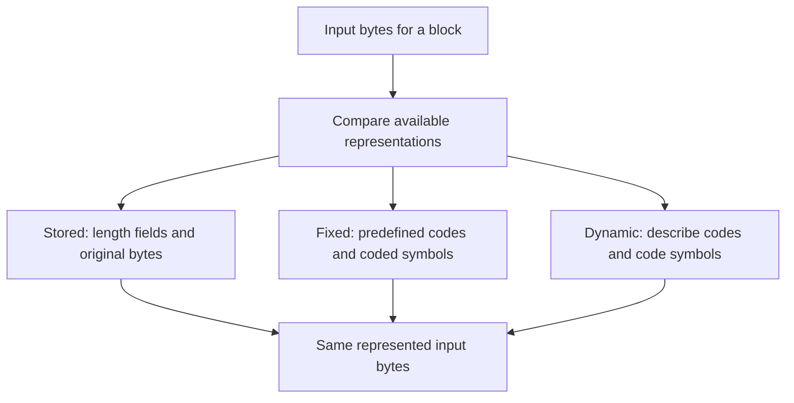
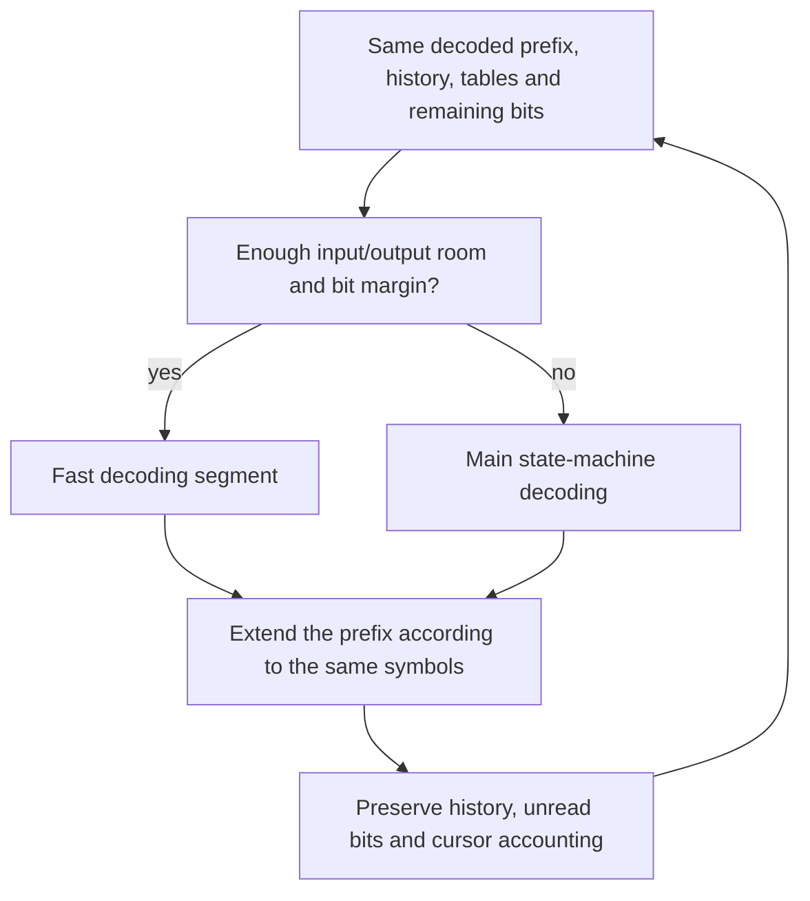

# 2. Repetition, codes and blocks

[Previous: 1. A complete task](round-trip.md) · [Overview](../overview.md) · [Next: 3. Streaming](streaming.md)

`ABABABAB` suggests an instruction: write `AB`, then repeat the bytes two positions back.
This chapter follows that instruction into a compressed block: matches, the history they read,
Huffman codes and the three block forms. It explains what zlib does. It proves nothing.

Two markers say how a sentence relates to the proofs:

- **Safety:** an obligation that the registered safety theorems cover: no undefined behaviour,
  no memory error, no leak, and termination ([safety](../spec/safety.md)).
- **Functional:** a property of the bytes or of the format. It is not required for the safety
  results.

A sentence marked **to confirm** says that a C function implements a rule of the format; this
chapter cites no theorem for that reading. The
[table at the end](#what-the-safety-theorems-say-about-this-chapter) names the safety goals.

## Contents

- [2.1 Turn repeated bytes into a match](#21-turn-repeated-bytes-into-a-match)
  - [2.1.1 A copy can read bytes it just produced](#211-a-copy-can-read-bytes-it-just-produced)
  - [2.1.2 The compressor must justify its choice](#212-the-compressor-must-justify-its-choice)
- [2.2 Keep enough recent history](#22-keep-enough-recent-history)
- [2.3 Give frequent symbols shorter codes](#23-give-frequent-symbols-shorter-codes)
  - [2.3.1 Read a small code tree](#231-read-a-small-code-tree)
  - [2.3.2 Connect the tree to real decoding tables](#232-connect-the-tree-to-real-decoding-tables)
- [2.4 Choose a block representation](#24-choose-a-block-representation)
- [2.5 Share meaning between slow and fast decoding](#25-share-meaning-between-slow-and-fast-decoding)
- [What the safety theorems say about this chapter](#what-the-safety-theorems-say-about-this-chapter)

## 2.1 Turn repeated bytes into a match

One valid description is:

```text
literal A, literal B, match(length = 6, distance = 2)
```

A **literal** appends one byte. A **match** copies `length` bytes, each read `distance` bytes
behind the current end of the output. These tokens are not yet Huffman codewords or the complete
wire format, and they do not predict what a particular compressor chooses.

### 2.1.1 A copy can read bytes it just produced


*Blue cells were written by this match. Orange outlines mark sources; blue
outlines mark destinations. Zero-based indices and arrows show sequential
byte-copy order, not a bulk memory copy.*

Source 0 supplies destination 2. On the third step, source 2 supplies destination 4: it uses a
byte that the first step wrote. A copy from a snapshot of the original `AB` cannot express this
operation.

After `k` steps, the first `2 + k` bytes are the corresponding prefix of the output, the next
source index is `2 + k - 2`, and `6 - k` bytes remain. The source is always before the
destination, even when the two ranges overlap. This invariant serves both kinds of statement.
**Safety:** every read is of a byte already written, and every write is inside the output room.
**Functional:** the bytes written are the ones the match denotes.

The `MATCH` mode of `inflate` and the function `inflate_fast` copy byte by byte in this order.
**Functional, to confirm:** their pointer updates implement the rule `F-match-copy` of the
[format specification](../spec/format/README.md#literals-matches-and-history).
The [fast-decoder page](../proof/inffast.md#match-copies-f3-and-f4) treats overlapping copies
in memory.

### 2.1.2 The compressor must justify its choice

At input position 2, the bytes `ABABAB` match the bytes two positions back. A compressor may
emit that match or any other valid description. In zlib, hash chains give `longest_match` its
candidates, and the strategy loops choose the tokens.

A matching hash is only a hint: the bytes at a candidate may differ.
**Safety:** every candidate read stays inside the window, and the walk along a hash chain ends.
**Functional:** the distance and length of an emitted match describe bytes that really are equal.
Neither statement says that zlib finds the longest possible match; see the
[compressor page](../proof/deflate.md).

## 2.2 Keep enough recent history

DEFLATE distances reach 32,768 bytes. A 32 KiB window therefore keeps a recent suffix of the
output instead of all of it.


*Top: saved history after earlier output was delivered, before any current-call
output. Bottom: a separate malformed-input example without a preset dictionary.*

After 40,000 bytes, the oldest index kept is `40000 - 32768 = 7232`. Distance 32,768 reaches it;
distance 1 reaches the newest byte. The window is a ring in memory.
**Functional:** its slots denote that logical suffix through every wrap and slide.

With only `AB` available, distance 3 asks for a byte that does not exist.
**Safety:** the default decoder rejects this distance without reading outside the history.
Malformed input is thus covered by the safety theorems, not excluded by a premise that the data
is valid.

A real match can read the saved history, the output of the current call, or both. The window
size alone does not justify those reads: the number of valid bytes in the window matters too.
Smaller windows and the optional strict-distance check change which distances are accepted, and
the way the buffers are split can matter. The exact conditions are in the
[history specification](../spec/format/README.md#literals-matches-and-history) and the
[decoder invariant](../proof/inflate.md).

## 2.3 Give frequent symbols shorter codes

Huffman coding represents symbols with bit strings called **codewords**.
Shorter codewords for frequent symbols can reduce the total bit count.
Encoder and decoder must use the same code.

### 2.3.1 Read a small code tree

Use a **toy four-symbol alphabet** with frequencies `A:4, B:2, C:1, D:1`.
Repeatedly combine the two least frequent nodes. This illustrates Huffman
coding, not DEFLATE's fixed table, complete alphabet or a complete block.


*Symbol labels give frequencies. Follow 0 left and 1 right; a leaf ends a codeword.*

`ABAD` becomes `0 | 10 | 0 | 111`, or `0100111`. Decoding repeatedly starts
at the root: `0` reaches A, `10` B, then `0` A and `111` D. No leaf is another's
ancestor, so no complete codeword begins another. This **prefix-free** property
makes symbol boundaries unambiguous.

For all eight symbols, the payload cost is
`4×1 + 2×2 + 1×3 + 1×3 = 14` bits, versus 16 for two bits per symbol.
This excludes the cost of describing the code: saving two payload bits alone does not
make a dynamic block smaller.

### 2.3.2 Connect the tree to real decoding tables

DEFLATE has two alphabets: literal/length and distance. A literal/length symbol denotes a byte,
the end of the block, or a length. Some lengths and distances need extra bits.
A match of length 12 uses symbol 265: base 11 plus the extra value 1. Distance 2 uses
symbol 1 with no extra bits. Their codewords depend on the code of the block.

A dynamic block transmits code lengths. Canonical assignment derives the codewords from the
lengths and the symbol order. `inflate_table` builds lookup tables, so decoding does not walk a
tree for each symbol.

**Safety:** `inflate_table` writes only inside the table storage, and each later lookup reads an
entry that was written. **Functional:** the lengths describe a code the format admits, an
invalid set is rejected, and each entry returns the prescribed symbol, extra-bit count or error.
Bounded access alone does not establish that meaning; see [table construction](../proof/inftrees.md).

The toy bit strings show codeword order only. Real packing gives numeric fields
and Huffman codewords different bit-order rules, defined by the
[bit-order specification](../spec/format/README.md#bits-and-blocks).

## 2.4 Choose a block representation

A stored block carries bytes directly. A fixed block uses predefined codes. A dynamic block
describes its codes first. One DEFLATE stream can mix all three.



*Representation choices, not statement-by-statement C control flow. Costs
include headers, extra bits and alignment.*

A short block may not repay the cost of a dynamic description, and poorly compressible data may
favour the stored form. In `trees.c`, `_tr_flush_block` compares the costs and selects the form.
**Functional:** every choice represents the same input bytes.
**Safety:** every form is written inside the compressor's pending-output buffer. See [tree construction and emission](../proof/trees.md).

A dynamic header needs a second level of codes:


*The code-length code describes payload codes, not original bytes directly.*

Suppose two slots of the length array remain, and the header asks to repeat zero three times.
The header is invalid. **Safety:** the decoder rejects it without writing past the array, so
here a rule of the format is also a memory bound.
The [dynamic-block specification](../spec/format/README.md#dynamic-codes)
defines the exact counts and repeat rules.

## 2.5 Share meaning between slow and fast decoding

`inflate` decodes in its own state machine, or calls `inflate_fast` when the available input,
the output room and the number of buffered bits allow it. Both paths occur under the default
parameters; small buffers do not select a different format.



*An intended shared invariant. Actual paths can suspend, reach block boundaries,
finish or fail.*

**Safety:** the entry margins that `inflate_fast` relies on follow from the test `inflate` makes
before the call; they are not assumed. The result used afterwards is about the pointers, bits
and output that `inflate_fast` actually returns. **Functional:** both paths extend the decoded
prefix by the same symbols. The [main-decoder](../proof/inflate.md) and
[fast-decoder](../proof/inffast.md) pages develop this connection.

## What the safety theorems say about this chapter

The mechanisms of this chapter are internal: `longest_match`, `_tr_flush_block`, `inflate_table`
and `inflate_fast` are not public functions. Their safety is part of the safety of the public
calls that reach them.

Each goal below is registered: a theorem of exactly its type is listed in
`tests/audit/theorems.txt`, and the goal in `tests/audit/proved-goals.txt`. The full name of a
goal is `ZlibF.Spec.Public.Goal.<name>`. [Safety](../spec/safety.md) says what the goals state,
[deviations](../deviations.md) lists every premise narrower than `zlib.h`, and
[progress](../progress.md#scope) names the commit on which the acceptance suite is green.

| Function | Safety goal | Contract and internal argument |
| --- | --- | --- |
| `deflate` (match search, block choice and emission) | `Goal.deflate_safety` | [deflate](../spec/api/deflate-stream.md#deflate); [compressor](../proof/deflate.md), [trees](../proof/trees.md) |
| `inflate` (match copies, table construction, fast path) | `Goal.inflate_safety` | [inflate](../spec/api/inflate-stream.md#inflate); [decoder](../proof/inflate.md), [tables](../proof/inftrees.md), [fast decoder](../proof/inffast.md) |

[Streaming](streaming.md) next follows what must survive a pause.
