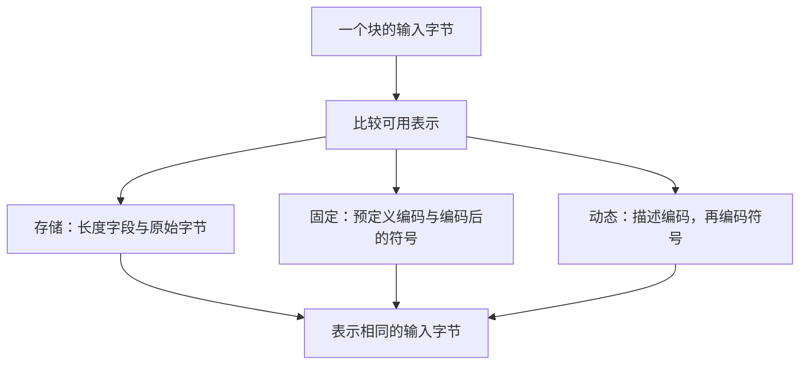
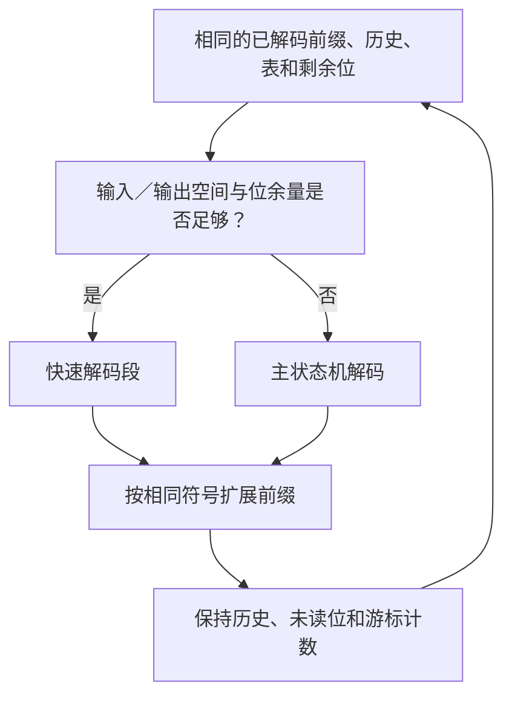

<!-- source-sha256: c5c73bc884bf635276c6eb5bf0f65f1a859043435ff3e0fce6552a82f08cf082 -->

# 2. 重复、编码与数据块

[上一章：1. 一次完整任务](round-trip.md) · [总览](../overview.md) · [下一章：3. 流式处理](streaming.md)

`ABABABAB` 提示了一条指令：先写出 `AB`，再重复当前位置前两个字节。
本章沿着这条指令进入压缩块：匹配、匹配读取的历史、Huffman 编码和三种块形式。
本章解释 zlib 做了什么，不证明任何结论。

两个标记说明一句话与证明的关系：

- **安全：** 已登记的安全定理所覆盖的义务：没有未定义行为、没有内存错误、没有泄漏，并且终止（见[安全性](../spec/safety.md)）。
- **功能：** 关于字节或格式的性质。安全结论不要求它。

标有**尚未由证明确认**的句子说的是某个 C 函数实现了格式的某条规则；本章没有为这种读法引用定理。
[章末的表](#what-the-safety-theorems-say-about-this-chapter)列出相关的安全目标。

## 目录

- [2.1 将重复字节表示为匹配](#21-turn-repeated-bytes-into-a-match)
  - [2.1.1 复制可以读取刚刚产生的字节](#211-a-copy-can-read-bytes-it-just-produced)
  - [2.1.2 压缩器必须证明所选匹配有效](#212-the-compressor-must-justify-its-choice)
- [2.2 保留足够的近期历史](#22-keep-enough-recent-history)
- [2.3 为高频符号分配较短编码](#23-give-frequent-symbols-shorter-codes)
  - [2.3.1 阅读一棵小编码树](#231-read-a-small-code-tree)
  - [2.3.2 将树连接到实际解码表](#232-connect-the-tree-to-real-decoding-tables)
- [2.4 选择块的表示方式](#24-choose-a-block-representation)
- [2.5 让慢速与快速解码共享含义](#25-share-meaning-between-slow-and-fast-decoding)
- [安全定理对本章说了什么](#what-the-safety-theorems-say-about-this-chapter)

## 2.1 将重复字节表示为匹配

一种有效的描述是：

```text
写出字面量 A，写出字面量 B，匹配复制（长度 = 6 字节，回退距离 = 2 字节）
```

**字面量**追加一个字节。**匹配**复制“长度”个字节，每个字节都从当前输出末尾之前“距离”个字节处读取。
这些记号还不是 Huffman 码字，也不是完整的实际字节格式，更不预测某个压缩器会如何选择。

### 2.1.1 复制可以读取刚刚产生的字节


*蓝色单元格表示本次匹配写入的字节。橙框标出读取源，蓝框标出写入目的。
下标从零开始，箭头表示逐字节复制顺序，而非一次批量内存复制。*

源下标 0 提供目的下标 2 的字节。第三步中，源下标 2 提供目的下标 4 的字节：
它用的是第一步刚写入的字节。对最初的 `AB` 拍一份快照再复制，无法表达这个操作。

执行 `k` 步后，前 `2 + k` 个字节是相应的输出前缀，下一个源下标为 `2 + k - 2`，还剩 `6 - k` 个字节。
即使两个区间重叠，源位置也始终在目的位置之前。这个不变量同时服务于两类命题。
**安全：** 每次读取的都是已经写入的字节，每次写入都在输出空间之内。
**功能：** 写入的字节正是这个匹配所表示的字节。

`inflate` 的 `MATCH` 模式和函数 `inflate_fast` 都按这个顺序逐字节复制。
**功能，尚未由证明确认：** 它们的指针更新实现了[格式规格](../spec/format/README.md#literals-matches-and-history)中的规则 `F-match-copy`。
[快速解码器一页](../proof/inffast.md#match-copies-f3-and-f4)讨论内存中的重叠复制。

### 2.1.2 压缩器必须证明所选匹配有效

在输入位置 2，字节 `ABABAB` 与两个位置之前的字节相同。
压缩器可以输出这个匹配，也可以输出其他任何有效描述。
在 zlib 中，哈希链为 `longest_match` 提供候选位置，策略循环再选择要输出的记号。

哈希相同只是线索：候选位置上的字节可能不同。
**安全：** 每次读取候选都在窗口之内，沿哈希链的遍历会结束。
**功能：** 所输出匹配的距离和长度描述的确实是相等的字节。
这两条都没有说 zlib 会找到最长的匹配；见[压缩器一页](../proof/deflate.md)。

## 2.2 保留足够的近期历史

DEFLATE 的距离最多为 32,768 字节。因此 32 KiB 的窗口只保留输出的近期后缀，而不是全部输出。


*上图：此前输出已经交付，当前调用尚未产生新输出时的历史。
下图：另一个不使用预置字典的格式错误输入例子。*

输出 40,000 字节后，保留的最早下标为 `40000 - 32768 = 7232`。
距离 32,768 指向该字节，距离 1 指向最新字节。窗口在内存中是一个环。
**功能：** 无论怎样回绕和滑动，窗口的槽位表示的都是这个逻辑后缀。

如果历史只有 `AB`，距离 3 请求的是一个不存在的字节。
**安全：** 默认的解码器拒绝这个距离，不会读到历史之外。
因此，格式错误的输入由安全定理覆盖，而不是靠“数据有效”这一前提排除。

实际的匹配可以读取保存的历史、当前调用产生的输出，或两者兼有。
仅凭窗口大小不能说明这些读取有效：窗口中有效字节的数量同样重要。
较小的窗口和可选的严格距离检查会改变哪些距离被接受，缓冲区的切分方式也可能有影响。
精确条件见[历史规格](../spec/format/README.md#literals-matches-and-history)与
[解码器不变量](../proof/inflate.md)。

## 2.3 为高频符号分配较短编码

Huffman 编码用称为**码字**的位串表示符号。
为高频符号分配较短码字，可以减少总位数。
编码器与解码器必须使用同一套编码。

### 2.3.1 阅读一棵小编码树

取一个**四符号教学字母表**，频率为 `A:4, B:2, C:1, D:1`。
反复合并频率最低的两个节点。
这用于解释 Huffman 编码，并非 DEFLATE 的固定编码表、完整字母表或完整数据块。


*符号旁的数字为频率。沿 0 向左、1 向右走，到叶节点就完成一个码字。*

`ABAD` 变为 `0 | 10 | 0 | 111`，即 `0100111`。
解码每个符号都从树根开始：`0` 到达 A，`10` 到达 B，随后 `0` 到达 A，`111` 到达 D。
没有叶节点是另一个叶节点的祖先，因此任何完整码字都不是另一码字的开头。
这个**前缀无关**性质确定了符号边界。

全部八个符号的有效载荷成本为
`4×1 + 2×2 + 1×3 + 1×3 = 14` 位；每个符号使用两位则需要 16 位。
这里没有计入描述编码本身的成本：仅节省两个有效载荷位，不能说明动态块整体更小。

### 2.3.2 将树连接到实际解码表

DEFLATE 有两个字母表：字面量／长度字母表和距离字母表。
一个字面量／长度符号表示一个字节、块结束或一个长度。某些长度和距离还需要额外位。
长度为 12 的匹配使用符号 265：基值 11 加额外值 1。
距离 2 使用符号 1，没有额外位。
它们的码字取决于该块的编码。

动态块传递码长。规范分配规则根据码长和符号顺序推出码字。
`inflate_table` 构造查找表，因此解码不必为每个符号沿树查找。

**安全：** `inflate_table` 只写入表的存储，之后每次查表读取的都是已经写入的表项。
**功能：** 码长描述的是格式允许的编码，无效的码长组合被拒绝，每个表项返回规定的符号、额外位数或错误。
访问有界并不能建立这层含义；详见[表构造](../proof/inftrees.md)。

教学位串只展示码字顺序。
实际打包时，数值字段与 Huffman 码字有不同的位序规则，见
[位序规格](../spec/format/README.md#bits-and-blocks)。

## 2.4 选择块的表示方式

存储块直接携带字节。固定块使用预定义的编码。动态块先描述自己的编码。
同一条 DEFLATE 流可以混合这三种块。



*图中表示编码选择，不是逐语句的 C 控制流。
成本包括头部、额外位和对齐。*

较短的块可能抵不上动态描述的成本，不易压缩的数据可能更适合存储形式。
在 `trees.c` 中，`_tr_flush_block` 比较各种成本并选择形式。
**功能：** 每一种选择表示的都是相同的输入字节。
**安全：** 每一种形式都写在压缩器的待输出缓冲区之内。
详见[树构造与输出](../proof/trees.md)。

动态头部需要再增加一层编码：


*码长编码描述有效载荷所用编码，并不直接编码原始字节。*

假设码长数组只剩两个位置，而头部要求把零重复三次。这个头部无效。
**安全：** 解码器拒绝它，不会写到数组之外；在这里，格式的一条规则同时也是一条内存边界。
[动态块规格](../spec/format/README.md#dynamic-codes)定义精确的计数和重复规则。

## 2.5 让慢速与快速解码共享含义

`inflate` 在自己的状态机中解码；当可用输入、输出空间和已缓冲的位数允许时，它调用 `inflate_fast`。
默认参数下两条路径都会出现；较小的缓冲区不会选出另一种格式。



*图中表示预期共享的不变量。实际路径也可能暂停、到达块边界、完成或失败。*

**安全：** `inflate_fast` 依赖的入口余量由 `inflate` 在调用之前所做的判断推出，而不是假设。
之后使用的结论，说的是 `inflate_fast` 实际返回的指针、位和输出。
**功能：** 两条路径按相同的符号扩展已解码前缀。
[主解码器](../proof/inflate.md)与[快速解码器](../proof/inffast.md)两页展开这条联系。

## 安全定理对本章说了什么

本章的机制都在库内部：`longest_match`、`_tr_flush_block`、`inflate_table` 和 `inflate_fast` 不是公开函数。
它们的安全性是到达它们的公开调用的安全性的一部分。

下表中的每个目标都已登记：`tests/audit/theorems.txt` 列有一个类型恰好是该目标的定理，
`tests/audit/proved-goals.txt` 列有该目标。目标的全名是 `ZlibF.Spec.Public.Goal.<name>`。
[安全性](../spec/safety.md)说明这些目标陈述什么，[偏离记录](../deviations.md)列出每个比 `zlib.h` 更窄的前提，
[进度页](../progress.md#scope)给出验收套件全部通过的提交。

| 函数 | 安全目标 | 契约与内部论证 |
| --- | --- | --- |
| `deflate`（匹配搜索、块的选择与输出） | `Goal.deflate_safety` | [deflate](../spec/api/deflate-stream.md#deflate)；[压缩器](../proof/deflate.md)、[树](../proof/trees.md) |
| `inflate`（匹配复制、表构造、快速路径） | `Goal.inflate_safety` | [inflate](../spec/api/inflate-stream.md#inflate)；[解码器](../proof/inflate.md)、[表](../proof/inftrees.md)、[快速解码器](../proof/inffast.md) |

下一章[流式处理](streaming.md)跟踪暂停时必须保留的内容。
