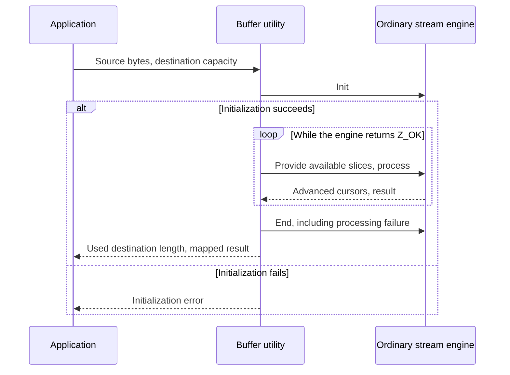
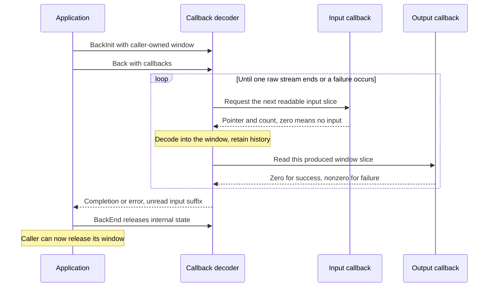
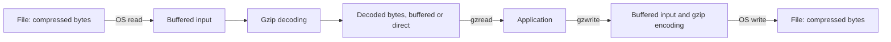
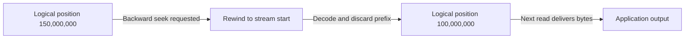

# 6. Application interfaces

[Previous: 5. State operations](state-operations.md) · [Overview](../overview.md) · Next: none

Decoding eight bytes held in memory, copying a large archive to a destination, and reading a
line near the end of a gzip file all rest on the same meaning of the bytes. They use different
interfaces: whole buffers, callbacks and file handles. This chapter shows what each interface
adds to the stream calls of the earlier chapters. It explains what zlib does. It proves nothing.

Two markers say how a sentence relates to the proofs:

- **Safety:** an obligation that the registered safety theorems cover: no undefined behaviour,
  no memory error, no leak, and termination ([safety](../spec/safety.md)).
- **Functional:** a property of the bytes or of the format. It is not required for the safety
  results.

The [table at the end](#what-the-safety-theorems-say-about-this-chapter) names the safety goal
of each function used here. The [shared argument](../overview.md#argument) applies to every
interface.

## Contents

- [6.1 One buffer operation contains a stream lifetime](#61-one-buffer-operation-contains-a-stream-lifetime)
- [6.2 Callbacks let the decoder request input](#62-callbacks-let-the-decoder-request-input)
- [6.3 A gzip handle connects the codec to a file](#63-a-gzip-handle-connects-the-codec-to-a-file)
- [6.4 Seeking names a position in the original data](#64-seeking-names-a-position-in-the-original-data)
- [6.5 Independent checksum operations](#65-independent-checksum-operations)
- [What the safety theorems say about this chapter](#what-the-safety-theorems-say-about-this-chapter)

## 6.1 One buffer operation contains a stream lifetime

`compress` takes a complete source and the capacity of a destination. Inside, it creates an
ordinary compressor, runs it and ends it. `uncompress` does the same with an ordinary decoder.
Both use the zlib format; they cannot select gzip or raw DEFLATE.

A length wider than the stream's 32-bit `avail_in` and `avail_out` fields is passed in slices.
The [streaming discipline](streaming.md) is hidden from the application, but it is still there.
**Safety:** the utility reads only the source range and writes only the destination range and
the length cell, and it ends the internal stream on every path, so no block stays live. The
goals assume, among other premises, that the source and the destination do not overlap; the
complete premises are in
[deviations](../deviations.md#whole-buffer-utilities-and-checksums).

**Eight-byte example.** For `ABABABAB`, let the compressor produce `m` bytes. Headers, trailers
and block descriptions can make `m` larger than eight. The default formula gives
`compressBound(8) = 21`. **Functional:** `m` never exceeds the bound; this is a statement about
the size of the actual output. The compressed bytes and `m` can vary across configurations.

Decompression needs a separate bound on the original size: the compressed length alone does not
give the capacity of the destination. Take a valid stream that represents eight bytes and a
destination of four bytes. **Safety:** `uncompress` writes only within those four bytes, also
when it fails with `Z_BUF_ERROR`. The four bytes may already have changed by then.

The utilities map the engine's `Z_STREAM_END` to `Z_OK`. `uncompress2` also reports how much
input it consumed. It returns `Z_DATA_ERROR` when the stream asks for a dictionary, and when
the input ends before the stream does. The [contracts](../spec/api/utility.md) state the exact
results and what the length cells must point to; the [buffer page](../proof/buffers.md) covers
the local stream, the conversions and the bounds.

## 6.2 Callbacks let the decoder request input

With `inflateBack`, the decoder itself calls an input function and an output function during
one call. It is a separate raw-DEFLATE implementation in `infback.c`, not a wrapper around
`inflate`.

The diagram assumes a successful init and shows one possible cycle; the decoder does not make
one input call per output call. Input passed in `next_in` and `avail_in` is used before the
first input callback. An output chunk is at most one window long; the last chunk may be shorter.
The window is also the history, so a callback must not overwrite or free it. The output function
reads or copies each slice before it returns; the decoder may reuse the slice afterwards.

**Copying to a destination.** The input callback supplies chunks of the archive. The output
callback copies each decoded slice to the application's storage.
**Safety:** the decoder reads only the chunk the input callback last handed out, and writes only
inside the window. This rests on premises about the callbacks, because a function-pointer type
guarantees nothing. The main ones: each callback returns, changes only the caller's own storage,
and hands out a readable chunk apart from the window; and one `inflateBack` call is offered fewer
than `2^48` input bytes in all. These are not all of them. The goal also assumes that the window
and every input chunk lie in heap byte blocks, that the input already in `next_in` is apart from
the window, and that every byte object has fewer than `2^63` bytes. The complete premises are in
[deviations](../deviations.md#callback-decoder).

`inflateBack` returns `Z_BUF_ERROR` when the input callback supplies nothing or the output
callback reports a failure. It returns `Z_DATA_ERROR` for malformed data, possibly after some
output. A failure of the last output call does not replace a format error that was found
before it. `inflateBackEnd` releases the state. Each `inflateBack` call decodes one complete raw
stream from its start; a call does not resume an earlier one.

The [callback contracts](../spec/api/inflate-back.md) state this domain, and the
[callback page](../proof/callbacks.md) connects the calls to the ownership of the window.
An enclosing [zlib or gzip wrapper](wrappers.md) is the application's task.

## 6.3 A gzip handle connects the codec to a file

`gzopen` creates a handle, `gzread` and `gzwrite` transfer the application's bytes, and
`gzclose` releases the handle. The buffers and the codec are allocated at the first transfer,
not at open: a successful open does not mean that later allocation or I/O succeeds. These calls
depend on the operating system, which the project describes by explicit
[external-world semantics](../design/external-io.md).

A handle either reads or writes. Buffering separates the arrows in time: `gzwrite` can accept
bytes before anything is written to the file, and the write can fail later, in a flush or in
`gzclose`. **Functional:** bytes accepted, bytes encoded and bytes written successfully are
three different quantities.

`gzread` handles concatenated gzip members itself; plain `inflate` completes one member and
leaves the next to its caller. When the file does not start with a gzip header, `gzread`
returns its bytes unchanged. **Safety:** both paths, decoding and plain copying, are covered.

**Members containing `AB` and `CD`.** Repeated reads deliver `ABCD`, wherever the buffer
boundaries fall. Data may be returned before a later error is found. End of file, truncation,
corruption and an OS failure give different [API results](../spec/api/gz-file.md).
**Safety:** every call on a handle is safe after any history of calls, including a failed first
allocation, partial I/O and a close after an error; `gzclose` frees the handle's storage also
when its last write fails. The goal has premises. One of them is that the descriptor can deliver
fewer than `2^61` further bytes: the reading calls terminate on it. The complete premises are in
[deviations](../deviations.md#gzip-file-interface). See the
[gzip page](../proof/gzip.md).

## 6.4 Seeking names a position in the original data

`gzseek(file, 100000000, SEEK_SET)` names byte 100,000,000 of the **uncompressed** data.
`gztell` returns the uncompressed position of the next transfer. `gzoffset` returns the offset
in the compressed file; when reading, it subtracts the input that is buffered but not yet used.
There is no fixed conversion between the two positions.

**Reading.** To seek backward from uncompressed byte 150,000,000 to 100,000,000, the library
rewinds the file, then decodes and discards the first 100,000,000 bytes. Part of this work
waits until the next read. Positioning can therefore be much slower than a seek in a plain file.

A forward seek uses up decoded bytes that are already buffered, or records a number of bytes to
skip later. When the input is not gzip, the library seeks in the file directly.
`SEEK_END` is not supported.
**Functional:** the position already processed plus the pending skip equals the position the
application observes. **Safety:** the offset arithmetic does not overflow the signed offset
type. This holds for the patched source; the pinned source can overflow
([findings](../findings.md)).

**Writing.** Write `ABC`, seek to uncompressed offset 6, then write `D`: the three bytes in
between are zeros, compressed as data.

The colours distinguish existing bytes, zeros and new input; they do not show proof coverage.
A writer cannot seek backward to patch `A`. The zeros are written at the next write or at
close, so the pending distance is kept across calls and across a later I/O failure. See
[seek](../spec/api/gz-file.md#gzseek64), [position queries](../spec/api/gz-file.md#gztell64)
and the [position argument](../proof/gzip.md#positions-seeking-and-error-ownership).
[Decoder checkpoints](state-operations.md) are a separate mechanism.

## 6.5 Independent checksum operations

`adler32` and `crc32` update a small running value over slices of bytes. They need no codec and
no file handle. `adler32_combine` and `crc32_combine` take the checksums of two separately
processed parts `X` and `Y` and the length of `Y`, and return the checksum of `X` followed by
`Y`. The length matters: combining checksums is not ordinary addition.

**Functional:** the combined value equals the checksum of the concatenation.
**Safety:** an update reads only its byte range, a combine call writes no memory, and the
integer arithmetic of both has no undefined behaviour. See the
[contracts](../spec/api/checksums.md), [Adler-32](../proof/adler32.md) and
[CRC-32](../proof/crc32.md). The use of checksums in wrappers is in [chapter 4](wrappers.md).

## What the safety theorems say about this chapter

Each goal below is registered: a theorem of exactly its type is listed in
`tests/audit/theorems.txt`, and the goal in `tests/audit/proved-goals.txt`. The full name of a
goal is `ZlibF.Spec.Public.Goal.<name>`. [Safety](../spec/safety.md) says what the goals state,
[deviations](../deviations.md) lists every premise narrower than `zlib.h`, and
[progress](../progress.md#scope) names the commit on which the acceptance suite is green.

| Function | Safety goal | Contract |
| --- | --- | --- |
| `compress`, `compress2`, `compress_z`, `compress2_z` | `Goal.compress_safety`, `Goal.compress2_safety`, `Goal.compress_z_safety`, `Goal.compress2_z_safety` | [compress](../spec/api/utility.md#compress) |
| `uncompress`, `uncompress2`, `uncompress_z`, `uncompress2_z` | `Goal.uncompress_safe`, `Goal.uncompress2_safe`, `Goal.uncompress_z_safe`, `Goal.uncompress2_z_safe` | [uncompress](../spec/api/utility.md#uncompress) |
| `compressBound`, `compressBound_z` | The full contract `Goal.compressBound`, `Goal.compressBound_z`: a pure function with no heap and no fault. | [compressBound](../spec/api/utility.md#compressbound) |
| `inflateBackInit` (macro for `inflateBackInit_`), `inflateBack`, `inflateBackEnd` | Proved safe through the sequence goal `Goal.inflate_back_sequence_safety`. They have no separate one-function goal yet. | [callback decoder](../spec/api/inflate-back.md#inflateback) |
| `gzopen`, `gzread`, `gzwrite`, `gzseek`, `gztell`, `gzoffset`, `gzclose` and the other documented gz functions of the default build, 31 in all | Proved safe through the sequence goal `Goal.gz_sequence_safety`. They have no separate one-function goal yet. | [gzip files](../spec/api/gz-file.md) |
| `adler32`, `adler32_z` | `Goal.adler32_safety`, `Goal.adler32_z_safety` | [adler32](../spec/api/checksums.md#adler32) |
| `crc32`, `crc32_z` | `Goal.crc32_safety`, `Goal.crc32_z_safety` | [crc32](../spec/api/checksums.md#crc32) |
| `adler32_combine`, `crc32_combine` | `Goal.adler32_combine_safety`, `Goal.crc32_combine_safety` | [adler32_combine](../spec/api/checksums.md#adler32_combine), [crc32_combine](../spec/api/checksums.md#crc32_combine) |

`Goal.gz_sequence_nonvacuity` and `Goal.inflate_back_initialisation_domain` are registered too:
they show that the premises of the two sequence goals can be met.
[Progress](../progress.md) holds the status of every goal.
