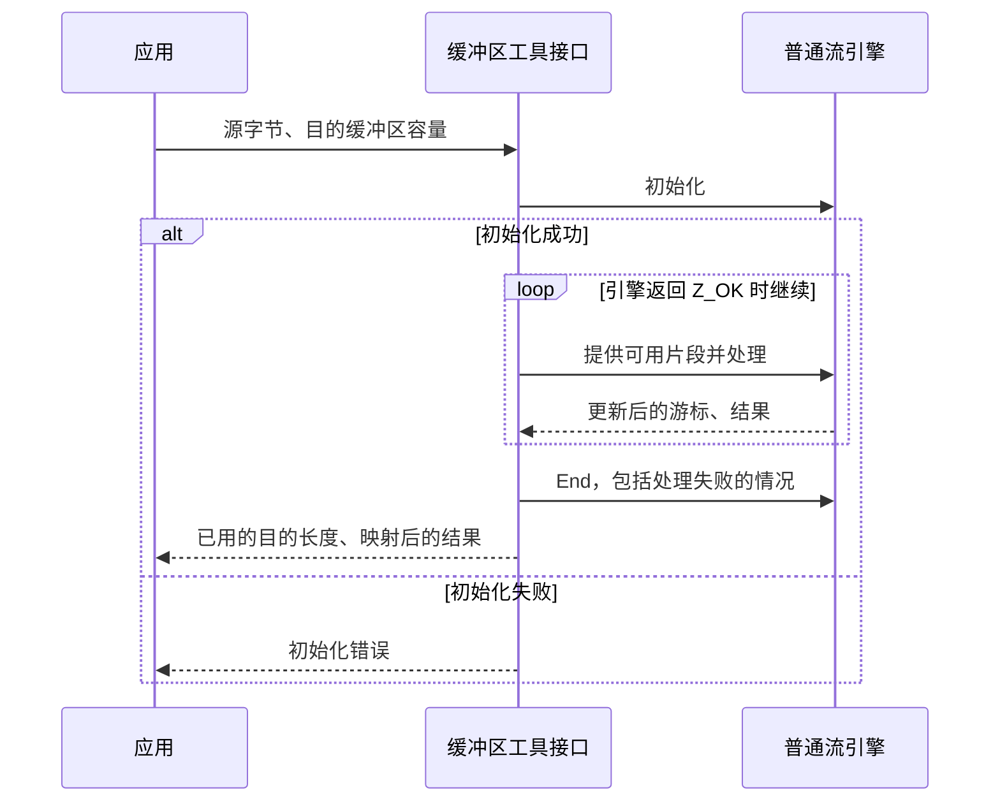
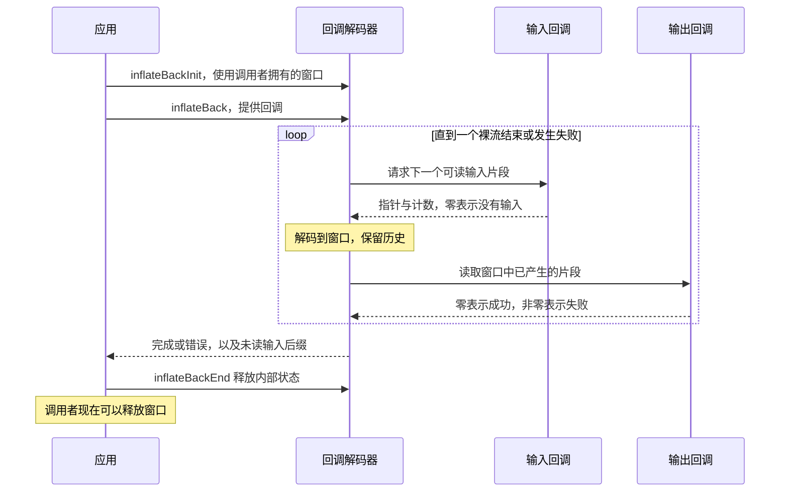

<!-- source-sha256: 046f212efd6cd19a1dce9a68082a0ec31090701621fee4d0670642c4b2fa4cf4 -->

# 6. 应用接口

[上一章：5. 状态操作](state-operations.md) · [总览](../overview.md) · 下一章：无

解码内存中的八个字节，把一个大归档复制到目的地，读取 gzip 文件末尾附近的一行：这三件事依赖同一套字节含义。
它们使用不同的接口：整块缓冲区、回调和文件句柄。本章说明每种接口在前几章的流调用之上增加了什么。
本章解释 zlib 做了什么，不证明任何结论。

两个标记说明一句话与证明的关系：

- **安全：** 安全定理所覆盖的义务：没有未定义行为、没有内存错误、没有泄漏，并且终止（见[安全性](../spec/safety.md)）。
- **功能：** 关于字节或格式的性质。安全结论不要求它。

[章末的表](#what-the-safety-theorems-say-about-this-chapter)列出本章用到的每个函数的安全目标。
[共同的论证](../overview.md#argument)适用于每种接口。

## 目录

- [6.1 一次缓冲区操作包含一段流生命周期](#61-one-buffer-operation-contains-a-stream-lifetime)
- [6.2 回调让解码器主动请求输入](#62-callbacks-let-the-decoder-request-input)
- [6.3 gzip 句柄把编解码器连接到文件](#63-a-gzip-handle-connects-the-codec-to-a-file)
- [6.4 定位使用原始数据中的位置](#64-seeking-names-a-position-in-the-original-data)
- [6.5 独立的校验和操作](#65-independent-checksum-operations)
- [安全定理对本章说了什么](#what-the-safety-theorems-say-about-this-chapter)

## 6.1 一次缓冲区操作包含一段流生命周期

`compress` 接受完整的源数据和目的缓冲区的容量。它在内部创建一个普通压缩器，运行它，再结束它。
`uncompress` 用普通解码器做同样的事。
两者都使用 zlib 格式，不能选择 gzip 或裸 DEFLATE。

如果长度超出流的 32 位字段 `avail_in` 和 `avail_out` 所能表示的范围，就分片传入。
[流式使用规则](streaming.md)对应用是隐藏的，但它仍然存在。
**安全：** 工具函数只读取源范围，只写入目的范围和长度单元，并且在每条路径上都结束内部的流，所以没有块继续存活。这些目标有若干前提，其中一条是源与目的缓冲区不重叠；完整的前提见[偏离记录](../deviations.md#whole-buffer-utilities-and-checksums)。

**八字节示例。** 对 `ABABABAB`，设压缩器产生 `m` 个字节。头部、尾部和块描述可能使 `m` 大于八。
默认公式给出 `compressBound(8) = 21`。
**功能：** `m` 不会超过这个上界；这是关于实际输出大小的命题。
压缩后的字节和 `m` 可能随配置而变。

解压需要另外知道原始大小的上界：仅凭压缩后的长度得不出目的缓冲区的容量。
取一个表示八个字节的有效流和一个四字节的目的缓冲区。
**安全：** `uncompress` 只在这四个字节之内写入，以 `Z_BUF_ERROR` 失败时也是如此。到那时这四个字节可能已经被改写。

工具函数把引擎的 `Z_STREAM_END` 映射为 `Z_OK`。`uncompress2` 还会报告消费了多少输入。
当流请求字典，或者输入先于流结束时，它返回 `Z_DATA_ERROR`。
[契约](../spec/api/utility.md)给出精确的结果，以及长度单元必须指向什么；
[缓冲区一页](../proof/buffers.md)讨论局部的流、类型转换和上界函数。

## 6.2 回调让解码器主动请求输入

使用 `inflateBack` 时，解码器在一次调用期间自己调用输入函数和输出函数。
它是 `infback.c` 中一份独立的裸 DEFLATE 实现，不是 `inflate` 的包装。

图中假定初始化成功，展示一种可能的循环；解码器并不是每调用一次输入就调用一次输出。
通过 `next_in` 和 `avail_in` 传入的输入先于第一次输入回调被使用。
一个输出片段最长为一个窗口；最后一个片段可能更短。
窗口同时也是历史，所以回调不得覆盖或释放它。
输出函数在返回之前读取或复制每个片段；之后解码器可能复用这个片段。

**复制到目的地。** 输入回调提供归档的各个片段。输出回调把每个解码后的片段复制到应用的存储。
**安全：** 解码器只读取输入回调最近一次交出的片段，只在窗口之内写入。
这依赖关于回调的前提，因为函数指针类型什么也不保证。主要的几条是：每个回调都会返回，只改动调用者自己的存储，
交出的片段可读且与窗口分离；并且一次 `inflateBack` 调用得到的输入总量少于 `2^48` 字节。
前提不止这些。目标还假设窗口和每个输入片段都位于堆上的字节块中，已经放在 `next_in` 中的输入与窗口分离，
并且每个字节对象都小于 `2^63` 字节。完整的前提见[偏离记录](../deviations.md#callback-decoder)。

输入回调不提供数据，或者输出回调报告失败时，`inflateBack` 返回 `Z_BUF_ERROR`。
数据格式有误时它返回 `Z_DATA_ERROR`，此前可能已有输出。
最后一次输出调用失败，不会取代在它之前发现的格式错误。`inflateBackEnd` 释放状态。
每次 `inflateBack` 调用从头解码一条完整的裸流；一次调用不会接着上一次继续。

[回调契约](../spec/api/inflate-back.md)说明这个定义域，
[回调一页](../proof/callbacks.md)把这些调用与窗口的所有权联系起来。
外层的 [zlib 或 gzip 封装](wrappers.md)由应用自己处理。

## 6.3 gzip 句柄把编解码器连接到文件

`gzopen` 创建句柄，`gzread` 和 `gzwrite` 传输应用的字节，`gzclose` 释放句柄。
缓冲区和编解码器在第一次传输时才分配，而不是在打开时：打开成功并不意味着之后的分配或 I/O 会成功。
这些调用依赖操作系统，项目用显式的[外部世界语义](../design/external-io.md)描述它。

一个句柄要么读，要么写。缓冲使各个箭头在时间上分开：`gzwrite` 可以先接受字节而尚未向文件写入任何内容，
写入可能在之后的刷新或 `gzclose` 中失败。
**功能：** 已接受的字节、已编码的字节和成功写出的字节是三个不同的量。

`gzread` 自己处理串接的 gzip 成员；普通的 `inflate` 完成一个成员后，把下一个留给调用者。
如果文件不是以 gzip 头开始，`gzread` 原样返回它的字节。
**安全：** 解码和原样复制这两条路径都在覆盖范围内。

**成员分别包含 `AB` 和 `CD`。** 无论缓冲区边界落在哪里，多次读取都交付 `ABCD`。
数据可能已经返回，错误到后面才被发现。
文件结束、数据被截断、数据损坏和操作系统失败有不同的 [API 结果](../spec/api/gz-file.md)。
**安全：** 在任何调用历史之后，对句柄的每次调用都是安全的，包括第一次分配失败、部分 I/O 以及出错之后的关闭；
即使最后一次写入失败，`gzclose` 也释放句柄的存储。
这个目标带有前提。其中一条是该描述符还能交付的字节少于 `2^61`：读取类调用的终止依赖它。完整的前提见[偏离记录](../deviations.md#gzip-file-interface)。
见 [gzip 一页](../proof/gzip.md)。

## 6.4 定位使用原始数据中的位置

`gzseek(file, 100000000, SEEK_SET)` 指的是**未压缩**数据中偏移 100,000,000 处的字节。
`gztell` 返回下一次传输的未压缩位置。`gzoffset` 返回压缩文件中的偏移；
读取时，它会减去已缓冲但尚未使用的输入。
这两种位置之间没有固定的换算关系。

**读取。** 要从未压缩位置 150,000,000 往回定位（朝文件开头）到 100,000,000，库把文件倒回起点，
然后解码并丢弃前 100,000,000 个字节。其中一部分工作要等到下一次读取才做。
因此定位可能比普通文件的定位慢得多。

往前定位（朝文件末尾）会用掉已经缓冲的解码字节，或者记下稍后要跳过的字节数。
输入不是 gzip 时，库直接在文件中定位。不支持 `SEEK_END`。
**功能：** 已处理的位置加上待跳过的量，等于应用观察到的位置。
**安全：** 偏移的算术不会溢出有符号偏移类型。这对打过补丁的源码成立；固定的源码可能溢出（见[发现](../findings.md)）。

**写入。** 写入 `ABC`，定位到未压缩偏移 6，再写入 `D`：中间的三个字节是零，按普通数据压缩。

颜色区分已有字节、零字节和新输入，不表示证明覆盖范围。
写入方不能往回定位去修改 `A`。这些零在下一次写入或关闭时才写出，
所以待补的距离要跨调用保存，之后发生 I/O 失败时也要保存。
见[定位](../spec/api/gz-file.md#gzseek64)、[位置查询](../spec/api/gz-file.md#gztell64)
和[位置论证](../proof/gzip.md#positions-seeking-and-error-ownership)。
[解码器检查点](state-operations.md)是另一种机制。

## 6.5 独立的校验和操作

`adler32` 和 `crc32` 在一段段字节上更新一个很小的累加值。它们不需要编解码器，也不需要文件句柄。
`adler32_combine` 和 `crc32_combine` 接受分别处理的两部分 `X` 和 `Y` 的校验和以及 `Y` 的长度，
返回 `X` 后接 `Y` 的校验和。长度不可缺少：组合校验和不是普通的加法。

**功能：** 组合得到的值等于拼接后数据的校验和。
**安全：** 更新调用只读取它的字节范围，组合调用不写任何内存，两者的整数算术都没有未定义行为。
见[契约](../spec/api/checksums.md)、[Adler-32](../proof/adler32.md) 和
[CRC-32](../proof/crc32.md)。校验和在封装中的用法见[第 4 章](wrappers.md)。

## 安全定理对本章说了什么

下表中的每个目标都有一个类型恰好是该目标的定理，列在 `tests/audit/theorems.txt` 中；
`tests/audit/proved-goals.txt` 列有该目标。目标的全名是 `ZlibF.Spec.Public.Goal.<name>`。
[安全性](../spec/safety.md)说明这些目标陈述什么，[偏离记录](../deviations.md)列出每个比 `zlib.h` 更窄的前提，
[进度页](../progress.md#scope)记录每项结论的层级。

| 函数 | 安全目标 | 契约 |
| --- | --- | --- |
| `compress`、`compress2`、`compress_z`、`compress2_z` | `Goal.compress_safety`、`Goal.compress2_safety`、`Goal.compress_z_safety`、`Goal.compress2_z_safety` | [compress](../spec/api/utility.md#compress) |
| `uncompress`、`uncompress2`、`uncompress_z`、`uncompress2_z` | `Goal.uncompress_safe`、`Goal.uncompress2_safe`、`Goal.uncompress_z_safe`、`Goal.uncompress2_z_safe` | [uncompress](../spec/api/utility.md#uncompress) |
| `compressBound`、`compressBound_z` | 完整契约 `Goal.compressBound`、`Goal.compressBound_z`：纯函数，不涉及堆，不出故障。 | [compressBound](../spec/api/utility.md#compressbound) |
| `inflateBackInit`（`inflateBackInit_` 的宏）、`inflateBack`、`inflateBackEnd` | `Goal.inflateBackInit__safety`、`Goal.inflateBack_safety`、`Goal.inflateBackEnd_safety`。对调用序列：`Goal.inflate_back_sequence_safety`。 | [回调解码器](../spec/api/inflate-back.md#inflateback) |
| `gzopen`、`gzread`、`gzwrite`、`gzseek`、`gztell`、`gzoffset`、`gzclose` 以及默认构建中其余已文档化的 gz 函数，共 31 个 | 各有自己的 `Goal.<function>_safety`，例如 `Goal.gzread_safety`。对一个句柄的各段历史：`Goal.gz_sequence_safety`。 | [gzip 文件](../spec/api/gz-file.md) |
| `adler32`、`adler32_z` | `Goal.adler32_safety`、`Goal.adler32_z_safety` | [adler32](../spec/api/checksums.md#adler32) |
| `crc32`、`crc32_z` | `Goal.crc32_safety`、`Goal.crc32_z_safety` | [crc32](../spec/api/checksums.md#crc32) |
| `adler32_combine`、`crc32_combine` | `Goal.adler32_combine_safety`、`Goal.crc32_combine_safety` | [adler32_combine](../spec/api/checksums.md#adler32_combine)、[crc32_combine](../spec/api/checksums.md#crc32_combine) |

`Goal.gz_sequence_nonvacuity` 和 `Goal.inflate_back_initialisation_domain` 也已证明：
它们表明这两个序列目标的前提可以满足。
[进度页](../progress.md)记录每个目标的状态。
