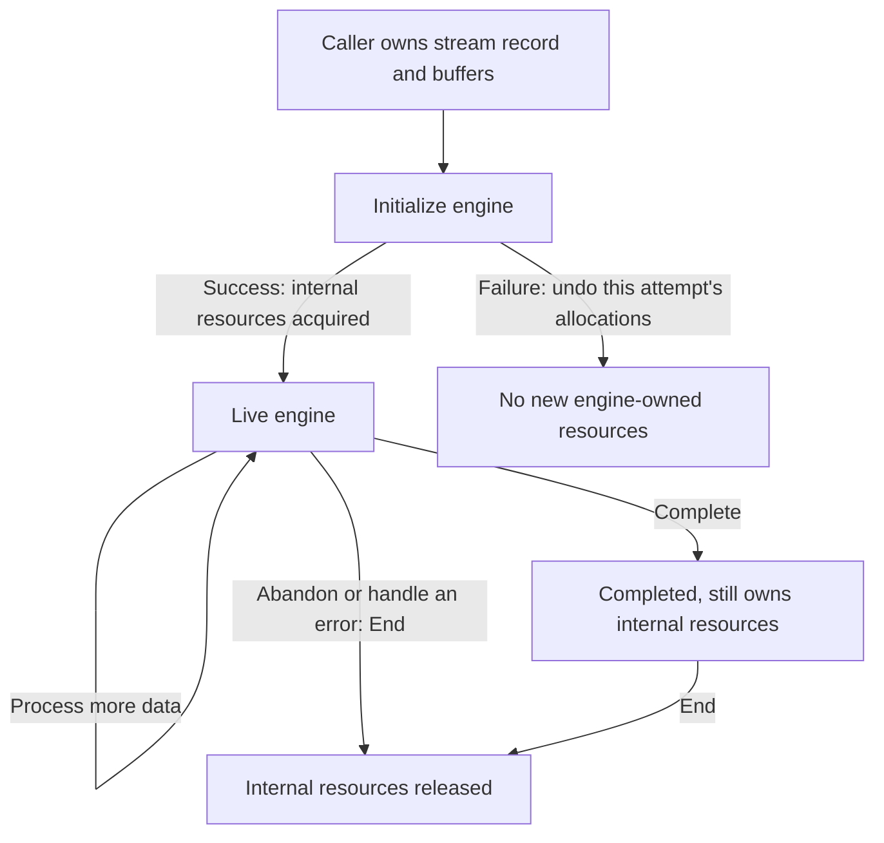
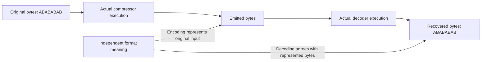

# 1. A complete task

Previous: none · [Overview](../overview.md) · [Next: 2. Repetition, codes and blocks](encoding.md)

An application stores the eight bytes `ABABABAB` and recovers them later. This chapter follows
that task through the caller's bytes, the library's output and the resources used.
It explains what zlib does. It proves nothing.

Two markers say how a sentence relates to the proofs:

- **Safety:** an obligation that the safety theorems cover: no undefined behaviour,
  no memory error, no leak, and termination ([safety](../spec/safety.md)).
- **Functional:** a property of the bytes or of the format. It is not required for the safety
  results.

The [table at the end](#what-the-safety-theorems-say-about-this-chapter) names the safety goal
of each function used here. The [shared proof rules](../overview.md#shared-proof-rules) give the
scope and the method.

## Contents

- [1.1 Follow eight bytes](#11-follow-eight-bytes)
- [1.2 Start, process and release](#12-start-process-and-release)
  - [The successful route](#the-successful-route)
  - [Failure and abandonment](#failure-and-abandonment)
- [1.3 Accepted input and published output](#13-accepted-input-and-published-output)
- [1.4 Too little room or damaged data](#14-too-little-room-or-damaged-data)
- [1.5 Connect both engines to byte meaning](#15-connect-both-engines-to-byte-meaning)
- [What the safety theorems say about this chapter](#what-the-safety-theorems-say-about-this-chapter)

## 1.1 Follow eight bytes

Our hexadecimal bytes are `41 42 41 42 41 42 41 42`. zlib treats them as bytes,
just as it would image data, serialized records or embedded zeros.

The middle row is **one valid zlib-format encoding**, not a promise of identical
output across versions, configurations or call schedules. [Encoding](encoding.md)
and [wrappers](wrappers.md) explain its body, header and trailer.

Twelve bytes represent eight: coding and wrapper overhead can outweigh the savings.
**Safety:** the compressor writes only into the output room it is given, however small.
**Functional:** that a given capacity is enough for the whole encoding is a property of the
output size. Several representations can encode the same input, so a statement of correctness
uses independent [format relations](../spec/format/model.md), not equality to one preferred
compressed string.

This example selects the default zlib wrapper, no preset dictionary and ordinary
validation. Wider domains remain in the [configuration specification](../spec/input-configurations.md).

## 1.2 Start, process and release

### The successful route

Create a compressor with `deflateInit` and `Z_DEFAULT_COMPRESSION`. Provide
buffers, call `deflate`, and request `Z_FINISH` once all input has been supplied.
`Z_STREAM_END` reports completion; `deflateEnd` releases the internal resources.

Separately, create a decoder with `inflateInit`, feed it the encoded bytes,
call `inflate` until completion, and release it with `inflateEnd`.
Initialization prepares state without compressing or decompressing.
Exact call conditions are in the [compression](../spec/api/deflate-stream.md)
and [decompression](../spec/api/inflate-stream.md) contracts.

The engines need not share a program: a producer can write today and an
unrelated consumer decode later. The format is their agreement.

### Failure and abandonment

**Safety:** a failed initialization leaves no allocation of that attempt live. A successful
initialization makes the stream the owner of its internal resources until End (`deflateEnd` or `inflateEnd`).

*Ownership through a task, rather than an exhaustive API transition graph.
The caller retains its record and buffers.*

An application can abandon decoding after an error or because it no longer
needs the data. End releases resources without processing the remainder.
For compression, End also discards pending output. It can report premature
abandonment (`Z_DATA_ERROR`) even though it has freed the internal storage; see the
[end contract](../spec/api/deflate-stream.md#deflateend).

Recovering eight bytes therefore does not establish the lifetime claim.
**Safety:** initialization establishes ownership, every call preserves it, and End frees each
owned allocation exactly once. The [shared argument](../overview.md#argument) explains how
these three steps compose over a call sequence.

## 1.3 Accepted input and published output

A call may accept only `ABA` from the supplied `ABABABAB`. The remaining `BABAB`
must be presented again. Updated input pointers and counts identify accepted
bytes; updated output pointers and counts identify written bytes.

The compressor can retain work internally, so accepted and published byte
counts need not correspond in the same call. [Streaming](streaming.md) follows
the buffer boundaries and saved state.

**Functional:** a correctness argument records the accumulated accepted input and the published
prefix of the encoding. Before completion, that prefix need not be a complete decodable stream;
it is related to the retained state. After finishing, the full encoding describes exactly
`ABABABAB`.

## 1.4 Too little room or damaged data

Give the decoder only seven output slots. The eighth decoded byte waits for more room; it is
never written outside the range. [Streaming](streaming.md) explains continuation.

| Change to the example | What holds |
| --- | --- |
| Seven output bytes of capacity | **Safety:** every write stays within the seven bytes. **Functional:** the decoder does not report completion before the eighth byte is delivered. |
| Only the beginning of the encoding is available | **Safety:** the decoder reads only the bytes supplied. **Functional:** it asks for more input; a missing suffix alone is not malformed data. |
| The last byte changes from `0d` to `0c` | **Functional:** the body still yields `ABABABAB`, and the enabled trailer check rejects the changed value with `Z_DATA_ERROR`. **Safety:** the rejecting call is as safe as an accepting one. |
| An internal allocation fails | **Safety:** the call returns, and the live blocks are exactly those the stream still owns, so End can release them. |

Output can precede a bad-trailer error. [Wrappers](wrappers.md) explains why
published bytes do not certify whole-stream validation.

**Safety:** malformed compressed data is inside the domain of the safety theorems. Invalid
pointers are not: they are caller obligations, and expecting an error return does not make them
safe. See [defined refusals and memory obligations](../spec/safety.md#terms-and-reading-guide).

**Safety:** every single call terminates. The safety theorems do not say that a task completes:
completion needs enough input, enough output room and the required finish requests, and
repeating a request that makes no progress does not supply them.

## 1.5 Connect both engines to byte meaning

**Functional:** this whole section is about functional correctness, which is not required for
the safety results. A round trip is insufficient as the sole correctness statement: two engines
could agree with each other while violating the interoperable format.

The upper route executes the task. The lower connections independently relate
actual translated buffers and executions to byte meaning. A model that assumes
the desired behavior does not establish either connection.

A compressor argument follows accepted input through symbols, bits and published bytes. A
decoder argument follows supplied bits through tables and history copies into output. The
technical details are in the [compressor](../proof/deflate.md) and [decoder](../proof/inflate.md)
pages. In every argument, safety or functional, the premises of a helper function follow from
initialization and the preceding execution; they are not assumed.

For the default zlib stream both connections are proved, and so is the completion of the task:
[the round trip](../proof/roundtrip.md).

The [rules of evidence](../overview.md#evidence) say what counts as a result. Finite example
tests can expose a disagreement; they do not prove a universal claim.

## What the safety theorems say about this chapter

The table names the safety goal of each function used in this chapter. The full name of a
goal is `ZlibF.Spec.Public.Goal.<name>`. [Safety](../spec/safety.md) says what the goals state,
[deviations](../deviations.md) lists every premise narrower than `zlib.h`, and
[progress](../progress.md) says which goals are done.

| Function | Safety goal | Contract |
| --- | --- | --- |
| `deflateInit` (macro for `deflateInit_`) | `Goal.deflateInit__safety` | [deflateInit_](../spec/api/deflate-stream.md#deflateinit_) |
| `deflate` | `Goal.deflate_safety` | [deflate](../spec/api/deflate-stream.md#deflate) |
| `deflateEnd` | `Goal.deflateEnd_safety` | [deflateEnd](../spec/api/deflate-stream.md#deflateend) |
| `inflateInit` (macro for `inflateInit_`) | `Goal.inflateInit__safety` | [inflateInit_](../spec/api/inflate-stream.md#inflateinit_) |
| `inflate` | `Goal.inflate_safety` | [inflate](../spec/api/inflate-stream.md#inflate) |
| `inflateEnd` | `Goal.inflateEnd_safety` | [inflateEnd](../spec/api/inflate-stream.md#inflateend) |
| every sequence of compressor calls | `Goal.deflate_sequence_safety` | [calls and sequences](../spec/safety.md#2-calls-and-sequences) |
| every sequence of decoder calls | `Goal.inflate_sequence_safety` | [calls and sequences](../spec/safety.md#2-calls-and-sequences) |

Continue with [repetition, codes and blocks](encoding.md): the mechanisms inside the encoding,
and the invariants each mechanism needs.
