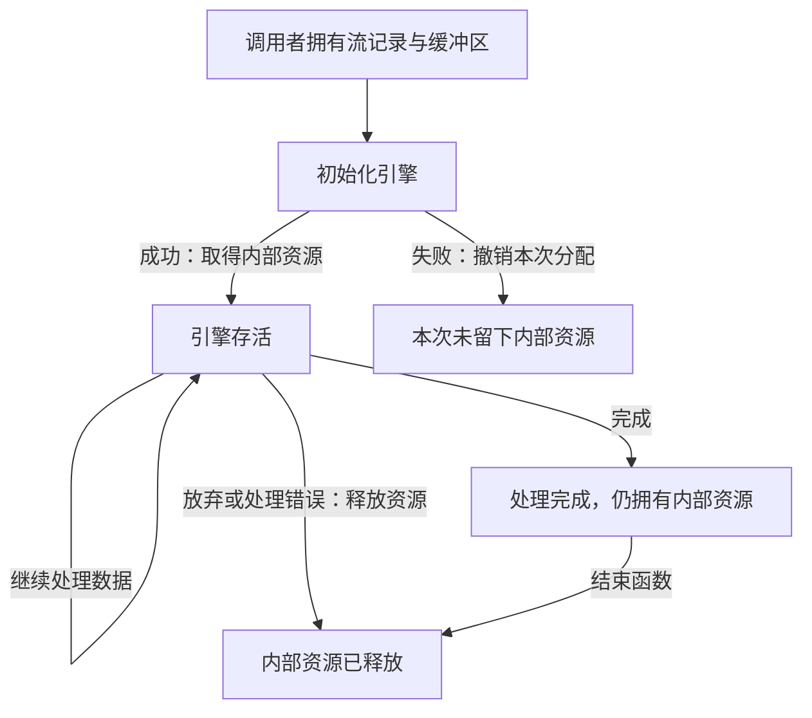
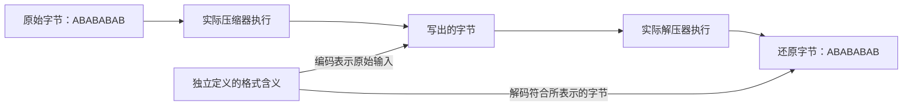

<!-- source-sha256: 18161956579bbe3d4c44866c4f39e62d0ac7344f0c5c5803ea84f64a5228a039 -->

# 1. 一次完整任务

上一章：无 · [总览](../overview.md) · [下一章：2. 重复、编码与数据块](encoding.md)

应用保存八个字节 `ABABABAB`，稍后再还原它们。本章沿着这项任务，依次看调用者的字节、库的输出和所用的资源。
本章解释 zlib 做了什么，不证明任何结论。

两个标记说明一句话与证明的关系：

- **安全：** 已登记的安全定理所覆盖的义务：没有未定义行为、没有内存错误、没有泄漏，并且终止（见[安全性](../spec/safety.md)）。
- **功能：** 关于字节或格式的性质。安全结论不要求它。

[章末的表](#what-the-safety-theorems-say-about-this-chapter)列出本章用到的每个函数的安全目标。
[共同的证明规则](../overview.md#shared-proof-rules)给出范围和方法。

## 目录

- [1.1 跟随八个字节](#11-follow-eight-bytes)
- [1.2 建立、处理与释放](#12-start-process-and-release)
  - [成功路径](#the-successful-route)
  - [失败与放弃任务](#failure-and-abandonment)
- [1.3 已消费输入与已交付输出](#13-accepted-input-and-published-output)
- [1.4 空间不足或数据损坏](#14-too-little-room-or-damaged-data)
- [1.5 将两个引擎分别连接到字节含义](#15-connect-both-engines-to-byte-meaning)
- [安全定理对本章说了什么](#what-the-safety-theorems-say-about-this-chapter)

## 1.1 跟随八个字节

这些字节的十六进制值是 `41 42 41 42 41 42 41 42`。
zlib 将它们当作字节处理，图像数据、序列化记录或内嵌的零也一样。

中间一行是**一种有效的 zlib 格式编码**，并不承诺不同版本、配置或调用安排都会输出相同字节。
[编码](encoding.md)与[格式包装](wrappers.md)两章会解释主体、头部和尾部。

十二个字节表示八个字节：编码和包装的开销可能超过节省的空间。
**安全：** 无论给出的输出空间多小，压缩器都只写入这段空间。
**功能：** 某个容量是否装得下整个编码，是关于输出大小的性质。
同一份输入可以有多种表示，所以正确性的命题依照独立的[格式关系](../spec/format/model.md)来写，而不是要求输出等于某个指定的压缩字节串。

这个例子选用默认 zlib 包装，不使用预置字典，并采用通常的校验行为。
更广的定义域仍由[输入配置规格](../spec/input-configurations.md)规定。

## 1.2 建立、处理与释放

### 成功路径

用 `deflateInit` 和 `Z_DEFAULT_COMPRESSION` 创建压缩器。
提供缓冲区并调用 `deflate`；全部输入已经提供后，请求 `Z_FINISH`。
`Z_STREAM_END` 表示完成，`deflateEnd` 释放内部资源。

解压是一项独立任务：用 `inflateInit` 创建解压器，提供编码后的字节，
调用 `inflate` 直至完成，再用 `inflateEnd` 释放资源。
初始化只准备状态，不执行压缩或解压。
精确的调用条件见[压缩](../spec/api/deflate-stream.md)与
[解压](../spec/api/inflate-stream.md)契约。

两个引擎不必属于同一个程序：生产者可以今天写出数据，另一位使用者日后再解码。
格式是双方共同遵守的约定。

### 失败与放弃任务

**安全：** 初始化失败后，本次尝试所做的分配没有一个仍然存活。
初始化成功后，流拥有它的内部资源，直到 End（`deflateEnd` 或 `inflateEnd`）。

*图中表示任务期间的所有权变化，并未列举全部 API 转移。
调用者始终保有自己的记录与缓冲区。*

应用可以在出错后，或不再需要数据时放弃解压。
End 释放资源，不再处理剩余数据。
对压缩而言，End 还会丢弃待输出内容。
即使内部存储已经释放，它仍可能报告任务被提前放弃（`Z_DATA_ERROR`）；详见
[结束契约](../spec/api/deflate-stream.md#deflateend)。

所以，还原出八个字节并不能建立整个生命周期的性质。
**安全：** 初始化建立所有权，每次调用保持所有权，End 将每个拥有的分配恰好释放一次。
[共同的论证](../overview.md#argument)解释这三步怎样沿调用序列组合起来。

## 1.3 已消费输入与已交付输出

一次调用可能只消费所提供的 `ABABABAB` 中的 `ABA`。
剩余 `BABAB` 必须再次提供。
更新后的输入指针和计数确定已消费的字节，输出指针和计数确定已写入的字节。

压缩器可以在内部保留未完成的工作，因此同一次调用的输入消费量和输出交付量不必对应。
[流式处理](streaming.md)一章会跟踪缓冲区边界与保存的状态。

**功能：** 正确性论证记录累计已消费的输入和已交付的编码前缀。
完成之前，这个前缀不必已经构成完整、可解码的数据流；它与保留的状态相对应。
结束处理完成后，整个编码恰好表示 `ABABABAB`。

## 1.4 空间不足或数据损坏

如果解压器只有七个输出位置，第八个解码字节就等待更多空间，绝不会写到所给范围之外。
[流式处理](streaming.md)解释怎样继续。

| 对例子的改变 | 成立的性质 |
| --- | --- |
| 输出容量只有七个字节 | **安全：** 每次写入都在这七个字节之内。**功能：** 第八个字节交付之前，解压器不报告完成。 |
| 只有编码开头可用 | **安全：** 解压器只读取已提供的字节。**功能：** 它要求更多输入；仅仅缺少后缀不算数据格式有误。 |
| 最后一个字节由 `0d` 改为 `0c` | **功能：** 主体仍然产生 `ABABABAB`，启用的尾部校验以 `Z_DATA_ERROR` 拒绝改动后的校验值。**安全：** 拒绝数据的调用与接受数据的调用同样安全。 |
| 内部分配失败 | **安全：** 调用返回，存活的块恰好是流仍然拥有的块，因此 End 可以释放它们。 |

输出可能早于尾部错误被交付。[格式包装](wrappers.md)解释为什么已有输出不能说明整个流已通过校验。

**安全：** 格式错误的压缩数据在安全定理的定义域之内。无效指针则不在其内：
它们属于调用者义务，期待错误返回并不能使无效指针安全。详见
[有定义的拒绝与内存义务](../spec/safety.md#terms-and-reading-guide)。

**安全：** 每一次调用都终止。安全定理并不说一项任务会完成：
完成需要足够的输入、足够的输出空间和所需的结束请求，重复一个毫无进展的请求并不能提供这些。

## 1.5 将两个引擎分别连接到字节含义

**功能：** 本节整节讲的是功能正确性，安全结论不要求它。
只把往返还原作为正确性标准并不充分：两个引擎可能彼此一致，却都违背可互操作的格式。

上方路径执行实际任务，下方两条联系分别把翻译后的实际缓冲区和执行连接到字节含义。
一个已经假定期望行为的模型不能建立其中任何一条联系。

压缩器的论证跟踪已消费输入如何经过符号、位和已交付字节；
解压器的论证跟踪输入位如何经过表和历史复制进入输出。
技术细节见[压缩器](../proof/deflate.md)与[解压器](../proof/inflate.md)两页。
无论是安全论证还是功能论证，辅助函数的前提都由初始化和之前的执行推出，而不是假设。

[证据规则](../overview.md#evidence)说明什么才算一项结论。
有限的例子测试可以发现不一致，但不能证明全称命题。

## 安全定理对本章说了什么

下表中的每个目标都已登记：`tests/audit/theorems.txt` 列有一个类型恰好是该目标的定理，
`tests/audit/proved-goals.txt` 列有该目标。目标的全名是 `ZlibF.Spec.Public.Goal.<name>`。
[安全性](../spec/safety.md)说明这些目标陈述什么，[偏离记录](../deviations.md)列出每个比 `zlib.h` 更窄的前提，
[进度页](../progress.md#scope)给出验收套件全部通过的提交。

| 函数 | 安全目标 | 契约 |
| --- | --- | --- |
| `deflateInit`（`deflateInit_` 的宏） | `Goal.deflateInit__safety` | [deflateInit_](../spec/api/deflate-stream.md#deflateinit_) |
| `deflate` | `Goal.deflate_safety` | [deflate](../spec/api/deflate-stream.md#deflate) |
| `deflateEnd` | `Goal.deflateEnd_safety` | [deflateEnd](../spec/api/deflate-stream.md#deflateend) |
| `inflateInit`（`inflateInit_` 的宏） | `Goal.inflateInit__safety` | [inflateInit_](../spec/api/inflate-stream.md#inflateinit_) |
| `inflate` | `Goal.inflate_safety` | [inflate](../spec/api/inflate-stream.md#inflate) |
| `inflateEnd` | `Goal.inflateEnd_safety` | [inflateEnd](../spec/api/inflate-stream.md#inflateend) |
| 压缩器调用的每个序列 | `Goal.deflate_sequence_safety` | [调用与序列](../spec/safety.md#2-calls-and-sequences) |
| 解压器调用的每个序列 | `Goal.inflate_sequence_safety` | [调用与序列](../spec/safety.md#2-calls-and-sequences) |

继续阅读[重复、编码与数据块](encoding.md)，查看编码内部的机制及各自需要的不变量。
