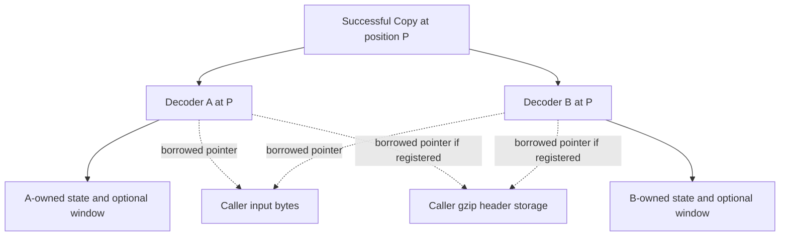
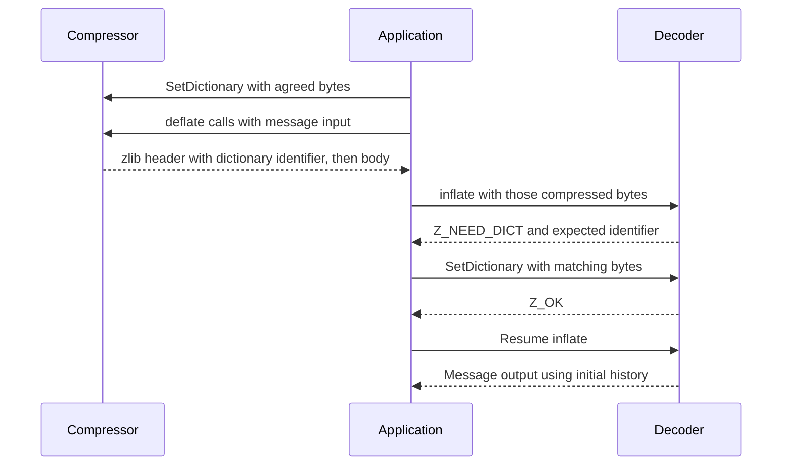
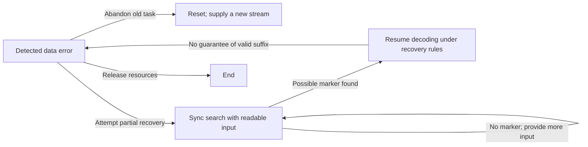

# 5. State operations

[Previous: 4. Formats and integrity checks](wrappers.md) · [Overview](../overview.md) · [Next: 6. Application interfaces](interfaces.md)

A server reuses one stream for many independent messages. A viewer saves its progress so that it
can come back to a place in a document. Reset serves the first need and Copy the second. This
chapter covers them, and dictionaries, flushes and the small query functions: the calls that
change what later calls can do with the [stream state](streaming.md).
It explains what zlib does. It proves nothing.

Two markers say how a sentence relates to the proofs:

- **Safety:** an obligation that the registered safety theorems cover: no undefined behaviour,
  no memory error, no leak, and termination ([safety](../spec/safety.md)).
- **Functional:** a property of the bytes or of the format. It is not required for the safety
  results.

The [table at the end](#what-the-safety-theorems-say-about-this-chapter) names the safety goal
of each function used here. The [shared argument](../overview.md#argument) explains how the
statements about single operations compose over a call sequence.

## Contents

- [5.1 Reuse storage for another message](#51-reuse-storage-for-another-message)
- [5.2 Save a checkpoint with Copy](#52-save-a-checkpoint-with-copy)
  - [5.2.1 Equal progress, independent ownership](#521-equal-progress-independent-ownership)
- [5.3 Start with an agreed dictionary](#53-start-with-an-agreed-dictionary)
- [5.4 Choose when a compressor exposes a boundary](#54-choose-when-a-compressor-exposes-a-boundary)
  - [5.4.1 Finish, reset and parameter changes](#541-finish-reset-and-parameter-changes)
- [5.5 Inspect or recover a special state](#55-inspect-or-recover-a-special-state)
- [What the safety theorems say about this chapter](#what-the-safety-theorems-say-about-this-chapter)

## 5.1 Reuse storage for another message

A decoder has delivered `ABAB` from message A. It can then process an independent message B.
`inflateReset` discards the progress and the history of A. It keeps the allocated state and the
requested format and window size. The caller supplies the buffers for B.

Blue cells denote valid history. The white application box denotes delivered data. Reset does
not erase bytes already delivered, and it does not move the read position of a file.

**Functional:** after Reset, no later match can read the old window contents, even when the
storage is still allocated. **Safety:** Reset keeps the stream invariant. When a header had
selected a window size different from the requested one, `inflateReset` frees the window, and
that block leaves the set of blocks the stream owns.

`inflateReset2` also selects a new wrapper and window size. It refuses an invalid value with
`Z_STREAM_ERROR`. `deflateReset` discards the progress of a compressor and clears its match
history in the same way. A Reset may abandon unfinished work; it does not say that the previous
message was complete.

`inflateResetKeep` and `deflateResetKeep` keep the history. `zlib.h` lists both as undocumented.
A compressor that matches against old history after `deflateResetKeep` need not produce a stream
that decodes from an empty history. Their
[contracts](../spec/api/deflate-stream.md#deflateresetkeep) define that protocol.
The exact effects of the ordinary resets are in the
[inflate](../spec/api/inflate-stream.md#inflatereset) and
[deflate](../spec/api/deflate-stream.md#deflatereset) contracts.

## 5.2 Save a checkpoint with Copy

Imagine a decoder A that has paused after `AB`, before a match that produces `ABABAB`.
This position is conceptual: `inflate` need not return exactly there.
`inflateCopy(B, A)` lets B resume from the same position and history while A continues.
A useful checkpoint also needs the unread compressed input and its position: the application
keeps them or can fetch them again. A byte offset alone is not a checkpoint. It leaves out the
buffered bits, the tables, the history and any operation that is partly decoded.

### 5.2.1 Equal progress, independent ownership

Solid edges show internal storage that each decoder owns. Dotted edges show caller storage that
both borrow. The output pointers are copied too, so the application gives each decoder its own
destination before it continues. A shared header record must stay valid for both.

**Functional:** B is at the same decoding position as A. **Safety:** the two streams own
separate internal blocks, so a call on A, or `inflateEnd` on A, neither writes nor frees a block
of B. Each stream needs its own End. The static read-only tables are shared. A pointer of A into
its own table storage becomes, in B, a pointer into B's copy of that storage.

**Safety:** when an allocation fails part of the way, `inflateCopy` returns `Z_MEM_ERROR`, has
freed what the attempt allocated, and leaves the source unchanged. The destination then holds no
state. The safety goals of both copy functions take a destination record that is readable and is
not the source record, and a source that uses the default allocator
([deviations](../deviations.md)). The
[Copy contract](../spec/api/inflate-stream.md#inflatecopy) gives the full conditions.

`deflateCopy` branches a compression in the same way, for example to try two continuations.
Bytes already published stay the application's responsibility. Its
[contract](../spec/api/deflate-stream.md#deflatecopy) and the
[compressor page](../proof/deflate.md) cover its different internal storage.

## 5.3 Start with an agreed dictionary

Short messages may share vocabulary. With the preset history `AB`, a body could begin with
"copy 6 bytes from distance 2" and produce `ABABAB`; the dictionary itself is not delivered as
output. This illustrates the format. It does not prescribe what a compressor chooses.

**Functional:** the history the decoder installs equals the dictionary the compressor used.
Equal Adler-32 identifiers do not imply equal bytes. **Safety:** `inflateSetDictionary` and
`deflateSetDictionary` read only the dictionary range, keep only the suffix that fits the
window, and write only stream storage. A later match that reaches before the first output byte
of the message reads that installed history. The [copy example](encoding.md) explains how new
bytes extend a match.

A zlib stream asks for its dictionary through `Z_NEED_DICT`. A raw stream has no identifier:
the application may install a dictionary at any time, and nothing checks it. Gzip has no preset
dictionary. A wrong dictionary and an allocation failure are followed by different rules, given
in the [dictionary contract](../spec/api/inflate-stream.md#inflatesetdictionary).

## 5.4 Choose when a compressor exposes a boundary

A receiver may need to decode the bytes sent so far before the message ends.
`Z_SYNC_FLUSH` makes all pending output available and aligns it to a byte boundary; later
matches may still refer to earlier history. A completed `Z_FULL_FLUSH` also clears the match
history, so a decoder with suitable state can restart from that point.

The arrows are possible later references, not memory copies made at the flush. A full flush
does not start a new zlib or gzip wrapper and does not end the stream. Frequent full flushes
reduce the compression. A flush marker does not make an arbitrary suffix of the stream a valid
wrapped stream on its own.

**Functional:** at a completed flush, the published bytes decode to all the input accepted so
far, and after a full flush no later match refers to the discarded history.
**Safety:** a flush call writes only inside the output room it is given.

When the output fills before a flush completes, the application calls `deflate` again with the
same flush value, more room and the updated input pointer and count. The exact completion and
marker-space rules are in the [flush contract](../spec/api/streams.md#compression-and-flushes).

### 5.4.1 Finish, reset and parameter changes

For `Z_FINISH`, the application keeps supplying output room until `deflate` returns
`Z_STREAM_END`. It adds no new input to the finish operation; input not yet consumed still
counts. End then frees the resources, or Reset prepares another task.

`deflateParams` may first compress the input accepted so far with the old level and strategy,
and then installs the new ones. When it returns `Z_BUF_ERROR`, the settings are unchanged, but
the input consumed and the output produced by that call remain progress.
**Functional:** the accounting of that progress is the same as for `deflate`, across retries
too. **Safety:** a `deflateParams` call is safe on the same premises about the buffers as a
`deflate` call. See the [parameter contract](../spec/api/deflate-stream.md#deflateparams) and
the [block-emission page](../proof/trees.md).

## 5.5 Inspect or recover a special state

`inflateSync` searches damaged input for a possible full-flush marker. The same byte pattern
can occur elsewhere, so finding it guarantees neither a valid suffix nor the integrity of the
whole stream.

These are selected workflows, not all the states a stream can be in. While a Sync search is
under way, an ordinary `inflate` call does not take its place: it returns `Z_STREAM_ERROR`.
After a successful search, `inflate` no longer checks the trailer checksum; the
[contract](../spec/api/inflate-stream.md#inflatesync) states that scope.
**Safety:** `inflateSync` reads only the input range, and `inflate` after it is as safe as
before it.

The remaining entries read or adjust a small part of the state.

| Need | Entries | What holds |
| --- | --- | --- |
| Supply a bit fragment | `inflatePrime` inserts bits into the input of a raw stream, to start in the middle of a byte. `deflatePrime` inserts bits into the output of a raw stream, before the first `deflate` call after init or reset. | **Functional:** the inserted bits are part of the stream the format relation describes. **Safety:** see the paragraph below the table. |
| Inspect progress or buffering | `inflateMark`, `deflatePending`, `deflateUsed`; `inflateCodesUsed` is undocumented. | **Functional:** the reported number is the quantity `zlib.h` names. **Safety:** the call writes nothing except the result cells the caller passes, if any. |
| Read the history | `inflateGetDictionary`, `deflateGetDictionary` | **Safety:** the copy stays inside the destination, whose required size the goal states ([deviations](../deviations.md)). **Functional:** the bytes are the current history, which may differ from the preset dictionary. |
| Control validation | `inflateValidate` is undocumented. It turns the trailer check on or off. | No required goal. |

The C does not enforce every timing rule of the two Prime functions. A call outside such a rule
is not thereby undefined behaviour, and not thereby a clean refusal; the
[contract conventions](../spec/api/contracts.md) say how to read each case.
**Safety:** the safety goal of `inflatePrime` has no timing premise. The safety goal of
`deflatePrime` assumes that no `deflate` call has started the stream since init or reset:
priming later overwrites the symbol buffer in the real C ([deviations](../deviations.md)).

## What the safety theorems say about this chapter

Each goal below is registered: a theorem of exactly its type is listed in
`tests/audit/theorems.txt`, and the goal in `tests/audit/proved-goals.txt`. The full name of a
goal is `ZlibF.Spec.Public.Goal.<name>`. [Safety](../spec/safety.md) says what the goals state,
[deviations](../deviations.md) lists every premise narrower than `zlib.h`, and
[progress](../progress.md#scope) names the commit on which the acceptance suite is green.

| Function | Safety goal | Contract |
| --- | --- | --- |
| `inflateReset` | `Goal.inflateReset_safety` | [inflateReset](../spec/api/inflate-stream.md#inflatereset) |
| `inflateReset2` | `Goal.inflateReset2_safety` | [inflateReset2](../spec/api/inflate-stream.md#inflatereset2) |
| `deflateReset` | `Goal.deflateReset_safety` | [deflateReset](../spec/api/deflate-stream.md#deflatereset) |
| `inflateCopy` | `Goal.inflateCopy_safety` | [inflateCopy](../spec/api/inflate-stream.md#inflatecopy) |
| `deflateCopy` | `Goal.deflateCopy_safety` | [deflateCopy](../spec/api/deflate-stream.md#deflatecopy) |
| `inflateSetDictionary` | `Goal.inflateSetDictionary_safety` | [inflateSetDictionary](../spec/api/inflate-stream.md#inflatesetdictionary) |
| `deflateSetDictionary` | `Goal.deflateSetDictionary_safety` | [deflateSetDictionary](../spec/api/deflate-stream.md#deflatesetdictionary) |
| `inflateGetDictionary` | `Goal.inflateGetDictionary_safety` | [inflateGetDictionary](../spec/api/inflate-stream.md#inflategetdictionary) |
| `deflateGetDictionary` | `Goal.deflateGetDictionary_safety` | [deflateGetDictionary](../spec/api/deflate-stream.md#deflategetdictionary) |
| `deflate` with a flush value | `Goal.deflate_safety` | [deflate](../spec/api/deflate-stream.md#deflate) |
| `deflateParams` | `Goal.deflateParams_safety` | [deflateParams](../spec/api/deflate-stream.md#deflateparams) |
| `inflateSync` | `Goal.inflateSync_safety` | [inflateSync](../spec/api/inflate-stream.md#inflatesync) |
| `inflatePrime` | `Goal.inflatePrime_safety` | [inflatePrime](../spec/api/inflate-stream.md#inflateprime) |
| `deflatePrime` | `Goal.deflatePrime_safety` | [deflatePrime](../spec/api/deflate-stream.md#deflateprime) |
| `inflateMark` | `Goal.inflateMark_safety` | [inflateMark](../spec/api/inflate-stream.md#inflatemark) |
| `deflatePending` | `Goal.deflatePending_safety` | [deflatePending](../spec/api/deflate-stream.md#deflatepending) |
| `deflateUsed` | `Goal.deflateUsed_safety` | [deflateUsed](../spec/api/deflate-stream.md#deflateused) |
| `inflateResetKeep`, `deflateResetKeep`, `inflateCodesUsed`, `inflateValidate` | None required: `zlib.h` lists them as undocumented. | [inflate](../spec/api/inflate-stream.md#inflateresetkeep), [deflate](../spec/api/deflate-stream.md#deflateresetkeep) |

The sequence goals `Goal.inflate_sequence_safety` and `Goal.deflate_sequence_safety` state that
these calls are safe in any order `zlib.h` permits, on every stream a call history can reach.
The [call-history method](../proof/method.md) gives the common argument.
Next: [application interfaces](interfaces.md).
