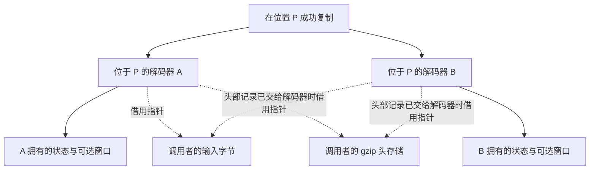
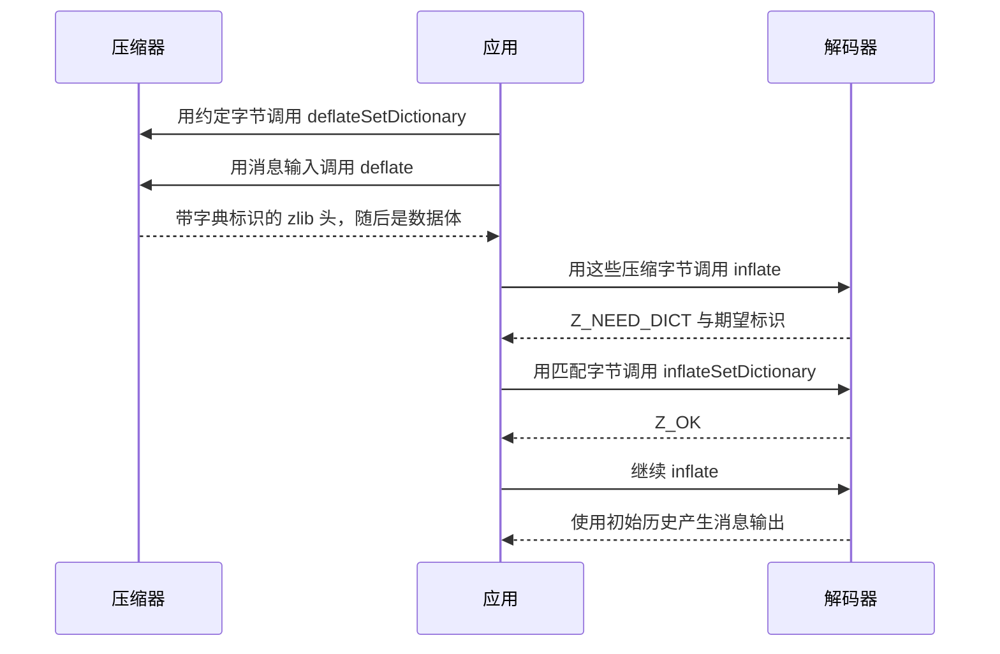
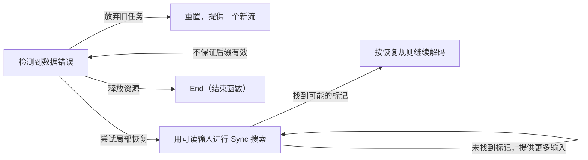

<!-- source-sha256: 73453b9107a0f9b8755e036feb151b56d40c2b3810d03ba587d10ec8cd79f645 -->

# 5. 状态操作

[上一章：4. 格式与完整性检查](wrappers.md) · [总览](../overview.md) · [下一章：6. 应用接口](interfaces.md)

服务器用同一个流处理许多互不相关的消息。阅读器保存进度，以便回到文档中的某个位置。
Reset 满足前一种需要，Copy 满足后一种。本章讨论它们，以及字典、刷新和几个小的查询函数：
这些调用都会改变之后的调用能对[流状态](streaming.md)做什么。
本章解释 zlib 做了什么，不证明任何结论。

两个标记说明一句话与证明的关系：

- **安全：** 安全定理所覆盖的义务：没有未定义行为、没有内存错误、没有泄漏，并且终止（见[安全性](../spec/safety.md)）。
- **功能：** 关于字节或格式的性质。安全结论不要求它。

[章末的表](#what-the-safety-theorems-say-about-this-chapter)列出本章用到的每个函数的安全目标。
[共同的论证](../overview.md#argument)解释关于单个操作的命题怎样沿调用序列组合起来。

## 目录

- [5.1 复用存储来处理下一条消息](#51-reuse-storage-for-another-message)
- [5.2 用复制保存检查点](#52-save-a-checkpoint-with-copy)
  - [5.2.1 进度相同，所有权独立](#521-equal-progress-independent-ownership)
- [5.3 从约定的字典开始](#53-start-with-an-agreed-dictionary)
- [5.4 决定压缩器何时输出一个边界](#54-choose-when-a-compressor-exposes-a-boundary)
  - [5.4.1 完成、重置与参数变更](#541-finish-reset-and-parameter-changes)
- [5.5 查询或恢复特殊状态](#55-inspect-or-recover-a-special-state)
- [安全定理对本章说了什么](#what-the-safety-theorems-say-about-this-chapter)

## 5.1 复用存储来处理下一条消息

解码器已经交付了消息 A 的 `ABAB`。之后它可以处理一条与之无关的消息 B。
`inflateReset` 丢弃 A 的进度和历史，保留已分配的状态以及所请求的格式和窗口大小。
B 的缓冲区由调用者提供。

蓝色单元格表示有效历史，白色应用框表示已交付数据。
Reset 不会抹掉已经交付的字节，也不会移动文件的读取位置。

**功能：** Reset 之后，以后的匹配都读不到旧的窗口内容，即使那块存储仍然分配着。
**安全：** Reset 保持流不变量。如果此前某个头部选定的窗口大小与所请求的不同，`inflateReset` 会释放窗口，
这个块随之离开流所拥有的块的集合。

`inflateReset2` 还会选择新的封装和窗口大小。对无效的取值，它以 `Z_STREAM_ERROR` 拒绝。
`deflateReset` 以同样的方式丢弃压缩器的进度并清除匹配历史。
Reset 可以放弃尚未完成的工作；它并不表示上一条消息已经完整。

`inflateResetKeep` 和 `deflateResetKeep` 保留历史。`zlib.h` 把二者列为未文档化函数。
`deflateResetKeep` 之后，继续匹配旧历史的压缩器产生的流，不一定能从空历史解码。
它们的[契约](../spec/api/deflate-stream.md#deflateresetkeep)定义了这种协议。
普通重置的精确效果见
[inflate](../spec/api/inflate-stream.md#inflatereset) 和
[deflate](../spec/api/deflate-stream.md#deflatereset) 契约。

## 5.2 用复制保存检查点

设想解码器 A 在输出 `AB` 之后暂停，接下来的匹配将产生 `ABABAB`。
这个位置是概念上的：`inflate` 不一定恰好在这里返回。
`inflateCopy(B, A)` 让 B 从同一位置和同一历史继续，A 也可以照常继续。
有用的检查点还需要未读的压缩输入及其位置：应用自己保留它们，或者能够重新取得。
仅有字节偏移不算检查点，它漏掉了缓冲位、编码表、历史以及解码到一半的操作。

### 5.2.1 进度相同，所有权独立

实线表示每个解码器各自拥有的内部存储；虚线表示两者共同借用的调用者存储。
输出指针也会被复制，所以应用在让任何一方继续之前，要给它各自的目的缓冲区。
共享的头部记录必须对双方都保持有效。

**功能：** B 与 A 处在同一个解码位置。
**安全：** 两个流拥有各自独立的内部块，所以对 A 的调用，或者对 A 调用 `inflateEnd`，既不写入也不释放 B 的块。
每个流都需要自己的 End。静态只读表是共享的。A 中指向自身表存储的指针，在 B 中成为指向 B 那份副本的指针。

**安全：** 如果分配中途失败，`inflateCopy` 返回 `Z_MEM_ERROR`，本次尝试分配的内容已经释放，源保持不变。
此时目的流不持有状态。两个复制函数的安全目标都要求：目的记录可读且不是源记录，源使用默认分配器
（见[偏离记录](../deviations.md)）。
[Copy 契约](../spec/api/inflate-stream.md#inflatecopy)给出完整的条件。

`deflateCopy` 以同样的方式为压缩建立分支，例如用来尝试两种后续做法。
已经交付的字节仍由应用负责。它的[契约](../spec/api/deflate-stream.md#deflatecopy)和
[压缩器一页](../proof/deflate.md)讨论它不同的内部存储。

## 5.3 从约定的字典开始

短消息可能共享词汇。有了预置历史 `AB`，主体可以用“从距离 2 复制 6 个字节”开头，产生 `ABABAB`；
字典本身并不作为输出交付。这是对格式的说明，并不规定压缩器怎样选择。

**功能：** 解码器装入的历史等于压缩器使用的字典。Adler-32 标识相等并不意味着字节相等。
**安全：** `inflateSetDictionary` 和 `deflateSetDictionary` 只读取字典范围，只保留窗口装得下的后缀，只写入流的存储。
之后如果有匹配引用到消息第一个输出字节之前，它读取的就是这段已装入的历史。
[复制示例](encoding.md)说明新产生的字节怎样延长匹配。

zlib 流通过 `Z_NEED_DICT` 请求字典。裸流没有标识：应用可以随时装入字典，没有任何检查。
Gzip 没有预置字典。字典错误和分配失败之后适用不同的规则，见
[字典契约](../spec/api/inflate-stream.md#inflatesetdictionary)。

## 5.4 决定压缩器何时输出一个边界

接收方可能需要在消息结束之前解码已经发来的字节。
`Z_SYNC_FLUSH` 交出全部待输出内容，并对齐到字节边界；之后的匹配仍然可以引用更早的历史。
完成的 `Z_FULL_FLUSH` 还会清除匹配历史，因此状态合适的解码器可以从这一点重新开始。

箭头表示以后可能出现的引用，不表示刷新时执行的内存复制。
完全刷新不会开始新的 zlib 或 gzip 封装，也不会结束流。频繁的完全刷新会降低压缩效果。
刷新标记并不能让流的任意后缀自己成为一个带封装的有效流。

**功能：** 刷新完成时，已交付的字节解码出至此接受的全部输入；完全刷新之后，以后的匹配不再引用被丢弃的历史。
**安全：** 刷新调用只写入交给它的输出空间。

如果输出空间在刷新完成之前用完，应用用相同的刷新值、更多的空间以及更新后的输入指针和计数再次调用 `deflate`。
精确的完成规则和标记空间规则见[刷新契约](../spec/api/streams.md#compression-and-flushes)。

### 5.4.1 完成、重置与参数变更

对于 `Z_FINISH`，应用持续提供输出空间，直到 `deflate` 返回 `Z_STREAM_END`。
它不再为这次结束操作添加新输入；尚未消费的输入仍然算数。
之后由 End 释放资源，或由 Reset 准备下一项任务。

`deflateParams` 可能先用旧的级别和策略压缩至此接受的输入，然后才装入新的设置。
它返回 `Z_BUF_ERROR` 时，设置没有改变，但这次调用消费的输入和产生的输出仍然是进展。
**功能：** 这些进展的记账与 `deflate` 相同，重试时也一样。
**安全：** `deflateParams` 调用在与 `deflate` 调用相同的缓冲区前提下是安全的。
见[参数契约](../spec/api/deflate-stream.md#deflateparams)和[块输出一页](../proof/trees.md)。

## 5.5 查询或恢复特殊状态

`inflateSync` 在损坏的输入中搜索可能的完全刷新标记。同样的字节模式也可能出现在别处，
所以找到它既不保证后缀有效，也不保证整个流完整。

图中只选取了部分使用流程，并非流可能处于的全部状态。
Sync 搜索进行期间，普通的 `inflate` 调用不能代替它：它返回 `Z_STREAM_ERROR`。
搜索成功之后，`inflate` 不再检查尾部校验和；[契约](../spec/api/inflate-stream.md#inflatesync)说明了相应范围。
**安全：** `inflateSync` 只读取输入范围，其后的 `inflate` 与之前同样安全。

其余的入口读取或调整状态的一小部分。

| 需求 | 入口 | 成立的性质 |
| --- | --- | --- |
| 提供位片段 | `inflatePrime` 向裸流的输入插入若干位，以便从一个字节的中间开始。`deflatePrime` 在初始化或重置后的第一次 `deflate` 调用之前，向裸流的输出插入若干位。 | **功能：** 插入的位属于格式关系所描述的那条流。**安全：** 见表后的段落。 |
| 查询进度或缓冲情况 | `inflateMark`、`deflatePending`、`deflateUsed`；`inflateCodesUsed` 未文档化。 | **功能：** 报告的数值就是 `zlib.h` 所说的那个量。**安全：** 除了调用者传入的结果单元（如果有），调用不写任何内存。 |
| 读取历史 | `inflateGetDictionary`、`deflateGetDictionary` | **安全：** 复制不超出目的缓冲区，目标写明了它所需的大小（见[偏离记录](../deviations.md)）。**功能：** 得到的字节是当前历史，可能与预置字典不同。 |
| 控制校验 | `inflateValidate` 未文档化。它打开或关闭尾部检查。 | 安全目标不在计划内。 |

C 并不强制两个 Prime 函数的每一条时机规则。违反这类规则的调用并不因此就是未定义行为，也不因此就是干净的拒绝；
[契约约定](../spec/api/contracts.md)说明每种情况怎样解读。
**安全：** `inflatePrime` 的安全目标没有时机前提。`deflatePrime` 的安全目标假设自初始化或重置以来还没有 `deflate` 调用启动过这条流：
在真实的 C 中，更晚的 Prime 会覆盖符号缓冲区（见[偏离记录](../deviations.md)）。

## 安全定理对本章说了什么

下表给出本章用到的每个函数的安全目标。目标的全名是 `ZlibF.Spec.Public.Goal.<name>`。
[安全性](../spec/safety.md)说明这些目标陈述什么，[偏离记录](../deviations.md)列出每个比 `zlib.h` 更窄的前提，
[进度页](../progress.md)说明哪些目标已完成。

| 函数 | 安全目标 | 契约 |
| --- | --- | --- |
| `inflateReset` | `Goal.inflateReset_safety` | [inflateReset](../spec/api/inflate-stream.md#inflatereset) |
| `inflateReset2` | `Goal.inflateReset2_safety` | [inflateReset2](../spec/api/inflate-stream.md#inflatereset2) |
| `deflateReset` | `Goal.deflateReset_safety` | [deflateReset](../spec/api/deflate-stream.md#deflatereset) |
| `inflateCopy` | `Goal.inflateCopy_safety` | [inflateCopy](../spec/api/inflate-stream.md#inflatecopy) |
| `deflateCopy` | `Goal.deflateCopy_safety` | [deflateCopy](../spec/api/deflate-stream.md#deflatecopy) |
| `inflateSetDictionary` | `Goal.inflateSetDictionary_safety` | [inflateSetDictionary](../spec/api/inflate-stream.md#inflatesetdictionary) |
| `deflateSetDictionary` | `Goal.deflateSetDictionary_safety` | [deflateSetDictionary](../spec/api/deflate-stream.md#deflatesetdictionary) |
| `inflateGetDictionary` | `Goal.inflateGetDictionary_safety` | [inflateGetDictionary](../spec/api/inflate-stream.md#inflategetdictionary) |
| `deflateGetDictionary` | `Goal.deflateGetDictionary_safety` | [deflateGetDictionary](../spec/api/deflate-stream.md#deflategetdictionary) |
| 带刷新值的 `deflate` | `Goal.deflate_safety` | [deflate](../spec/api/deflate-stream.md#deflate) |
| `deflateParams` | `Goal.deflateParams_safety` | [deflateParams](../spec/api/deflate-stream.md#deflateparams) |
| `inflateSync` | `Goal.inflateSync_safety` | [inflateSync](../spec/api/inflate-stream.md#inflatesync) |
| `inflatePrime` | `Goal.inflatePrime_safety` | [inflatePrime](../spec/api/inflate-stream.md#inflateprime) |
| `deflatePrime` | `Goal.deflatePrime_safety` | [deflatePrime](../spec/api/deflate-stream.md#deflateprime) |
| `inflateMark` | `Goal.inflateMark_safety` | [inflateMark](../spec/api/inflate-stream.md#inflatemark) |
| `deflatePending` | `Goal.deflatePending_safety` | [deflatePending](../spec/api/deflate-stream.md#deflatepending) |
| `deflateUsed` | `Goal.deflateUsed_safety` | [deflateUsed](../spec/api/deflate-stream.md#deflateused) |
| `inflateResetKeep`、`deflateResetKeep`、`inflateCodesUsed`、`inflateValidate` | 不在计划内：`zlib.h` 把它们列为未文档化函数。 | [inflate](../spec/api/inflate-stream.md#inflateresetkeep)、[deflate](../spec/api/deflate-stream.md#deflateresetkeep) |

序列目标 `Goal.inflate_sequence_safety` 和 `Goal.deflate_sequence_safety` 说的是：
在调用历史能够到达的每个流上，这些调用按 `zlib.h` 允许的任何顺序都是安全的。
[调用历史方法](../proof/method.md)给出共同的论证。
接下来阅读[应用接口](interfaces.md)。
