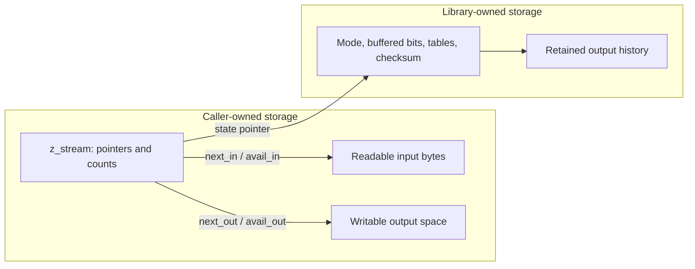
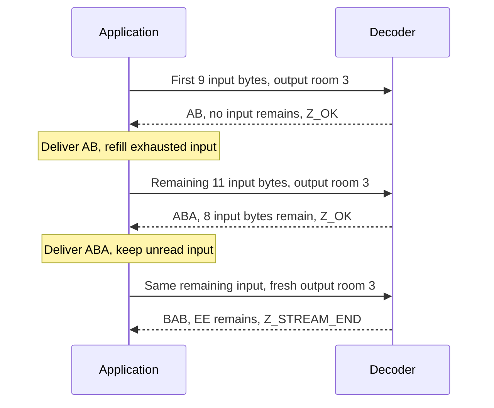
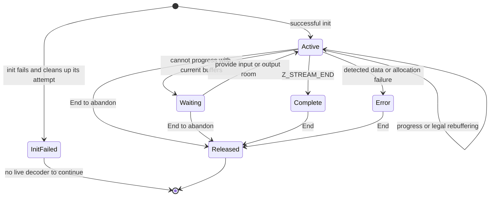

# 3. Streaming

[Previous: 2. Repetition, codes and blocks](encoding.md) · [Overview](../overview.md) · [Next: 4. Formats and integrity checks](wrappers.md)

To deliver `ABABABAB` through three-byte output buffers, a decoder must pause and continue.
A stream keeps the state of the task across calls. This chapter follows that state: what the
caller owns, what the library keeps, and what a pause must preserve.
It explains what zlib does. It proves nothing.

Two markers say how a sentence relates to the proofs:

- **Safety:** an obligation that the safety theorems cover: no undefined behaviour,
  no memory error, no leak, and termination ([safety](../spec/safety.md)).
- **Functional:** a property of the bytes or of the format. It is not required for the safety
  results.

A sentence marked **to confirm** says that the C implements a rule of the format; this chapter
cites no theorem for that reading. The
[table at the end](#what-the-safety-theorems-say-about-this-chapter) names the safety goals.

## Contents

- [3.1 Where the bytes and the memory live](#31-where-the-bytes-and-the-memory-live)
- [3.2 Three calls, one decoded result](#32-three-calls-one-decoded-result)
  - [3.2.1 Preserve the input that remains](#321-preserve-the-input-that-remains)
  - [3.2.2 Account for the same execution](#322-account-for-the-same-execution)
- [3.3 A pause can occur inside a match](#33-a-pause-can-occur-inside-a-match)
- [3.4 A buffer boundary is not a format boundary](#34-a-buffer-boundary-is-not-a-format-boundary)
- [3.5 Progress, completion and errors](#35-progress-completion-and-errors)
- [What the safety theorems say about this chapter](#what-the-safety-theorems-say-about-this-chapter)

## 3.1 Where the bytes and the memory live

The application owns `z_stream` and its buffers. `next_in` points at `avail_in`
unread compressed bytes; `next_out` points at `avail_out` writable bytes.
Calls advance these pointers and reduce their counts by the amounts used.



*The arrows denote references. They do not transfer ownership of caller buffers.*

When the application replaces an output buffer, the decoder keeps its tables and its history.
The **stream invariant** is the set of facts a stream must satisfy before each call: the bounds
of its internal storage and which blocks it owns.
**Safety:** initialization establishes the stream invariant, and every permitted call preserves
it. **Functional:** the saved history equals the bytes already decoded. The
[shared argument](../overview.md#argument) explains frames and why the contract of a helper
function is proved, not assumed.

The [shared contracts](../spec/api/streams.md#stream-storage-and-ownership) give the exact
buffer, alias and lifetime conditions. Init allocates the state; a later `inflate` call may
allocate the history window. **Safety:** when either allocation fails, the call returns and
leaves no block that nothing owns.

## 3.2 Three calls, one decoded result

This hand-constructed zlib stream stores the eight ASCII bytes `ABABABAB`.
The extra `EE` exposes the stopping position.

```text
78 01 | 01 08 00 F7 FF | 41 42 41 42 41 42 41 42 | 09 3C 02 0D | EE
header  stored-block     A  B  A  B  A  B  A  B    Adler-32      tail
        header
```

This encoding need not be the default compressor's choice. See
[encoding](encoding.md) for block choices and [wrappers](wrappers.md) for the
header and check value.

After `inflateInit` succeeds, use `Z_NO_FLUSH` and three-byte output buffers.
Supply nine input bytes, then the remaining eleven once those are exhausted.
Call 3 keeps unread input. Deliver each output before reusing its buffer.


*Blue: supplied input; amber: produced bytes; gray: unread input. Colors denote
data roles, not proof status.*

| Call | Input available before | Consumed | Produced | Input left | Output room left | Return |
| --- | ---: | ---: | --- | ---: | ---: | --- |
| 1 | 9 | 9 | `AB` (2) | 0 | 1 | `Z_OK` |
| 2 | 11 | 3 | `ABA` (3) | 8 | 0 | `Z_OK` |
| 3 | 8 | 7 | `BAB` (3) | 1 | 0 | `Z_STREAM_END` |

Cumulative `(total_in, total_out)` is `(9, 2)`, `(12, 5)`, then `(19, 8)`.
Call 3 consumes three payload and four trailer bytes. Output joins to
`ABABABAB`; `EE` remains unread. A finite run of the pinned C confirmed these
values. That is [example evidence, not a general proof](../overview.md#evidence).

### 3.2.1 Preserve the input that remains

Call 2 leaves eight bytes needed to finish. Replacing them loses input. Refill
only when `avail_in == 0`, or move/append data while preserving unread bytes and
their correct pointer and count.



*The application drives `inflate` and manages buffer lifetimes between calls.*

### 3.2.2 Account for the same execution

For one actual returned heap, consumed input `c` and produced output `p` obey:

```text
c = avail_in_before  - avail_in_after
p = avail_out_before - avail_out_after
next_in_after  = next_in_before  + c
next_out_after = next_out_before + p
```

**Safety:** the call reads only inside the input range and writes only inside the output range
that the counts before the call describe. **Functional:** the four equations hold, and for valid
input the newly written bytes extend the decoded prefix. A statement about the counters and a
statement about the output are about the same execution. The
[decoder page](../proof/inflate.md) connects the argument for each mode to the common return
path.

The totals wrap at the width of C `unsigned long`; this example does not wrap. When the
allocation of the window fails at the end of a call, `inflate` returns `Z_MEM_ERROR` with the
pointers already advanced and the totals and the checksum not updated. See the exact
[accounting contract](../spec/api/inflate-stream.md#inflate).

## 3.3 A pause can occur inside a match

After output `AB`, a length-six, distance-two match needs six output slots.
With three slots per call, it spans two calls.


*An abstract match-state example, not a compressed-byte or actual return trace.*

After writing `ABA`, the decoder keeps the distance `2`, the remaining length `3` and the
history needed for `BAB`. The application may then reuse its old output buffer.
**Safety:** the continuation reads the history from the library's window, which is still valid,
and never from the caller's old buffer.

A remaining length alone does not justify a read: the argument connects the window contents,
the current output, the distance and the remaining match. In the C, the `MATCH` mode keeps the
distance and length in the state, and `inflate` copies new output into the window before it
returns. **Functional, to confirm:** this mechanism delivers exactly the bytes the match
denotes; see the [decoder page](../proof/inflate.md).

## 3.4 A buffer boundary is not a format boundary

A symbol can span input chunks. A decoder can also consume a byte but retain
unused bits. Thus `avail_in == 0` leaves no unread caller bytes, yet buffered
bits or pending output may remain.


*Input may split a symbol; output may split its expansion. Meaning is unchanged.*

**Functional:** no bit and no output byte is lost or duplicated across these cuts.
The fast path and the ordinary path keep the same relations; both occur under the default
configuration as buffers change. The [fast-decoder page](../proof/inffast.md) gives the entry
margins and the relation for the returned bit buffer.

## 3.5 Progress, completion and errors



*Waiting is an application condition, not a C mode. This End-only cleanup view
omits the [reset and recovery protocols](state-operations.md).*

`Z_BUF_ERROR` can mean no progress: provide input or room before retrying a
blocked request. EOF before `Z_STREAM_END` is not completion. Output can precede
a [failed trailer check](wrappers.md#44-output-can-precede-a-failed-check).

Compression uses `Z_NO_FLUSH`, then `Z_FINISH` until `Z_STREAM_END`, adding no
new input after the first finish request. See [flushes](state-operations.md).

**Safety:** the [sequence statement](../spec/safety.md#2-calls-and-sequences) composes the
actual init, the calls, the changes of buffers between them and End. It includes the cleanup of
a failed init and a safe End after a data error or a failed window allocation. The diagram
illustrates this statement; it does not prove it.

## What the safety theorems say about this chapter

Each goal below has a theorem of exactly its type, listed in
`tests/audit/theorems.txt`; the goal is listed in `tests/audit/proved-goals.txt`. The full name of a
goal is `ZlibF.Spec.Public.Goal.<name>`. [Safety](../spec/safety.md) says what the goals state,
[deviations](../deviations.md) lists every premise narrower than `zlib.h`, and
[progress](../progress.md#scope) records the level of each result.

| Function | Safety goal | Contract |
| --- | --- | --- |
| `inflateInit` (macro for `inflateInit_`) | `Goal.inflateInit__safety` | [inflateInit_](../spec/api/inflate-stream.md#inflateinit_) |
| `inflate` | `Goal.inflate_safety` | [inflate](../spec/api/inflate-stream.md#inflate) |
| `inflateEnd` | `Goal.inflateEnd_safety` | [inflateEnd](../spec/api/inflate-stream.md#inflateend) |
| `deflate` | `Goal.deflate_safety` | [deflate](../spec/api/deflate-stream.md#deflate) |
| every sequence of decoder calls, with caller buffer changes between them | `Goal.inflate_sequence_safety` | [calls and sequences](../spec/safety.md#2-calls-and-sequences) |
| every sequence of compressor calls, with caller buffer changes between them | `Goal.deflate_sequence_safety` | [calls and sequences](../spec/safety.md#2-calls-and-sequences) |

[Formats and integrity checks](wrappers.md) next follows the headers and trailers around the
compressed body.
