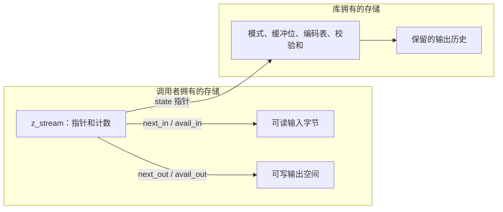
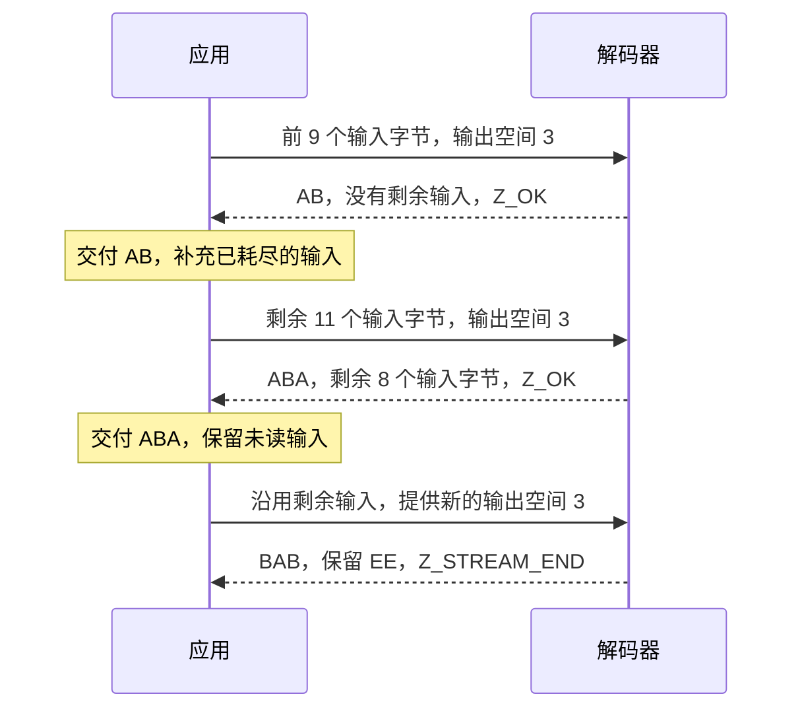
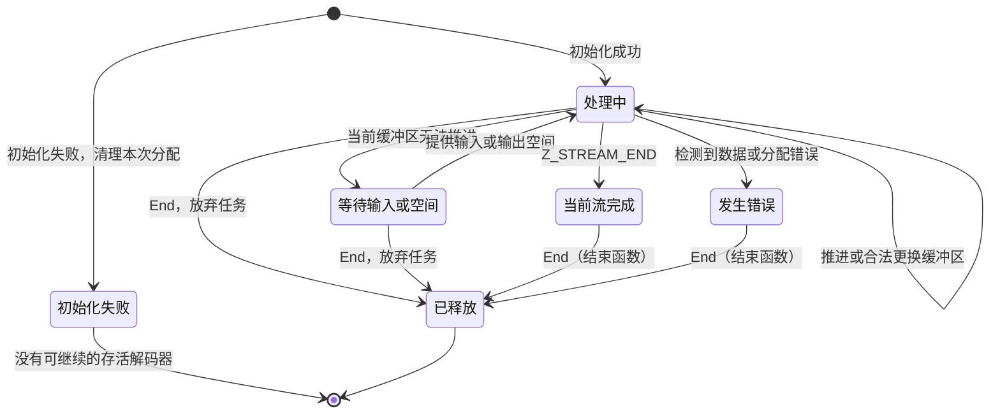

<!-- source-sha256: 231d9e7858d680c5517e4c23a634e1665d02209cbb801ec7a710ca54240d3d29 -->

# 3. 流式处理

[上一章：2. 重复、编码与数据块](encoding.md) · [总览](../overview.md) · [下一章：4. 格式与完整性检查](wrappers.md)

要用每次只有三个字节的输出缓冲区交付 `ABABABAB`，解码器就必须能暂停、再继续。
流把任务的状态保存在调用之间。本章沿着这些状态往下看：调用者拥有什么，库保留什么，暂停时必须保住什么。
本章解释 zlib 做了什么，不证明任何结论。

两个标记说明一句话与证明的关系：

- **安全：** 已登记的安全定理所覆盖的义务：没有未定义行为、没有内存错误、没有泄漏，并且终止（见[安全性](../spec/safety.md)）。
- **功能：** 关于字节或格式的性质。安全结论不要求它。

标有**尚未由证明确认**的句子说的是 C 实现了格式的某条规则；本章没有为这种解读引用定理。
[章末的表](#what-the-safety-theorems-say-about-this-chapter)列出相关的安全目标。

## 目录

- [3.1 字节和内存分别在哪里](#31-where-the-bytes-and-the-memory-live)
- [3.2 三次调用，一个解码结果](#32-three-calls-one-decoded-result)
  - [3.2.1 保留剩余输入](#321-preserve-the-input-that-remains)
  - [3.2.2 对同一次执行进行记账](#322-account-for-the-same-execution)
- [3.3 匹配内部也可以暂停](#33-a-pause-can-occur-inside-a-match)
- [3.4 缓冲区边界不等于格式边界](#34-a-buffer-boundary-is-not-a-format-boundary)
- [3.5 推进、完成和错误](#35-progress-completion-and-errors)
- [安全定理对本章说了什么](#what-the-safety-theorems-say-about-this-chapter)

## 3.1 字节和内存分别在哪里

应用拥有 `z_stream` 和它的缓冲区。`next_in` 指向 `avail_in` 个未读压缩字节；
`next_out` 指向 `avail_out` 个可写字节。调用按照实际使用量推进这些指针，并减少相应的计数。



*箭头表示引用关系，不转移调用者缓冲区的所有权。*

应用更换输出缓冲区时，解码器保留它的编码表和历史。
**流不变量**是流在每次调用之前必须满足的一组事实：内部存储的边界，以及它拥有哪些块。
**安全：** 初始化建立流不变量，每个允许的调用保持它。
**功能：** 保存的历史等于已经解码的字节。
[共同的论证](../overview.md#argument)解释帧性质，以及为什么辅助函数的契约是证明出来的，而不是假设的。

[共享契约](../spec/api/streams.md#stream-storage-and-ownership)给出精确的缓冲区、别名和生命期条件。
初始化函数分配状态；之后的某次 `inflate` 调用可能分配历史窗口。
**安全：** 这两处分配无论哪一处失败，调用都返回，并且不留下无主的块。

## 3.2 三次调用，一个解码结果

下面这份手工构造的 zlib 流保存八个 ASCII 字节 `ABABABAB`。
额外的 `EE` 用来显露处理停止的位置。

```text
78 01 | 01 08 00 F7 FF | 41 42 41 42 41 42 41 42 | 09 3C 02 0D | EE
头部    存储块头部       A  B  A  B  A  B  A  B    Adler-32      尾随字节
```

这份编码不一定是默认压缩器会选择的结果。[编码](encoding.md)一章解释块的选择，
[格式封装](wrappers.md)一章解释头部和校验值。

`inflateInit` 成功后，使用 `Z_NO_FLUSH` 和三个字节的输出缓冲区。
先提供九个输入字节，耗尽后再提供剩余十一个。第三次调用保留未读输入。
每次复用输出缓冲区前，先交付其中已经产生的输出。


*蓝色表示已提供的输入；琥珀色表示已产生的字节；灰色表示未读输入。颜色表示数据角色，不表示证明状态。*

| 调用 | 调用前可用输入 | 已消费 | 已产生 | 剩余输入 | 剩余输出空间 | 返回值 |
| --- | ---: | ---: | --- | ---: | ---: | --- |
| 1 | 9 | 9 | `AB` (2) | 0 | 1 | `Z_OK` |
| 2 | 11 | 3 | `ABA` (3) | 8 | 0 | `Z_OK` |
| 3 | 8 | 7 | `BAB` (3) | 1 | 0 | `Z_STREAM_END` |

累计 `(total_in, total_out)` 依次为 `(9, 2)`、`(12, 5)`、`(19, 8)`。
第三次调用消费三个载荷字节和四个尾部字节。输出拼接后为 `ABABABAB`，`EE` 仍未读取。
对固定的 C 的一次有限运行确认了这些数值。
这是[示例证据，不是一般证明](../overview.md#evidence)。

### 3.2.1 保留剩余输入

第二次调用留下的八个字节仍是完成当前流所需的输入。替换掉它们就会丢失输入。
只在 `avail_in == 0` 时补充新输入；或者移动、追加数据，同时保留未读字节，并给出正确的指针和计数。



*应用驱动 `inflate`，并在调用之间管理缓冲区的生命期。*

### 3.2.2 对同一次执行进行记账

对同一次实际执行返回的堆，本次消费的输入字节数 `c` 和产生的输出字节数 `p` 满足：

```text
c = avail_in_before  - avail_in_after
p = avail_out_before - avail_out_after
next_in_after  = next_in_before  + c
next_out_after = next_out_before + p
```

**安全：** 调用只在输入范围内读取，只在输出范围内写入；这两个范围由调用前的计数给出。
**功能：** 这四个等式成立；对有效输入，新写入的字节延长了已解码前缀。
关于计数器的命题和关于输出的命题说的是同一次执行。
[解码器一页](../proof/inflate.md)把各个模式的论证与公共返回路径连接起来。

累计值按 C `unsigned long` 的位宽回绕；这个例子没有发生回绕。
如果窗口的分配在调用结束时失败，`inflate` 返回 `Z_MEM_ERROR`，此时指针已经推进，而累计值和校验和没有更新。
精确行为见[记账契约](../spec/api/inflate-stream.md#inflate)。

## 3.3 匹配内部也可以暂停

输出 `AB` 后，一个长度为六、距离为二的匹配需要六个输出位置。
若每次调用只有三个位置，这个匹配就会跨越两次调用。


*这是抽象匹配状态的例子，不是压缩字节消费轨迹，也不是实际返回轨迹。*

写出 `ABA` 后，解码器保留距离 `2`、剩余长度 `3`，以及产生 `BAB` 所需的历史。
此后应用可以复用旧的输出缓冲区。
**安全：** 继续执行时，历史取自库的窗口，窗口仍然有效；绝不取自调用者的旧缓冲区。

仅有剩余长度不能说明一次读取有效：论证要把窗口内容、当前输出、距离和剩余匹配联系起来。
在 C 中，`MATCH` 模式把距离和长度保存在状态里，`inflate` 在返回之前把新输出复制进窗口。
**功能，尚未由证明确认：** 这一机制交付的恰好是该匹配所表示的字节；见[解码器一页](../proof/inflate.md)。

## 3.4 缓冲区边界不等于格式边界

一个符号可以跨越多个输入片段。解码器也可以消费一个字节，却保留其中尚未使用的位。
因此，`avail_in == 0` 表示调用者没有未读字节，但内部仍可能有缓冲位或待产生的输出。


*输入边界可以切开符号；输出边界可以切开符号的展开过程。符号含义保持不变。*

**功能：** 跨越这些边界时，没有一个位、没有一个输出字节会丢失或重复。
快速路径和普通路径保持同样的关系；在默认配置下，两者都会随缓冲区的变化而出现。
[快速解码器一页](../proof/inffast.md)给出入口余量，以及返回时位缓冲区满足的关系。

## 3.5 推进、完成和错误



*“等待”是应用层条件，不是 C 的模式。这张图只展示用 End 清理的路径，省略了
[重置和恢复协议](state-operations.md)。*

`Z_BUF_ERROR` 可能表示没有进展：重试受阻的请求前，先提供输入或输出空间。
在 `Z_STREAM_END` 之前遇到输入结束，不算流已完成。
输出也可能先于[尾部检查失败](wrappers.md#44-output-can-precede-a-failed-check)发生。

压缩先使用 `Z_NO_FLUSH`，再持续使用 `Z_FINISH` 直到 `Z_STREAM_END`，
第一次结束请求之后不再添加新输入。见[刷新操作](state-operations.md)。

**安全：** [序列命题](../spec/safety.md#2-calls-and-sequences)把实际的初始化、各次调用、调用之间更换缓冲区和 End 组合起来。
它包括初始化失败时的清理，以及数据错误或窗口分配失败之后 End 的安全性。
这张图只是说明这条命题，并不证明它。

## 安全定理对本章说了什么

下表中的每个目标都已登记：`tests/audit/theorems.txt` 列有一个类型恰好是该目标的定理，
`tests/audit/proved-goals.txt` 列有该目标。目标的全名是 `ZlibF.Spec.Public.Goal.<name>`。
[安全性](../spec/safety.md)说明这些目标陈述什么，[偏离记录](../deviations.md)列出每个比 `zlib.h` 更窄的前提，
[进度页](../progress.md#scope)给出验收套件全部通过的提交。

| 函数 | 安全目标 | 契约 |
| --- | --- | --- |
| `inflateInit`（`inflateInit_` 的宏） | `Goal.inflateInit__safety` | [inflateInit_](../spec/api/inflate-stream.md#inflateinit_) |
| `inflate` | `Goal.inflate_safety` | [inflate](../spec/api/inflate-stream.md#inflate) |
| `inflateEnd` | `Goal.inflateEnd_safety` | [inflateEnd](../spec/api/inflate-stream.md#inflateend) |
| `deflate` | `Goal.deflate_safety` | [deflate](../spec/api/deflate-stream.md#deflate) |
| 解码器调用的每个序列，调用之间调用者可以更换缓冲区 | `Goal.inflate_sequence_safety` | [调用与序列](../spec/safety.md#2-calls-and-sequences) |
| 压缩器调用的每个序列，调用之间调用者可以更换缓冲区 | `Goal.deflate_sequence_safety` | [调用与序列](../spec/safety.md#2-calls-and-sequences) |

下一章[格式与完整性检查](wrappers.md)讨论压缩主体前后的头部和尾部。
