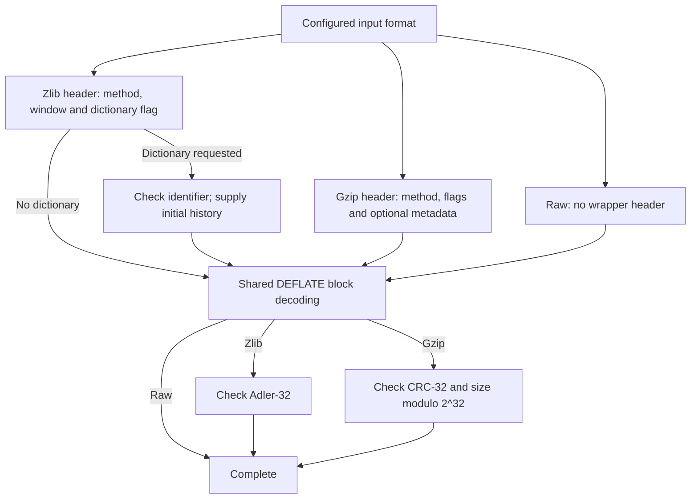
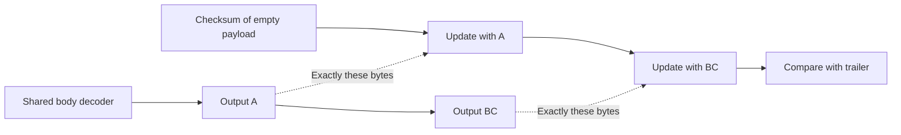
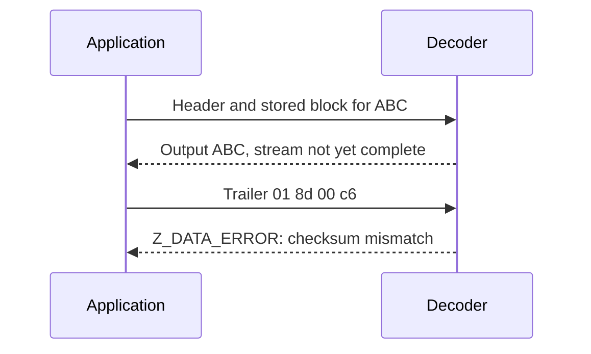

# 4. Formats and integrity checks

[Previous: 3. Streaming](streaming.md) · [Overview](../overview.md) · [Next: 5. State operations](state-operations.md)

Raw DEFLATE, zlib and gzip can carry the same compressed body for `ABC`. The formats differ in
the header, which sets the decoder's starting conditions, and in the trailer, which checks the
result. This chapter separates the shared body from the wrapper around it.
It explains what zlib does. It proves nothing.

Two markers say how a sentence relates to the proofs:

- **Safety:** an obligation that the safety theorems cover: no undefined behaviour,
  no memory error, no leak, and termination ([safety](../spec/safety.md)).
- **Functional:** a property of the bytes or of the format. It is not required for the safety
  results.

The [table at the end](#what-the-safety-theorems-say-about-this-chapter) names the safety goal
of each function used here.

## Contents

- [4.1 Put the same body in three envelopes](#41-put-the-same-body-in-three-envelopes)
- [4.2 Headers establish the decoder's starting conditions](#42-headers-establish-the-decoders-starting-conditions)
  - [4.2.1 A window and an optional initial history](#421-a-window-and-an-optional-initial-history)
  - [4.2.2 Gzip metadata has a different destination](#422-gzip-metadata-has-a-different-destination)
- [4.3 Follow the bytes into the checksum](#43-follow-the-bytes-into-the-checksum)
- [4.4 Output can precede a failed check](#44-output-can-precede-a-failed-check)
- [4.5 Finishing one member and starting another](#45-finishing-one-member-and-starting-another)
- [What the safety theorems say about this chapter](#what-the-safety-theorems-say-about-this-chapter)

## 4.1 Put the same body in three envelopes

A final **stored block** carries these three bytes without Huffman coding:

```text
01 | 03 00 | fc ff | 41 42 43
     LEN=3  NLEN     A  B  C
```

`01` contains the final flag, stored type and padding; `03 00` is the length;
`fc ff` is its 16-bit complement. This chosen encoding need not be the
compressor's choice. [Encoding](encoding.md) explains the alternatives.


*Figure 4.1. Blue: shared body; grey: header; amber: trailer. Widths are schematic,
hex values are actual bytes, and colors denote data roles rather than status.*

**Functional:** all three paths interpret this block identically, and the decoder finds its
end, so a trailer becomes neither output nor another block. The
[format rules](../spec/format/README.md#layers-and-stream-boundaries) define the meaning of the
bytes. **Safety:** every read of a header, body or trailer byte is inside the input the caller
supplied.

## 4.2 Headers establish the decoder's starting conditions

The paths share block-decoding modes, with potentially different history and
window parameters.



*Figure 4.2. Normal conceptual paths, not separate C functions. Headers/trailers
can span calls; malformed fields branch to errors.*

`inflate()` is one state machine. Its mode `HEAD` and the gzip modes after it parse headers.
`TYPE` and the table and symbol modes decode the body. `CHECK` and `LENGTH` handle trailers.
Three helper functions do part of the work: `inflate_table()` builds tables, `inflate_fast()`
decodes a fast segment, and `updatewindow()` saves history. The
[mode proof](../proof/inflate.md#the-mode-proof) follows these boundaries on the translation as
it is.

### 4.2.1 A window and an optional initial history

A decoder limited to a 16 KiB window refuses a zlib header that announces 32 KiB
(`Z_DATA_ERROR`). A decoder initialised with `windowBits` 0 takes its window size from the
header instead. The compile-time option `INFLATE_STRICT` also uses the header's maximum distance
in the body checks; the default build does not define it.

If both engines start with dictionary bytes ending in `AB`, a distance-two
reference can use that history before producing two bytes. Without initial
history, that reference is unjustified.

**Functional:** a statement about the body therefore starts from an initial history and a
window size, and the actual header and dictionary calls establish both. An Adler-32
dictionary identifier can collide: recovering the intended data requires matching bytes,
not just an equal identifier. See the exact
[window requests](../spec/api/inflate-stream.md#inflateinit2_) and
[dictionary conditions](../spec/api/inflate-stream.md#inflatesetdictionary);
[state operations](state-operations.md) covers raw dictionaries.

### 4.2.2 Gzip metadata has a different destination

Gzip names, comments and extra fields do not change literal, match or Huffman
rules. Gzip has no zlib-style preset-dictionary request.

`inflateGetHeader()` registers a header record and buffers that the caller owns. Later
`inflate()` calls parse into them. A name can span several input buffers, so the decoder saves
its progress between calls. **Safety:** `inflate` writes at most `extra_max`, `name_max` and
`comm_max` bytes into the three buffers. This rests on a premise: the record and its buffers
stay valid for as long as `inflate` is called, and the `extra` buffer is separate from the
unread input ([deviations](../deviations.md)). The
[header contract](../spec/api/inflate-stream.md#inflategetheader) defines these memory effects
alongside the meaning of the bytes.

The optional header check stores the low 16 bits of the CRC-32 of the preceding header bytes.
The payload CRC starts anew and covers the uncompressed data. A decoder that mixed the two
would reject valid input even with a correct CRC routine.

## 4.3 Follow the bytes into the checksum

For `ABC` (65, 66, 67), start Adler-32 at `s1 = 1`, `s2 = 0`. Add each byte to
`s1`, then `s1` to `s2`, modulo 65521:

| Prefix processed | `s1` | `s2` |
| --- | --- | --- |
| Empty | 1 | 0 |
| `A` | 66 | 66 |
| `AB` | 132 | 198 |
| `ABC` | 199 | 397 |

The result is `397 * 65536 + 199 = 0x018d00c7`; zlib writes it most significant
byte first. CRC-32 is `0xa3830348`; gzip writes CRC and size least significant
byte first (Figure 4.1). These illustrate the independent
[checksum definitions](../spec/format/README.md#checksum-mathematics), not an
implementation proof.



*Figure 4.3. Decompression checksums emitted bytes; compression checksums accepted
input. Neither uses compressed bytes as its payload.*

**Functional:** updating with `A` and then with `BC` equals updating with `ABC`, and the
accumulator is the checksum of exactly the processed prefix: no byte skipped, none counted
twice, no header byte included. **Safety:** each checksum call reads only the range it is
given, and its arithmetic has no undefined behaviour. See the [Adler-32](../proof/adler32.md)
and [CRC-32](../proof/crc32.md) pages.

## 4.4 Output can precede a failed check

Supply Figure 4.1's zlib header and body without the four trailer bytes.
After output `ABC`, supply `01 8d 00 c6` instead of `01 8d 00 c7`.



*Figure 4.4. Emitted bytes cannot be retracted; stream validation comes later.*

**Functional:** with validation enabled, the decoder rejects the mismatch.
**Safety:** the rejecting call is safe, and so is `inflateEnd` after it.
Matching checksums alone establish neither byte equality nor authenticity: the relation between
the body and the output is also needed. An incomplete trailer is not an error; the decoder
waits for more input.
See the [result contract](../spec/api/inflate-stream.md#inflate) and
[trailer proof](../proof/inflate.md#table-and-trailer-statement-boundaries).

## 4.5 Finishing one member and starting another

In `member("ABC") || member("DEF")`, `||` means concatenation. Each gzip member
has its own header, body, checksum and size. `inflate()` stops at the first
`Z_STREAM_END`; reset the live decoder and preserve unread input for the next.

```text
first member:  header → body ABC → CRC/size → Z_STREAM_END
                                               │ Reset
next member:  header → body DEF → CRC/size → Z_STREAM_END
```

**Functional:** a correct composition splits the input at the actual end of the first member,
restarts the history and the checksum, and joins the output as `ABCDEF`. An application that
stops at the first end loses `DEF`. **Safety:** `inflateReset` between the members keeps the
stream's storage owned and bounded. See [Reset](state-operations.md); the
[gzip file reader](interfaces.md) handles concatenated members itself. The
[shared proof rules](../overview.md#shared-proof-rules) apply throughout.

## What the safety theorems say about this chapter

The table names the safety goal of each function used in this chapter. The full name of a
goal is `ZlibF.Spec.Public.Goal.<name>`. [Safety](../spec/safety.md) says what the goals state,
[deviations](../deviations.md) lists every premise narrower than `zlib.h`, and
[progress](../progress.md) says which goals are done.

| Function | Safety goal | Contract |
| --- | --- | --- |
| `inflateInit2` (macro for `inflateInit2_`), which selects raw, zlib or gzip and the window | `Goal.inflateInit2__safety` | [inflateInit2_](../spec/api/inflate-stream.md#inflateinit2_) |
| `inflate` (headers, body, trailers) | `Goal.inflate_safety` | [inflate](../spec/api/inflate-stream.md#inflate) |
| `inflateSetDictionary` | `Goal.inflateSetDictionary_safety` | [inflateSetDictionary](../spec/api/inflate-stream.md#inflatesetdictionary) |
| `inflateGetHeader` | `Goal.inflateGetHeader_safety` | [inflateGetHeader](../spec/api/inflate-stream.md#inflategetheader) |
| `inflateReset` | `Goal.inflateReset_safety` | [inflateReset](../spec/api/inflate-stream.md#inflatereset) |
| `inflateEnd` | `Goal.inflateEnd_safety` | [inflateEnd](../spec/api/inflate-stream.md#inflateend) |
| `adler32` | `Goal.adler32_safety` | [adler32](../spec/api/checksums.md#adler32) |
| `crc32` | `Goal.crc32_safety` | [crc32](../spec/api/checksums.md#crc32) |

[State operations](state-operations.md) next covers Reset, Copy, dictionaries and flushes.
