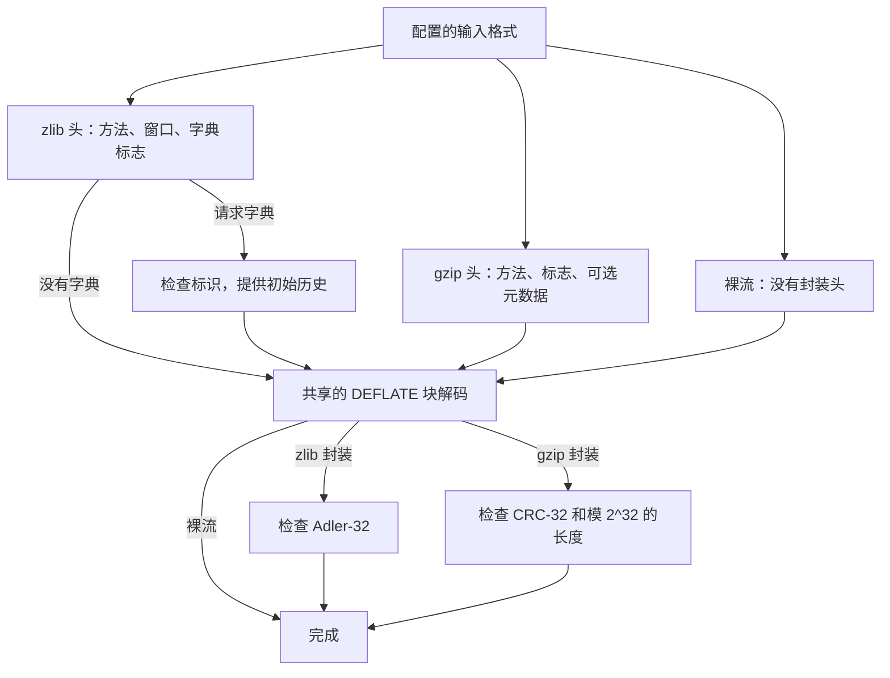
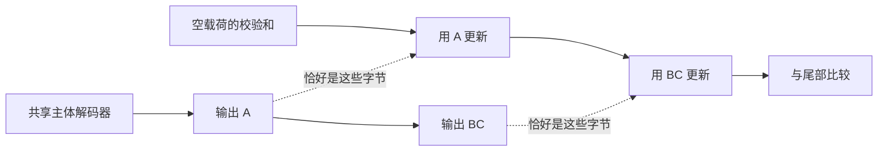
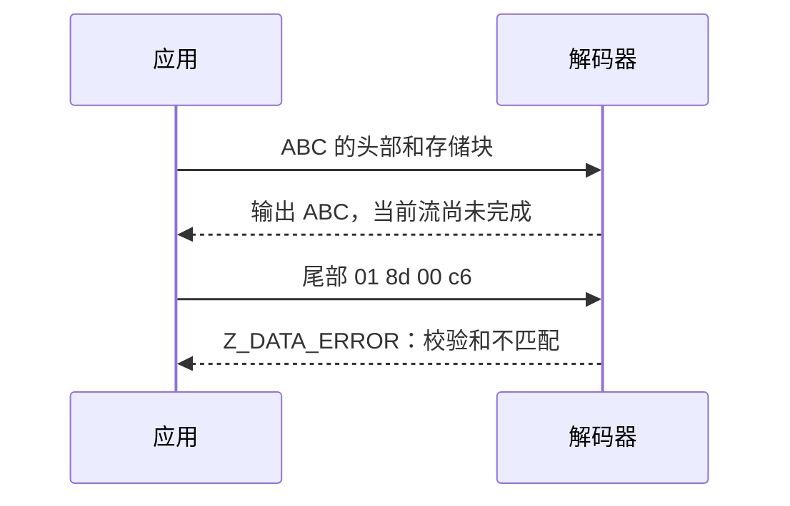

<!-- source-sha256: 077978280d767781e00a4a2d3498a2aca16ee960e9e12a9df13d8faba7e89319 -->

# 4. 格式与完整性检查

[上一章：3. 流式处理](streaming.md) · [总览](../overview.md) · [下一章：5. 状态操作](state-operations.md)

裸 DEFLATE、zlib 和 gzip 可以携带同一个表示 `ABC` 的压缩主体。
三种格式的区别在头部和尾部：头部设定解码器的起始条件，尾部检查结果。本章把共用的主体与包在外面的包装分开来看。
本章解释 zlib 做了什么，不证明任何结论。

两个标记说明一句话与证明的关系：

- **安全：** 安全定理所覆盖的义务：没有未定义行为、没有内存错误、没有泄漏，并且终止（见[安全性](../spec/safety.md)）。
- **功能：** 关于字节或格式的性质。安全结论不要求它。

[章末的表](#what-the-safety-theorems-say-about-this-chapter)列出本章用到的每个函数的安全目标。

## 目录

- [4.1 把同一个主体放入三种封装](#41-put-the-same-body-in-three-envelopes)
- [4.2 头部建立解码器的起始条件](#42-headers-establish-the-decoders-starting-conditions)
  - [4.2.1 窗口与可选的初始历史](#421-a-window-and-an-optional-initial-history)
  - [4.2.2 Gzip 元数据有独立的接收位置](#422-gzip-metadata-has-a-different-destination)
- [4.3 沿着字节追踪校验和](#43-follow-the-bytes-into-the-checksum)
- [4.4 输出可以先于检查失败发生](#44-output-can-precede-a-failed-check)
- [4.5 结束一个成员，再开始下一个](#45-finishing-one-member-and-starting-another)
- [安全定理对本章说了什么](#what-the-safety-theorems-say-about-this-chapter)

## 4.1 把同一个主体放入三种封装

一个最终**存储块**可以不使用 Huffman 编码，直接携带这三个字节：

```text
01 | 03 00 | fc ff | 41 42 43
     LEN=3  NLEN     A  B  C
```

`01` 包含最终块标志、存储块类型和填充位；`03 00` 是长度；`fc ff` 是它的 16 位反码。
这份选定的编码不一定是压缩器的选择。[编码](encoding.md)一章解释其他选择。


*图 4.1。蓝色表示共享主体，灰色表示头部，琥珀色表示尾部。宽度是示意性的，
十六进制值是实际字节。颜色表示数据角色，不表示状态。*

**功能：** 三条路径对这个块的解释完全相同，解码器找得到它的终点，所以尾部既不会变成输出，也不会被当作下一个块。
[格式规则](../spec/format/README.md#layers-and-stream-boundaries)定义这些字节的含义。
**安全：** 对头部、主体或尾部字节的每次读取，都在调用者提供的输入之内。

## 4.2 头部建立解码器的起始条件

各路径共享块解码模式，但历史和窗口参数可能不同。



*图 4.2。这是普通流程的概念路径，不表示各自独立的 C 函数。
头部和尾部都可以跨越多次调用；格式错误的字段会转入错误路径。*

`inflate()` 是一个状态机。它的 `HEAD` 模式及其后的 gzip 模式解析头部。
`TYPE` 以及表和符号的各个模式解码主体。`CHECK` 与 `LENGTH` 处理尾部。
三个辅助函数承担其中一部分工作：`inflate_table()` 构造表，`inflate_fast()` 解码一段快速片段，`updatewindow()` 保存历史。
[模式证明](../proof/inflate.md#the-mode-proof)沿着这些边界、按翻译的原样展开。

### 4.2.1 窗口与可选的初始历史

窗口限制为 16 KiB 的解码器会拒绝声明 32 KiB 的 zlib 头（`Z_DATA_ERROR`）。
以 `windowBits` 为 0 初始化的解码器则从头部取得窗口大小。
编译期选项 `INFLATE_STRICT` 还会把头部的最大距离用于主体检查；默认构建没有定义它。

如果两端都以末尾为 `AB` 的字典开始，距离为二的引用可以在当前流尚未输出两个字节前使用这段历史。
没有初始历史时，同样的引用就没有依据。

**功能：** 因此，关于主体的命题从一段初始历史和一个窗口大小出发，二者都由实际的头部处理和字典调用建立。
Adler-32 字典标识可能碰撞：恢复预期的数据需要字节相符，不能仅凭标识相等。
精确范围见[窗口请求](../spec/api/inflate-stream.md#inflateinit2_)和
[字典条件](../spec/api/inflate-stream.md#inflatesetdictionary)；
[状态操作](state-operations.md)一章讨论裸流的字典。

### 4.2.2 Gzip 元数据有独立的接收位置

Gzip 的名称、注释和额外字段不会改变字面量、匹配或 Huffman 规则。
Gzip 没有 zlib 式的预置字典请求。

`inflateGetHeader()` 把调用者拥有的头部记录及其缓冲区交给解码器。之后的 `inflate()` 调用解析并写入它们。
名称可能跨越多个输入缓冲区，所以解码器在调用之间保存解析进度。
**安全：** `inflate` 向这三个缓冲区最多分别写入 `extra_max`、`name_max` 和 `comm_max` 个字节。
这依赖一条前提：只要该记录还交在解码器手里，每次调用 `inflate` 时记录及其缓冲区都保持有效；并且在 `inflate` 读取头部期间，`extra` 缓冲区与未读输入互不重叠（见[偏离记录](../deviations.md#when-a-gzip-header-and-its-buffers-must-be-valid)）。
[头部契约](../spec/api/inflate-stream.md#inflategetheader)同时定义这些内存效果和字节含义。

可选的头部检查保存此前头部字节的 CRC-32 的低 16 位。
载荷的 CRC 重新开始，覆盖未压缩数据。把二者混在一起的解码器，即使 CRC 函数正确，也会拒绝有效输入。

## 4.3 沿着字节追踪校验和

对于 `ABC`（65、66、67），Adler-32 从 `s1 = 1`、`s2 = 0` 开始。
逐字节把字节值加到 `s1`，再把 `s1` 加到 `s2`，都对 65521 取模：

| 已处理前缀 | `s1` | `s2` |
| --- | --- | --- |
| 空 | 1 | 0 |
| `A` | 66 | 66 |
| `AB` | 132 | 198 |
| `ABC` | 199 | 397 |

结果是 `397 * 65536 + 199 = 0x018d00c7`；zlib 按最高有效字节在前的顺序写出。
CRC-32 是 `0xa3830348`；gzip 按最低有效字节在前的顺序写出 CRC 和长度（图 4.1）。
这些计算示范了独立的[校验和定义](../spec/format/README.md#checksum-mathematics)，不是实现证明。



*图 4.3。解压对已输出字节计算校验和；压缩对已接受输入计算校验和。
两者都不把压缩后的字节当作载荷来计算校验和。*

**功能：** 先用 `A` 更新、再用 `BC` 更新，等于用 `ABC` 更新；累加值恰好是已处理前缀的校验和：
不漏掉字节，不重复计入，也不混入头部字节。
**安全：** 每次校验和调用只读取交给它的范围，其算术没有未定义行为。
见 [Adler-32](../proof/adler32.md) 和 [CRC-32](../proof/crc32.md) 两页。

## 4.4 输出可以先于检查失败发生

先提供图 4.1 中 zlib 格式的头部和主体，不提供四个尾部字节。
输出 `ABC` 后，再提供 `01 8d 00 c6`，而非正确的 `01 8d 00 c7`。



*图 4.4。已经输出的字节不能撤回；完整流的验证发生在后面。*

**功能：** 启用校验时，解码器拒绝这个不匹配。
**安全：** 拒绝数据的那次调用是安全的，其后的 `inflateEnd` 也是安全的。
校验和相等本身既不能确立字节相等，也不能确立真实性；还需要主体与输出之间的关系。
尾部不完整不算错误；解码器等待更多输入。
详见[结果契约](../spec/api/inflate-stream.md#inflate)和
[尾部证明](../proof/inflate.md#table-and-trailer-statement-boundaries)。

## 4.5 结束一个成员，再开始下一个

在 `member("ABC") || member("DEF")` 中，`||` 表示拼接。
每个 gzip 成员都有自己的头部、主体、校验和和长度。
`inflate()` 在第一个 `Z_STREAM_END` 处停止；处理下一个成员前，重置存活的解码器，并保留未读输入。

```text
第一个成员：头部 → 主体 ABC → CRC／长度 → Z_STREAM_END
                                          │ 重置
下一个成员：头部 → 主体 DEF → CRC／长度 → Z_STREAM_END
```

**功能：** 正确的组合在第一个成员的实际终点处切分输入，重新开始历史和校验和，并把输出拼成 `ABCDEF`。
在第一个终点就停下的应用会丢失 `DEF`。
**安全：** 两个成员之间的 `inflateReset` 使流的存储仍归流所有，并且访问不越界。
详见[重置操作](state-operations.md)；[gzip 文件读取接口](interfaces.md)自己处理连续的成员。
[共同的证明规则](../overview.md#shared-proof-rules)适用于本章全部内容。

## 安全定理对本章说了什么

下表给出本章用到的每个函数的安全目标。目标的全名是 `ZlibF.Spec.Public.Goal.<name>`。
[安全性](../spec/safety.md)说明这些目标陈述什么，[偏离记录](../deviations.md)列出每个比 `zlib.h` 更窄的前提，
[进度页](../progress.md)说明哪些目标已完成。

| 函数 | 安全目标 | 契约 |
| --- | --- | --- |
| `inflateInit2`（`inflateInit2_` 的宏），它选择裸流、zlib 或 gzip 以及窗口 | `Goal.inflateInit2__safety` | [inflateInit2_](../spec/api/inflate-stream.md#inflateinit2_) |
| `inflate`（头部、主体、尾部） | `Goal.inflate_safety` | [inflate](../spec/api/inflate-stream.md#inflate) |
| `inflateSetDictionary` | `Goal.inflateSetDictionary_safety` | [inflateSetDictionary](../spec/api/inflate-stream.md#inflatesetdictionary) |
| `inflateGetHeader` | `Goal.inflateGetHeader_safety` | [inflateGetHeader](../spec/api/inflate-stream.md#inflategetheader) |
| `inflateReset` | `Goal.inflateReset_safety` | [inflateReset](../spec/api/inflate-stream.md#inflatereset) |
| `inflateEnd` | `Goal.inflateEnd_safety` | [inflateEnd](../spec/api/inflate-stream.md#inflateend) |
| `adler32` | `Goal.adler32_safety` | [adler32](../spec/api/checksums.md#adler32) |
| `crc32` | `Goal.crc32_safety` | [crc32](../spec/api/checksums.md#crc32) |

下一章[状态操作](state-operations.md)讨论 Reset、Copy、字典和刷新。
