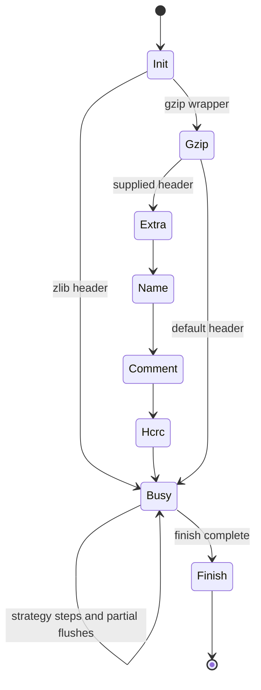

# Earlier notes on what a functional proof needs

This page keeps sections that were removed from the pages under
[`docs/proof/`](../proof/README.md) when those pages were rewritten to explain the safety proofs.
The sections were written as instructions: what a proof of functional correctness, or a proof
then still open, has to establish. They are not statements of results, and a sentence here that
says "prove" or "must" does not mean that the step is open or that it is done.

**State today.** Every required safety goal has a registered theorem; the current argument for
each component is on its proof page. The functional goals these notes speak of (the output of
`inflate` equals the meaning of the input, the output of `deflate` decodes to its input) are not
required for the safety results. The notes are kept for work on those goals.

The text below each heading is unchanged, except that links were adjusted to this directory.

## `inflate.c`: causality and history across calls

This section is functional. It is not required. It records why two earlier
model statements were wrong, and what a correct functional statement needs.

Functional correctness must identify output independently of the implementation
state. A decoded symbol needs a supporting prefix of source bits. The decoder
may read beyond that prefix speculatively, and may return whole lookahead bytes
before leaving the fast path. Relate the emitted symbol to the supporting bits;
do not require its meaning to agree with all speculative lookahead.

The earlier whole-lookahead consistency condition is false. The corrected
supporting-bit-prefix relation addresses that distinction. Likewise, a fixed
data-error detection lag of eight bytes has a counterexample. Increasing the
constant without proof does not establish a causal error theorem. These are
specification and model lessons, not upstream memory bugs. The corrected
relation is registered as `inflate_deferred_distance` and
`inflate_deferred_distance_rejects_legacy_consistency`, with the regression
`tests/regression/inflate-deferred-distance`.

Across calls, preserve the accumulated bit prefix, output prefix, logical
history, wrapper/checksum state and any dictionary requirement. Quantify over
all permitted input splits, output-room splits and flush values. A later
failure may follow actual output: delayed window allocation can return
`Z_MEM_ERROR` after decompression has written bytes. Error contracts must retain
those effects rather than require empty output.

A preset dictionary contributes a known checksum requirement and may provide
history whose contents are not known until the caller supplies it. Distinguish
that unknown history from output bytes. Raw dictionary replacement, header
operations, priming and recovery require their exact API effects; an ordinary
data-epoch refinement does not cover every such sequence automatically.
Negative-value priming also requires the general bit-level bridge, beyond a
finite execution matrix or model witness.

## `inflate.c`: lifecycle and auxiliary functions

| Functions | What the proof must compose |
| --- | --- |
| `inflateInit_`, `inflateInit2_` | Version/size and parameter refusals, state allocation, initialization writes, success invariant and exact failure cleanup. |
| `inflateReset`, `inflateResetKeep`, `inflateReset2` | Their distinct counter/history/header effects, permitted window-size changes and matching ownership transitions. |
| `inflateEnd` | Free window and state once, clear the stream state and restore the caller's prior live-block set. |
| `inflatePrime` | Negative-count reset and nonnegative bit insertion; shifts, low-bit interpretation and count-limit refusals. |
| `inflateSetDictionary`, `inflateGetDictionary` | Documented dictionary modes, checksum decision and ring copies in chronological order; history differs from produced output. |
| `inflateCopy` | Independent state/window allocations and failure cleanup; copy content, rebase dynamic `lencode`, `distcode`, `next`, preserve static pointers and prove future behavioral equivalence. |
| `inflateSync`, `syncsearch` | Bounded scanning, recovery state changes and the relation of discarded input to the restarted decoder epoch. |
| `inflateGetHeader` | Store permitted caller storage and preserve its lifetime/capacity requirements until header processing completes. |
| `inflateMark`, `inflateSyncPoint`, `inflateCodesUsed` | Exact numeric/query behavior in every admitted mode, including refusal cases. |
| `inflateValidate`, `inflateUndermine` | Exact state updates, supported/unsupported behavior and invariant preservation. |

The unpatched `inflateCopy` compares pointers to the static fixed table and to
the state's `codes` array with `>=` and `<=`. Those are different objects, so the
comparison is undefined. Patch 0001 replaces it with pointer equality
([finding](../findings/inflate-copy-fixed/README.md), `patches/README.md`). The
translation and `inflateCopy_safety` are for the patched source.

The sequence theorem uses the init result and each function's proved
preservation, frame and ownership effects. It does not connect the internal
history and table predicates to the independent format relation. That
connection is functional and not planned; the abstract model theorem
`inflate_decodes` is a statement about the model only.

## `inffast.c`: from safety to decoding

This section is functional. It is not required; the results it describes were
proved earlier and stay.

The functional loop invariant identifies the consumed low bits with the
original source stream and relate emitted literals/matches to independent
format symbols. The relation is kept through length and distance selection,
extra-bit reads, all copy shapes, linked tables, end and error exits, rollback
and final writeback. It holds for the whole body and the whole call, not only
for one successful token.

The source-origin lemmas establish the exact selected bits for their stated
domains. Connecting them to every legal caller view and to the independent
output semantics is the functional goal of `inflate`, which is not planned.
Speculative lookahead is not justified by the bytes supporting a decoded
symbol; the causal distinction is explained in [inflate](../proof/inflate.md).

For termination, a body writes at least one byte or exits on end or error. The
finite output range bounds the number of continuing bodies. Copy loops and
linked lookups also have bounded measures. These bounds stay below the fuel
budget, and the frame holds on every exit. No allocation occurs here; ownership
of the existing state and window is unchanged.

## `deflate.c`: headers, data and trailers

The actual source has conditional skips and partial returns inside these
groups. The invariant D7 ties `EXTRA`, `NAME`, `COMMENT` and `HCRC` to valid
`gzhead` storage. An earlier invariant admitted `EXTRA` with a null header;
that counterexample showed a missing reachability condition, not a legal
sequence theorem.

Each header `put_byte` needs pending room. Extra/name/comment loops flush at
capacity and preserve their exact progress counters across output exhaustion.
The subtraction `(extra_len & 0xffff) - gzindex` requires the corresponding
progress bound. Trailer writes require the same room proof. `flush_pending`
uses `pending_out + pending ≤ pending_buf + pending_buf_size` and copies at
most `avail_out`, then updates exact cursors and counts.

Functional only: public correctness additionally relates emitted wrapper
fields, block bits, checksums and trailer lengths to the consumed input and
selected flush schedule. A monotone history of whether compression has started
matters across refusals: a failed call must not make a later call look like a
fresh stream.

## `deflate.c`: API lifecycle and error cases

| Functions | Proof boundary |
| --- | --- |
| `deflateInit_`, `deflateInit2_` | Validate parameters and version/size; allocate state and four buffers; establish every field/ownership clause on success and free every successful allocation on failure. The default allocator does not zero storage. |
| `deflateReset`, `deflateResetKeep`, `lm_init` | Distinguish full history/hash reset from retained-state behavior and establish the appropriate phase invariant. |
| `deflateEnd` | Free all owned buffers and state exactly once under every admitted status; return the documented status and clear the state pointer. |
| `deflateSetDictionary`, `deflateGetDictionary` | Read/copy the permitted dictionary views, update wrapper checksum/history and meaningful insertions, and return the exact dictionary suffix. |
| `deflatePrime` | Preserve nonnegative/negative-count behavior and pending/bit-buffer capacity conditions with the source's exact shifts. |
| `deflateParams` | Compose any `deflate(Z_BLOCK)` call and its partial/failure effects before changing strategy, level and hash state. |
| `deflateCopy` | Allocate independent blocks, clean up each failure prefix, copy only the source-prescribed ranges and rebase pending/symbol/descriptor pointers. |
| `deflateBound`, `deflateBound_z` | Prove machine arithmetic and separately prove output adequacy under the contract's configuration/header conditions. A numeric formula theorem is not adequacy. |
| `deflateTune`, `deflatePending`, `deflateSetHeader`, `deflateUsed` | Exact parameter/query/refusal effects, permitted output-cell writes and preservation needed by later data calls. |

Copy's window content range is `high_water`; its `prev` copy includes unwritten
integer cells. Allocation failure may occur after earlier allocations succeeded.
The proof must retain the source's cleanup behavior and destination/source
frames for each case. Callee contracts are proved execution results, never
hypotheses bundled into the top theorem.

The sequence theorem composes initialization, calls, the reset, dictionary,
header, priming and copy operations, and End. It has no restriction on
`memLevel` or on any other parameter. A round-trip theorem, which would connect
the emitted stream to independent DEFLATE semantics, is functional and not
planned.

## `trees.c`: canonical words and tree descriptions

`gen_codes` first computes canonical start words from `bl_count`, then writes
the reversed word for each positive-length symbol and advances that length's
next word. `I-gc-*` must establish the exact reversed canonical assignment,
preservation of lengths and the frame outside selected code cells. Safety
needs explicit array and length bounds; correctness additionally needs the
canonical-code/count relation. Unsigned wrapping in the start-code arithmetic
must agree with the actual translated operations.

`bi_reverse` has a positive count for each such call, at most 15. Its loop
reverses exactly that many bits. The zero-length case is skipped before the
call. The actual execution proof must account for both loops and their fuel.

| Functions | Required bounds and meanings |
| --- | --- |
| `scan_tree` | Sentinel store at `max_code+1` fits the tree. Real lengths are `0..15`; sentinel `0xffff` is compared without indexing `bl_tree` by it. Repeat symbols 16, 17 and 18 fit the bit-length tree. |
| `send_tree` | Its repeat decomposition matches the scan's counts and reproduces the original code-length sequence using the generated bit-length codes. |
| `build_bl_tree` | `bl_order[max_blindex]` is bounded while scanning from 18 toward 3; connect tree costs to the actual description. |
| `send_all_trees` | `blcodes ≤ 19` and the other count bounds justify descriptor and order-table accesses; emitted counts and lengths match the format grammar. |
| `_tr_tally` and tally macros | Every stored literal/match has the specified length/distance domain and corresponding frequency update; symbol writes fit the shared region. |
| Initialization and reset helpers | Establish descriptor pointers, END_BLOCK frequency, bit-buffer state and zero/count facts before their consumers read them. |

## `trees.c`: what the block flush composes

The flush result uses actual descriptor initialization, heap selection and
merges, length repair, canonical assignment, description emission and
block-cost selection. It establishes F7, F8 and F9 on the same execution and
frames all memory outside the allowed tree, symbol and pending regions. A proof
mutant must fail the function's execution proof, even when a source-equality
lemma still checks.
