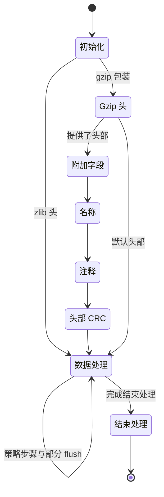

<!-- source-sha256: 0610fe9350ec612ded1b92505dd9ea479ff16095a70ee23925f398365dc58aef -->
# 早先关于功能证明需要什么的笔记

[`docs/proof/`](../proof/README.md) 下的页面改写为解释安全证明时，删去了一些小节，本页把它们保存下来。这些小节是以指示的口吻写的：功能正确性的证明，或者当时尚未完成的证明，需要建立什么。它们不是对结论的陈述；这里的句子说“应当证明”或“必须”，并不表示那一步未完成，也不表示它已经完成。

**现状。** 每一个必需的安全目标都有一条已登记的定理；各组件现在的论证在它的证明页面上。这些笔记谈到的功能目标（`inflate` 的输出等于输入的含义，`deflate` 的输出能解码回它的输入）不是安全结论所必需的。保留这些笔记，是为了这些目标上的工作。

每个标题下面的文字没有改动，只是把链接调整到了本目录。

## `inflate.c`：因果关系与跨调用历史

本节是功能性的，不是必需的。它记录早先两个模型陈述为什么是错的，以及正确的功能性陈述需要什么。

需要区分“为确定当前符号已经检查的比特”和“为了快速查表提前读入的比特”。例如当前字面量只由前 3 位决定，寄存器可能已经读入整字节；后面 5 位不必已经构成一个合法的后续符号。当前输出的依据是前 3 位，证明不能把更远预读错误地当成已经解释完的输入。

功能正确性必须独立于实现状态确定输出。解出的一个符号需要一段支撑它的源比特前缀。
解码器可能推测性地读到该前缀之后，也可能在离开快速路径前归还完整预读字节。
应把发出的符号与支撑比特关联，不能要求符号含义与所有推测性预读都一致。

早期针对整个预读区间的一致性条件是错误的。修正后的支撑比特前缀关系区分了两者。
同样，固定八字节的数据错误检测延迟存在反例。
没有证明就增大常数，不能建立因果错误定理。这些是规范和模型方面的经验，
并非上游内存问题。修正后的关系登记为 `inflate_deferred_distance` 和 `inflate_deferred_distance_rejects_legacy_consistency`，对应的回归是 `tests/regression/inflate-deferred-distance`。

跨调用应保持累计比特前缀、输出前缀、逻辑历史、包装／校验和状态及字典需求。
应量化所有许可的输入拆分、输出空间拆分及刷新值。
后续失败可能发生在实际输出之后：延迟窗口分配可在解压已经写出字节后返回 `Z_MEM_ERROR`。
错误契约必须保留这些效果，不能要求输出为空。

预置字典带来已知校验和要求，也可能提供在调用者给出字典前内容未知的历史。
要把这种未知历史与输出字节区分开。裸 DEFLATE 字典替换、头部操作、位预置和恢复需要各自精确的 API 效果；
普通数据阶段的细化不会自动涵盖所有此类序列。
负值位预置也需要一般的比特级连接，不能只依靠有限执行矩阵或模型见证。

## `inflate.c`：生命周期与辅助函数

| 函数 | 证明必须组合的内容 |
| --- | --- |
| `inflateInit_`、`inflateInit2_` | 版本／大小及参数拒绝、状态分配、初始化写入、成功不变量与准确的失败清理。 |
| `inflateReset`、`inflateResetKeep`、`inflateReset2` | 各自不同的计数／历史／头部效果、许可的窗口大小变化及对应所有权转换。 |
| `inflateEnd` | 窗口与状态各释放一次，清空流状态，并恢复调用者先前的存活块集合。 |
| `inflatePrime` | 负计数重置与非负比特插入；移位、低位含义和计数上限拒绝。 |
| `inflateSetDictionary`、`inflateGetDictionary` | 文档规定的字典模式、校验和判定，以及按时间顺序的环形复制；历史不等于已产生输出。 |
| `inflateCopy` | 独立状态／窗口分配与失败清理；复制内容，重定位动态 `lencode`、`distcode`、`next`，保留静态指针，并证明未来行为等价。 |
| `inflateSync`、`syncsearch` | 有界扫描、恢复状态变化，以及丢弃输入与重新开始的解码阶段之间的关系。 |
| `inflateGetHeader` | 保存获准的调用者存储，并保持其生命周期／容量要求直到头处理完成。 |
| `inflateMark`、`inflateSyncPoint`、`inflateCodesUsed` | 每个许可模式中的准确数值／查询行为，包括拒绝情形。 |
| `inflateValidate`、`inflateUndermine` | 准确状态更新、支持／不支持的行为及不变量保持。 |

未打补丁的 `inflateCopy` 用 `>=` 和 `<=` 比较指向静态固定表的指针和指向状态 `codes` 数组的指针。它们是不同对象，所以这种比较是未定义的。补丁 0001 把它换成指针相等比较（[发现](../findings/inflate-copy-fixed/README.md)，`patches/README.md`）。翻译和 `inflateCopy_safety` 针对的是打过补丁的源代码。

序列定理使用初始化结果，以及各函数已证明的保持、帧与所有权效果。它并不把内部历史和表谓词连接到独立的格式关系。这种连接是功能性的，不在计划内；抽象的模型定理 `inflate_decodes` 只是关于模型的陈述。

## `inffast.c`：从安全到解码含义

本节是功能性的。它不是必需的；它描述的结果是早先证明的，继续保留。

“源出处”回答每一段已消费比特来自原输入的哪里；“格式语义”回答这些比特表示哪个符号。二者要在同一次运行中连接起来。例如，距离码的几位来自正确输入位置，并不单独保证复制循环输出了正确的历史字节。

功能循环不变量把已消费的低位比特对应到原始源比特流，并把发出的字面量／匹配对应到独立格式符号。该关系经过长度／距离选择、附加位读取、所有复制形状、链接表、结束与错误出口、回退及最终写回而保持。它对整个循环体和整个调用成立，而不只是对局部成功解出的一个符号成立。

源出处引理在其声明的定义域内确定所选比特的准确来源。把它们连接到所有合法调用者视图及独立输出语义，是 `inflate` 的功能性目标，不在计划内。解出一个符号所依赖的比特，并不能说明更远的推测性预读合理；其因果区别见 [inflate](../proof/inflate.md)。

终止性方面，每个循环体至少写一个字节，或通过结束／错误出口退出。有限输出范围限制继续执行的循环体数量。复制循环与链接查找也各有有界度量。这些界限保持在燃料预算之内，并且帧性质在所有出口成立。这里不分配内存；现有状态和窗口的所有权不变。

## `deflate.c`：头部、数据与尾部

头部阶段中的 `gzhead` 指向调用者借出的 gzip 头。`gzindex` 计数当前头字段已经发出多少字节，`pending` 计数内部仍待交付的字节，`pending_out` 指向其中下一次应交付的位置。它们让一次写不完的头部可以跨调用继续；不是每次调用都重新从头输出。

实际源代码在这些组内有条件跳过及部分返回。
不变量 D7 把 `EXTRA`、`NAME`、`COMMENT`、`HCRC` 对应到有效的 `gzhead` 存储。
先前不变量允许空头指针处于 `EXTRA`；该反例表明缺少可达性条件，并不是合法序列定理。

每个头部 `put_byte` 都需要待输出区空间。
附加数据、名称和注释循环在容量处刷新，并在输出空间耗尽时保持准确的进度计数。
减法 `(extra_len & 0xffff) - gzindex` 需要相应进度界限。
尾部写入需要同样的空间证明。
`flush_pending` 使用 `pending_out + pending ≤ pending_buf + pending_buf_size`，
复制量至多为 `avail_out`，随后准确更新游标和计数。

仅属于功能性证明：公开正确性还需把发出的包装字段、块比特、校验和及尾部长度，
对应到已消费输入与所选刷新安排。
对于“压缩是否已经开始”需要单调的历史记录，并跨拒绝保持：
失败调用不得使后续调用看起来像全新流。

## `deflate.c`：API 生命周期与错误情形

| 函数 | 证明边界 |
| --- | --- |
| `deflateInit_`、`deflateInit2_` | 验证参数及版本／大小；分配状态与四个缓冲区；成功时建立全部字段／所有权条件，失败时释放每个成功分配。默认分配器不清零存储。 |
| `deflateReset`、`deflateResetKeep`、`lm_init` | 区分完整历史／哈希重置与保留状态行为，并建立相应阶段不变量。 |
| `deflateEnd` | 在每个许可状态下恰好释放一次所有自有缓冲区及状态，返回文档规定状态并清空状态指针。 |
| `deflateSetDictionary`、`deflateGetDictionary` | 读取／复制许可字典视图，更新包装校验和／历史及有意义的插入，返回准确字典后缀。 |
| `deflatePrime` | 用源代码准确的移位，保持非负／负计数行为及待输出区／位缓冲区容量条件。 |
| `deflateParams` | 改变策略、级别及哈希状态前，组合可能的 `deflate(Z_BLOCK)` 调用及其部分／失败效果。 |
| `deflateCopy` | 分配独立块，清理每个失败前缀，只复制源规定范围，并重定位待输出／符号／描述符指针。 |
| `deflateBound`、`deflateBound_z` | 证明机器算术，并单独证明在契约配置／头部条件下容量足够。数值公式定理不等于容量充分性。 |
| `deflateTune`、`deflatePending`、`deflateSetHeader`、`deflateUsed` | 准确参数／查询／拒绝效果、许可输出单元写入及后续数据调用所需的保持。 |

下表的“复制”要求两条流在相同后续输入下可以继续相同任务，同时各自拥有独立动态存储；“重置”则开始或准备另一个任务。复制内容相等不等于共享所有权，失败清理也不能误释放原流仍在使用的块。

复制的窗口内容范围是 `high_water`；`prev` 复制包括未写入的整数单元。
先前分配成功后仍可能出现分配失败。
证明必须逐一保持源清理行为及目标／源的帧性质。
被调用者契约是已证明的执行结果，不能打包成顶层定理的假设。

序列定理组合初始化、数据调用、重置、字典、头部、位预置和复制操作，以及结束。它对 `memLevel` 和其他任何参数都没有限制。把发出的流连接到独立 DEFLATE 语义的往返定理是功能性的，不在计划内。

## `trees.c`：规范码字与树描述

规范码字按“码长优先，同长时按符号编号”的固定次序分配。这样解码器只需要收到码长，就能重建相同码字。`gen_codes` 负责这次赋值；`scan_tree` 统计连续重复码长可以如何压缩，`send_tree` 则按这个描述真正发出码长符号。统计成本与实际发出的描述必须一致。

`gen_codes` 先由 `bl_count` 计算各码长的规范起始码字，再为每个正码长符号写入反转码字，
并推进相应长度的下一个码字。
`I-gc-*` 必须建立准确的反转规范赋值、长度保持及选定码字段之外的帧性质。
安全性需要明确的数组和长度界限；正确性还需要规范码／计数关系。
起始码算术中的无符号回绕必须与实际翻译操作一致。

这里每次 `bi_reverse` 调用的计数都为正，至多为 15。循环恰好反转这么多比特。
零长度情形在调用前跳过。实际执行证明必须考虑两个循环及其执行步数预算。

| 函数 | 所需界限与含义 |
| --- | --- |
| `scan_tree` | `max_code+1` 的哨兵写入位于树内。真实长度是 `0..15`；比较哨兵 `0xffff` 时不得用它索引 `bl_tree`。重复符号 16、17、18 在码长树内。 |
| `send_tree` | 重复分解匹配扫描计数，并用生成的码长码重建原始码长序列。 |
| `build_bl_tree` | 从 18 向 3 扫描时，`bl_order[max_blindex]` 有界；把树成本连接到实际描述。 |
| `send_all_trees` | `blcodes ≤ 19` 及其他计数界限证明描述符和顺序表访问有效；发出的计数与长度匹配格式语法。 |
| `_tr_tally` 与符号累计宏 | 保存的每个字面量／匹配都具有规定的长度／距离定义域及相应频率更新；符号写入位于共用区域内。 |
| 初始化与重置辅助函数 | 在消费者读取前建立描述符指针、`END_BLOCK` 频率、位缓冲状态及零值／计数事实。 |

## `trees.c`：块刷新所组合的内容

刷新结果使用实际描述符初始化、堆选择与合并、码长修复、规范赋值、描述输出及块成本选择。
它在同一次执行上建立 F7、F8 和 F9，并证明许可的树、符号和待输出区域之外的所有内存不变。
即便源代码相等引理仍通过，证明变异也必须使该函数的执行证明失败。
