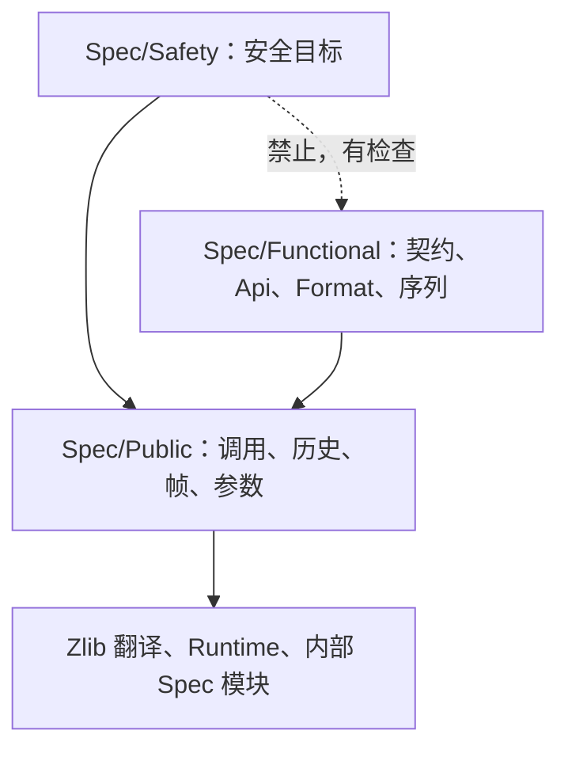

<!-- source-sha256: e44491d3c30ff9daf3863c761204f3f3ecffe6620b3781547611af875ba58edb -->
# 安全与功能拆分的计划（历史）

本页保存把 `ZlibF/Spec/` 拆分为安全规格和功能规格的工作计划，内容是它在 2026-11-15 的样子。除相对链接和这段说明之外，文字没有改动。它是历史记录：“今天”“已完成”“未证明”“未完成”这类词，以及批次名、数目和提交号，描述的都是各自写下时的情况。[规格的布局](../design/safety-functional-split.md)说明现在的布局，[目标](../checking/goals.md)说明现在的审计规则。Lean 注释和清单 `tests/audit/public-api.json` 引用了“step 2”和“step 4”：它们就是下文[工作顺序](#order-of-work)中的步骤。

这份计划说明怎样拆分 `ZlibF/Spec/`，使当前目标（每个公开函数的安全性）能从一个目录读出。其中的任何内容都不改变已证定理的含义。

**状态（2026-11-15）。** 设计已于 2026-11-13 批准，按[工作顺序](#order-of-work)中列出的步骤实施。

- 已完成：第 1 至 3 步。目录、快速关卡中的分层检查、无状态族与 inflate、deflate 两族的逐函数安全目标，以及清单和审计规则都已就位。`open_safety` 为空，所以现在缺少必需的定理就会使审计失败。
- 部分完成：第 4 步。gzip 文件接口和 `inflateBack` 的序列安全目标已登记。仍待处理的有：为每个 gz 函数和 `inflateBack` 函数各陈述一个安全目标；把 gz 与 `inflateBack` 的目标定义移出 `Spec/Public/`；去掉唯一一条仍在允许列表中的导入边（`Public/GzState` 到 `Api/Gz`）。
- 未完成：进度视图的两栏汇总，以及 `docs/spec/` 的 `safety/` 和 `functional/` 两节。

## 改变什么，不改变什么

- `ZlibF/Spec/Safety/` 存放安全目标：在文档规定的定义域上没有 `Fault.ub`、没有内存错误、没有泄漏，并且终止。验收审计要求这些目标。
- `ZlibF/Spec/Functional/` 存放结果契约、格式模型和 API 模型（`Api/`、`Format/`），以及往返命题（`Goal.*_sequence`）。它们仍然参加构建，已证明的仍然接受完整审计。未证明的报告为未证明，不使任何检查失败。
- `ZlibF/Spec/Public/` 保留，成为公共部分：两类目标共用的定义。只有目标定义和纯功能性的内容移出。以后是否把 `Public/` 改名为 `Common/` 尚未决定（见下文）。
- 目标名称不变。每个目标仍是 `ZlibF.Spec.Public.Goal.<name>`。拆分体现在目录上；Lean 命名空间保持原样。因此 `tests/audit/theorems.txt`、`goals.txt`、变异体表以及每个引用目标名的证明都继续有效。
- **目前已登记的每个定理都保持已登记，并接受完整审计。** 拆分不删除、不削弱任何已验收或已登记的结果。
- 移动时不改动任何命题文本。完整契约 `Goal.X` 不会被削弱或删除：它成为 `X` 的功能目标，安全目标写在它旁边。
- 快速关卡增加一项导入检查。必需内容的变化发生在验收的 `audit` 作业中。

## 布局与导入方向



`Spec/Safety/` 或 `Spec/Public/` 下的模块不得导入 `Spec/Functional/` 下的模块，间接导入也不行。脚本 `scripts/check-spec-layers.py` 遍历导入闭包，遇到这样的边就失败。快速关卡运行它。这样，读者读 `Spec/Safety/` 及其导入的内容，就知道完整的当前目标。在 gzip 模块拆分（第 4 步）之前，脚本带有一张尚待去掉的边的允许列表。这张列表只能缩短。

旧的模块路径 `ZlibF/Spec/Api/*` 和 `ZlibF/Spec/Format/*` 保留为只有一行的再导出模块，保留一个版本，使导入它们的分支仍能构建。检查把它们算作功能部分。

`ZlibF/Spec/` 顶层的内部规格（`Inflate*.lean`、`PlatformMemory.lean`、`ByteAddress.lean`、`Crc32ByteViews.lean`）是供证明使用的被调用者契约，不是公开目标。它们留在原处。其中两个导入了 `Spec/Format`（`InflateDecodeTableSemantics`、`InflateFastBodyToken`）。今天没有安全目标导入它们；如果有，检查会报告。

## 今天各模块的去向

每个定义按这条规则处理：完整契约 `Goal.X` 进入 `Functional/`。安全目标（`Goal.X_safety`、现有的 `_safe` 名称、序列安全目标和非空性目标）进入 `Safety/`。其他定义如果被某个安全目标使用，就留在 `Public/`，否则进入 `Functional/`。

| 今天 | 拆分之后 |
| --- | --- |
| `Spec/Format/*`、`Spec/Format.lean` | `Functional/Format/*` |
| 除参数解码器之外的 `Spec/Api/*` | `Functional/Api/*` |
| `Api/Basic` 中的参数解码器：返回码 `Api.Z`、`Flush`、`Wrap`、`inflWbits`、`DWrap`、`DeflParams`、`deflInit?` | `Public/Parameters.lean`，不带对 `Format` 的导入，命名空间不变 |
| `Public/Calls`、`Public/Memory`、`Public/History`（`StreamOwned`、`CallerRange`、`ActiveHeader`、`StreamOperation`、`StreamArguments`、`StreamReachable`、`Region`、各种帧） | 留在 `Public/` |
| `Public/Initialisation`、`Public/Lifecycle`、`Public/StreamQueries`、`Public/Domains`（`InitDomain`、见证堆） | 定义留下；`Goal.*` 进入 `Functional/`，非空性目标进入 `Safety/` |
| `Public/Sequences` 中的 `StreamInvariant`、`StreamWriteRegions`、`StreamHeaderRecord`、`StreamSequenceSafety`、`BackReachable`、`BackSafeReachable`、`BackPlatform` | 留在 `Public/Sequences.lean` |
| `Public/Sequences` 中的 `DataLog`、各种轨迹、`DecodesFor`、`FlushedFor`、`InflateCompletes`、`DeflateCompletes`、`Goal.inflate_sequence`、`Goal.deflate_sequence` | `Functional/Sequences.lean` |
| `Public/Sequences` 中的 `Goal.inflate_sequence_safety`、`Goal.deflate_sequence_safety` | `Safety/Sequences.lean` |
| `Public/Checksums`、`Public/Queries`、`Public/Streams`、`Public/Copy`、`Public/Utilities` | 定义留下；`Goal.*` 按规则进入 `Functional/` 或 `Safety/` |
| `Public/GzState`、`Public/GzTrace`、`Public/Gz*`、`Public/Back`、`Goal.gz_sequence`、`Goal.inflate_back_sequence*` | 第 4 步，等 gzip 的命题改动落地之后 |

`Public/GzState` 为了 `GzLooksGzip` 导入 `Api/Gz`，还导入 `Proof.«gzlib.c.base»`。前者在第 4 步之前是允许列表中的边。后者为检查所允许（只禁止 `Functional/`），列为以后的清理项。

## 每个公开函数两个目标

`tests/audit/public-api.json` 中的每个函数都得到一个安全目标和一个功能目标。安全目标陈述：执行的调用返回 `.ok`，只写自己的帧，并按账本所说改变存活块。它是可以不成立的：没有哪个安全目标按定义就为真。安全目标有三种形式。

- **无状态调用**（校验和、`compressBound*`、`zlibVersion`、`zlibCompileFlags`、`compress*` 与 `uncompress*` 工具函数）：在文档规定的定义域上，调用无故障地返回，只写声明的调用者区域，存活块不变。如果完整契约已经存在并且已证明，安全定理就是它的一个简短推论。
- **流操作**（inflate 族和 deflate 族）：每个函数一个目标，是关于该函数在每个可达历史上的一次调用的实在命题。它是 `StreamSequenceSafety` 的第二个子句对该 `Call` 构造子的特化，再加上不变量。初始化函数从 `InitDomain` 出发陈述，后者不需要历史。`inflateEnd` 和 `deflateEnd` 取第三个子句。已经存在的目标直接使用，不重新陈述：`Goal.deflateCopy_safety`（dev `fb1b8a02`），以及 batch 3 的拒绝目标 `Goal.inflate_refusal` 和 `Goal.deflate_refusal`（NULL 流或不一致的流以 `Z_STREAM_ERROR` 拒绝）。
- **gzip 文件接口和 `inflateBack`**：做法相同，分别来自 `Goal.gz_sequence_safety` 和 `Goal.inflate_back_sequence_safety`。gz 调用的写帧在陈述之前先与 batch C 在笔记中商定。

清单与 `docs/progress.md` 中“zlib.h 函数的无故障覆盖”一表逐行一致。该表按函数写出定理和途径（自己的目标、序列目标、End 子句，或未证明）。

非空性：第二种形式的流目标，强度取决于它的可达集合。四个非空性目标为每一族给出一个可达的见证：`Goal.inflate_initialisation_domain`、`Goal.deflate_initialisation_domain`、`Goal.inflate_back_initialisation_domain` 和 `Goal.gz_sequence_nonvacuity`。它们属于必需集合。`Goal.gz_initialisation_domain` 不属于：它陈述的是 `gzopen` 的功能契约，在清单中列于 `not_planned` 之下。每个逐函数目标的文档注释写明它依赖的见证。

命名：新目标叫 `Goal.<function>_safety`。现有的四个 `uncompress*_safe` 名称保留，因为给已登记的目标改名是一次命题改动，没有收益。清单明确写出目标名，所以审计不再猜后缀。

## 清单与审计

`apis` 的每一项用两个字段代替 `goal`：

```json
{"function": "deflateCopy", "safety_goal": "ZlibF.Spec.Public.Goal.deflateCopy_safety",
 "functional_goal": "ZlibF.Spec.Public.Goal.deflateCopy", ...}
```

顶层的 `open_safety` 列表写出每个还没有已登记定理的必需安全目标，以及它的负责人。把一个函数移入或移出必需集合只需改一行。`undocumented` 组保持 981aee5b 中的样子。gzip 文件接口和 `inflateBack` 在计划之内：它们的安全目标是必需的。两个序列安全目标现在都已登记，该列表为空。

`scripts/verification.py`：

- **必需**：每个不属于未文档化函数的 `lp64-linux` 函数的安全目标，加上 `safety_goals` 和 `nonvacuity_goals` 的各项。在每一个都证明之前，审计检查：不在 `open_safety` 中的每个目标都有一个类型恰好是它、只用允许公理的已登记定理，并且 `open_safety` 只缩短。dev 不会变红。从 `open_safety` 为空的那个提交起，缺少定理就使审计失败。
- **功能**：每个 `functional_goal` 以及 `sequence_goals`。已登记的证明接受完整审计（公理、确切类型、重放、有键时的变异体）。未证明的只报告，不使任何检查失败。
- **变异体**：功能目标已证明时以它为键，否则以安全目标为键。这取代 `mutation_apis` 中对 `_safe`/`_safety` 后缀的猜测。

实际的实现（第 3 步）：

- 未文档化的函数，以及 `gzopen_w`（不在目标构建中），带有 `safety_goal: null`。
- 在第 4 步为每个函数陈述一个目标之前，gzip 函数写的是 `Goal.gz_sequence_safety`，`inflateBackInit_`、`inflateBack` 和 `inflateBackEnd` 写的是 `Goal.inflate_back_sequence_safety`。共用的安全目标不作为变异体的键。这两个目标及其函数固定在 `scripts/verification.py` 的 `SHARED_SAFETY_GOALS` 中。一个函数自己的 `Goal.<function>_safety`（或 `_safe`）如果在固定的 `safety_goals` 中，它就必须恰好写这个目标。只有 `FULL_CONTRACT_SAFETY` 中的函数（`compressBound`、`compressBound_z`）写它们的完整契约，并带 `safety_note`。
- `compressBound` 和 `compressBound_z` 写它们的完整契约，并带 `safety_note`：它们的翻译是纯函数，没有堆，也没有故障，所以单独的安全目标会按定义成立。
- 只减不增的检查与一条修订链比较：基线分支（`ZLIBF_BASE_REF`，否则是拉取请求的基线，否则是 `origin/main`；在 `main` 自身上则是第一个父提交）、`CHAIN_FLOORS` 中是 `HEAD` 祖先的固定下限，以及 `HEAD` 包含的、在它们之后的每个提交（经由所有父提交，所以没有哪次合并能隐藏它之前的内容）。至少要有一个下限是 `HEAD` 的祖先。下限是 dev 的 bd2afafd 和 main 的 364790f5（main 上的压缩提交没有 dev 的祖先）；只有修改脚本才能移动它们。
- `open_safety`：在链上任何一个修订中属于必需且不是未证明的目标，不得变成未证明。新进入必需集合的目标可以进入该列表。
- `open_safety` 不得列出已证明的目标。`final` 还要求它为空。审计工具的严格模式不再使用：它会拒绝每个未证明的功能目标。
- 任何判定都不读报告文本：Lean 名字可以含换行，从而伪造一行。`tests/audit/proved-goals.txt` 列出已证明的目标，审计工具的 `--proved` 检查拒绝它与审计工具判为 PROVED 的目标之间的任何差异。`specs` 和 `final` 还用 `--require` 传入未列为未证明的必需目标，所以其中某一个是 OPEN 时，审计工具自己就失败。`proved-goals.txt` 中的每个名字都必须是一个目标。审计工具拒绝含控制字符（C0、DEL、C1、U+2028、U+2029）的声明名。
- 每个登记文件在审计工具和 `scripts/verification.py` 中都遵循同一条行规则：行只以 `\n` 分隔，空行或 `#` 行被跳过，任何行都不含控制字符，名字行不含空白。违反规则的行被拒绝。
- 属于单个函数的每个已证明目标（它的功能目标，或它自己的安全目标）都需要函数变异体。`scripts/verification.py` 中的 `MUTANT_COVERAGE_PENDING` 可以带理由写出一个还没有变异体行的已证明安全目标；过时的条目被拒绝，相对上述修订也不得有新条目。验收批次已把它清空。
- 在链上任何一个修订中登记于 `theorems.txt` 或记录于 `proved-goals.txt` 的名字都不得消失，除非 `tests/audit/registry-removals.json` 带理由写出它。一个条目的名字如果从未在那里登记过，或者现在仍然登记着，它就是过时的，会被拒绝。在基线还没有 `open_safety` 时，以 `ec860375` 处的列表为下限。
- 一个目标处于已证明状态期间，它在 `tests/audit/public-mutants.json` 中的变异体引用只减不增：链上任何一个修订中的引用（列表和行）都不得消失，被引用的行（文件、旧文本和新文本）也不得改变，除非 `registry-removals.json` 在 `mutant_references` 下带理由写出目标、列表和行。不豁免任何东西的条目是过时的。

## 进度视图

函数表得到两个状态列：安全和功能。`docs/progress.md` 顶部显示两张汇总表：“安全（必需）”按族给出已证明和未证明的数目，“功能（非必需）”给出同样的数目。两者都来自生成器，生成器还写出中文对照页。这要等 batch 3 对生成器过期检查的改动。

## `docs/spec/`

`docs/spec/` 得到 `safety/` 和 `functional/` 两节，与两个目录对应，每一族有一个短页面及其中文对照页。`docs/spec/safety.md` 成为安全一节的入口页。`docs/spec/api/` 下的 API 手册保留；每个函数的条目链接到它的两个目标。

## 工作顺序

每个 Lean 切片都在完整的 `lake build ZlibF` 和验证自检之后，从 `worker/safety-split` 落到 `dev`。每个触及受保护路径的提交都写明这一点。

1. **目录，以及无状态族和流族。** `Spec/Safety/`、`Spec/Functional/`、快速关卡中的分层检查、带再导出模块移动的 `Api/` 和 `Format/`、`Public/Parameters.lean`，以及移出 `Public/` 的校验和、工具函数、inflate 和 deflate 各族的目标定义。引用了被移动目标的导入方改为导入它的新模块。不改命题文本。在共享笔记中通告。
2. **新的安全目标和推论**，针对 inflate、deflate 和无状态各族。
3. **清单、审计、进度视图。** 与 batch 3 协调。在 batch 3 的过期检查改动落地之前，`scripts/proof-progress.py` 归它所有；两栏视图在那之后。
4. **gzip 和 `inflateBack`。** 在读取方的负责人和 batch C 表示他们的命题改动已经落地之前，不移动也不编辑 `GzState`、`GzTrace` 和 gz 目标。gz 的写帧先与 batch C 商定。
5. **文档。** `docs/spec/` 各节、`AGENTS.md`（“What counts as proved”“Checking”）、`docs/overview.md`、`docs/checking/goals.md`，并配中文对照页。

## 待决事项

- 把 `Spec/Public/` 改名为 `Spec/Common/`。这会是一个机械的提交；今天有 104 个模块导入 `Spec/Public`。只有所有者想要时才做。
- `Goal.gz_sequence_safety` 的写帧已经确定：`GzStepPost` 用 `GzWriteRegions` 陈述它。
- `Spec/Public/` 中有两个模块导入了证明模块：`Public/GzState` 导入 `Proof.«gzlib.c.base»`，`Public/GzSafety` 导入 `Proof.«gz.inv-model»`，后者定义 `GzInv`、`ReadsFinite` 和 `GzStepPost`。所以 gz 安全目标的命题有一部分要到证明模块中去读。分层检查允许这样做。

[规格的布局](../design/safety-functional-split.md) · [设计](../design/README.md)
