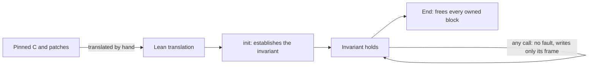

# Overview: what is proved about zlib

This page says what the project proves about zlib, what it assumes, what is open, and how the
proof is built. The main point: every documented public function of the default x86_64 Linux
build is proved safe in every sequence of calls, for a Lean translation of the C, under premises
that each theorem states. The words in bold type are defined in the [glossary](glossary.md).

## The claim

**Proved.** Every documented public function of the default x86_64 Linux build of zlib is safe.
On every input that its premises admit, the translated call returns with no undefined behaviour
and no memory error, writes only the memory it is allowed to (its frame), leaks nothing, and
terminates. This holds over call sequences: for every history of an inflate stream, a deflate
stream, a callback decoder and a gzip file handle. The 63 required goals are registered. The
acceptance suite was green on commit `bde170e9`, so the results are accepted on that commit. One
exception: the four init safety goals were widened after it, and in the wider form they are
registered and not yet accepted. [Scope](progress.md#scope) records the level of each result and
what changed after that commit.

**Assumed.** The theorems are about a Lean translation that runs on a runtime model. Six things
are trusted and not proved ([trusted base](trusted-base.md)):

1. the Lean kernel, three standard axioms, and the audit programs;
2. the runtime model of memory, pointers, faults and loops;
3. the hand translation of the C;
4. the selected source: the pinned `zlib/` plus five patches;
5. the build configuration, and the model of allocation, files and formatting;
6. the statements: that each goal says what it should.

Differential tests are evidence of fidelity, not proof. Compiler, operating-system and hardware
correctness are outside the proof. The premises that a theorem puts on the caller are in
[deviations](deviations.md), as a checklist by function.

**Open.** Nothing that a safety result needs. The 31 gz functions and the three `inflateBack`
functions are proved safe through their sequence goals, which cover every call in every history;
they have no separate one-function goal yet. Stating and registering those 34 goals is remaining
work ([progress](progress.md#ordered-next-work)).

**Not required.** Functional correctness is not required for the safety results. A functional
fact is in scope when a planned safety proof depends on it; what is already proved stays. One
functional result is planned work and not proved: the round trip of a default zlib stream through
`deflate` and then `inflate`. Model-only statements (theorems about the abstract API model, not
about the translated C), other build configurations and the functions that `zlib.h` declares
undocumented are not planned. [Scope](progress.md#scope) lists every group with its reason.

## Contents

- [The claim](#the-claim)
- [How the proof is built](#how-the-proof-is-built)
- [How to read a result](#how-to-read-a-result)
- [Guide chapters](#guide-chapters)
- [Where each rule is written](#where-each-rule-is-written)

## How the proof is built

The proof has four steps.

1. **Translate.** The pinned C, with the registered patches, is translated to Lean by hand,
   statement by statement. Every undefined behaviour the C can reach becomes the fault `Fault.ub`
   in the translation.
2. **Define an invariant.** For each kind of stream an invariant is defined: the facts about the
   stream's state that hold before every call. An example is that the decoder's saved history
   agrees with the bytes it has already produced.
3. **Prove each function.** The init function is proved to establish the invariant. Every other
   function is proved to return without a fault when the invariant holds, to keep the invariant,
   to write only its frame, and to allocate and free exactly what its ledger says. No function's
   behaviour is assumed: each callee has its own theorem about its own translation.
4. **Compose.** Induction over the history of calls gives the sequence goal. The End function is
   proved to free every block the stream owns. A separate non-vacuity theorem exhibits one
   concrete heap on which init succeeds, so the premises are not empty.

The [common method](proof/method.md) gives the induction in detail, and the
[implementation arguments](proof/README.md) give the invariant of each C component.

## How to read a result

A result has four parts: the goal, its premises, the theorem that proves it, and its level. Here
they are for `inflate`.

| Part | For `inflate` |
| --- | --- |
| Goal | `Goal.inflate_safety`, in `ZlibF/Spec/Safety/Streams.lean` |
| What it says | For every heap, every stream `r` and every `flush` value: if the premises hold, the call `inflate(r, flush)` returns without a fault, keeps the invariant, writes only the stream's own blocks, the stream record, an attached gzip header and the output range, and changes the set of live blocks exactly as its ledger says (`StreamCallSafe`) |
| Premises | `StreamCallDomain`: the stream is reachable (some history starting at a successful init produces it); every byte object has fewer than 2^63 bytes; the buffers are as [deviations](deviations.md#stream-calls-inflate-and-deflate) describes (`StreamArguments`) |
| Theorem | `ZlibF.Spec.Public.StreamCallSafetyProof.inflate_safety`, in `ZlibF/Proof/public-stream-call-safety.lean` |
| Level | Registered: the theorem is in `tests/audit/theorems.txt`. [Scope](progress.md#scope) names the commit on which it is accepted |

[Coverage by function](coverage.md) gives the same four parts for every function.

Three cautions apply when reading any result.

- A lemma about one branch, or a theorem about the abstract API model, does not establish a
  public function. Only a theorem whose type is exactly the goal does.
- A finite run of differential tests checks examples. It does not prove a statement about all
  inputs.
- The guide chapters below describe the implementation in prose. Those readings of the C are
  **to confirm**: only a registered theorem settles one.

## Guide chapters

The six chapters below each follow one example through zlib and name the proof obligation it
creates. They explain the mechanism; the exact contracts are in the
[specifications](spec/README.md), and the derivations by C component are in the
[implementation arguments](proof/README.md).

| Chapter | Follow the example to understand… |
| --- | --- |
| [1. A complete task](guide/round-trip.md) | Original bytes → compressed bytes → recovered bytes; start, process and release. |
| [2. Repetition, codes and blocks](guide/encoding.md) | Overlapping history copies, Huffman codes and block choice. |
| [3. Streaming](guide/streaming.md) | Buffer exhaustion, retained bits/history and exact continuation. |
| [4. Formats and integrity checks](guide/wrappers.md) | A shared DEFLATE body, wrapper conditions and trailer validation. |
| [5. State operations](guide/state-operations.md) | Reset for another task, Copy for a checkpoint, dictionaries and flushes. |
| [6. Application interfaces](guide/interfaces.md) | Whole buffers, callbacks, gzip files and logical Seek. |

## Where each rule is written

| Question | Page |
| --- | --- |
| What exactly does "safe" mean: undefined behaviour, frame, termination, leaks? | [Safety](spec/safety.md) |
| Which platform is assumed? | [Platform](spec/platform.md): the default x86_64 Linux build; each byte object has fewer than `2^63` bytes, which does not bound the length of a stream |
| What must a caller's call satisfy? | [Deviations](deviations.md) |
| Which limits of the model can a caller not act on? | [Model limits](model-limits.md) |
| What is trusted and not proved? | [Trusted base](trusted-base.md) |
| Which theorem covers a function? | [Coverage by function](coverage.md) |
| What is the level of each result, and what work remains? | [Progress](progress.md#scope) |
| How does a theorem become accepted? | [Checking](checking/README.md) |

A safety goal quantifies over every input, parameter, allocation outcome and history that its
premises admit. The narrower ranges in [input configurations](spec/input-configurations.md)
describe internal lemmas and the colours of the target graph; they do not limit a safety goal.
Earlier narrative checkpoints of this page are kept, unchanged, in the
[overview changelog](history/overview-changelog.md); they are historical.
