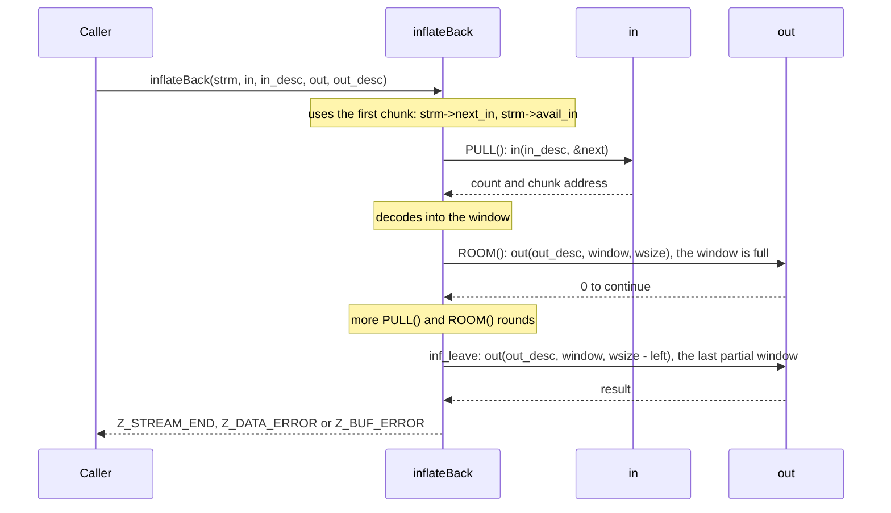
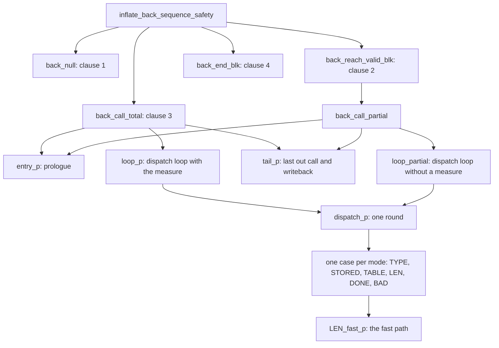

# Callback decoder: the caller protocol and finite input

`inflateBack` decodes with two functions that the caller supplies: `in` delivers input, `out`
takes output. Its safety therefore depends on what those functions do. The result on this page:
`inflateBack` and its call sequences are safe for every pair of callbacks that follows a stated
protocol and supplies a bounded amount of input. The page gives the statement, the protocol
and the shape of the proof.

Source: `infback.c`. The [API page](../spec/api/inflate-back.md) states the public contract.
Terms: [glossary](../glossary.md).

## The result

| Goal | Theorem |
| --- | --- |
| `Goal.inflate_back_sequence_safety` | `inflate_back_sequence_safety` |
| `Goal.inflate_back_initialisation_domain` | `back_init_domain_public` |
| `Goal.inflateBack_call_domain` | `BackCallDomainProof.inflateBack_call_domain` |
| `Goal.inflateBackInit__safety`, `Goal.inflateBack_safety`, `Goal.inflateBackEnd_safety` | `BackSafetyProof.inflateBackInit__safety`, `inflateBack_safety`, `inflateBackEnd_safety` |

All six are done. The first is the safety result over histories, and the second shows that
init can succeed. The third shows that the premises of a call of `inflateBack` can be met, the
callback protocol included ([the caller protocol](#the-caller-protocol)). The last three are
the safety goals of the three functions.

The one-function goals follow from the results of this page:

- `Goal.inflateBack_safety` is clauses 1 and 3 of the sequence goal, with one more refusal: a
  stream record whose state is `NULL` (`inflateBack_nostate`).
- `Goal.inflateBackEnd_safety` is clause 4 of the sequence goal, with the refusals of a `NULL`
  stream and of a stream record whose state or `zfree` is `NULL` (from `back_end_public`).
- `Goal.inflateBackInit__safety` is the init call on every argument `zlib.h` allows
  (`InitArguments`), with no history. It follows from the functional theorem `back_init_public`.

Each function also has a functional contract (`Goal.inflateBackInit_`, `Goal.inflateBack`,
`Goal.inflateBackEnd`). These contracts are not required;
[the last section](#functional-results-that-stay) says which are done.

`Goal.inflate_back_sequence_safety` has four clauses.

1. `inflateBack` on a `NULL` stream returns `Z_STREAM_ERROR` and changes nothing.
2. After every reachable history the stream has a valid state over the caller's window
   (`BackValid`: the heap is well formed, the stream record points to a live inflate state
   with the default allocator, `8 ≤ wbits ≤ 15`, `wsize = 2^wbits`, and the window is not
   `NULL` and writable for `wsize` bytes).
3. One more `inflateBack` call returns without a fault, for every caller protocol in the
   domain below. Its result is `Z_STREAM_END`, `Z_DATA_ERROR` or `Z_BUF_ERROR`. The state
   stays valid over the same window, and the protocol's invariant holds again. The call changes only the stream record, the state
   record, the callbacks' own blocks and the window slice (`CallbackFrame`). The live blocks
   outside the callbacks' own are unchanged, so the library leaks nothing.
4. `inflateBackEnd` on every reachable history returns `Z_OK`, frees the state block and
   nothing else, and clears the stream's state pointer. The window stays with the caller.

## The C calls of `in` and `out`

`zlib.h` declares the callbacks and the decoder:

```c
typedef unsigned (*in_func)(void FAR *, z_const unsigned char FAR * FAR *);
typedef int (*out_func)(void FAR *, unsigned char FAR *, unsigned);

int inflateBack(z_streamp strm, in_func in, void FAR *in_desc,
                out_func out, void FAR *out_desc);
```

`infback.c` calls them at three places. The macros are shown in condensed form:

```c
/* PULL(): the current input chunk is used up */
have = in(in_desc, &next);
if (have == 0) { next = Z_NULL; ret = Z_BUF_ERROR; goto inf_leave; }

/* ROOM(): the window is full */
put = state->window; left = state->wsize; state->whave = left;
if (out(out_desc, put, left)) { ret = Z_BUF_ERROR; goto inf_leave; }

/* inf_leave: the last, partial window */
if (left < state->wsize) {
    if (out(out_desc, state->window, state->wsize - left) && ret == Z_STREAM_END)
        ret = Z_BUF_ERROR;
}
strm->next_in = next;
strm->avail_in = have;
return ret;
```

So `in` returns a byte count and stores the address of its chunk through `&next`; a count of 0
ends the call. `out` receives a range of the window and returns nonzero to stop.



The last `out` call happens before the return code is tested, so it also occurs on an error
path.

In the translation the call `in(in_desc, &next)` passes the current value of `next` and
receives the pair (count, new value of `next`)
([normalisation 1](../design/translation.md#the-accepted-normalisations)). No cell is allocated
for `&next`. A callback that keeps that address and writes through it after it returned is
outside the model.

## What is assumed

The callbacks are caller code. Their contract is a premise about the caller. It is not an
assumed specification of a zlib function: every library function that `inflateBack` calls has
its own theorem.

| Premise | Where | Row in [deviations](../deviations.md#callback-decoder) |
| --- | --- | --- |
| Before `inflateBackInit_`: the heap is well formed (`Fresh`, `Uniq`, `LibraryGlobals`); `version` points to a readable byte `'1'`; the stream record is readable; its `zalloc` and `zfree` are each `NULL` or the default function. Its other fields, `state` included, may hold any value. The call has `stream_size = 112` and returned `Z_OK`; a call with another version byte or size does not return `Z_OK` (`back_init_public`). | `BackInitArguments` in `BackSafeReachable.init` | Callback decoder init |
| The callbacks follow a `CallbackProtocol` (next section), and its invariant holds when `inflateBack` is called. | the `protocol` argument | Callbacks |
| One call is offered fewer than `2^48` bytes in the caller's first chunk and all its `in` calls together. | `protocol.inputBound < 2^48`, with `bounded` | Callback input total |
| `8 ≤ windowBits ≤ 15`, and the window is not `NULL`, is writable for `2^windowBits` bytes and is a slice of a heap byte block. | `BackSafeReachable.init` | Callback decoder window |
| Every input chunk lies in a heap byte block: the caller's first chunk and each chunk `in` hands out. | `BackFirstChunk`, `BackPlatform` | Callback decoder input chunks |
| Every byte object has fewer than `2^63` bytes at each call and after each callback step. | `ByteObjectsFit`, `BackPlatform` | Platform byte-object scope |
| The stream uses the default allocator, or `NULL` allocator fields that init replaces. | `BackValid`, `BackInitArguments` | Initial configuration |
| The caller's first input chunk is readable and separate from the window: `strm->avail_in` bytes at `strm->next_in`, or no bytes when `strm->next_in` is `NULL`. | `Bytes` and `Separate` in clause 3 | Callbacks |
| Between two calls the caller changes only memory the stream does not own and the four buffer fields of the stream record. The heap stays well formed, the bytes of the window slice are kept, and no block that stays live changes its read-only flag. | `BackSafeReachable.caller` | Caller edits between calls (`BackSafeReachable.caller`) |

The complete list is the statement itself: `Goal.inflate_back_sequence_safety`, with
`BackSafeReachable` and `BackInitArguments`. The premises
of this table are also those of the history clauses of `Goal.inflateBack_safety` and
`Goal.inflateBackEnd_safety`.

### Why a bound on the input

An input callback can supply infinitely many empty non-final stored blocks, and `inflateBack`
then never returns. `zlib.h` does not promise that a callback eventually ends its input.

The figure `2^48` is the model's limit, not zlib's. The runtime bounds every loop by `2^64`
iterations, and the measure of the dispatch loop counts input bits.

The bound counts every byte of the call. The log of supplied bytes starts with the caller's
first chunk (`strm->next_in`, `strm->avail_in`), and each `in` call appends to it. The
requirement `bounded` below limits the length of that log.

## The caller protocol

`CallbackProtocol` says what the two callbacks may do. The
caller of the theorem chooses its parts:

- `own`: the set of heap blocks that belong to the callbacks. It excludes the state record and
  the stream record.
- `invariant`: a property of the heap and of a log. The log (`BackLog`) records the bytes
  supplied so far, which are the caller's first chunk and then what `in` has returned, and the
  chunks that `out` has received. It is not memory; it exists only in the statement.
- `inputBound`: a number.

The protocol then requires five things of `in` and `out`.

| Requirement | Meaning, against the C calls above |
| --- | --- |
| `local_` | The invariant depends on two things only: the contents of the callbacks' own blocks, and the allocator fields of the heap (the next block number, the count of allocation calls, the allocation-failure oracle, the content of fresh memory, and the static tables). Two heaps that agree on these (`ExternalAgreement`) satisfy it equally. The bytes of the window slice are left out of the comparison, so a change of the window slice does not affect it. The object behind `in_desc` or `out_desc` may lie in the same allocation as the window, outside the slice. |
| `inStep` | On a heap that satisfies `CallbackEntry` (below), from the invariant, `in(in_desc, &next)` returns a count and a chunk address without a fault. It changes only its own blocks (`ExternalFrame`) and keeps the bytes of the window slice. A nonempty chunk is readable for the count, separate from the window, and outside the state and stream records. The invariant holds again, with the chunk appended to the log. |
| `outStep` | On a heap that satisfies `CallbackEntry`, from the invariant, `out(out_desc, buf, len)` returns without a fault for any readable range of at most the window capacity. It changes only its own blocks, keeps the bytes of the window slice, and keeps the current input chunk readable until the next `in` call. The invariant holds again, with the chunk appended to the log. |
| `liveInput` | Under the invariant, the current input chunk is readable. |
| `bounded` | Under the invariant, the bytes supplied so far, the caller's first chunk included, number at most `inputBound`. |

The table is a summary. The complete statement is the structure `CallbackProtocol`.

`inStep` and `outStep` are required only on a heap that satisfies `CallbackEntry`: the stream is
a valid callback decoder over this window (`BackValid`). So the heap is a library heap and the
window is writable. This is what the library provides at each call of `in` and `out`.
Without the premise no protocol exists: `local_` makes the invariant insensitive to
every block outside `own`, and `disjoint` puts the state block outside `own`. The invariant
would then also hold on a heap whose state block holds two objects, and no step from that heap
can end in a well-formed heap with that block unchanged. So a protocol whose steps are required
on every heap that satisfies its invariant has an invariant that no heap and log satisfy. Every
such protocol is also a protocol with the `CallbackEntry` premise, with the same invariant.
Both facts have Lean proofs, which are not among the theorems of the library.

`Goal.inflateBack_call_domain` shows that the premises can be met. It gives a concrete
history: `inflateBackInit_` on the witness heap, then a caller's edit of `next_in` and
`avail_in`. The callbacks are concrete: `noInput` reports the end of input, and `takeOutput`
accepts every chunk. The protocol `witnessProtocol` owns one block. The first chunk has two
bytes in a heap byte block. Every premise of the call clause of `Goal.inflateBack_safety` holds
on them together. The input callback delivers no bytes: all input of
the witness call is the caller's first chunk. The two bytes are not a valid deflate stream, so
the witness call ends with an error code. Not covered: a witness whose `in` callback delivers
bytes, or whose call returns `Z_STREAM_END`.

"Changes only its own blocks" (`ExternalFrame`) allows a callback to allocate and free blocks
of its own. Every block it creates is one of its own, and the heap stays well formed. It cannot
change whether a block that stays live is read-only: C code has no way to do that.

## Histories

`BackSafeReachable h r i window n` says that heap `h` is reached by some actual history of
the stream `r` with state block `i` over the caller's window of `n` bytes.

| Constructor | Step |
| --- | --- |
| `init` | A successful `inflateBackInit_` from caller storage in `BackInitArguments`, with `stream_size = 112`, `8 ≤ windowBits ≤ 15` and a non-`NULL` writable window in a heap byte block. |
| `caller` | The caller changes memory the stream does not own and the four buffer fields of the stream record (`Rebuffer`). The heap stays well formed, the bytes of the window slice are kept, and no block that stays live changes its read-only flag. |
| `step` | An `inflateBack` call that returned. Its first chunk was readable and separate from the window, the protocol's invariant held at the call, and the platform premises held (`ByteObjectsFit` at the call, `BackPlatform`, `BackFirstChunk`). |

A `step` does not ask for the input bound. So a history may contain calls with unbounded
input that happened to return. The bound is asked only of the next call, where the goal
claims termination.

## The invariant of the dispatch loop

`PInv` holds whenever
`for (;;) switch (state->mode)` is about to read the mode. It is stated relative to the heap
at the call, and it mentions the protocol's log.

- The state is valid over the caller's window, and the window is outside the state and
  stream records.
- `put` and `left` describe the unwritten tail of the window: `put = window + (n - left)`.
- `next` and `have` describe the rest of the chunk in use: the caller's first chunk, or the
  one that `in` returned last. That chunk stays readable, outside the window and outside both
  records.
- The bit buffer is normalised: `bits ≤ 39` and `hold < 2^bits`.
- The protocol's invariant holds of the current heap and the log.
- The heap differs from the heap at the call by a `CallbackFrame`, and liveness is unchanged
  outside the callbacks' blocks.
- The mode is one of `TYPE`, `STORED`, `TABLE`, `LEN`, `DONE`, `BAD` (`ModeOk`). In `LEN` the
  decoding tables have the shape the lookups need (`TablesOk`): each is the static fixed
  table, or lies in the state's `codes` array with the table predicates of
  [decode tables](inftrees.md).
- `sane ≠ 0`, `wnext = 0` and `whave ≤ wsize` (`StOk`). `inflate_fast` relies on them and
  `inflateBack` never breaks them.
- The platform premises hold: the protocol's platform side (`BackPlatform`), every byte object
  of the current heap has fewer than `2^63` bytes, and the chunk in use lies in a heap byte
  block. The fast path needs them.

The list is a summary. It leaves out the two clauses that tie the loop to the stream record
and the state block of the call (`cstrm`, `cst`). The complete statement is the structure
`PInv`.

`inflateBackInit_` allocates a state and does not zero it. It writes the window settings,
the window pointer, the history counters and `sane`. The prologue of `inflateBack` then
resets the mode, `last` and `whave`. The table pointers are written on the way to `LEN`, and
they are read only there. `TablesOk` is asked only in `LEN`. It excludes the `NULL` that the
model gives a fresh pointer field, so in `LEN` both table pointers have been written.

## Proof structure



One call is three pieces: the prologue
(`entry_p`), the dispatch loop, and the tail (`tail_p`), which is the code at `inf_leave`
above.

There are two loop rules.

- `back_call_total` uses the loop rule with a measure. It gives clause 3: the call returns.
- `back_call_partial` uses `xwhileBrk_partial`, a rule without a measure: a run that
  returned has kept the invariant. It serves a `step` of a history, whose input has no bound.
  It gives clause 2 by induction on the history (`back_reach_st_blk`).

One round of the loop is `dispatch_p`. It
splits by mode. The default case of the `switch` is unreachable, because `ModeOk` names the
six modes.

### The callbacks inside the loop

`PULL()` calls `in` only when the current chunk is exhausted. `PULL_p` applies the protocol's
`inStep`. Its `CallbackEntry` premise is the `valid` field of the loop invariant.

`ROOM()` calls `out` on the full window when no room is left, sets `whave = wsize` and
restarts at the window. `ROOM_p` applies `outStep`, with the same `valid` field as the
`CallbackEntry` premise.

After either callback the state is valid again (`backValid_callback`). The callback changed only its own blocks, which
exclude both records, and it kept the window slice.

### Termination

The measure of the dispatch loop is `backMeasure`:

```
4 · (bits + 8 · have + 8 · (inputBound - supplied)) + modeRank(mode)
```

The first term counts the input bits still readable: held, in the current chunk, and what
`in` may still deliver. `modeRank` is 0 for `DONE` and `BAD`, 1 for `TYPE` and 2 otherwise.
Every round that continues lowers the measure. With `inputBound < 2^48` it starts below
`2^64`, the loop fuel.

Output does not appear in the measure, because `ROOM()` resets the output room. So the fast
path must be shown to consume input, not to produce output.

### The fast path

`case LEN` calls `inflate_fast` when at least 6 input bytes and 258 bytes of room are
available. In `inflateBack` the output of that call is the window itself: the window block
is the output block, `wnext = 0`, and the window ends where the output range ends. The lemma
`fast_env` states these facts in the form the entry conditions of `inflate_fast` take.

`fast_consumes` gives the run, its frame and the
strict consumption of input bits: the held bits plus eight times the bytes left never grow,
and they fall strictly unless the call ends in `TYPE` or `BAD`. `LEN_fast_p` turns that into
one round of the dispatch loop.

`fast_env` builds the entry conditions of `inflate_fast` for a window in a heap byte block,
and the fast path is proved at such a window only (`lenFast_of_blk`). The entry conditions
themselves allow any byte object ([fast decoding](inffast.md#assumptions)). Every history of the goal has its window
there (`back_reach_window`), because the `init` constructor asks for it. That is the reason
for the window premise.

## Functional results that stay

Each of the three functions has a functional contract, and there is a functional sequence
goal `Goal.inflate_back_sequence`. None is required for the safety results. Two of the four
are done:

- `Goal.inflateBackInit_` (`back_init_public`) and `Goal.inflateBackEnd` (`back_end_public`):
  the full contracts of the two lifecycle functions. Clause 4 of the safety goal uses
  `back_end_public`. The refusal clauses of `Goal.inflateBackEnd_safety` and the whole of
  `Goal.inflateBackInit__safety` are derived from these two theorems.

Further theorems that are not goals:

- Branch results of `inflateBack`: the `NULL` stream, the missing state, and input that ends
  at once (`inflateBack_eof`). The first two are also clauses
  of `Goal.inflateBack_safety`.

Not done and not planned; the safety results do not need them: `Goal.inflateBack` and
`Goal.inflate_back_sequence`. They also state what reaches `out` (the decoding clauses).
