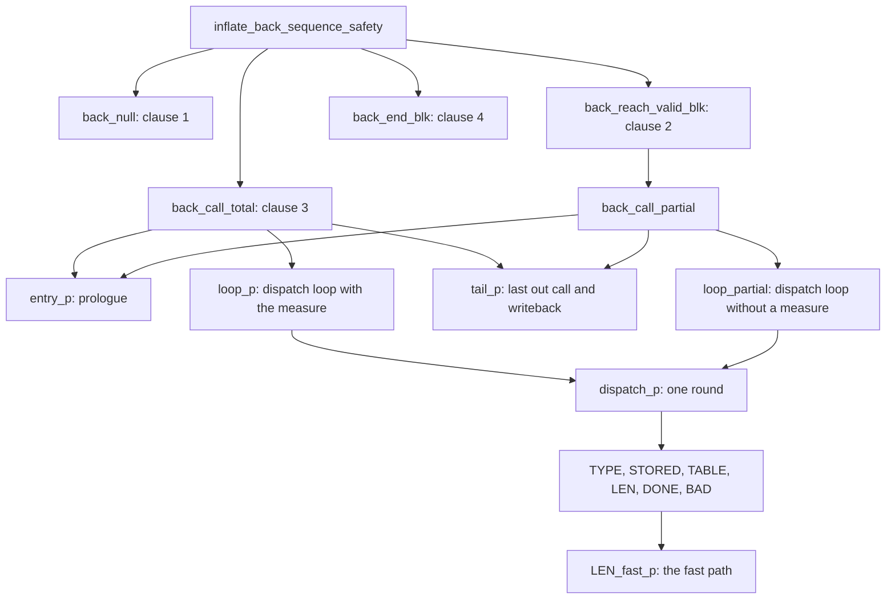

# Callback decoder: the caller protocol and finite input

Source: `infback.c`. The caller owns the window and supplies an input callback `in` and an
output callback `out`. The [API page](../spec/api/inflate-back.md) states the public
contract.

`inflateBack` and its call sequences are safe for every caller protocol whose total input is
bounded. This page explains that result: the statement, its premises and the shape of the
proof.

## What is proved

| Goal | Theorem | Module |
| --- | --- | --- |
| `Goal.inflate_back_sequence_safety` (`ZlibF/Spec/Public/Sequences.lean`) | `inflate_back_sequence_safety` | `ZlibF/Proof/infback.c.safety-fast.lean` |
| `Goal.inflate_back_initialisation_domain` (`ZlibF/Spec/Public/Domains.lean`) | `back_init_domain_public` | `ZlibF/Proof/public-infback-init.lean` |

Both are required: the first is the safety result, the second is its non-vacuity. They are
registered in `tests/audit/theorems.txt` and accepted on commit `bde170e9`
([progress, Scope](../progress.md#scope)).

`Goal.inflate_back_sequence_safety` has four clauses.

1. `inflateBack` on a `NULL` stream returns `Z_STREAM_ERROR` and changes nothing.
2. Every reachable history leaves a valid state (`BackValid`) over the caller's window.
3. One more `inflateBack` call returns without a fault, for every caller protocol in the
   domain below. Its result is `Z_STREAM_END`, `Z_DATA_ERROR` or `Z_BUF_ERROR`. The state
   stays valid over the same window. The call changes only the stream record, the state
   record, the callbacks' own blocks and the window slice (`CallbackFrame`). The live blocks
   outside the callbacks' own are unchanged, so the library leaks nothing.
4. `inflateBackEnd` on every reachable history returns `Z_OK`, frees the state block and
   nothing else, and clears the stream's state pointer. The window stays with the caller.

## What is assumed

The callbacks are caller code. Their contract is a premise about the caller. It is not an
assumed specification of a zlib callee: every library function that `inflateBack` calls has
its own theorem.

| Premise | Where | Row in [deviations](../deviations.md) |
| --- | --- | --- |
| The callbacks follow a `CallbackProtocol`: they return, change only their own blocks, and keep the window slice. | the `protocol` argument | Callbacks |
| One call is offered fewer than `2^48` bytes in all its `in` calls. | `protocol.inputBound < 2^48` | Callback input total |
| The window is a slice of a heap byte block. | `BackSafeReachable.init` | Callback decoder window |
| Every input chunk lies in a heap byte block: the caller's first chunk and each chunk `in` hands out. | `BackFirstChunk`, `BackPlatform` | Callback decoder input chunks |
| Every byte object has fewer than `2^63` bytes at each call and after each callback step. | `ByteObjectsFit`, `BackPlatform` | Platform byte-object scope |
| The stream uses the default allocator, or `NULL` allocator fields that init replaces. | `BackValid`, `InitDomain` | Initial configuration |
| The caller's first input chunk is separate from the window. | `Separate` in the call clause | Not listed as its own row |

### Why a bound on the input

A callback that returns is not enough for termination. An input callback can supply
infinitely many empty non-final stored blocks, and `inflateBack` then never returns. That is
not undefined behaviour, but it is not termination either. `zlib.h` does not promise that a
callback eventually ends its input.

The figure `2^48` is the model's limit, not zlib's. The runtime bounds every loop by `2^64`
iterations, and the measure of the dispatch loop counts input bits.

## The caller protocol

`CallbackProtocol` (`ZlibF/Spec/Public/Back.lean`) describes what the two callbacks may do.
It carries a set `own` of the callbacks' blocks, an invariant over the heap and an
observation log (`BackLog`), and the input bound.

- `own` excludes the state record and the stream record.
- The invariant depends only on the callbacks' own blocks. A change of the window slice does
  not affect it. A descriptor may share the window's allocation outside that slice.
- `inStep`: from the invariant, `in` returns a count and a pointer. It changes only its own
  blocks (`ExternalFrame`) and keeps the window slice. A nonempty chunk is readable, separate
  from the window, and outside the state and stream records. The invariant holds again, with
  the chunk appended to the log.
- `outStep`: from the invariant, `out` returns for any readable range of at most the window
  capacity. It changes only its own blocks, keeps the window slice, and keeps the current
  input chunk readable until the next `in` call.
- `bounded`: the bytes supplied so far never exceed `inputBound`.

A callback may allocate and free its own blocks. It cannot change whether a block that stays
live is read-only: C code has no way to do that.

The translation passes the current input pointer to `in` and receives `(count, pointer)`.
It does not allocate a cell for `&next`. A callback that keeps that address and later writes
through it is outside this representation.

## Histories

`BackSafeReachable h r i window n` says that heap `h` is reached by some actual history of
the stream `r` with state block `i` over the caller's window of `n` bytes.

| Constructor | Step |
| --- | --- |
| `init` | A successful `inflateBackInit_` with `8 ≤ windowBits ≤ 15` and a writable window in a heap byte block. |
| `caller` | The caller changes its own memory and the four buffer fields of the stream, and keeps the window slice. |
| `step` | An `inflateBack` call that returned, under a protocol with the platform premises. |

A `step` does not ask for the input bound. So a history may contain calls with unbounded
input that happened to return. The bound is asked only of the next call, where the goal
claims termination.

## The invariant of the dispatch loop

`PInv` (`ZlibF/Proof/infback.c.safety-inv.lean`) holds whenever
`for (;;) switch (state->mode)` is about to read the mode. It is stated relative to the heap
at the call, with the protocol's log as ghost state.

- The state is valid over the caller's window, and the window is outside the state and
  stream records.
- `put` and `left` describe the unwritten tail of the window: `put = window + (n - left)`.
- `next` and `have` describe the rest of the chunk that `in` returned last. That chunk stays
  readable, outside the window and outside both records.
- The bit buffer is normalised: `bits ≤ 39` and `hold < 2^bits`.
- The protocol's invariant holds of the log.
- The heap differs from the heap at the call by a `CallbackFrame`, and liveness is unchanged
  outside the callbacks' blocks.
- The mode is one of `TYPE`, `STORED`, `TABLE`, `LEN`, `DONE`, `BAD` (`ModeOk`). In `LEN` the
  decoding tables have the shape the lookups need (`TablesOk`): each is the static fixed
  table, or lies in the state's `codes` array with the table predicates of
  [decode tables](inftrees.md).
- `sane ≠ 0`, `wnext = 0` and `whave ≤ wsize` (`StOk`). `inflate_fast` relies on them and
  `inflateBack` never breaks them.

`inflateBackInit_` allocates a state and does not zero it. It writes the window settings,
the window pointer, the history counters and `sane`. The prologue of `inflateBack` then
resets the mode, `last` and `whave`. The table pointers are written on the way to `LEN`, and
they are read only there. `TablesOk` is asked only in `LEN`. It excludes the `NULL` that the
model gives a fresh pointer field, so in `LEN` both table pointers have been written.

## Proof structure



One call is three pieces (`ZlibF/Proof/infback.c.safety-call.lean`): the prologue
(`entry_p`), the dispatch loop, and the tail (`tail_p`), which sends the last partial window
to `out` and writes back `next_in` and `avail_in`. The tail's `out` call happens before the
test of the return code, so it also occurs on an error path.

There are two loop rules.

- `back_call_total` uses the loop rule with a measure. It gives clause 3: the call returns.
- `back_call_partial` uses `xwhileBrk_partial`, a rule without a measure: a run that
  returned has kept the invariant. It serves a `step` of a history, whose input has no bound.
  It gives clause 2 by induction on the history (`back_reach_st_blk`).

One round of the loop is `dispatch_p` (`ZlibF/Proof/infback.c.safety-dispatch.lean`). It
splits by mode. The default case of the `switch` is unreachable, because `ModeOk` names the
six modes.

### The callbacks inside the loop

`PULL()` calls `in` only when the current chunk is exhausted. A zero count sets
`next = NULL` and leads to `Z_BUF_ERROR`. `PULL_p` applies the protocol's `inStep`.

`ROOM()` calls `out` on the full window when no room is left, sets `whave = wsize` and
restarts at the window. `ROOM_p` applies `outStep`.

After either callback the state is valid again (`backValid_callback`,
`ZlibF/Proof/infback.c.safety-valid.lean`). The callback changed only its own blocks, which
exclude both records, and it kept the window slice.

### Termination

The measure of the dispatch loop is `backMeasure`:

```
4 · (bits + 8 · have + 8 · (inputBound - supplied)) + modeRank(mode)
```

The first term counts the input bits still readable: held, in the current chunk, and what
`in` may still deliver. `modeRank` is 0 for `DONE` and `BAD`, 1 for `TYPE` and 2 otherwise.
Every round that continues lowers the measure. With `inputBound < 2^48` it starts below
`2^64`, the loop fuel.

Output does not appear in the measure, because `ROOM()` resets the output room. So the fast
path must be shown to consume input, not to produce output.

### The fast path

`case LEN` calls `inflate_fast` when at least 6 input bytes and 258 bytes of room are
available. In `inflateBack` the output of that call is the window itself: the window block
is the output block, `wnext = 0`, and the window ends where the output range ends
(`fast_env`).

`fast_consumes` (`ZlibF/Proof/inffast.c.consume.lean`) gives the run, its frame and the
strict consumption of input bits: the held bits plus eight times the bytes left never grow,
and they fall strictly unless the call ends in `TYPE` or `BAD`. `LEN_fast_p` turns that into
one round of the dispatch loop.

The entry conditions of `inflate_fast` take output in a heap byte block. So the fast path is
proved at such a window only (`lenFast_of_blk`). Every history of the goal has its window
there (`back_reach_window`), because the `init` constructor asks for it. That is the reason
for the window premise.

## Functional results that stay

These results are not required. They were proved earlier and stay registered.

- `Goal.inflateBackInit_` (`back_init_public`) and `Goal.inflateBackEnd` (`back_end_public`):
  the full contracts of the two lifecycle functions. Clause 4 of the safety goal uses
  `back_end_public`.
- Branch results of `inflateBack`: the `NULL` stream, the missing state, and input that ends
  at once (`inflateBack_eof`, `ZlibF/Proof/infback.c.back.lean`).

`Goal.inflateBack` and `Goal.inflate_back_sequence` also state what reaches `out`. Those
decoding clauses are not planned and not proved.

Per-function safety goals for `inflateBackInit_`, `inflateBack` and `inflateBackEnd` are not
stated yet. The sequence goal is their safety goal in `tests/audit/public-api.json` until
they are.
