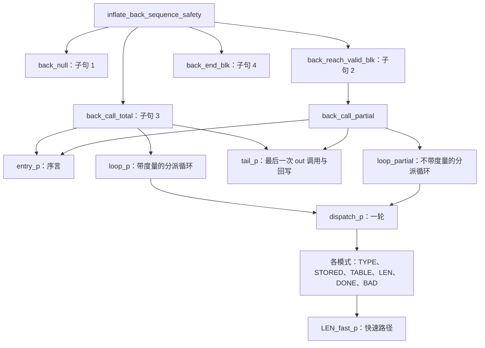

<!-- source-sha256: 05d2e4c94c75a352195b540d84428a4be4cb64cd6b143d19b4378d109f780689 -->
# 回调解码器：调用者协议与有限输入

源文件为 `infback.c`。窗口归调用者所有，调用者提供输入回调 `in` 和输出回调 `out`。[API 页面](../spec/api/inflate-back.md)陈述公开契约。

对每一个总输入有界的调用者协议，`inflateBack` 及其调用序列都是安全的。本页解释这个结果：它的陈述、前提和证明的结构。

## 已证明什么

| 目标 | 定理 | 模块 |
| --- | --- | --- |
| `Goal.inflate_back_sequence_safety`（`ZlibF/Spec/Public/Sequences.lean`） | `inflate_back_sequence_safety` | `ZlibF/Proof/infback.c.safety-fast.lean` |
| `Goal.inflate_back_initialisation_domain`（`ZlibF/Spec/Public/Domains.lean`） | `back_init_domain_public` | `ZlibF/Proof/public-infback-init.lean` |

两者都是必需的：第一个是安全性结果，第二个是它的非空泛性。它们登记在 `tests/audit/theorems.txt` 中，并在提交 `bde170e9` 上被接受（[进度，范围](../progress.md#scope)）。

`Goal.inflate_back_sequence_safety` 有四个子句。

1. 在 `NULL` 流上调用 `inflateBack` 返回 `Z_STREAM_ERROR`，不改变任何东西。
2. 每个可达历史都在调用者的窗口上留下一个有效状态（`BackValid`）。
3. 对下述定义域内的每个调用者协议，再调用一次 `inflateBack` 会无故障地返回。结果是 `Z_STREAM_END`、`Z_DATA_ERROR` 或 `Z_BUF_ERROR`。状态在同一窗口上保持有效。调用只改变流记录、状态记录、回调自己的块和窗口切片（`CallbackFrame`）。回调自有块之外的存活块不变，所以库没有泄漏。
4. 在每个可达历史上，`inflateBackEnd` 返回 `Z_OK`，只释放状态块，并清除流的状态指针。窗口仍归调用者。

## 假设了什么

回调是调用者的代码。它们的契约是关于调用者的前提，不是对 zlib 被调用函数的假设规范：`inflateBack` 调用的每个库函数都有自己的定理。

| 前提 | 位置 | [偏差记录](../deviations.md)中的行 |
| --- | --- | --- |
| 回调遵守 `CallbackProtocol`：它们会返回，只改变自己的块，并保持窗口切片。 | 参数 `protocol` | 回调 |
| 一次调用在所有 `in` 调用中得到的字节总数少于 `2^48`。 | `protocol.inputBound < 2^48` | 回调输入总量 |
| 窗口是某个堆字节块的切片。 | `BackSafeReachable.init` | 回调解码器窗口 |
| 每个输入块都位于堆字节块中：调用者的第一块，以及 `in` 交出的每一块。 | `BackFirstChunk`、`BackPlatform` | 回调解码器输入块 |
| 每次调用时以及每个回调步骤之后，每个字节对象都小于 `2^63` 字节。 | `ByteObjectsFit`、`BackPlatform` | 平台字节对象范围 |
| 流使用默认分配器，或者分配器字段为 `NULL` 并由初始化替换。 | `BackValid`、`InitDomain` | 初始配置 |
| 调用者的第一块输入与窗口分离。 | 调用子句中的 `Separate` | 没有单独列为一行 |

### 为什么要给输入设界

回调会返回并不足以保证终止。输入回调可以提供无穷多个空的、非最终的存储块，于是 `inflateBack` 永不返回。这不是未定义行为，但也不是终止。`zlib.h` 并不保证回调最终会结束它的输入。

`2^48` 这个数字是模型的限制，不是 zlib 的限制。运行时把每个循环限制在 `2^64` 次迭代之内，而分派循环的度量按输入位计数。

## 调用者协议

`CallbackProtocol`（`ZlibF/Spec/Public/Back.lean`）描述两个回调可以做什么。它包含回调自有块的集合 `own`、一个定义在堆和观察日志（`BackLog`）上的不变量，以及输入上界。

- `own` 不包含状态记录和流记录。
- 不变量只依赖回调自己的块。窗口切片的变化不影响它。描述符对象可以与窗口共用同一次分配中切片之外的部分。
- `inStep`：从不变量出发，`in` 返回一个计数和一个指针。它只改变自己的块（`ExternalFrame`），并保持窗口切片。非空的输入块可读，与窗口分离，并且在状态记录和流记录之外。不变量重新成立，日志中追加了这一块。
- `outStep`：从不变量出发，对任何长度不超过窗口容量的可读范围，`out` 都会返回。它只改变自己的块，保持窗口切片，并保持当前输入块在下一次 `in` 调用之前可读。
- `bounded`：到目前为止提供的字节数从不超过 `inputBound`。

回调可以分配和释放自己的块。它不能改变一个保持存活的块是否只读：C 代码没有办法做到这一点。

翻译把当前输入指针传给 `in`，并接收 `(计数, 指针)`。它不为 `&next` 分配单元。如果回调保留该地址并在之后通过它写入，就超出了这种表示。

## 历史

`BackSafeReachable h r i window n` 表示堆 `h` 可由流 `r` 的某个实际历史到达，其状态块为 `i`，调用者的窗口有 `n` 字节。

| 构造子 | 步骤 |
| --- | --- |
| `init` | 一次成功的 `inflateBackInit_`，`8 ≤ windowBits ≤ 15`，窗口可写并位于堆字节块中。 |
| `caller` | 调用者修改自己的内存和流的四个缓冲区字段，并保持窗口切片。 |
| `step` | 一次已返回的 `inflateBack` 调用，其协议满足平台前提。 |

`step` 不要求输入上界。因此历史中可以包含输入无界但恰好返回了的调用。上界只对下一次调用提出，因为目标正是对那次调用断言终止。

## 分派循环的不变量

每当 `for (;;) switch (state->mode)` 即将读取模式时，`PInv`（`ZlibF/Proof/infback.c.safety-inv.lean`）成立。它相对于调用开始时的堆陈述，并以协议的日志作为幽灵状态。

- 状态在调用者的窗口上有效，窗口在状态记录和流记录之外。
- `put` 和 `left` 描述窗口中尚未写入的尾部：`put = window + (n - left)`。
- `next` 和 `have` 描述 `in` 最近一次返回的输入块的剩余部分。该块保持可读，在窗口之外，也在两个记录之外。
- 位缓冲区是规范化的：`bits ≤ 39` 且 `hold < 2^bits`。
- 协议的不变量对日志成立。
- 当前堆与调用开始时的堆相差一个 `CallbackFrame`，回调自有块之外的存活性不变。
- 模式是 `TYPE`、`STORED`、`TABLE`、`LEN`、`DONE`、`BAD` 之一（`ModeOk`）。在 `LEN` 中，解码表具有查找所需的形状（`TablesOk`）：每张表要么是静态固定表，要么位于状态的 `codes` 数组中并满足[解码表](inftrees.md)的表谓词。
- `sane ≠ 0`、`wnext = 0` 且 `whave ≤ wsize`（`StOk`）。`inflate_fast` 依赖它们，`inflateBack` 从不破坏它们。

`inflateBackInit_` 分配状态但不清零。它写入窗口设置、窗口指针、历史计数器和 `sane`。随后 `inflateBack` 的序言重置模式、`last` 和 `whave`。表指针在通往 `LEN` 的途中写入，并且只在 `LEN` 中被读取。`TablesOk` 只在 `LEN` 中被要求。它排除了模型赋予新鲜指针字段的 `NULL`，所以在 `LEN` 中两个表指针都已经被写入。

## 证明结构



一次调用分三段（`ZlibF/Proof/infback.c.safety-call.lean`）：序言（`entry_p`）、分派循环和尾部（`tail_p`）。尾部把最后一个不满的窗口交给 `out`，并回写 `next_in` 和 `avail_in`。尾部的 `out` 调用发生在检查返回码之前，所以在错误路径上也会发生。

循环规则有两条。

- `back_call_total` 使用带度量的循环规则。它给出子句 3：调用会返回。
- `back_call_partial` 使用 `xwhileBrk_partial`，一条不带度量的规则：已返回的运行保持了不变量。它用于历史中的 `step`，那里的输入没有上界。它通过对历史归纳给出子句 2（`back_reach_st_blk`）。

循环的一轮是 `dispatch_p`（`ZlibF/Proof/infback.c.safety-dispatch.lean`）。它按模式分情形。`switch` 的默认分支不可达，因为 `ModeOk` 列出了全部六个模式。

### 循环内的回调

`PULL()` 只在当前输入块用完时调用 `in`。计数为零时置 `next = NULL`，并导致 `Z_BUF_ERROR`。`PULL_p` 应用协议的 `inStep`。

`ROOM()` 在没有剩余空间时对整个窗口调用 `out`，置 `whave = wsize`，并从窗口开头重新开始。`ROOM_p` 应用 `outStep`。

任一回调之后状态重新有效（`backValid_callback`，`ZlibF/Proof/infback.c.safety-valid.lean`）。回调只改变了自己的块，这些块不包含两个记录，并且它保持了窗口切片。

### 终止

分派循环的度量是 `backMeasure`：

```
4 · (bits + 8 · have + 8 · (inputBound - supplied)) + modeRank(mode)
```

第一项统计仍然可读的输入位：已持有的、当前块中的，以及 `in` 还可能交付的。`modeRank` 对 `DONE` 和 `BAD` 为 0，对 `TYPE` 为 1，其余为 2。每一轮继续的迭代都使度量下降。当 `inputBound < 2^48` 时，度量的初值低于循环燃料 `2^64`。

输出不出现在度量中，因为 `ROOM()` 会重置输出空间。所以对快速路径必须证明它消耗输入，而不是证明它产生输出。

### 快速路径

`case LEN` 在至少有 6 个输入字节和 258 字节空间时调用 `inflate_fast`。在 `inflateBack` 中，这次调用的输出就是窗口本身：窗口块就是输出块，`wnext = 0`，并且窗口的末尾就是输出范围的末尾（`fast_env`）。

`fast_consumes`（`ZlibF/Proof/inffast.c.consume.lean`）给出这次运行、它的帧，以及对输入位的严格消耗：已持有的位数加上八倍的剩余字节数从不增长，并且除非调用以 `TYPE` 或 `BAD` 结束，否则严格下降。`LEN_fast_p` 把它转化为分派循环的一轮。

`inflate_fast` 的入口条件要求输出位于堆字节块中。所以快速路径只在这样的窗口上得到证明（`lenFast_of_blk`）。目标中的每个历史，其窗口都在那里（`back_reach_window`），因为 `init` 构造子要求如此。这就是窗口前提的来由。

## 保留的功能性结果

这些结果不是必需的。它们是早先证明的，继续保持登记。

- `Goal.inflateBackInit_`（`back_init_public`）和 `Goal.inflateBackEnd`（`back_end_public`）：两个生命周期函数的完整契约。安全目标的子句 4 使用 `back_end_public`。
- `inflateBack` 的分支结果：`NULL` 流、缺失的状态，以及立即结束的输入（`inflateBack_eof`，`ZlibF/Proof/infback.c.back.lean`）。

`Goal.inflateBack` 和 `Goal.inflate_back_sequence` 还陈述了到达 `out` 的内容。这些解码子句不在计划内，也没有被证明。

`inflateBackInit_`、`inflateBack` 和 `inflateBackEnd` 的逐函数安全目标尚未陈述。在此之前，`tests/audit/public-api.json` 把序列目标登记为它们的安全目标。
