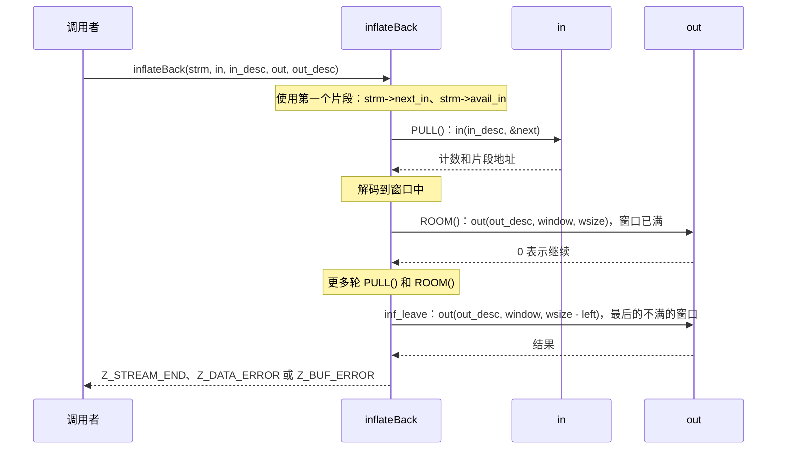
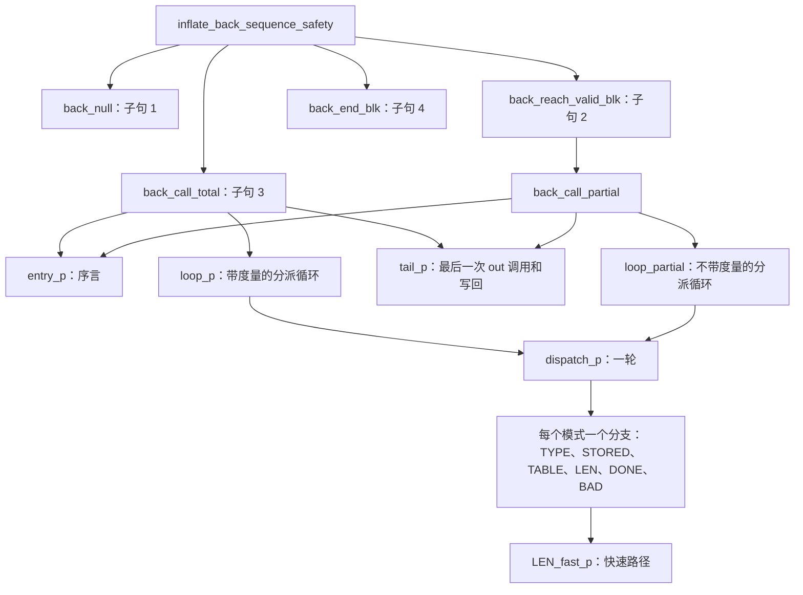

<!-- source-sha256: 2977873e31d689d1cb8ac377e26965b2f8b20b6bdd3c0313c56f0f1d91b7b20c -->
# 回调解码器：调用者协议与有限输入

`inflateBack` 用调用者提供的两个函数来解码：`in` 交付输入，`out`
接收输出。所以它的安全性取决于这两个函数做什么。本页的结论是：对每一对遵守一个明确写出的协议、并且提供的输入量有界的回调，`inflateBack`
及其调用序列是安全的。本页给出这个命题、协议和证明的轮廓。

源文件：`infback.c`。[API 页面](../spec/api/inflate-back.md)陈述公开契约。术语见[术语表](../glossary.md)。

## 结论

| 目标 | 定理 |
| --- | --- |
| `Goal.inflate_back_sequence_safety` | `inflate_back_sequence_safety` |
| `Goal.inflate_back_initialisation_domain` | `back_init_domain_public` |
| `Goal.inflateBack_call_domain` | `BackCallDomainProof.inflateBack_call_domain` |
| `Goal.inflateBackInit__safety`、`Goal.inflateBack_safety`、`Goal.inflateBackEnd_safety` | `BackSafetyProof.inflateBackInit__safety`、`inflateBack_safety`、`inflateBackEnd_safety` |

六个都已完成。第一个是关于历史的安全结论，第二个表明初始化可以成功。第三个表明 `inflateBack` 一次调用的前提可以被满足，
其中包括回调协议（[调用者协议](#the-caller-protocol)）。后三个是三个函数各自的安全目标。
序列目标的历史不要求 `inflateBackInit_` 之前 `state` 字段为 `NULL`。

单函数目标由本页的结论推出：

- `Goal.inflateBack_safety` 是序列目标的子句 1 和子句 3，再加一种拒绝：状态为 `NULL` 的流记录（`inflateBack_nostate`）。
- `Goal.inflateBackEnd_safety` 是序列目标的子句 4，再加对 `NULL` 流以及对状态或 `zfree` 为 `NULL` 的流记录的拒绝（来自 `back_end_public`）。
- `Goal.inflateBackInit__safety` 是初始化调用在 `zlib.h` 允许的每组参数上的安全（`InitArguments`），不需要历史。它由功能定理 `back_init_public` 推出。

每个函数另有一个功能契约（`Goal.inflateBackInit_`、`Goal.inflateBack`、`Goal.inflateBackEnd`）。这些契约不是必需的；哪些已完成，见[最后一节](#functional-results-that-stay)。

`Goal.inflate_back_sequence_safety` 有四个子句。

1. 在 `NULL` 流上，`inflateBack` 返回 `Z_STREAM_ERROR`，什么都不改。
2. 每个可达的历史之后，流在调用者的窗口上有一个有效的状态（`BackValid`：堆是良构的，流记录指向一个存活的 inflate
   状态，使用默认分配器，`8 ≤ wbits ≤ 15`，`wsize = 2^wbits`，窗口不是 `NULL`，并且有 `wsize` 个可写字节）。
3. 对下文定义域中的每个调用者协议，再调用一次 `inflateBack` 会无故障地返回。它的结果是 `Z_STREAM_END`、`Z_DATA_ERROR` 或
   `Z_BUF_ERROR`。状态在同一个窗口上保持有效，协议的不变量再次成立。调用只改动流记录、状态记录、回调自己的块和窗口切片（`CallbackFrame`）。回调自己的块之外的存活块不变，所以库不泄漏任何东西。
4. 在每个可达的历史上，`inflateBackEnd` 返回 `Z_OK`，释放状态块而不释放别的，并清除流的状态指针。窗口仍归调用者。

## C 对 `in` 和 `out` 的调用

`zlib.h` 声明了回调和解码器：

```c
typedef unsigned (*in_func)(void FAR *, z_const unsigned char FAR * FAR *);
typedef int (*out_func)(void FAR *, unsigned char FAR *, unsigned);

int inflateBack(z_streamp strm, in_func in, void FAR *in_desc,
                out_func out, void FAR *out_desc);
```

`infback.c` 在三个地方调用它们。下面的宏以精简后的形式列出：

```c
/* PULL()：当前的输入片段已用完 */
have = in(in_desc, &next);
if (have == 0) { next = Z_NULL; ret = Z_BUF_ERROR; goto inf_leave; }

/* ROOM()：窗口已满 */
put = state->window; left = state->wsize; state->whave = left;
if (out(out_desc, put, left)) { ret = Z_BUF_ERROR; goto inf_leave; }

/* inf_leave：最后的、不满的窗口 */
if (left < state->wsize) {
    if (out(out_desc, state->window, state->wsize - left) && ret == Z_STREAM_END)
        ret = Z_BUF_ERROR;
}
strm->next_in = next;
strm->avail_in = have;
return ret;
```

所以 `in` 返回一个字节计数，并通过 `&next` 存入它那个片段的地址；计数为 0 就结束这次调用。`out` 收到窗口的一个范围，返回非零值表示停止。



最后一次 `out` 调用发生在检查返回码之前，所以它在出错的路径上也会出现。

在翻译中，调用 `in(in_desc, &next)` 传入 `next` 的当前值，收到一个二元组（计数，`next`
的新值）（[规范化 1](../design/translation.md#the-accepted-normalisations)）。没有为 `&next`
分配单元。保留这个地址并在返回之后通过它写入的回调，不在模型之内。

## 假设了什么

回调是调用者的代码。它们的契约是关于调用者的前提。它不是对某个 zlib 函数假设的规格：`inflateBack` 调用的每个库函数都有自己的定理。

| 前提 | 位置 | [偏离记录](../deviations.md#callback-decoder)中的行 |
| --- | --- | --- |
| 在 `inflateBackInit_` 之前：堆是良构的（`Fresh`、`Uniq`、`LibraryGlobals`）；`version` 指向一个可读的字节 `'1'`；流记录可读；它的 `zalloc` 和 `zfree` 各自是 `NULL` 或默认函数。它的其他字段（包括 `state`）可以取任意值。这次调用的 `stream_size = 112`，并且返回了 `Z_OK`；版本字节或大小不同的调用不会返回 `Z_OK`（`back_init_public`）。 | `BackSafeReachable.init` 中的 `BackInitArguments` | 回调解码器的初始化 |
| 回调遵守一个 `CallbackProtocol`（下一节），并且它的不变量在调用 `inflateBack` 时成立。 | 参数 `protocol` | 回调 |
| 一次调用得到的字节，把调用者的第一个片段和它所有的 `in` 调用合在一起，总共少于 `2^48`。 | `protocol.inputBound < 2^48`，连同 `bounded` | 回调输入总量 |
| `8 ≤ windowBits ≤ 15`，窗口不是 `NULL`，有 `2^windowBits` 个可写字节，并且是一个堆字节块的切片。 | `BackSafeReachable.init` | 回调解码器窗口 |
| 每个输入片段都在一个堆字节块中：调用者的第一个片段，以及 `in` 交出的每个片段。 | `BackFirstChunk`、`BackPlatform` | 回调解码器输入片段 |
| 在每次调用时和每个回调步骤之后，每个字节对象少于 `2^63` 字节。 | `ByteObjectsFit`、`BackPlatform` | 平台字节对象范围 |
| 流使用默认分配器，或者分配器字段为 `NULL`，由初始化替换。 | `BackValid`、`BackInitArguments` | 初始配置 |
| 调用者的第一个输入片段可读，并且与窗口分离：它是 `strm->next_in` 处的 `strm->avail_in` 个字节；`strm->next_in` 为 `NULL` 时没有字节。 | 子句 3 中的 `Bytes` 和 `Separate` | 回调 |
| 在两次调用之间，调用者只改动流不拥有的内存和流记录的四个缓冲区字段。堆保持良构，窗口切片的字节保持不变，保持存活的块都不改变只读标志。 | `BackSafeReachable.caller` | 调用之间调用者的修改（`BackSafeReachable.caller`） |

完整的列表就是命题本身：`Goal.inflate_back_sequence_safety`，
以及 `BackSafeReachable` 和 `BackInitArguments`。这张表里的前提，也是 `Goal.inflateBack_safety` 和
`Goal.inflateBackEnd_safety` 中关于历史的子句的前提。

### 为什么要给输入设界

回调会返回，这对终止还不够。输入回调可以提供无穷多个空的、非最后的存储块，`inflateBack`
于是永不返回。这不是未定义行为，但也不是终止。`zlib.h` 没有承诺回调最终会结束它的输入。

`2^48` 这个数字是模型的限制，不是 zlib 的。运行时把每个循环界定在 `2^64` 次迭代之内，而分派循环的度量数的是输入的位。

这个界把这次调用的每个字节都算在内。已提供字节的日志从调用者的第一个片段（`strm->next_in`、`strm->avail_in`）开始，每次
`in` 调用再向它追加。下面的要求 `bounded` 限制的就是这份日志的长度。

## 调用者协议

`CallbackProtocol` 说明两个回调可以做什么。它的各个部分由定理的调用者选择：

- `own`：属于回调的堆块的集合。它不包含状态记录和流记录。
- `invariant`：关于堆和一份日志的一个性质。日志（`BackLog`）记录到此为止提供的字节（先是调用者的第一个片段，然后是 `in`
  返回的内容），以及 `out` 已经收到的片段。它不是内存；它只存在于命题中。
- `inputBound`：一个数。

协议随后对 `in` 和 `out` 提出五项要求。

| 要求 | 含义，对照上面的 C 调用 |
| --- | --- |
| `local_` | 不变量只依赖两样东西：回调自己的块的内容，以及堆的分配器字段（下一个块编号、分配调用的次数、分配失败预言、新分配内存的内容，以及静态表）。在这些方面一致的两个堆（`ExternalAgreement`）同样地满足或不满足它。比较时不计窗口切片的字节，所以窗口切片的变化不影响它。`in_desc` 或 `out_desc` 背后的对象可以与窗口在同一次分配中，位于切片之外。 |
| `inStep` | 在满足 `CallbackEntry`（见下）的堆上，从不变量出发，`in(in_desc, &next)` 无故障地返回一个计数和一个片段地址。它只改动自己的块（`ExternalFrame`），并保持窗口切片的字节。非空的片段在计数的长度内可读，与窗口分离，并且在状态记录和流记录之外。不变量再次成立，日志中追加了这个片段。 |
| `outStep` | 在满足 `CallbackEntry` 的堆上，从不变量出发，对任何不超过窗口容量的可读范围，`out(out_desc, buf, len)` 无故障地返回。它只改动自己的块，保持窗口切片的字节，并使当前的输入片段在下一次 `in` 调用之前保持可读。不变量再次成立，日志中追加了这个片段。 |
| `liveInput` | 在不变量之下，当前的输入片段可读。 |
| `bounded` | 在不变量之下，到此为止提供的字节数（包括调用者的第一个片段）至多是 `inputBound`。 |

这张表是摘要。完整的命题是结构 `CallbackProtocol`。

`inStep` 和 `outStep` 只在满足 `CallbackEntry` 的堆上才被要求：流是这个窗口上的一个有效回调解码器（`BackValid`）。
因此堆是库的堆，窗口可写。库在每次调用 `in` 和 `out` 时提供的正是这样的堆。这个前提是必要的。
没有它，就不存在任何协议：`local_` 使不变量对 `own` 之外的每个块都不敏感，而 `disjoint` 把状态块放在 `own` 之外。
于是不变量在“状态块里放着两个对象”的堆上同样成立，而从这样的堆出发，没有任何一步能以一个良构且该块不变的堆结束。
这两个事实都有 Lean 证明，这些证明不在库的定理之内。第一，如果协议要求它的步骤在每个满足其不变量的堆上都成立，那么没有任何堆和日志满足它的不变量。
第二，每个这样的协议也都是带 `CallbackEntry` 前提的协议，不变量相同。所以这个前提使目标更强，而不是更弱。

`Goal.inflateBack_call_domain` 表明这些前提可以被满足。它给出一个具体的历史：在见证堆上调用
`inflateBackInit_`，然后调用者修改 `next_in` 和 `avail_in`。回调是具体的：`noInput` 报告输入结束，`takeOutput`
接受每个片段。协议 `witnessProtocol` 拥有一个块。第一个片段有两个字节，位于一个堆字节块中。
`Goal.inflateBack_safety` 调用子句的每个前提在它们上面同时成立。这个见证有它的局限。它的输入回调不交付任何字节：
见证调用的全部输入就是调用者的第一个片段。这两个字节不是合法的 deflate 流，所以见证调用以错误码结束。
这个目标表明前提可以满足，并不表明每一类协议都可以满足。

“只改动自己的块”（`ExternalFrame`）允许回调分配和释放它自己的块。它创建的每个块都是它自己的块，堆保持良构。它不能改变一个保持存活的块是否只读：C
代码没有办法做到这一点。

## 历史

`BackSafeReachable h r i window n` 说的是：堆 `h` 是流 `r`（状态块为 `i`）在调用者的 `n` 字节窗口上经某个实际历史到达的。

| 构造子 | 步骤 |
| --- | --- |
| `init` | 一次成功的 `inflateBackInit_`，出发的调用者存储满足 `BackInitArguments`（流记录的 `state` 字段可以取任意值），其中 `stream_size = 112`，`8 ≤ windowBits ≤ 15`，窗口不是 `NULL`、可写，并且在一个堆字节块中。 |
| `caller` | 调用者改动流不拥有的内存和流记录的四个缓冲区字段（`Rebuffer`）。堆保持良构，窗口切片的字节保持不变，保持存活的块都不改变只读标志。 |
| `step` | 一次已返回的 `inflateBack` 调用。它的第一个片段可读并且与窗口分离，协议的不变量在调用时成立，平台前提也成立（调用时的 `ByteObjectsFit`、`BackPlatform`、`BackFirstChunk`）。 |

`step` 不要求输入的界。所以一个历史可以包含输入无界而碰巧返回了的调用。界只对下一次调用提出，目标正是在那里断言终止。

## 分派循环的不变量

每当 `for (;;) switch (state->mode)` 将要读取模式时，`PInv` 成立。它是相对于调用时的堆陈述的，并且提到协议的日志。

- 状态在调用者的窗口上有效，窗口在状态记录和流记录之外。
- `put` 和 `left` 描述窗口中还没写的尾部：`put = window + (n - left)`。
- `next` 和 `have` 描述正在使用的片段的剩余部分：这个片段是调用者的第一个片段，或者是 `in`
  上一次返回的片段。它保持可读，在窗口之外，也在两个记录之外。
- 位缓冲是规范化的：`bits ≤ 39`，`hold < 2^bits`。
- 协议的不变量对当前的堆和日志成立。
- 堆与调用时的堆相差一个 `CallbackFrame`，回调的块之外，存活情况不变。
- 模式是 `TYPE`、`STORED`、`TABLE`、`LEN`、`DONE`、`BAD` 之一（`ModeOk`）。在 `LEN`
  中，解码表具有查表所需的形状（`TablesOk`）：每张表要么是静态的固定表，要么位于状态的 `codes`
  数组中，并满足[解码表](inftrees.md)的表谓词。
- `sane ≠ 0`、`wnext = 0`、`whave ≤ wsize`（`StOk`）。`inflate_fast` 依赖它们，而 `inflateBack` 从不破坏它们。
- 平台前提成立：协议的平台部分（`BackPlatform`），当前堆的每个字节对象少于 `2^63`
  字节，正在使用的片段在一个堆字节块中。快速路径需要它们。

这个列表是摘要。它略去了把循环同这次调用的流记录和状态块联系起来的两个子句（`cstrm`、`cst`）。完整的命题是结构 `PInv`。

`inflateBackInit_` 分配一个状态，不把它清零。它写入窗口设置、窗口指针、历史计数器和 `sane`。`inflateBack` 的序言随后复位模式、`last` 和
`whave`。表指针在通往 `LEN` 的路上写入，并且只在那里被读。`TablesOk` 只在 `LEN` 中要求。它排除了模型给新分配的指针字段的
`NULL`，所以在 `LEN` 中两个表指针都已经写入。

## 证明结构



一次调用是三段：序言（`entry_p`）、分派循环和尾部（`tail_p`），尾部就是上面
`inf_leave` 处的代码。

循环规则有两条。

- `back_call_total` 使用带度量的循环规则。它给出子句 3：调用会返回。
- `back_call_partial` 使用 `xwhileBrk_partial`，一条不带度量的规则：已返回的运行保持了不变量。它用于历史中的
  `step`，那里的输入没有界。它通过对历史归纳给出子句 2（`back_reach_st_blk`）。

循环的一轮是 `dispatch_p`。它按模式分情形。`switch` 的默认分支不可达，因为
`ModeOk` 列出了那六个模式。

### 循环内部的回调

`PULL()` 只在当前片段用尽时调用 `in`。`PULL_p` 应用协议的 `inStep`。它的 `CallbackEntry` 前提就是循环不变量的 `valid` 字段。

`ROOM()` 在没有剩余空间时对满的窗口调用 `out`，设置 `whave = wsize`，并从窗口开头重新开始。`ROOM_p` 应用 `outStep`，同样以 `valid` 字段作为 `CallbackEntry` 前提。

任何一个回调之后，状态再次有效（`backValid_callback`）。回调只改动了它自己的块，这些块不包含那两个记录，并且它保持了窗口切片。

### 终止

分派循环的度量是 `backMeasure`：

```
4 · (bits + 8 · have + 8 · (inputBound - supplied)) + modeRank(mode)
```

第一项数的是还可读的输入位：已持有的，当前片段中的，以及 `in` 还可能交付的。`modeRank` 对 `DONE` 和 `BAD` 为 0，对 `TYPE` 为
1，其他情况为 2。每一个继续下去的轮次都降低度量。有了 `inputBound < 2^48`，它的初值低于循环燃料 `2^64`。

输出不出现在度量中，因为 `ROOM()` 会复位输出空间。所以对快速路径必须证明的是它消耗输入，而不是它产生输出。

### 快速路径

当至少有 6 个输入字节和 258 字节的空间可用时，`case LEN` 调用 `inflate_fast`。在 `inflateBack`
中，这次调用的输出就是窗口本身：窗口块就是输出块，`wnext = 0`，窗口在输出范围结束的地方结束。引理 `fast_env` 以 `inflate_fast`
入口条件所取的形式陈述这些事实。

`fast_consumes` 给出运行、它的帧性质以及对输入位的严格消耗：已持有的位加上八倍的剩余字节从不增长，并且严格下降，除非调用以
`TYPE` 或 `BAD` 结束。`LEN_fast_p` 把这变成分派循环的一轮。

`fast_env` 是对位于堆字节块中的窗口构造 `inflate_fast` 的入口条件的，快速路径也只在这样的窗口上证明（`lenFast_of_blk`）。入口条件本身允许任何字节对象（[快速解码](inffast.md#assumptions)）。目标的每个历史都有这样的窗口（`back_reach_window`），因为
`init` 构造子要求它。这就是窗口前提的理由。

## 保留的功能结论

这三个函数各有一个功能契约，另有功能序列目标
`Goal.inflate_back_sequence`。安全结论不需要其中任何一个。这四个中有两个已完成：

- `Goal.inflateBackInit_`（`back_init_public`）和
  `Goal.inflateBackEnd`（`back_end_public`）：两个生命周期函数的完整契约。安全目标的子句 4 使用 `back_end_public`。`Goal.inflateBackEnd_safety` 的拒绝子句和整个 `Goal.inflateBackInit__safety` 都由这两条定理推出。

另外还有一些不是目标的定理：

- `inflateBack` 的分支结论：`NULL` 流、缺失的状态，以及立即结束的输入（`inflateBack_eof`）。前两个同时也是 `Goal.inflateBack_safety` 的子句。

未完成，也不在计划内；安全结论用不到它们：`Goal.inflateBack` 和 `Goal.inflate_back_sequence`。它们还说明到达 `out`
的是什么（解码子句）。
