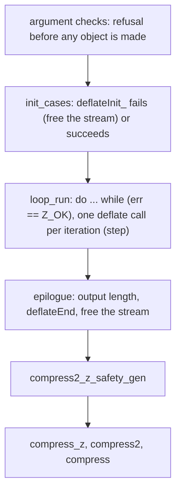

# Safety of `compress*`

Source: `compress.c`. `compress`, `compress_z`, `compress2` and `compress2_z` are safe on
every input. This page explains that result.

## What is proved

| Goal (`ZlibF/Spec/Safety/Utilities.lean`) | Theorem | Module |
| --- | --- | --- |
| `Goal.compress2_z_safety` | `compress2_z_safety` | `ZlibF/Proof/public-compress-safe-mid.lean` |
| `Goal.compress2_safety` | `compress2_safety` | same |
| `Goal.compress_z_safety` | `compress_z_safety` | same |
| `Goal.compress_safety` | `compress_safety` | same |

All four are safety results and are required. They have no hypothesis. They are registered in
`tests/audit/theorems.txt` and accepted on commit `bde170e9`
([progress, Scope](../progress.md#scope)).

Each goal is an instance of `CompressorSafety` (`ZlibF/Spec/Public/Utilities.lean`). For
every admitted input:

- the call runs without undefined behaviour and returns;
- a rejected argument returns `Z_STREAM_ERROR` and changes nothing;
- otherwise the call writes at most the capacity into the output buffer and nothing else;
- every allocation is freed on every path;
- `Z_MEM_ERROR` comes only after an allocation failed.

Nothing is said about the bytes written. That is the functional contract
`CompressorContract`, which is not required.

## What is assumed

| Premise | Meaning |
| --- | --- |
| `Fresh`, `Uniq`, `LibraryGlobals` | The caller heap is well formed and the static tables are the initial ones. |
| `ByteObjectsFit` | Every byte object has fewer than `2^63` bytes. |
| `CompressArguments` | The arguments are rejected by the C's own checks, or the source is readable, the destination is writable for its capacity, and the two do not overlap. |
| A length cell | `compress` and `compress2` take a non-null `destLen`. The `_z` forms admit `NULL`. |

The separation of source and destination has a row in [deviations](../deviations.md),
"Whole-buffer compression".

## Structure

`CState` is the state between iterations: the stream invariant, reachability, the counts of
consumed input and produced output, and agreement of the heap with the caller heap with the
output written.

The proof is generic in the histories of the stream it drives (`CompressReach`).
`compress2_z_safety_gen` takes two facts about those histories:

- the full contract of one `deflate` call, `Goal.deflate`, restricted to them;
- `DeflateLoopFacts`, four facts about one `deflate` call that `Goal.deflate` does not state:
  - a `Z_NO_FLUSH` call that is not refused, has input and room, and returns `Z_OK` makes
    progress;
  - new input after the first `Z_FINISH` gives `Z_BUF_ERROR` or writes at least one byte;
  - every call keeps the gzip header pointer;
  - every call keeps the owned blocks.

`compress2_z` initialises its stream with `memLevel` 8. So the registered theorems
instantiate the generic proof with `DeflateReachMid`: the histories that start with
`deflateInit2_` at `memLevel ≥ 3` and then only rebuffer the stream and call `deflate`. Along
them `lit_bufsize ≥ 512`, and both facts hold with no hypothesis (`goalDeflate_mid`,
`loopFacts_mid`). The small-buffer case of the overlay bound is not needed here; see
[trees](trees.md#the-overlay-lemma-f9).

`deflateInit_` and `deflateEnd` are used through their own theorems (`deflateInit_proof`,
`deflateEnd_safe`, `deflate_end_public`).

## Termination

The measure is `avail_in + sourceLen + avail_out + left`. It starts below `2^64`, the loop
fuel. The refills keep it. A call that returns `Z_OK` is not refused and has room; otherwise
`Goal.deflate` gives `Z_BUF_ERROR`. With `Z_NO_FLUSH` the call has input, because source
remains after the refill, so `DeflateLoopFacts` gives progress. With `Z_FINISH`, the progress
clause of `Goal.deflate` gives progress, unless the stream is finished and has new input; in
that case `DeflateLoopFacts` gives `Z_BUF_ERROR` or a written byte. Progress lowers the
measure.

## The bound functions

`compressBound` and `compressBound_z` read no memory. Their goals `Goal.compressBound` and
`Goal.compressBound_z` give the exact value of the bound formula, and the manifest
`tests/audit/public-api.json` uses these same goals as their safety goals. The theorems are
`compressBound` and `compressBound_z` (`ZlibF/Proof/public-compress-bound.lean`).

Whether every compressor output fits the bound is a separate functional question. It is not
required; see [buffer utilities](buffers.md).
