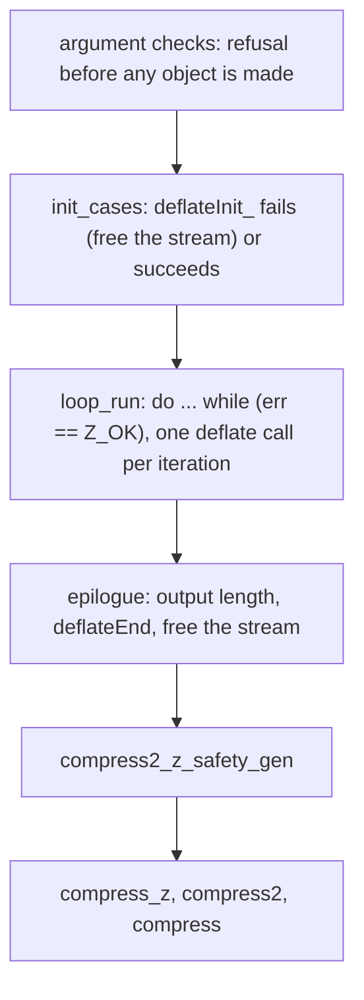

# Safety of `compress*`

`compress`, `compress_z`, `compress2` and `compress2_z` are safe on every input that meets the
premises below: the call returns, has no undefined behaviour, writes only the destination
buffer, and frees everything it allocated. This page gives the statement, its premises and
the shape of the proof.

Source: `compress.c`. [Buffer utilities](buffers.md) reads the C. Terms:
[glossary](../glossary.md).

## What is proved

| Goal | Theorem |
| --- | --- |
| `Goal.compress2_z_safety` | `compress2_z_safety` |
| `Goal.compress2_safety` | `compress2_safety` |
| `Goal.compress_z_safety` | `compress_z_safety` |
| `Goal.compress_safety` | `compress_safety` |

All four are safety results, are required, and are done. Each theorem proves its goal exactly
as stated, with no hypothesis added; the premises below are part of the goal statements.

Each goal is an instance of `CompressorSafety`. For every input that meets the premises below:

- the call runs without undefined behaviour and returns;
- a rejected argument returns `Z_STREAM_ERROR` and changes nothing;
- otherwise the call writes at most the capacity into the output buffer and nothing else;
- every allocation is freed on every path;
- `Z_MEM_ERROR` comes only after an allocation failed.

Nothing is said about the bytes written. That is the functional contract
`CompressorContract`, which is not required for the safety results.

## What is assumed

| Premise | Meaning |
| --- | --- |
| `Fresh`, `Uniq`, `LibraryGlobals` | The caller heap is well formed and the static tables are the initial ones. |
| `ByteObjectsFit` | Every byte object has fewer than `2^63` bytes. |
| `CompressArguments` | The arguments are rejected by the C's own checks, or the source is readable, the destination is writable for its capacity, and the two do not overlap. |
| The length cell | `compress` and `compress2` take a non-null `destLen`. The `_z` forms admit `NULL` and refuse it. In the translation the cell is a value passed in and a value returned, not memory. So a cell that overlaps the source or the destination cannot be expressed, and such a call is outside the theorems. |

The separation of source and destination, and the limit on the length cell, have a row in
[deviations](../deviations.md), "Whole-buffer compression".

## Structure

`compress2_z` drives a local `z_stream` through `deflateInit_`, a loop of `deflate` calls and
`deflateEnd`. Before each `deflate` call the loop refills `avail_in` and `avail_out`, which are
32-bit, from the 64-bit remaining lengths. This page calls that refill a *rebuffer* of the
stream.

`CState` is the state between iterations: the stream invariant, reachability, the counts of
consumed input and produced output, and the fact that the heap is the caller's heap with the
output so far written into the destination.

The proof is generic in the histories of the stream it drives (`CompressReach`).
`compress2_z_safety_gen` takes two facts about those histories:

- the full contract of one `deflate` call, `Goal.deflate`, restricted to them;
- `DeflateLoopFacts`, four facts about one `deflate` call that `Goal.deflate` does not state:
  - a `Z_NO_FLUSH` call that is not refused, has input and room, and returns `Z_OK` makes
    progress;
  - new input after the first `Z_FINISH` gives `Z_BUF_ERROR` or writes at least one byte;
  - every call keeps the gzip header pointer;
  - every call keeps the owned blocks.

`compress2_z` initialises its stream with `memLevel` 8. So the four theorems
instantiate the generic proof with `DeflateReachMid`: the histories that start with
`deflateInit2_` at `memLevel ≥ 3` and then only rebuffer the stream and call `deflate`. Along
them `lit_bufsize ≥ 512`, and both facts hold with no hypothesis (`goalDeflate_mid`,
`loopFacts_mid`). Histories with `memLevel` 1 or 2 need a further bound on the compressor's
shared pending and symbol buffer, described in [trees](trees.md#the-overlay-lemma-f9). The
theorems here do not use it.

`deflateInit_` and `deflateEnd` are used through their own theorems (`deflateInit_proof`,
`deflateEnd_safe`, `deflate_end_public`).

## Termination

The measure is `avail_in + sourceLen + avail_out + left`. Here `sourceLen` and `left` are the C
locals: the source bytes and the destination room not yet given to the stream. The measure
starts below the loop fuel, `2^64`. The refills keep it. A call that returns `Z_OK` is not
refused and has room; otherwise `Goal.deflate` gives `Z_BUF_ERROR`. With `Z_NO_FLUSH` the
call has input, because source remains after the refill, so `DeflateLoopFacts` gives progress. With `Z_FINISH`, the progress
clause of `Goal.deflate` gives progress, unless the stream is finished and has new input; in
that case `DeflateLoopFacts` gives `Z_BUF_ERROR` or a written byte. Progress lowers the
measure.

## The bound functions

`compressBound` and `compressBound_z` read no memory. Their goals `Goal.compressBound` and
`Goal.compressBound_z` give the exact value of the bound formula, and these same goals are
their safety goals. The theorems are `compressBound` and `compressBound_z`.

Not covered: that every output of the translated compressor fits the bound. That is a
functional statement, which the safety results do not need; see
[buffer utilities](buffers.md). The theorem `compress_bound_adequate` states it, and
`deflate_bound_adequate` states the same for the bound of `deflateBound`, for the heap-free
[API model](../design/api-model.md) only. No theorem says that the translated `compress2` or
`deflate` follows that model.
