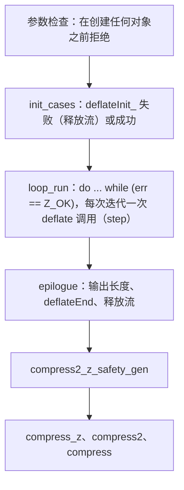

<!-- source-sha256: 1c446561c12893cefc894813da4e12ee477408787cd10829b16d90a1a174e905 -->
# `compress*` 的安全性

源文件为 `compress.c`。`compress`、`compress_z`、`compress2` 和 `compress2_z` 在每个输入上都是安全的。本页解释这个结果。

## 已证明什么

| 目标（`ZlibF/Spec/Safety/Utilities.lean`） | 定理 | 模块 |
| --- | --- | --- |
| `Goal.compress2_z_safety` | `compress2_z_safety` | `ZlibF/Proof/public-compress-safe-mid.lean` |
| `Goal.compress2_safety` | `compress2_safety` | 同上 |
| `Goal.compress_z_safety` | `compress_z_safety` | 同上 |
| `Goal.compress_safety` | `compress_safety` | 同上 |

四者都是安全性结果，都是必需的，都没有假设。它们登记在 `tests/audit/theorems.txt` 中，并在提交 `bde170e9` 上被接受（[进度，范围](../progress.md#scope)）。

每个目标都是 `CompressorSafety`（`ZlibF/Spec/Public/Utilities.lean`）的一个实例。对每个允许的输入：

- 调用在没有未定义行为的情况下运行并返回；
- 被拒绝的参数返回 `Z_STREAM_ERROR`，不改变任何东西；
- 否则，调用向输出缓冲区写入不超过容量的字节，不写其他任何地方；
- 每次分配在每条路径上都被释放；
- `Z_MEM_ERROR` 只在某次分配失败之后出现。

目标对写出的字节不作任何断言。那是功能性契约 `CompressorContract`，不是必需的。

## 假设了什么

| 前提 | 含义 |
| --- | --- |
| `Fresh`、`Uniq`、`LibraryGlobals` | 调用者的堆是良构的，静态表是初始的那些表。 |
| `ByteObjectsFit` | 每个字节对象小于 `2^63` 字节。 |
| `CompressArguments` | 参数要么被 C 自己的检查拒绝，要么源可读、目标在其容量内可写，并且两者不重叠。 |
| 长度单元 | `compress` 和 `compress2` 接受非空的 `destLen`。`_z` 形式允许 `NULL`。 |

源与目标的分离在[偏差记录](../deviations.md)中有一行，名为“整缓冲区压缩”。

## 结构

`CState` 是两次迭代之间的状态：流不变量、可达性、已消耗输入和已产生输出的计数，以及当前堆与“调用者的堆加上已写输出”一致。

证明对它所驱动的流的历史是通用的（`CompressReach`）。`compress2_z_safety_gen` 需要关于这些历史的两个事实：

- 单次 `deflate` 调用的完整契约 `Goal.deflate`，限制在这些历史上；
- `DeflateLoopFacts`，即 `Goal.deflate` 没有陈述的、关于单次 `deflate` 调用的四个事实：
  - 一次未被拒绝、有输入也有空间并返回 `Z_OK` 的 `Z_NO_FLUSH` 调用会取得进展；
  - 第一次 `Z_FINISH` 之后的新输入要么得到 `Z_BUF_ERROR`，要么至少写出一个字节；
  - 每次调用都保持 gzip 头指针；
  - 每次调用都保持所拥有的块。

`compress2_z` 以 `memLevel` 8 初始化它的流。因此已登记的定理用 `DeflateReachMid` 实例化这个通用证明：这些历史以 `memLevel ≥ 3` 的 `deflateInit2_` 开始，之后只对流换缓冲区并调用 `deflate`。沿着这些历史 `lit_bufsize ≥ 512`，上述两个事实都无需假设即成立（`goalDeflate_mid`、`loopFacts_mid`）。这里用不到重叠缓冲区界限的小缓冲区情形；见[树](trees.md#the-overlay-lemma-f9)。

`deflateInit_` 和 `deflateEnd` 通过它们自己的定理使用（`deflateInit_proof`、`deflateEnd_safe`、`deflate_end_public`）。

## 终止

度量是 `avail_in + sourceLen + avail_out + left`。它的初值低于循环燃料 `2^64`。补充缓冲区的操作保持它不变。返回 `Z_OK` 的调用没有被拒绝并且有空间；否则 `Goal.deflate` 给出 `Z_BUF_ERROR`。使用 `Z_NO_FLUSH` 时调用有输入，因为补充之后源仍有剩余，于是 `DeflateLoopFacts` 给出进展。使用 `Z_FINISH` 时，`Goal.deflate` 的进展子句给出进展，除非流已经结束而又有新输入；这种情形下 `DeflateLoopFacts` 给出 `Z_BUF_ERROR` 或一个写出的字节。有进展就使度量下降。

## 界限函数

`compressBound` 和 `compressBound_z` 不读内存。它们的目标 `Goal.compressBound` 和 `Goal.compressBound_z` 给出界限公式的准确值，清单 `tests/audit/public-api.json` 把这两个目标同时用作它们的安全目标。对应的定理是 `compressBound` 和 `compressBound_z`（`ZlibF/Proof/public-compress-bound.lean`）。

每个压缩输出是否都不超过该界限，是另一个功能性问题。它不是必需的；见[缓冲区工具](buffers.md)。
