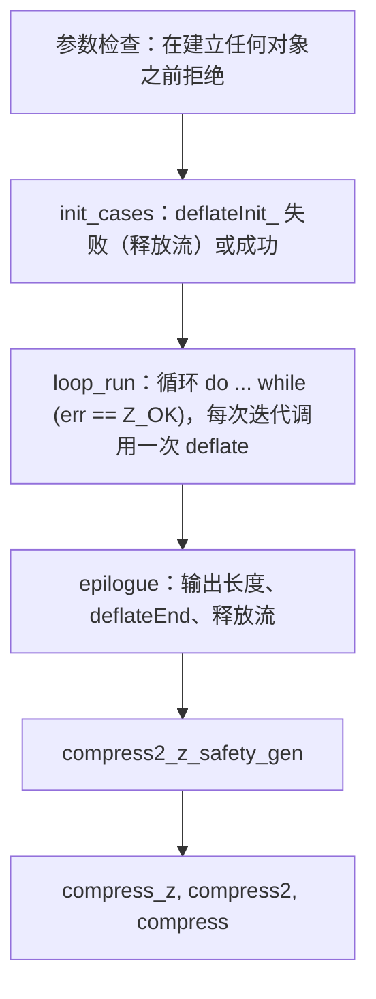

<!-- source-sha256: 5c142fae4071144b457186bc724ab6daced2aef1940b2dd8c7a36aca9b205e60 -->
# `compress*` 的安全性

`compress`、`compress_z`、`compress2` 和 `compress2_z` 在满足下列前提的每个输入上都是安全的：调用会返回，没有未定义行为，只写目的缓冲区，并且释放它分配的一切。本页给出这条陈述、它的前提和证明的轮廓。

源文件：`compress.c`。[缓冲区工具函数](buffers.md)一页解读这段 C。术语见[术语表](../glossary.md)。

## 证明了什么

| 目标（`ZlibF/Spec/Safety/Utilities.lean`） | 定理 | 模块 |
| --- | --- | --- |
| `Goal.compress2_z_safety` | `compress2_z_safety` | `ZlibF/Proof/public-compress-safe-mid.lean` |
| `Goal.compress2_safety` | `compress2_safety` | 同上 |
| `Goal.compress_z_safety` | `compress_z_safety` | 同上 |
| `Goal.compress_safety` | `compress_safety` | 同上 |

这四个都是安全结果，都是必需的。每个定理证明的正是所陈述的目标，没有附加假设；下面的前提是目标陈述的一部分。这些定理[已登记](../checking/README.md)在 `tests/audit/theorems.txt` 中，并[已在提交 `bde170e9` 上验收](../checking/README.md)（[进度，范围](../progress.md#scope)）。

每个目标都是 `CompressorSafety`（`ZlibF/Spec/Public/Utilities.lean`）的一个实例。对满足下列前提的每个输入：

- 调用在没有未定义行为的情况下运行并返回；
- 被拒绝的参数返回 `Z_STREAM_ERROR`，并且什么都不改变；
- 否则，调用向输出缓冲区写入的字节数不超过容量，此外什么都不写；
- 每次分配在每条路径上都被释放；
- `Z_MEM_ERROR` 只在某次分配失败之后出现。

关于写出的字节，这里什么都没有说。那是功能契约 `CompressorContract`，不是安全结果所必需的。

## 假设了什么

| 前提 | 含义 |
| --- | --- |
| `Fresh`、`Uniq`、`LibraryGlobals` | 调用者的堆是良构的，静态表是初始的那些表。 |
| `ByteObjectsFit` | 每个字节对象少于 `2^63` 个字节。 |
| `CompressArguments` | 参数要么被 C 自己的检查拒绝，要么源缓冲区可读、目的缓冲区在其容量内可写，并且两者不重叠。 |
| 长度单元 | `compress` 和 `compress2` 取非 NULL 的 `destLen`。`_z` 形式接受 `NULL` 并拒绝它。在翻译中，这个单元是一个传入的值和一个返回的值，不是内存。所以与源缓冲区或目的缓冲区重叠的单元无法表达，这样的调用在定理之外。 |

源缓冲区与目的缓冲区的分离，以及对长度单元的限制，在[偏离记录](../deviations.md)中有一行：“整缓冲区压缩”。

## 结构

`compress2_z` 驱动一个局部的 `z_stream`，依次经过 `deflateInit_`、一个由 `deflate` 调用组成的循环和 `deflateEnd`。每次调用 `deflate` 之前，循环用 64 位的剩余长度补充 32 位的 `avail_in` 和 `avail_out`。本页把这次补充称为流的*重新装填*（rebuffer）。

`CState` 是两次迭代之间的状态：流不变量、可达性、已消耗输入和已产生输出的计数，以及这样一个事实：堆就是调用者的堆，只是目的缓冲区里写入了到此为止的输出。

证明对它所驱动的流的历史是泛型的（`CompressReach`）。`compress2_z_safety_gen` 取关于这些历史的两个事实：

- 一次 `deflate` 调用的完整契约 `Goal.deflate`，限制在这些历史上；
- `DeflateLoopFacts`，即 `Goal.deflate` 没有陈述的、关于一次 `deflate` 调用的四个事实：
  - 一次 `Z_NO_FLUSH` 调用如果没有被拒绝，有输入也有空间，并且返回 `Z_OK`，就取得进展；
  - 第一次 `Z_FINISH` 之后的新输入，要么得到 `Z_BUF_ERROR`，要么至少写出一个字节；
  - 每次调用都保持 gzip 头指针；
  - 每次调用都保持所拥有的块。

`compress2_z` 以 `memLevel` 8 初始化它的流。所以已登记的定理用 `DeflateReachMid` 实例化这个泛型证明：这些历史以 `memLevel ≥ 3` 的 `deflateInit2_` 开始，之后只重新装填流并调用 `deflate`。沿着这些历史有 `lit_bufsize ≥ 512`，两个事实都无需假设即成立（`goalDeflate_mid`、`loopFacts_mid`）。`memLevel` 为 1 或 2 的历史还需要一个关于压缩器共用的待输出与符号缓冲区的界，见 [trees](trees.md#the-overlay-lemma-f9)。这里的定理不使用它。

`deflateInit_` 和 `deflateEnd` 通过它们各自的定理使用（`deflateInit_proof`、`deflateEnd_safe`、`deflate_end_public`）。

## 终止

度量是 `avail_in + sourceLen + avail_out + left`。这里的 `sourceLen` 和 `left` 是 C 的局部变量：尚未交给流的源字节数和目的空间。度量的初值低于循环燃料 `2^64`。补充保持度量不变。返回 `Z_OK` 的调用没有被拒绝，并且有空间；否则 `Goal.deflate` 给出 `Z_BUF_ERROR`。使用 `Z_NO_FLUSH` 时调用有输入，因为补充之后源数据还有剩余，所以 `DeflateLoopFacts` 给出进展。使用 `Z_FINISH` 时，`Goal.deflate` 的进展子句给出进展，除非流已经结束而又有新输入；在那种情况下 `DeflateLoopFacts` 给出 `Z_BUF_ERROR` 或一个写出的字节。进展使度量下降。

## 上界函数

`compressBound` 和 `compressBound_z` 不读内存。它们的目标 `Goal.compressBound` 和 `Goal.compressBound_z` 给出上界公式的精确值，清单 `tests/audit/public-api.json` 把这两个目标用作它们的安全目标。定理是 `compressBound` 和 `compressBound_z`（`ZlibF/Proof/public-compress-bound.lean`）。

压缩器的每个输出是否都不超过上界，是另一个单独的功能问题。它不是安全结果所必需的；见[缓冲区工具函数](buffers.md)。
