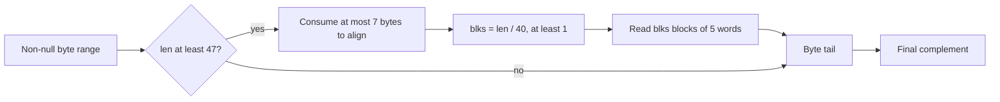

# CRC-32: byte ranges, braids and polynomial meaning

The CRC-32 functions are safe on their documented domain: they return, they read only the
caller's buffer and the static tables, and they leave the heap unchanged. They also return the
CRC-32 value; that part is functional and is not required for the safety results. This page
explains why every read is in range, how the alignment test is modelled, and what the value
theorems state.

Source: `zlib/crc32.c`; translation: `ZlibF/Zlib/crc32.c.lean`. The translated branch is the
default x86_64 Linux one: little-endian words, no hardware CRC instructions, and the "braided"
word loop with the source's parameters `W = 8` (bytes per word) and `N = 5` (words per block).
The [API page](../spec/api/checksums.md) gives the public domains; the
[format guide](../spec/format/README.md) specifies the value (`F-crc-incremental`). Terms:
[glossary](../glossary.md).

## What is proved

| Result | Kind | Theorem | Module |
| --- | --- | --- | --- |
| `Goal.crc32_safety`, `Goal.crc32_z_safety`, `Goal.crc32_combine_safety`, `Goal.crc32_combine64_safety`, `Goal.crc32_combine_gen_safety`, `Goal.crc32_combine_gen64_safety`, `Goal.crc32_combine_op_safety` (`ZlibF/Spec/Safety/Checksums.lean`) | Safety, required | theorems of the same names without `Goal.` | `ZlibF/Proof/public-stateless-safety.lean` |
| `Goal.crc32`, `Goal.crc32_z` | Functional | `crc32`, `crc32_z` | `ZlibF/Proof/public-crc-updates.lean` |
| The five combination goals | Functional | `gen`, `gen64`, `op`, `combine`, `combine64` | `ZlibF/Proof/public-crc-combine.lean` |
| The same for every byte array the model has (heap block, static array, array inside a record), at every alignment | Both | `crc32_z_all_byte_views`, `crc32_all_byte_views` | `ZlibF/Proof/crc32.c.views.lean` |
| Heap byte blocks and the helpers | Both | `crc32_z_safe`, `crc32_z_correct`, `multmodp_safe`, `multmodp_correct`, `x2nmodp_safe`, `x2nmodp_correct`, and the combination results | `ZlibF/Proof/crc32.c.lean` |
| `get_crc_table` | Not required: `zlib.h` lists it as undocumented | `get_crc_table` | `ZlibF/Proof/public-get-crc-table.lean` |

All of these are [registered](../checking/README.md) in `tests/audit/theorems.txt` and
[accepted](../checking/README.md) on commit `bde170e9`
([progress, Scope](../progress.md#scope)).

A safety goal says that the call returns without a fault and leaves the heap exactly as it
was. Each safety theorem is the full contract of the same function with the value forgotten.

## What is assumed

- The static tables are the library's own (`CrcGlobals`).
- The buffer is a readable range of `len` bytes, or `NULL` (`BufferBytes`).
- `crc32_combine_op` takes an operator that `crc32_combine_gen` or `crc32_combine_gen64`
  returned. That is the domain `zlib.h` documents. Outside it the C can hang: see
  [helper contracts](#helper-contracts).
- Trusted, not in the statements: the address model behind the alignment test, and the reading
  of the C word load as eight byte reads ([below](#alignment-and-represented-addresses);
  [trusted base](../trusted-base.md)).

The rows are in [deviations](../deviations.md).

## Why every read is in range

A null buffer returns 0. Otherwise the function complements and masks the incoming CRC,
optionally processes braided word blocks, then processes the remaining bytes and returns the
complemented result.

The threshold is `N*W + W - 1 = 47`. After at most seven alignment bytes, at least 40 bytes
remain, so `blks ≥ 1` before `while (--blks)`. The loop processes `blks₀ - 1` blocks, and the
code after it processes the last one. With `blks = 0` the pre-decrement would wrap the counter;
the threshold excludes that.

Each block reads five 8-byte words and advances by five words. Since
`40 * blks₀ ≤ len_after_alignment`, all word reads fit the original range. The remaining length
is below 40. The tail is an unrolled byte loop while `len ≥ 8`, then a byte loop; it has no
further word reads. Each body consumes exactly the count it removes from `len`.

`crc32_z_safe` states the result for heap byte blocks: the call returns and the heap is
unchanged, so every load was inside the range and no loop ran out of fuel.
`crc32_z_all_byte_views` states it for every byte array of the model.

The table lookups are in range as well. For a byte lookup, `x & 0xff < 256`. The braid row
index is `k < W = 8`, and each row has 256 entries. The shifts that extract bytes use
`8k ≤ 56`, below the 64-bit word width. The loop measures are the remaining byte count, the
remaining block count, or the fixed row counter; each is far below the runtime's fuel bound.

## Alignment and represented addresses

The C tests the alignment of `buf` through its address:
`while (len && ((z_size_t)buf & (W - 1)) != 0)`. A pointer of the model has no
address. The model supplies only the low three bits (`ZlibF/Runtime/Address.lean`):

- a heap byte block starts at an aligned address, so the low bits of a pointer into it are
  those of its offset;
- a static byte array, or a byte array inside a record, starts at an arbitrary residue modulo
  8. The residue is fixed for the heap and unknown to the proof.

`ZlibF/Proof/ByteAddress.lean` relates these represented addresses to offsets, alignment and
valid byte ranges, and shows that every assignment of residues is representable. The CRC goals
therefore hold for every residue, and no alignment premise is added to them.

The translated word read assembles eight bytes in little-endian order. In C the read is a load
through a pointer cast to `z_word_t *`. That the two agree, including the strict-aliasing reading
of the cast, and the general ABI layout behind real addresses, are trusted
([trusted base](../trusted-base.md)); they are not proved. The C also reads the low byte of a
local endian marker to choose the branch; on this target it chooses the little-endian one, and
the big-endian branch is not run. Of the big-endian helpers only `crc_word_big_safe` is proved.

A [regression](../../tests/verification/regressions/crc-static-address.lean) checks a valid
47-byte read from a static table: both `crc32` and `crc32_z` return the independent checksum
and leave the heap unchanged.

## The value (functional)

`crc32_z_correct` states the value for heap byte blocks: for every seed, every length and every
alignment of the offset, `crc32_z` returns `ZlibF.Spec.crc32Update` of the byte list and leaves
the heap unchanged. `crc32_z_all_byte_views` extends it to static and embedded arrays. The
specification `crc32Update` is a bit-at-a-time register and does not mention the translation.

The argument, as proved in `ZlibF/Proof/crc32.c.lean`:

- One step of the CRC register (`crcBit`) is linear over GF(2) (`crcBit_xor`). Write `pw m` for
  `m` steps; it is multiplication by `x^m` modulo the CRC polynomial.
- The table contents are checked by evaluation in the kernel, not assumed:
  `crc_table[n] = pw 8 n` (`crc_table_eq`), `crc_braid_table[j][n] = pw (8 * (40 - j)) n`
  (`braid_eq`), and the squaring chain of `x2n_table` with `x^(2^32) = x` (`Xt_sq`, `Xt_wrap`).
- The word step of `crc_word` is a linear map on 64-bit words. It agrees with its closed form on
  the 64 unit vectors, hence everywhere (`Phi_eq_Psi`).
- The braided loop keeps an invariant that relates the five running CRCs to the register of
  the bytes consumed so far (`loopBlk_ok`). The final chain of `crc_word` calls then merges
  them in the order of the C.
- `crc32_append` is the concatenation law used for input splitting.

## Helper contracts

Every theorem of this table also states that the heap is unchanged.

| Function | What is proved |
| --- | --- |
| `crc32` | `crc32_safe`, `crc32_correct`: the wrapper converts its 32-bit length and calls `crc32_z`. |
| `crc_word` | `crc_word_safe`: it returns for every 64-bit word. `crc_word_correct`: for a register `c` and eight bytes of a heap block read as a little-endian word, `crc_word(c ^ word)` is the register after those eight bytes. |
| `crc_word_big`, `byte_swap` | `crc_word_big_safe` only. These are the big-endian helpers, which the target does not run; they have no value theorem. |
| `multmodp(a, b)` | The C scans a mask from bit 31 down and stops at the lowest set bit of `a`. `multmodp_safe`: when the low 32 bits of `a` are not all zero and `b < 2^32`, it returns a value below `2^32`. `multmodp_diverges`: when the low 32 bits of `a` are zero, the loop never ends (the run is `Fault.outOfFuel`). `multmodp_correct`: for `a = x^n` the result is `b` multiplied by `x^n` modulo the CRC polynomial. Each caller supplies the premise from its own domain. |
| `x2nmodp(n, k)` | `x2nmodp_safe`, `x2nmodp_correct`: for `n ≥ 0` and every `k`, it returns `x^(n·2^k)` modulo the polynomial. The index `k & 31` is inside the 32-entry table. A negative `n` is excluded by the callers: the loop `while (n)` shifts `n` right arithmetically and would not end. |
| `crc32_combine_gen64`, `crc32_combine_gen` | `crc32_combine_gen64_safe`, `crc32_combine_gen_safe`: for every `len2` it returns; the result is 0 for `len2 < 0`, and for `len2 ≥ 0` it is below `2^32` and nonzero. The `_correct` theorems: for `len2 ≥ 0` the operator is `x^(8·len2)` modulo the polynomial. |
| `crc32_combine_op` | `crc32_combine_op_safe`: it returns for every `op` that is 0 or has a set bit among its low 32 bits; every generated operator is one. `crc32_combine_op_diverges`: for a nonzero `op` whose low 32 bits are zero, the run is `Fault.outOfFuel`. `Goal.crc32_combine_op_safety` is stated for generated operators. |
| `crc32_combine64`, `crc32_combine` | `crc32_combine64_safe`, `crc32_combine_safe`: they return for every argument, with 0 for a negative length. The `_correct` theorems: for byte strings `A` and `B`, combining `crc32(A)` and `crc32(B)` with `len2` the length of `B` gives `crc32(A ++ B)`. |
| `get_crc_table` | `get_crc_table_safe`, `get_crc_table_correct`: it returns the pointer to the read-only static table, whose entries are the specified ones; no allocation. |

The checksum functions write no memory and allocate nothing. Other build branches (dynamic table
initialisation, hardware CRC) are not translated; [deviations](../deviations.md) has the row for
the build.

### The hang of `crc32_combine_op` outside its domain

`multmodp` scans bits 31 down to 0 of its first operand. If the low word is zero, the mask
reaches zero and the C loop never terminates. `crc32_combine_op` handles `op == 0` before it
calls `multmodp`, and a generated operator has a nonzero low word, so the documented use
terminates: that is the content of `Goal.crc32_combine_op_safety`. An arbitrary nonzero 64-bit
value is not in the documented domain. For `crc32_combine_op(1, 2, 1UL << 32)`,
`crc32_combine_op_diverges` proves that the translation runs out of fuel. A review reported that
the real C does not return on that call; no reproduction is kept in the repository. The hang is
a misuse outside the documented domain, not a defect within it.

## Evidence for the static tables

A source review regenerated the CRC header and reported byte-identical tables: the 256-entry CRC
table, the eight-row braid tables and the 32-entry polynomial-power table. That is evidence of
fidelity, not proof. The value theorems above do not rest on it: they check the table contents
in the kernel. The same review covered the static tables of `trees.h` and `inffixed.h` (the
288-entry literal tree, the 30-entry distance tree, the 512-entry distance map and the
256-entry length map).
