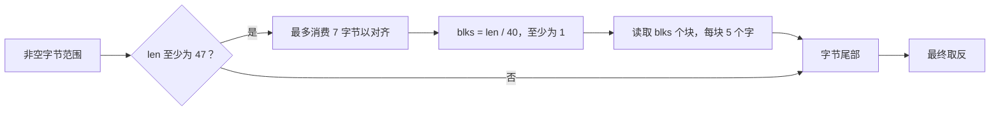

<!-- source-sha256: d01c90d256ada7227d0c1454c843b19139caa1cbd37a5bfd23b930fe93038e72 -->
# CRC-32：字节范围、交织与多项式含义

源文件为 `zlib/crc32.c`，翻译为 `ZlibF/Zlib/crc32.c.lean`。目标是默认 x86_64 Linux 分支。它把 8 字节作为一个机器字，记为 `W = 8`；把整字分到五条交织计算链，记为 `N = 5`。因此一个交织块含 `N * W = 40` 字节。该分支使用小端字，不使用硬件 CRC 指令。[格式指南](../spec/format/README.md)规定 `F-crc-incremental`；公开辅助函数的定义域见 [API 页面](../spec/api/checksums.md)。

CRC-32 各函数在其文档规定的定义域上是安全的，并且返回 CRC-32 值。本页解释读取预算、对齐测试背后的地址模型，以及关于值的多项式论证。

## 已证明什么

| 结果 | 类别 | 定理 | 模块 |
| --- | --- | --- | --- |
| `Goal.crc32_safety`、`Goal.crc32_z_safety`、`Goal.crc32_combine_safety`、`Goal.crc32_combine64_safety`、`Goal.crc32_combine_gen_safety`、`Goal.crc32_combine_gen64_safety`、`Goal.crc32_combine_op_safety`（`ZlibF/Spec/Safety/Checksums.lean`） | 安全，必需 | 去掉 `Goal.` 之后的同名定理 | `ZlibF/Proof/public-stateless-safety.lean` |
| `Goal.crc32`、`Goal.crc32_z` | 功能性，保留 | `crc32`、`crc32_z` | `ZlibF/Proof/public-crc-updates.lean` |
| 五个组合目标 | 功能性，保留 | `gen`、`gen64`、`op`、`combine`、`combine64` | `ZlibF/Proof/public-crc-combine.lean` |
| 每种已表示的字节数组视图，连同每种起始地址余数 | 两类都有 | `crc32_z_all_byte_views`、`crc32_all_byte_views` | `ZlibF/Proof/crc32.c.views.lean` |
| 堆字节块与各辅助函数 | 两类都有 | `crc32_z_safe`、`crc32_z_correct`、`multmodp_safe`、`multmodp_correct`、`x2nmodp_safe`、`x2nmodp_correct` 以及各组合结果 | `ZlibF/Proof/crc32.c.lean` |
| `get_crc_table` | 非必需：`zlib.h` 把它列为无文档函数 | `get_crc_table` | `ZlibF/Proof/public-get-crc-table.lean` |

这些都登记在 `tests/audit/theorems.txt` 中，并在提交 `bde170e9` 上被接受（[进度，范围](../progress.md#scope)）。

安全目标说的是：调用无故障地返回，并且堆完全不变。每条安全定理都是同一函数的完整契约去掉返回值之后的结果。下面的多项式论证是功能性的：它是早先证明的，继续保留，但只有其中的无故障部分是必需的。

下文中说明某一步“尚未完成”或“仍需证明”的段落，是对 C 源代码的解读，这里列出的定理没有以那种形式陈述它。定理是依据翻译检查的，而不是依据这段文字。

## 假设了什么

- 静态表是库自己的表（`CrcGlobals`）。
- 缓冲区是 `len` 字节的可读范围，或者是 `NULL`（`BufferBytes`）。
- `crc32_combine_op` 接受由 `crc32_combine_gen` 或 `crc32_combine_gen64` 返回的操作数。这就是 `zlib.h` 文档规定的定义域。在它之外 C 可能挂起：见[辅助函数表](#helper-contracts)。
- 地址模型以及整字加载的 C 别名规则属于[可信基础](../trusted-base.md)。对应的行在[偏差记录](../deviations.md)中。

## 读取预算

本节先证明“每次读取仍在调用者给出的范围内”，再在后面证明“算出的 CRC 与数学定义一致”。`len` 是当前尚未读取的字节数；对齐后完整块的数量叫 `blks`，其初值记为 `blks₀`。例如剩下 87 字节时，可以处理两个 40 字节块，再处理七字节尾部。

空缓冲区返回 0。否则函数对输入 CRC 取反并掩码，可选择处理交织字块，再处理剩余字节，最后返回取反结果。

阈值为 `N*W + W - 1 = 47`。即使消费七个对齐字节，仍至少剩下 40 字节。因此在 `while (--blks)` 前有 `blks ≥ 1`。循环处理 `blks₀ - 1` 个块，独立的最终块代码处理最后一块。若从零开始，计数器会回绕并破坏读取界限。

每块读取五个 8 字节字，并前移五个字。由于 `40 * blks₀ ≤ len_after_alignment`，全部字读取均位于原范围内。剩余长度低于 40。所选分支的最终尾部先在 `len ≥ 8` 时使用展开字节循环，再用单字节循环；它不是额外的整字读取循环。每轮消费的数量恰等于从 `len` 扣除的数量。

`crc32_z_safe` 是这一论证对堆字节块的结果：每次加载都在范围内，没有计数器回绕。

查表时，用 `x` 表示参与本次更新的机器整数；掩码 `& 0xff` 只保留低八位，因此 `x & 0xff < 256`。交织表按机器字中的字节位置选择行，用 `k` 表示这个位置，满足 `k < W = 8`；每行有 256 项。表值不影响这些索引界限。提取字节的移位满足 `8k ≤ 56`，低于 64 位字宽。在源代码执行掩码或转换的位置，证明也保持 32 位 CRC 解释。循环度量是剩余的字节数或块数，或固定的行计数器。它们保持在运行时的燃料界限之内。

## 对齐与表示地址

八字节对齐要求实际地址除以 8 的余数为零。对象内偏移为零并不保证实际地址对齐：例如对象起点余数为 5 时，要再前进三字节才对齐。因此，证明既要知道偏移，也要保留对象起点的地址余数。

源代码对齐测试使用 `buf` 的地址，而非数组索引。翻译后的整字读取按选定端序组合八个字节。两者之间的桥梁是一个把模型对象地址、内部偏移、对齐与有效字节范围联系起来的关系（`ZlibF/Proof/ByteAddress.lean`）。所选 C 分支的访问和别名解释没有被证明；它是被信任的。

分配的字节块保留起始地址对齐约定。静态和嵌入式字节数组在堆中具有任意但稳定的起始地址余数。地址证明把低三位联系到具体基址加偏移，并说明每种这样的非字节块布局都可表示。公开 CRC 目标没有增加对齐前提。

[正向回归](../../tests/verification/regressions/crc-static-address.lean)保留旧反例的合法 47 字节静态表输入。两个 CRC 入口现在均返回独立校验和，并保持整个堆。一般字节视图证明覆盖全部已表示数组、种子和可读长度。剩余 ABI 与别名限制见[可信基础](../trusted-base.md)和[偏差记录](../deviations.md)。

## 多项式细化

CRC 正确性需要的不只是安全查表。GF(2) 是只有 0 和 1 的系数系统，加法等同逐位异或。把 32 位 CRC 的每一位看作一个多项式系数后，移位、异或和取余便有对应的代数含义。证明使用 C 所采用的反射 CRC 多项式；“反射”说明位的处理方向，必须与实际移位和字节序一致。建立字节表递推和交织表递推，包括初始／最终取反与整字端序。

一种可复用路线是：通过多项式除法证明第一行表，再证明之后每行如何推进递推。具体表项求值可在内核中检查基础数据，避免把表内容当作未证明常量。

交织不变量把各运行 CRC 联系到各自的整字子序列，以及间隔这些字的 x 次幂。GF(2) 线性性随后证明实际顺序中的最终 `crc_word` 合并。尾部将字节递推与合并后的前缀组合。输入切分正确性来自多项式拼接律。

`crc32_z_correct` 对堆字节块陈述了这个结果：对每个种子、每个长度和偏移的每种对齐，`crc32_z` 返回字节列表的 `ZlibF.Spec.crc32Update`，并保持堆不变。`crc32_z_all_byte_views` 把它推广到静态数组和内嵌数组。

## 辅助函数契约

| 函数 | 证明边界 |
| --- | --- |
| `crc32` | 保留所选包装分支，把长度参数转换到 `crc32_z` 定义域。 |
| `crc_word`, `crc_word_big`, `byte_swap` | 针对所选构建证明固定宽度循环及准确的端序／多项式含义。 |
| `multmodp(a, b)` | 扫描掩码从位 31 开始。终止要求 `a` 的低 32 位中至少有一个置位；源注释排除零。`multmodp_safe` 带有这个前提，`multmodp_diverges` 表明没有它时循环永不结束。每个调用者从自己的定义域提供这个前提。 |
| `x2nmodp(n, k)` | `n` 非负，其右移会终止；`k & 31` 位于 32 项表内。证明表示的 x 次幂满足乘法前提。 |
| `crc32_combine_gen64`, `crc32_combine_gen` | 保留负长度返回 0 的行为，并对允许长度证明 x 次幂公式。 |
| `crc32_combine_op` | 保留 `op == 0` 返回。对已生成的操作数，乘法前提成立，`crc32_combine_op_safety` 就是这样陈述的。`crc32_combine_op_diverges` 表明，`op` 非零而低 32 位为零时会挂起。 |
| `crc32_combine64`, `crc32_combine` | 组合生成器与操作定理，包括负长度行为和参数转换。 |
| `get_crc_table` | 返回准确的只读静态表指针与目标要求的表项；不分配、不改变堆。 |

所有函数都需要准确帧声明。只读校验和调用保持调用者存储不变。静态数据不会变成流拥有的存储。其他构建分支、动态表初始化和硬件路径，在相同公开契约下各需与其源代码对应的论证。

## C 对应检查

### CRC 与小型工具的处理细节

`crc32_z` 对空缓冲区立即返回零。非空路径把取反 CRC 掩码为 32 位。从长度 47 开始交织处理。对齐最多消费七个字节，至少留下一个 40 字节块。`while (--blks)` 处理除最后一块之外的全部块，最后一块单独合并。`crc32_z_safe` 和 `crc32_z_all_byte_views` 确认了这给出每次加载的界限，并排除计数器回绕。

指针到整数测试、字节到整字转换跨越表示边界。地址辅助函数对分配字节块使用偏移，对静态和嵌入字节数组使用任意稳定的起始余数。[静态地址回归](../../tests/verification/regressions/crc-static-address.lean)检查旧反例的合法 47 字节静态表读取。局部证明覆盖全部已表示字节数组视图与余数。整字加载按目标字节序组合八个字节。一般 ABI 布局及 C 转换的严格别名语义仍在当前表示范围之外。读取局部端序标记的低字节也依赖目标。默认执行无法测试不可达的大端分支。

`multmodp` 从位 31 向下扫描第一个操作数。若其低字为零，掩码会降为零，C 循环永不终止。早先的一次审查报告说，真实的 C 在 `crc32_combine_op(1, 2, 1UL << 32)` 上不返回；没有保留复现。`crc32_combine_op_diverges` 证明翻译在该处耗尽燃料。文档规定操作数来自 `crc32_combine_gen`；任意非零 64 位值不在定义域内。`crc32_combine_op` 在调用 `multmodp` 前处理零。在 `x2nmodp` 可能永远算术右移负值之前，负长度已被拒绝；其索引由 31 掩码。生成的操作数具有终止所需的非零低字：这就是 `crc32_combine_op_safety` 的内容。这种挂起是文档定义域之外的误用，不是定义域之内的缺陷。

一次源代码审查重新生成过静态树和 CRC 头文件，并报告字节完全一致。这是表忠实性的证据，不是证明，也不说明其数学含义。重要形状包括：288 项字面量树、30 项距离树、512 项距离映射、256 项长度映射、256 项 CRC 表、八行交织表，以及 32 项多项式幂表。静态表项与界限必须忠实于源代码。
