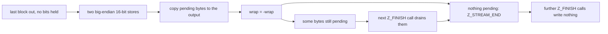
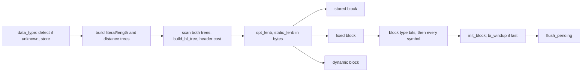

# The default-configuration engine of `deflate`

This page describes an earlier body of results about `deflate` for one configuration: the
stream that `deflateInit_(strm, Z_DEFAULT_COMPRESSION, ...)` creates (level 6, zlib wrapper,
`windowBits` 15, `memLevel` 8, default strategy), used only through `deflate` calls. For that
configuration the results say more than safety: a completed stream decodes to its input.

They are functional results. They are registered, and they are not required for the safety
results. The safety of `deflate` for every configuration is a separate proof, explained in
[stream compression](deflate.md); it reuses lemmas from here.

## Results

Modules are under `ZlibF/Proof/`. The goals are in `ZlibF/Spec/Public/DeflateCore.lean`. The
registered theorems are accepted on commit `bde170e9` ([levels](README.md#status-levels)).

| Result | Theorem | Module | Level |
| --- | --- | --- | --- |
| `DeflateCore.SafeEncodingAndCleanup`: the four clauses below | `DeflateCore.safe_encoding_and_cleanup` | `deflate.c.default-core.lean` | registered |
| `DeflateCore.Completes`: from any point of a history there is a continuation of `Z_FINISH` calls, each with positive output room and no new input, that reaches `Z_STREAM_END` | `DeflateCore.completes` | `deflate.c.default-core-completes.lean` | registered |
| Both together | `DeflateCore.correct` | `deflate.c.default-core-completes.lean` | registered |
| The conclusion of `Goal.deflate` on default histories | `generic_default_public_contract` | `deflate.c.default-public-contract.lean` | registered |
| The premises can be met: concrete histories | `generic_default_request_trace_witness`, `default_public_full_contract_witness` and the other `*_witness` theorems | `deflate.c.default-public-contract.lean`, `deflate.c.engine.full-contract-witness.lean` | registered |

The four clauses of `SafeEncodingAndCleanup`:

1. **Initialisation.** `deflateInit_` with the default level returns as `zlib.h` says, also
   for refusals and allocation failures, and frees what it allocated when it fails.
2. **Requests.** After any history of `deflate` calls, one more `deflate` call with any flush
   value returns, with exact output bytes, counters, frame and ownership.
3. **Completed encoding.** If a history ended with `Z_STREAM_END`, the output bytes are a valid
   zlib stream for the input bytes that were accepted (`Zlib.Valid`, the format specification).
4. **Cleanup.** After any history, `deflateEnd` frees exactly the five owned blocks.

## Assumptions

- The history is `deflateInit_` with `Z_DEFAULT_COMPRESSION`, then `deflate` calls and caller
  edits of the buffer fields (`DeflateCore.Calls`, `DeflateCore.Trace`). No dictionary, no
  `deflateParams`, no priming, no gzip header.
- `StreamBuffers` holds at each call.
- The output pointer is `NULL` or points into a heap byte block (`DeflateCore.Output`).
- For completion: once the stream is finishing, the caller offers no new input.

These histories are a subset of those of the sequence goal. Nothing on this page widens a
safety result.

## What the universal proof reuses

The proof for every configuration ([stream compression](deflate.md)) uses these parts of the
engine modules as they are:

- the hash-chain invariant and its lemmas (`chains_insert`, `chains_slide`,
  `chain_ok_of_chains`, `deflate.c.engine.chains.lean`);
- `longest_match` (`longest_match_ok`, `deflate.c.engine.lmmain.lean`);
- the symbol ledger (`SymbolLedger`, `deflate.c.engine.symbol-ledger.lean`);
- the overlay room for the two smallest buffers (`tinyOverlayAt_256`, `tinyOverlayAt_128`,
  `deflate.c.engine.overlay-header-ref.lean`; see [trees](trees.md#the-overlay-lemma-f9)).

## How three parts of the engine proof work

The theorems named in this section are checked and not registered. They lie inside the proofs
of the registered theorems above.

### Finishing the zlib wrapper

The end of `deflate` has two steps. It writes the four bytes of the Adler-32 checksum into the
pending buffer, and it copies as much pending output as the caller's buffer takes. `wrap` is
negated as soon as the trailer is written, also when the copy is partial. A later call first
drains what is pending and then returns through the branch for a negative `wrap`. That order is
what prevents a second trailer.

| Step | Theorem | Module |
| --- | --- | --- |
| The trailer bytes are stored, pending bytes are copied and `wrap` is negated, for any output capacity including zero | `zlib_trailer_publish` | `deflate.c.engine.trailer-output.lean` |
| A `Z_FINISH` call after the last block has drained writes the trailer and returns `Z_OK` for a short copy or `Z_STREAM_END` | `public_zlib_finish_ready` | `deflate.c.engine.public-finish.lean` |
| A `Z_FINISH` call with a trailer already queued drains it and returns `Z_STREAM_END`, without a second trailer | `public_finished_pending_drained` | `deflate.c.engine.public-finish-pending.lean` |
| A call whose pending bytes fill the output returns without touching the input | `public_pending_exhausted` | `deflate.c.engine.public-pending.lean` |

`public_zlib_finish_ready` assumes the state that the strategies leave after the last block:
`FINISH_STATE`, no input, no lookahead, an empty pending buffer with its cursor at the start, no
held bits, and positive output room.

### Tree construction on the compressor heap

`build_tree_engine` and `source_trees_engine` (`deflate.c.engine.tree-build.lean`) run
`build_tree` for the literal/length and the distance alphabet on the compressor's heap. They
state exactly which fields change: the tree, the descriptor's `max_code`, the `heap` and `depth`
arrays, `bl_count` and the two cost fields. All arrays keep their sizes. Ownership, the caller's
ranges, the allocation count and the output bits already written are unchanged. After the two
calls the state has what `build_bl_tree` needs as input.

### Preparation and the fixed choice

At a positive level `_tr_flush_block` begins with the same steps for every block.

`block_prepare_engine` (`deflate.c.engine.block-prepare.lean`) covers the preparation: the
`data_type` detection, which only reads the literal frequencies and writes one field of the
stream; the three tree constructions; and the cost store. Every field outside the trees, the
work arrays and the costs is unchanged.

`flush_fixed_prepared` and `flush_fixed_final_valid` (`deflate.c.engine.flush-fixed.lean`) then
take the case in which the computed costs select the fixed form: the static cost is at most the
dynamic cost, and the stored test before it failed. They do not force the strategy to
`Z_FIXED`. In that case the whole function runs, and the bits it writes decode to the recorded
symbols. For a last block that ends at a byte boundary, the published bytes are a complete raw
deflate stream.
