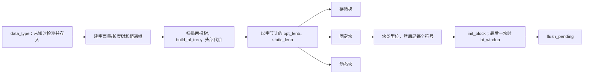

<!-- source-sha256: 405c1b11379221b91b86ee658e07e826a6282a9480a37f42f4453fcbf75b7e4f -->
# `deflate` 的默认配置引擎

本页介绍早先的一批结论，它们针对 `deflate` 的一种配置：由 `deflateInit_(strm, Z_DEFAULT_COMPRESSION, ...)` 创建的流（级别 6，zlib 封装，`windowBits` 为 15，`memLevel` 为 8，默认策略），并且只通过 `deflate` 调用来使用。对这种配置，结论说的不止是安全性：已完成的流能解码回它的输入。

它们是功能结论。它们已登记，但不是安全结论所必需的。`deflate` 对每一种配置的安全性是另一个证明，见[流式压缩](deflate.md)；那个证明复用了这里的引理。

## 结论

模块在 `ZlibF/Proof/` 下。目标在 `ZlibF/Spec/Public/DeflateCore.lean` 中。已登记的定理在提交 `bde170e9` 上已验收（[层级](README.md#status-levels)）。

| 结论 | 定理 | 模块 | 层级 |
| --- | --- | --- | --- |
| `DeflateCore.SafeEncodingAndCleanup`：下面的四个子句 | `DeflateCore.safe_encoding_and_cleanup` | `deflate.c.default-core.lean` | 已登记 |
| `DeflateCore.Completes`：从历史的任意一点出发，都存在一串后续的 `Z_FINISH` 调用，每次都有正的输出空间且不提供新输入，最终到达 `Z_STREAM_END` | `DeflateCore.completes` | `deflate.c.default-core-completes.lean` | 已登记 |
| 两者合在一起 | `DeflateCore.correct` | `deflate.c.default-core-completes.lean` | 已登记 |
| 在默认历史上，`Goal.deflate` 的结论成立 | `generic_default_public_contract` | `deflate.c.default-public-contract.lean` | 已登记 |
| 前提可以被满足：具体的历史 | `generic_default_request_trace_witness`、`default_public_full_contract_witness` 以及其他 `*_witness` 定理 | `deflate.c.default-public-contract.lean`、`deflate.c.engine.full-contract-witness.lean` | 已登记 |

`SafeEncodingAndCleanup` 的四个子句：

1. **初始化。** 以默认级别调用 `deflateInit_`，返回情况如 `zlib.h` 所述，拒绝和分配失败时也是如此；失败时它释放自己分配的内存。
2. **请求。** 在任意一段 `deflate` 调用的历史之后，再做一次带任意刷新值的 `deflate` 调用，调用会返回，输出字节、计数、帧和所有权都是确切的。
3. **已完成的编码。** 如果一段历史以 `Z_STREAM_END` 结束，那么输出字节就是被接受的那些输入字节的一个有效 zlib 流（`Zlib.Valid`，即格式规格）。
4. **清理。** 在任意历史之后，`deflateEnd` 恰好释放流拥有的五个块。

## 假设

- 历史是带 `Z_DEFAULT_COMPRESSION` 的 `deflateInit_`，随后是 `deflate` 调用和调用者对缓冲区字段的修改（`DeflateCore.Calls`、`DeflateCore.Trace`）。没有字典，没有 `deflateParams`，没有预置位，没有 gzip 头部。
- 每次调用时 `StreamBuffers` 成立。
- 输出指针是 `NULL`，或者指向一个堆上字节块的内部（`DeflateCore.Output`）。
- 对完成性：流进入结束阶段之后，调用者不再提供新输入。

这些历史是序列目标所允许的历史的一个子集。本页的内容不会扩大任何一条安全结论。

## 通用证明复用了什么

针对每一种配置的证明（[流式压缩](deflate.md)）原样使用了引擎模块中的这些部分：

- 哈希链不变量及其引理（`chains_insert`、`chains_slide`、`chain_ok_of_chains`，`deflate.c.engine.chains.lean`）；
- `longest_match`（`longest_match_ok`，`deflate.c.engine.lmmain.lean`）；
- 符号账本（`SymbolLedger`，`deflate.c.engine.symbol-ledger.lean`）；
- 最小的两个缓冲区的覆盖余量（`tinyOverlayAt_256`、`tinyOverlayAt_128`，`deflate.c.engine.overlay-header-ref.lean`；见[树](trees.md#the-overlay-lemma-f9)）。

## 引擎证明中的三个部分是怎样做的

本节提到的定理已检查而未登记。它们在上面那些已登记定理的证明内部。

### 结束 zlib 封装

`deflate` 的末尾有两步。它把 Adler-32 校验和的四个字节写进待输出缓冲，再把待输出的字节尽量复制到调用者的缓冲区里。尾部一写完，`wrap` 就被取负，即使复制只完成了一部分。之后的调用先把待输出的字节排空，再经由 `wrap` 为负的那个分支返回。正是这个顺序防止了尾部被写第二次。

| 步骤 | 定理 | 模块 |
| --- | --- | --- |
| 对任意输出容量（包括零），尾部字节被存入，待输出字节被复制，`wrap` 被取负 | `zlib_trailer_publish` | `deflate.c.engine.trailer-output.lean` |
| 最后一块排空之后的一次 `Z_FINISH` 调用写出尾部，复制不完时返回 `Z_OK`，否则返回 `Z_STREAM_END` | `public_zlib_finish_ready` | `deflate.c.engine.public-finish.lean` |
| 尾部已在排队时的一次 `Z_FINISH` 调用把它排空并返回 `Z_STREAM_END`，不写第二个尾部 | `public_finished_pending_drained` | `deflate.c.engine.public-finish-pending.lean` |
| 待输出字节填满输出的调用，不碰输入就返回 | `public_pending_exhausted` | `deflate.c.engine.public-pending.lean` |

`public_zlib_finish_ready` 假设的是各策略在最后一块之后留下的状态：`FINISH_STATE`，没有输入，没有前瞻数据，待输出缓冲为空且游标在开头，缓冲里没有位，输出空间为正。

### 在压缩器的堆上建树

`build_tree_engine` 和 `source_trees_engine`（`deflate.c.engine.tree-build.lean`）在压缩器的堆上，为字面量/长度字母表和距离字母表运行 `build_tree`。它们确切地陈述了哪些字段会变：树、描述符的 `max_code`、`heap` 和 `depth` 数组、`bl_count`，以及两个代价字段。所有数组保持原来的大小。所有权、调用者的区域、分配计数和已经写出的输出位都不变。两次调用之后，状态具备了 `build_bl_tree` 所需的输入。

### 准备阶段与固定形式的选择

级别为正时，`_tr_flush_block` 对每个块都以同样的步骤开头。

`block_prepare_engine`（`deflate.c.engine.block-prepare.lean`）涵盖准备阶段：`data_type` 的检测，它只读字面量的频率并写流的一个字段；三次建树；以及代价的存入。树、工作数组和代价之外的每个字段都不变。

`flush_fixed_prepared` 和 `flush_fixed_final_valid`（`deflate.c.engine.flush-fixed.lean`）随后处理这样的情形：算出的代价选中了固定形式，即静态代价不超过动态代价，并且此前对存储形式的判断没有通过。它们并不把策略强制成 `Z_FIXED`。在这种情形下整个函数运行完毕，它写出的位能解码回已记录的符号。对于在字节边界处结束的最后一块，输出的字节是一个完整的 raw deflate 流。
