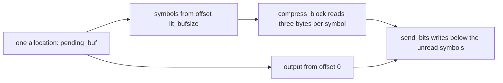

# Source notes for the compressor: `deflate.c`, `trees.c`

This page records details of the C source at places where a shortcut in the translation would
change what the program does: evaluation order, integer conversions, early returns, macro
expansion. It is for a reader who compares `zlib/*.c` with `ZlibF/Zlib/*.c.lean`.

The notes are readings of the C. They are not theorems. Where a theorem states a fact that a
note relies on, the note names it. The theorems are explained in
[stream compression](deflate.md) and [trees](trees.md). The differential tests compare the
translation with the compiled C; they are evidence of fidelity, not proof. The rules the
translation follows are in [translation semantics](../design/translation.md).

## `deflate.c`

### Allocation, initialisation and copying

`zcalloc(items, size)` multiplies two 32-bit unsigned arguments before widening the product.
Wrapping there is defined behaviour. The compressor's sizes stay far below the limit: the
window has `2 * w_size` bytes, `prev` has `w_size` 16-bit entries, `head` has `hash_size` 16-bit
entries, and the pending buffer has `4 * lit_bufsize` bytes; the largest of these is 131072
bytes.

`deflateInit2_` checks the version, the structure size and the parameters, in that order,
before it builds the state. It raises a requested window of 8 bits to 9. Allocator fields that
are `NULL` are replaced by the default functions. Other allocator functions are outside the
model ([deviations](../deviations.md)).

The version check reads the first byte of the version string, after its `NULL` test. The state
check reads the state's back pointer and its status. `Goal.deflate_refusal` covers a `NULL`
stream and a readable record that the check rejects, and the safety goal of each documented
`deflate*` function except init states the same refusal ([refusals](deflate.md#refusals)). A
`state` field that holds a garbage pointer, or a pointer to an inflate state, is outside it: in
the model that is a fault, as it is undefined behaviour in C (row "Refused streams" of
[deviations](../deviations.md)).

There are five owned allocations: the state, the window, `prev`, `head` and the pending buffer.
After the state is allocated the C makes all four buffer allocations and only then tests for
failure; a later allocation is still attempted when an earlier one failed. On failure it calls
`deflateEnd`, which frees what was obtained. The default allocator does not zero memory.
`deflateInit2_` zeroes the state record. It does not clear the window or `prev`; `lm_init`
clears `head`.

`deflateEnd` reads the status before it frees anything. It frees the pending buffer, `head`,
`prev`, the window and the state, in that order, and then sets `strm->state` to `NULL`. It
returns `Z_DATA_ERROR` when the status was `BUSY_STATE`, after freeing everything.

`deflateCopy` allocates the new state, copies the state record into it, and allocates the four
buffers. If an allocation failed it frees the new blocks, not the source pointers that the
record copy brought along, and sets `dest->state` to `NULL`. Only then does it copy the stream
record and install the new state.

- The window copy has `high_water` bytes. The clause `windowInit` of the invariant says that
  all window data is below `high_water`.
- The `prev` copy covers the whole array when the field `slid` is set or when
  `strstart - insert` exceeds `w_size`, and otherwise the prefix up to `strstart - insert`.
  That subtraction does not wrap: clause `insert` says `insert ≤ strstart`.
- `pending_out` keeps its offset inside the new pending buffer. The pending bytes and the used
  symbol bytes are copied to the same offsets. `sym_buf` becomes the new pending buffer plus
  `lit_bufsize`.
- The back pointer and the three tree descriptors' `dyn_tree` pointers change to the new
  state. The `gz_header` pointer and the static descriptors stay shared.

The byte copies include memory that was never written. A value copy keeps such bytes as they
are.

### Window movement and the strategies

`read_buf` lowers `avail_in` before it copies, computes the checksum over the bytes at the
destination, and then advances `next_in` and `total_in`. `deflate_stored` also uses it to copy
input straight to the caller's output.

`fill_window` computes the free space in `ulg`, narrows it to `unsigned`, and may slide the
window before it tests whether any input is left. A slide copies the upper part of the window
down, adjusts the positions and the signed `block_start`, caps `insert` at `strstart`, and then
slides the hash entries. Afterwards it zeroes up to `WIN_INIT` bytes beyond the data, tracked by
`high_water`, so that the matcher's reads beyond the lookahead meet written bytes.

These three facts are parts of theorems:

- the slide copy is in range and its two ranges do not overlap. In the model `memcpy` faults
  otherwise, so a theorem that `fill_window` returns states it. `fill_window_inv` is that
  theorem at a nonzero level only, where the strategies call `fill_window`. The call from
  `deflateSetDictionary`, which can run at level 0, is covered by `step_setDictionary`;
- the matcher's reads stay inside the window, also beyond `strstart + lookahead`
  (`longest_match_inserted`, which assumes the entry condition the strategies establish; see
  [stream compression](deflate.md#inside-one-deflate-call));
- the length the matcher returns is at most `lookahead` (`longest_match_inserted`: the result is
  the smaller of the best length and `lookahead`).

`CLEAR_HASH` sets the last entry of `head` to 0, zeroes the others and clears `slid`. It does
not touch `prev`. `INSERT_STRING` first stores the old head in `prev[str & w_mask]` and then
stores `str` in the head, so a position's `prev` slot is written before the position can be
reached.

The strategies call `longest_match` when the chain head is at a distance of at most `MAX_DIST`.
The first round of its loop runs without the `> limit` test, so the first candidate can be at
exactly that distance.

In `longest_match`, `continue` jumps to the condition of the `do` loop, which follows a `prev`
link and decrements the chain counter only if the link passes the limit test. `break` skips the
condition. The inner comparison is eight pre-increment comparisons joined by `&&`, then a test
of the end pointer. Every chain entry the loop follows is an older inserted position
(`HashChains`), which is why the walk is in range and ends for every tuning value.

`deflate_stored` first tries to write straight to the caller's output. It emits a stored-block
header with dummy lengths, overwrites the four length bytes, flushes, copies bytes from the
window and then reads input directly into the output. Afterwards it rebuilds the window so that
later calls have history, and it can fall back to stored blocks built in the pending buffer.

Its locals `len`, `left`, `have` and `used` are unsigned. `(unsigned)(strstart - block_start)`
is a signed difference that is then narrowed. `((unsigned)bi_valid + 42) >> 3` casts before it
adds. `MIN(pending_buf_size - have, MAX_STORED)` compares in `ulg`. At level 0 `block_start` is
not negative (clause `levelZero`). `stored_spec` proves that the function does not fault. Two
intermediate readings are not stated by a named theorem: that `insert ≤ w_size` holds
throughout, and that the pointer `next_in - used` stays inside bytes this call consumed.
**to confirm**. The field `matches` counts window slides while level 0 runs.

| Function | Detail of the C |
| --- | --- |
| `deflate_fast` | After a short match it inserts every position of the match. After a long match it sets `ins_h` again from two window bytes instead. `FLUSH_BLOCK` can return from the function |
| `deflate_slow` | The pending literal or match lives across rounds. After flushing for a pending literal it advances `strstart` and then tests `avail_out`. The last pending literal is followed by a flush |
| `deflate_rle` | It refills when `lookahead <= MAX_MATCH`, reads the previous byte only when `strstart > 0`, and cuts the run to `lookahead`. It does not touch the hash tables |
| `deflate_huff` | It emits literals only and sets `insert` to 0 at the end |

### Reset, dictionary, header and parameters

`deflateResetKeep` resets the counters and the block state, turns a negative `wrap` positive
again, sets the initial checksum and clears the `gzhead` pointer. It saves `matches` at level 0
across `_tr_init`, which would clear it. `deflateReset` is `deflateResetKeep` followed by
`lm_init`.

`deflateSetDictionary` saves `next_in`, `avail_in` and `wrap`, sets `wrap` to 0 so that the
checksum is not touched, points the input at the dictionary, calls `fill_window`, inserts the
hash entries, and restores the saved values. For a zlib stream it computes the Adler-32 of the
whole dictionary before it cuts a long dictionary down to its last `w_size` bytes. The pass
through `read_buf` adds to `total_in`
([stream compression](deflate.md#readings-of-the-c-that-no-theorem-states)).

The C accepts a zlib dictionary also after the stream has ended. The functional model rejects
it there (row "Deflate dictionary order" of [model limits](../model-limits.md)); the safety
theorems are about the C behaviour.

`deflateGetDictionary` copies the last bytes before `strstart + lookahead`, at most `w_size`.
Its buffer and its length cell are each optional.

`deflateSetHeader` stores the caller's pointer. It does not copy or free the record. The C
checks that the stream is a gzip stream and does not check the call order. In the sequence goal
`deflateSetHeader` is permitted only before the first `deflate` call (`DeflateNotStarted`), and
under that rule the header pointer is not `NULL` in the states that read it
(`HeaderInv.record`, proved for every reachable state by `reachable_inv_of`). While `deflate`
writes the header across several calls, the caller has to keep `extra`, `name` and `comment` as
they were: `extra_len` below `gzindex` would make the remaining-length subtraction wrap
(`DeflateHeaderProgress`).

`deflateParams` may call `deflate(strm, Z_BLOCK)` before it changes the level or strategy, and
it can return an error after that call has had effects. When it leaves level 0 it slides the
hash once or clears it, according to `matches`. The flush test is

```c
if ((strategy != s->strategy || func != configuration_table[level].func) &&
    s->last_flush != -2)
```

so the flush is needed when the strategy changes or the compression function of the new level
differs from that of the old one, and only when `last_flush` is not -2. A reset stores -2, and
it stays until a `deflate` call passes its entry checks.

`deflateTune` stores its arguments into unsigned fields without checking them; a negative
argument becomes a large value. `nice_length` stays signed. A chain limit of 0 wraps on the
first decrement. The safety theorems cover every tuning value: `deflateTune` is a permitted call
with any arguments, and the chain walk ends by decreasing positions, not by the counter.

### Priming, queries and the main function

`deflatePrime` rejects a bit count outside 0 to 16. Before its test for room it moves pending
bytes to the start of the buffer with a forward byte loop. The insertion loop is a `do` loop, so
it runs once also for zero bits. The mask and the left shift are signed `int` expressions; the
translation uses checked operations for them, and `deflatePrime_safety` proves that they do not
overflow on a stream that `deflate` has not started. The right shift of a negative `value` is
arithmetic on this platform.

`deflatePending` writes the bit count first. It narrows the pending byte count to `unsigned`,
compares with the original `ulg`, and on a mismatch stores the largest `unsigned` and returns
`Z_BUF_ERROR`. `deflateUsed` has its own optional output.

In `deflate` the header stages are consecutive `if` statements, not branches of one switch. One
call can run several stages, and each can return with output pending. The header CRC is
computed over the pending bytes written since a saved position.

The dispatch tests level 0, then `Z_HUFFMAN_ONLY`, then `Z_RLE`, and only then uses the
function from the configuration table. Finishing writes the trailer and negates `wrap`, which
records that the trailer is written.

### Signed positions

`strstart - block_start` is computed in `long`; `long` holds every `uInt` on this platform. The
same holds for `block_start -= (long)wsize` in a slide and for the expression
`(s->strstart - s->block_start) + s->lookahead` in `deflateParams`. The translation checks each
of these for overflow. `block_start_low` gives `block_start ≥ -2^62` at a nonzero level, from
the clause `blockSpan`; `block_start_slide_signed` and `flush_length_general` use it for the
slide and for the block length. For the expression in `deflateParams`, `params_after_outcome`
proves that the code after the inner `deflate` call returns from every state with the
invariant. Its proof bounds the difference by the clauses `blockStart` and `blockSpan`, and at
level 0 by `levelZero`.

The two unions in `ct_data` have two `unsigned short` members each. In the translation each
union is one cell: `Freq` and `Code` name one, `Dad` and `Len` the other. Tree construction
writes a parent and later a length into the same cell, and a frequency and later a code.

A dynamic tree descriptor points into an array inside its own state. A static descriptor points
at a read-only table.

### Uninitialised storage

`slide_hash` reads every entry of `prev`, written or not. `longest_match` may compare bytes
beyond the lookahead. In the model an integer that was never written has an arbitrary value, and
the theorems hold for every such value; they show that a garbage `prev` entry is never used as
an index. The limits of this model are in [safety](../spec/safety.md#uninitialised-memory) and
[the trusted base](../trusted-base.md).

In `build_tree` the expression `(s->depth[n] >= s->depth[m] ? s->depth[n] : s->depth[m]) + 1`
compares the depths of two nodes and then reads one of them again. The translation makes both
reads. The
[depth-read test](../../tests/regression/trees-depth-read/README.md) checks this in the
structure of the translation, because a test with initialised values cannot tell the two
versions apart.

### Constants of this build

`TOO_FAR = 4096` and `OS_CODE = 3`. `tr_static_init` has an empty body, because the static
trees are compiled in. The debug checks are compiled out. The function `_tr_tally` has no
caller in this build: the strategies use the macros `_tr_tally_lit` and `_tr_tally_dist`.

Right after allocation, before `lm_init` has run, the state has `window_size = 0`. The window
facts of the invariant hold from the end of `deflateInit2_` on.

## `trees.c`

The pending buffer holds output and symbols:



`sym_end = 3 * (lit_bufsize - 1)`. A tally writes the low byte of the distance, its high byte,
and the literal or the length byte, then counts the frequencies. A literal has distance 0. For a
match the macro decrements the distance in 16 bits before the lookup; a distance of 0 would wrap
to 65535 and make `d_code` read index 767 of a 512-entry table. The proof excludes it in two
parts. The upper bound is in the invariant: every recorded distance is at most `w_size - 262`
(clause `recorded`), and one more symbol always fits (clause `symRoom`). The lower bound is not
a clause of the invariant, because `recorded` also covers literals, whose distance is 0. It is
a premise of the tally lemma `tally_match_run`, and each strategy supplies it where it records
a match: the constant 1 in `deflate_rle`, a match that `longest_match_inserted` found below
`strstart` in `deflate_fast`, and the clause `pendingMatch` in `deflate_slow`
([stream compression](deflate.md#inside-one-deflate-call)).

The bit-output helpers do not check for room. That every write fits and stays below the unread
symbols is the overlay lemma of [trees](trees.md#the-overlay-lemma-f9), proved for every
`memLevel`.

`send_bits` promotes its `ush` operands to `int` for the shifts and narrows the result when it
stores it. With at most 16 bits held and at most 15 sent, no shift is out of range
(`send_bits_spec`). `bi_windup` computes `((bi_valid - 1) & 7) + 1`; with no bits held this is 8
on this platform, and `bi_used` gets that value.

| Function | Detail of the C |
| --- | --- |
| `init_block`, `_tr_init` | A reset clears frequencies and costs. It does not clear old lengths or parents. `_tr_init` also installs the descriptors and resets the bit buffer |
| `gen_codes` | The local `next_code[16]` is never read at index 0; entries 1 to 15 are written first. The start codes are computed in `unsigned` and narrowed to 16 bits. The post-increment hands the old value to `bi_reverse` |
| Heap operations | `pqremove` reads the last heap entry, decrements `heap_len`, then sifts. Equal frequencies are ordered by depth |
| `build_tree` | It adds leaves when fewer than two symbols occur. The cost decrements `opt_len--` wrap in `ulg` on purpose. A frequency sum is computed in `int` and narrowed to `ush` |
| `gen_bitlen` | It overwrites the parent field of a node with its length. Parents are visited before children, and the repair finds a nonempty shorter class before it could reach index 0 (`gen_bitlen_safe`). Its cost adjustments wrap on purpose |
| `scan_tree`, `send_tree` | The first writes the guard at `max_code + 1`; the second reads it with the same `max_code`. The guard is only ever the "next length", never a length used as an index (`ws_scan_tree`, `send_tree_emit`; see [trees](trees.md#codes-and-the-tree-description)) |
| `_tr_flush_block` | The stored, fixed and dynamic costs are computed and compared before the block is reset. The costs are rounded up to bytes in `ulg`; on a tie the fixed form wins |

Macros: `send_bits` declares `len` and `val`, and the distance tally declares `len` and `dist`;
the arguments passed in the source do not clash with them. `put_short` and `MIN` evaluate an
argument more than once. `INSERT_STRING` is a comma expression evaluated left to right.
`FLUSH_BLOCK` can return from the function that uses it; `FLUSH_BLOCK_ONLY` cannot. The
`Assert` and `Trace` macros are compiled out and guard nothing.
