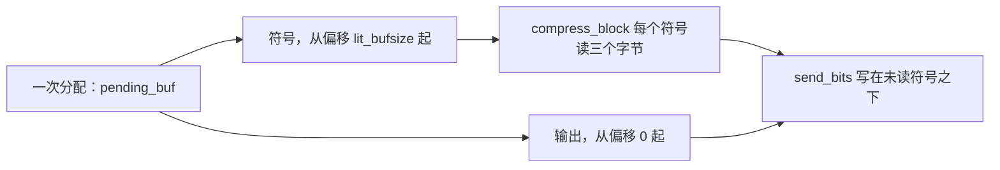

<!-- source-sha256: f4ce6c0b420245baccdc9d7b30efea5f0c3276ea7a247fc90e4b7e163aaa1190 -->
# 压缩器的源码笔记：`deflate.c`、`trees.c`

本页记录 C 源码里的一些细节：在这些地方，翻译若走捷径，程序的行为就会改变。它们涉及求值顺序、整数转换、提前返回和宏展开。本页写给拿 `zlib/*.c` 与 `ZlibF/Zlib/*.c.lean` 对照的读者。

这些笔记是对 C 的解读，不是定理。凡是某条笔记依赖的事实有定理陈述，笔记会指出那条定理。定理的解释见[流式压缩](deflate.md)和[树](trees.md)。差分测试把翻译与编译出来的 C 做比较；它们是忠实性的证据，不是证明。翻译遵循的规则见[翻译语义](../design/translation.md)。

## `deflate.c`

### 分配、初始化与复制

`zcalloc(items, size)` 先把两个 32 位无符号参数相乘，再把乘积加宽。那里的回绕是有定义的行为。压缩器用到的大小远低于这个上限：窗口有 `2 * w_size` 字节，`prev` 有 `w_size` 个 16 位表项，`head` 有 `hash_size` 个 16 位表项，待输出缓冲有 `4 * lit_bufsize` 字节；其中最大的是 131072 字节。

`deflateInit2_` 依次检查版本、结构体大小和各个参数，然后才构造状态。请求 8 位窗口时它改成 9 位。为 `NULL` 的分配器字段被替换成默认函数。其他分配器函数在模型之外（[偏离记录](../deviations.md)）。

版本检查在判断过 `NULL` 之后，读版本字符串的第一个字节。状态检查读状态的回指指针和它的状态值。`Goal.deflate_refusal` 覆盖 `NULL` 流和被这项检查拒绝的可读记录；除初始化之外，每个有文档的 `deflate*` 函数的安全目标也陈述同一个拒绝（见[拒绝](deflate.md#refusals)）。`state` 字段里是垃圾指针，或者是指向 inflate 状态的指针，都在它之外：在模型里那是故障，正如在 C 里那是未定义行为（[偏离记录](../deviations.md)中“被拒绝的流”一行）。

流拥有的分配共五处：状态、窗口、`prev`、`head` 和待输出缓冲。分配状态之后，C 把四个缓冲区全部分配完才检查是否失败；前一个分配失败时，后面的分配仍会尝试。失败时它调用 `deflateEnd`，释放已经拿到的部分。默认分配器不把内存清零。`deflateInit2_` 把状态记录清零。它不清窗口和 `prev`；`lm_init` 清空 `head`。

`deflateEnd` 先读状态值，再释放任何东西。它依次释放待输出缓冲、`head`、`prev`、窗口和状态，然后把 `strm->state` 置为 `NULL`。状态值原先是 `BUSY_STATE` 时，它在释放一切之后返回 `Z_DATA_ERROR`。

`deflateCopy` 分配新状态，把状态记录复制进去，再分配四个缓冲区。如果有分配失败，它释放新的块，而不是随记录复制带过来的那些源指针，并把 `dest->state` 置为 `NULL`。这之后它才复制流记录并装上新状态。

- 窗口复制 `high_water` 个字节。不变量的子句 `windowInit` 说，窗口里的全部数据都在 `high_water` 之下。
- `prev` 的复制，在字段 `slid` 已置位或 `strstart - insert` 超过 `w_size` 时覆盖整个数组，否则覆盖到 `strstart - insert` 为止的前缀。这个减法不会回绕：子句 `insert` 说 `insert ≤ strstart`。
- `pending_out` 在新的待输出缓冲里保持原来的偏移。待输出的字节和用过的符号字节被复制到相同的偏移处。`sym_buf` 变成新的待输出缓冲加 `lit_bufsize`。
- 回指指针和三个树描述符的 `dyn_tree` 指针改为指向新状态。`gz_header` 指针和静态描述符仍然共享。

这些字节复制包含从未写过的内存。按值复制会让这样的字节保持原样。

### 窗口的移动与各策略

`read_buf` 先减小 `avail_in` 再复制，对目的处的字节计算校验和，然后推进 `next_in` 和 `total_in`。`deflate_stored` 也用它把输入直接复制到调用者的输出。

`fill_window` 用 `ulg` 计算空闲空间，把它截成 `unsigned`，并且可能在检查是否还有输入之前就滑动窗口。一次滑动把窗口的上半部分往下复制，调整各个位置和有符号的 `block_start`，把 `insert` 限制到不超过 `strstart`，然后滑动哈希表项。之后它把数据后面至多 `WIN_INIT` 个字节清零，并用 `high_water` 记录，这样匹配器读到预读数据之后时，遇到的是写过的字节。

下面三条事实是定理的一部分：

- 滑动时的复制不越界，它的两段区域不重叠。在模型里，不满足这两点时 `memcpy` 就出故障，所以一条说 `fill_window` 会返回的定理就陈述了这件事。`fill_window_inv` 是这样的定理，但只针对非零级别，也就是各策略调用 `fill_window` 的地方。`deflateSetDictionary` 里的那次调用可以发生在级别 0，它由 `step_setDictionary` 涵盖；
- 匹配器的读始终在窗口之内，超过 `strstart + lookahead` 时也是如此（`longest_match_inserted`，它假设各策略确立的入口条件，见[流式压缩](deflate.md#inside-one-deflate-call)）；
- 匹配器返回的长度至多是 `lookahead`（`longest_match_inserted`：结果是最佳长度与 `lookahead` 中较小的一个）。

`CLEAR_HASH` 把 `head` 的最后一项置 0，把其余各项清零，并清掉 `slid`。它不碰 `prev`。`INSERT_STRING` 先把旧的链头存进 `prev[str & w_mask]`，再把 `str` 存进链头，所以一个位置的 `prev` 槽在这个位置能被到达之前就写过了。

各策略在链头的距离不超过 `MAX_DIST` 时调用 `longest_match`。它的循环第一轮不经 `> limit` 检查就执行，所以第一个候选位置可以恰好在这个距离上。

在 `longest_match` 中，`continue` 跳到 `do` 循环的条件处；这个条件沿着一条 `prev` 链接走，并且只有链接通过了界限检查时才递减链计数。`break` 跳过这个条件。内层比较是用 `&&` 连起来的八次前置自增比较，之后再检查末尾指针。循环沿着走的每个链表项都是更早插入的位置（`HashChains`），所以遍历不越界，并且对任何调优值都会结束。

`deflate_stored` 先尝试直接写到调用者的输出。它发出一个长度是占位值的存储块头，改写那四个长度字节，刷新，从窗口复制字节，然后把输入直接读进输出。之后它重建窗口，让后面的调用有历史可用；它也可以退回到在待输出缓冲里构造存储块。

它的局部变量 `len`、`left`、`have` 和 `used` 是无符号的。`(unsigned)(strstart - block_start)` 是先做有符号的差，再截断。`((unsigned)bi_valid + 42) >> 3` 先转换再相加。`MIN(pending_buf_size - have, MAX_STORED)` 按 `ulg` 比较。级别为 0 时 `block_start` 不为负（子句 `levelZero`）。`stored_spec` 证明这个函数不出故障。有两条中间解读没有被哪条具名的定理陈述：`insert ≤ w_size` 始终成立，以及指针 `next_in - used` 始终落在本次调用消耗掉的字节之内。**尚未由证明确认**。级别 0 运行期间，字段 `matches` 统计窗口滑动的次数。

| 函数 | C 的细节 |
| --- | --- |
| `deflate_fast` | 短匹配之后，它插入匹配中的每个位置。长匹配之后，它改为用窗口里的两个字节重新设置 `ins_h`。`FLUSH_BLOCK` 可以从函数返回 |
| `deflate_slow` | 待处理的字面量或匹配跨轮保留。为一个待处理的字面量刷新之后，它先推进 `strstart`，再检查 `avail_out`。最后一个待处理的字面量之后紧跟一次刷新 |
| `deflate_rle` | 它在 `lookahead <= MAX_MATCH` 时补充数据，只在 `strstart > 0` 时读前一个字节，并把游程截到 `lookahead`。它不碰哈希表 |
| `deflate_huff` | 它只输出字面量，并在结束时把 `insert` 置为 0 |

### 重置、字典、头部与参数

`deflateResetKeep` 重置各计数和块状态，把为负的 `wrap` 变回正的，设置初始校验和，清掉 `gzhead` 指针。级别为 0 时，它在调用 `_tr_init` 前后保存 `matches`，否则 `_tr_init` 会把它清零。`deflateReset` 就是 `deflateResetKeep` 再加 `lm_init`。

`deflateSetDictionary` 保存 `next_in`、`avail_in` 和 `wrap`，把 `wrap` 置为 0 以免动到校验和，让输入指向字典，调用 `fill_window`，插入哈希表项，然后恢复保存的值。对 zlib 流，它先对整个字典计算 Adler-32，再把过长的字典截到最后 `w_size` 个字节。经过 `read_buf` 的那一趟会增加 `total_in`（[流式压缩](deflate.md#readings-of-the-c-that-no-theorem-states)）。

流结束之后，C 仍然接受 zlib 字典。功能模型在那里拒绝它（[模型的限制](../model-limits.md)中“deflate 字典的顺序”一行）；安全定理说的是 C 的行为。

`deflateGetDictionary` 复制 `strstart + lookahead` 之前的最后若干字节，至多 `w_size` 个。它的缓冲区和长度单元各自都是可选的。

`deflateSetHeader` 存下调用者的指针。它不复制也不释放这个记录。C 检查流是不是 gzip 流，不检查调用顺序。在序列目标里，`deflateSetHeader` 只允许在第一次 `deflate` 调用之前使用（`DeflateNotStarted`）；在这条规则下，读头部指针的那些状态里它不是 `NULL`（`HeaderInv.record`，由 `reachable_inv_of` 对每个可达状态证明）。`deflate` 跨多次调用写头部期间，调用者必须让 `extra`、`name` 和 `comment` 保持原样：`extra_len` 小于 `gzindex` 会让“剩余长度”的减法回绕（`DeflateHeaderProgress`）。

`deflateParams` 在改变级别或策略之前可能调用 `deflate(strm, Z_BLOCK)`，而且可能在那次调用已经产生效果之后返回错误。离开级别 0 时，它按 `matches` 的值把哈希表滑动一次或清空。决定是否刷新的检查是

```c
if ((strategy != s->strategy || func != configuration_table[level].func) &&
    s->last_flush != -2)
```

所以，策略改变，或者新级别的压缩函数与旧级别的不同，才需要刷新，而且只在 `last_flush` 不是 -2 时才需要。重置存入 -2，这个值一直保持到某次 `deflate` 调用通过它的入口检查为止。

`deflateTune` 不做检查就把参数存进无符号字段；负的参数会变成很大的值。`nice_length` 仍是有符号的。链上限为 0 时，第一次递减就回绕。安全定理覆盖每一个调优值：`deflateTune` 无论带什么参数都是被允许的调用，而链的遍历靠位置下降结束，不靠这个计数器。

### 位预置、查询与主函数

`deflatePrime` 拒绝 0 到 16 之外的位数。在检查空间之前，它用一个向前的字节循环把待输出字节挪到缓冲区开头。插入循环是 `do` 循环，所以位数为零时也执行一次。掩码和左移是有符号 `int` 表达式；翻译对它们使用带检查的运算，`deflatePrime_safety` 证明在 `deflate` 尚未启动的流上它们不会溢出。负的 `value` 右移，在这个平台上是算术右移。

`deflatePending` 先写位数。它把待输出字节数截成 `unsigned`，与原来的 `ulg` 比较，不相等时存入最大的 `unsigned` 并返回 `Z_BUF_ERROR`。`deflateUsed` 有它自己的可选输出。

在 `deflate` 中，头部的各个阶段是接连的 `if` 语句，不是同一个 switch 的分支。一次调用可以执行好几个阶段，每个阶段都可以带着待输出的字节返回。头部 CRC 是对自某个保存位置以来写入的待输出字节计算的。

分派时先检查级别 0，再检查 `Z_HUFFMAN_ONLY`，再检查 `Z_RLE`，最后才使用配置表里的函数。结束时写尾部并把 `wrap` 取负，以此记录尾部已经写过。

### 有符号的位置

`strstart - block_start` 用 `long` 计算；在这个平台上 `long` 容得下每一个 `uInt`。滑动时的 `block_start -= (long)wsize`，以及 `deflateParams` 里的表达式 `(s->strstart - s->block_start) + s->lookahead` 也是如此。翻译对其中每一处都检查溢出。`block_start_low` 由子句 `blockSpan` 给出：级别非零时 `block_start ≥ -2^62`；`block_start_slide_signed` 和 `flush_length_general` 把它用于滑动和块长的计算。对 `deflateParams` 里的那个表达式，`params_after_outcome` 证明：从满足不变量的每个状态出发，内层 `deflate` 调用之后的那段代码都会返回。它的证明用子句 `blockStart` 和 `blockSpan` 给这个差定界，级别为 0 时用 `levelZero`。

`ct_data` 里的两个联合体各有两个 `unsigned short` 成员。在翻译里每个联合体是一个单元：`Freq` 和 `Code` 是同一个单元的两个名字，`Dad` 和 `Len` 是另一个的。建树时往同一个单元里先写父结点、后写码长，先写频率、后写编码。

动态树描述符指向它自己状态内部的数组。静态描述符指向只读的表。

### 未初始化的存储

`slide_hash` 读 `prev` 的每一个表项，不管写没写过。`longest_match` 可能比较预读数据之后的字节。在模型里，从未写过的整数取任意值，定理对每一个这样的值都成立；定理说明垃圾的 `prev` 表项永远不会被用作下标。这个模型的限制见[安全性](../spec/safety.md#uninitialised-memory)和[可信基础](../trusted-base.md)。

在 `build_tree` 中，表达式 `(s->depth[n] >= s->depth[m] ? s->depth[n] : s->depth[m]) + 1` 比较两个结点的深度，然后再读其中一个。翻译把两次读都做了。[深度读取测试](../../tests/regression/trees-depth-read/README.md)在翻译的结构上检查这一点，因为用初始化过的值做测试分辨不出这两种写法。

### 本构建的常量

`TOO_FAR = 4096`，`OS_CODE = 3`。`tr_static_init` 的函数体是空的，因为静态树是编译进来的。调试检查没有编译进来。函数 `_tr_tally` 在本构建中没有调用者：各策略用的是宏 `_tr_tally_lit` 和 `_tr_tally_dist`。

刚分配完、`lm_init` 还没运行时，状态的 `window_size = 0`。不变量里关于窗口的事实从 `deflateInit2_` 结束时起成立。

## `trees.c`

待输出缓冲里既有输出也有符号：



`sym_end = 3 * (lit_bufsize - 1)`。记录一个符号时，依次写距离的低字节、高字节，以及字面量或长度字节，然后统计频率。字面量的距离是 0。对匹配，宏在查表之前按 16 位把距离减一；距离若是 0，就会回绕成 65535，使 `d_code` 去读一张 512 项的表的下标 767。证明分两部分排除这种情况。上界在不变量里：每个记录下来的距离至多是 `w_size - 262`（子句 `recorded`），并且总还放得下一个符号（子句 `symRoom`）。下界不是不变量的子句，因为 `recorded` 也涵盖字面量，而字面量的距离是 0。它是符号记录引理 `tally_match_run` 的一个前提，各策略在记录匹配的地方提供它：`deflate_rle` 用常数 1；`deflate_fast` 记录的是 `longest_match_inserted` 在 `strstart` 之下找到的匹配；`deflate_slow` 用子句 `pendingMatch`（[流式压缩](deflate.md#inside-one-deflate-call)）。

位输出的辅助函数不检查空间。每次写都放得下、并且落在未读符号之下，这是[树](trees.md#the-overlay-lemma-f9)的事实 F9，它对每一个 `memLevel` 都证明了。

`send_bits` 做移位时把 `ush` 操作数提升为 `int`，存回时再截断。缓冲里至多留着 16 位、一次至多发送 15 位，所以没有哪次移位越界（`send_bits_spec`）。`bi_windup` 计算 `((bi_valid - 1) & 7) + 1`；缓冲里没有位时，这在本平台上是 8，`bi_used` 得到的就是这个值。

| 函数 | C 的细节 |
| --- | --- |
| `init_block`、`_tr_init` | 重置时清掉频率和代价，不清旧的码长和父结点。`_tr_init` 还装上描述符并重置位缓冲 |
| `gen_codes` | 局部数组 `next_code[16]` 的下标 0 从不被读；下标 1 到 15 先写后用。起始编码按 `unsigned` 计算，再截成 16 位。后置自增把旧值交给 `bi_reverse` |
| 堆操作 | `pqremove` 读堆的最后一项，递减 `heap_len`，然后下沉。频率相同时按深度排序 |
| `build_tree` | 出现的符号不足两个时它补入叶子。代价的递减 `opt_len--` 有意按 `ulg` 回绕。频率之和按 `int` 计算，再截成 `ush` |
| `gen_bitlen` | 它用码长覆盖结点的父结点字段。父结点先于孩子被访问，修复在走到下标 0 之前就能找到一个非空的较短类（`gen_bitlen_safe`）。它对代价的调整有意回绕 |
| `scan_tree`、`send_tree` | 前者在 `max_code + 1` 处写哨兵；后者用同一个 `max_code` 读它。哨兵只充当“下一个码长”，从不作为用于下标的码长（`ws_scan_tree`、`send_tree_emit`；见[树](trees.md#codes-and-the-tree-description)） |
| `_tr_flush_block` | 存储、固定、动态三种代价在块被重置之前算出并比较。代价按 `ulg` 向上取整到字节；相等时选固定形式 |

宏：`send_bits` 声明了 `len` 和 `val`，记录距离的宏声明了 `len` 和 `dist`；源码里传入的实参与它们不冲突。`put_short` 和 `MIN` 对某个参数求值不止一次。`INSERT_STRING` 是从左到右求值的逗号表达式。`FLUSH_BLOCK` 可以从使用它的函数返回；`FLUSH_BLOCK_ONLY` 不能。`Assert` 和 `Trace` 宏没有编译进来，不起任何保护作用。
