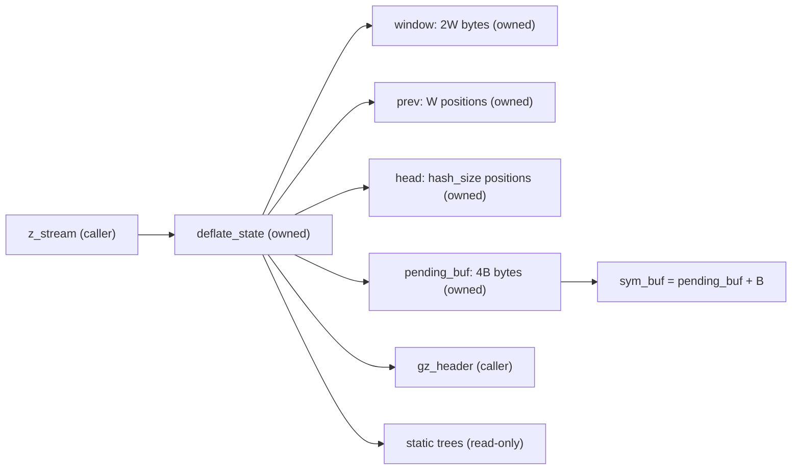
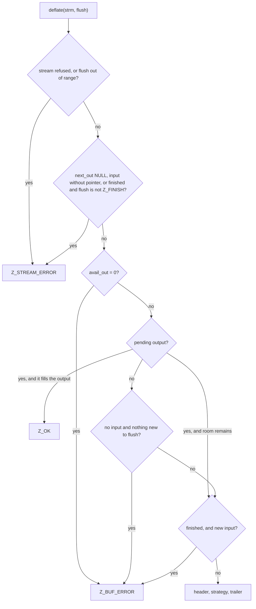
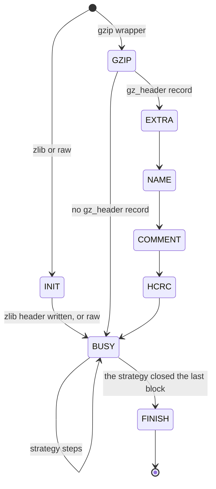

# Stream compression: why `deflate` is safe

Source: `zlib/deflate.c`. Translation: `ZlibF/Zlib/deflate.c.lean`.

`deflate` and the other `deflate*` functions are safe on every input, for every split of the
buffers, for every level, `memLevel`, `windowBits`, strategy, tuning and header, over every
permitted sequence of calls. The proof is one invariant of the compressor state and three
lemmas: every reachable state has the invariant, one more call from such a state is safe, and
`deflateEnd` frees everything. The hardest step is the buffer that pending output shares with
unread symbols; it is explained in [trees](trees.md#the-overlay-lemma-f9).

Related pages: [source notes for the compressor](deflate-source-notes.md) on how the
translation follows the C, and [the default-configuration engine](deflate-default-engine.md) on
earlier results for one configuration. The internal contracts of this file are `I-fw-*`,
`I-sh-*`, `I-hc-inv`, `I-lm-*` and `I-fp-*` in
[internal contracts](../spec/internal-contracts.md); `I-pb-room` there covers the macro
`put_byte` of `deflate.h`.

## Results

All theorems below are listed in `tests/audit/theorems.txt`. The level of each result is
recorded in [progress, Scope](../progress.md#scope). Modules are under `ZlibF/Proof/`.

| Goal | What it says | Theorem | Module |
| --- | --- | --- | --- |
| `Goal.deflate_sequence_safety` | The sequence result; see below | `Zlib.Deflate.Universal.deflate_sequence_safety` | `public-deflate-goals.lean` |
| Thirteen goals, one per function: `deflate`, `deflateSetDictionary`, `deflateGetDictionary`, `deflateReset`, `deflateParams`, `deflateTune`, `deflateBound`, `deflateBound_z`, `deflatePending`, `deflateUsed`, `deflatePrime`, `deflateSetHeader`, `deflateEnd` | The function refuses a refused stream ([Refusals](#refusals)), and one call of it on a reachable stream is safe | `StreamCallSafetyProof.deflate_safety` and the twelve others of the same form | `public-stream-call-safety.lean` |
| `Goal.deflateInit__safety`, `Goal.deflateInit2__safety` | Initialisation is safe for every argument `zlib.h` allows, with the default allocator (`InitArguments`, see [Assumptions](#assumptions)) | `deflateInit__safety`, `deflateInit2__safety` | `public-init-safety.lean` |
| `Goal.deflateCopy_safety` | `deflateCopy` refuses a `NULL` argument and a refused source, and a copy from a reachable source is safe | `deflate_copy_safety` | `public-deflate-copy.lean` |
| `Goal.deflate_refusal` | The refusals of five functions in one statement; see [Refusals](#refusals) | `deflate_refusal` | `public-stream-refusal.lean` |
| `Goal.deflate_initialisation_domain` | The premises of the sequence goal can be met (non-vacuity) | `deflate_initialisation_domain_public` | `public-deflate-init-domain.lean` |

The goals are stated in `ZlibF/Spec/Safety/`.

**The sequence result** has three parts (`StreamSequenceSafety`,
`ZlibF/Spec/Common/Sequences.lean`), the same as for
[`inflate`](inflate.md#results): every reachable stream has the public invariant; one more
permitted call returns without a fault, keeps the invariant, changes only the stream record,
the blocks the stream owns and the caller ranges it was given, and changes the set of live
blocks exactly by what the stream gained or released; `deflateEnd` frees every block the stream
owns. The goal says that `deflateEnd` returns `Z_OK` or `Z_DATA_ERROR`, and that it frees the
blocks in both cases. It does not say which of the two is returned; in the C, `Z_DATA_ERROR` is
the result when the status was `BUSY_STATE` (the last line of `deflateEnd`).

Two theorems are named `deflate_safety`. `StreamCallSafetyProof.deflate_safety` proves the
safety goal `Goal.deflate_safety`. `Zlib.Deflate.Universal.deflate_safety` proves the
functional goal `Goal.deflate`; see [Functional results](#functional-results).

## Refusals

A *refused* stream (`RefusedDeflate`) is `NULL`, or a readable record of one of these kinds:
its `zalloc`, `zfree` or `state` field is `NULL`; or its `state` is a live deflate state whose
back pointer is not this record or whose status is not one of the eight the state check
`deflateStateCheck` accepts (`INIT_STATE`, `GZIP_STATE`, `EXTRA_STATE`, `NAME_STATE`,
`COMMENT_STATE`, `HCRC_STATE`, `BUSY_STATE`, `FINISH_STATE`).

The refusal is stated in two places. Each of the thirteen one-function goals has it as its
first clause, and `Goal.deflateCopy_safety` has a clause for a refused source.
`Goal.deflate_refusal` states it again, in one statement, for five functions: `deflate`,
`deflateSetDictionary`, `deflateParams`, `deflateGetDictionary` and `deflateCopy`. On a refused
stream every one of the fourteen functions returns without a fault.

- `deflateCopy` with a refused source returns `Z_STREAM_ERROR`: the destination is a readable
  record. Its `state` field becomes `NULL`, and nothing else changes.
- `deflateBound` and `deflateBound_z` do not return an error. As in the C, a stream that fails
  the check gets the conservative bound: the clause states that the call returns the value it
  returns for a `NULL` stream with the same `sourceLen`, and that the heap is as it was.
- The other eleven return `Z_STREAM_ERROR` and leave the heap exactly as it was. The three
  that report through a pointer store nothing: `deflateGetDictionary` no length,
  `deflatePending` neither count, `deflateUsed` no count.

A record with `zalloc` and `zfree` set whose `state` field holds a garbage pointer, a pointer
to a freed state or a pointer to an inflate state is outside these clauses; the row "Refused streams" of
[deviations](../deviations.md) says why.

How the refusal clauses are proved (`public-stream-call-safety.lean`,
`public-deflate-copy.lean`). No clause needed a new lemma about the C. Five clauses are the
clauses of `deflate_refusal`. Those of `deflateTune`, `deflatePending`, `deflateUsed` and
`deflateSetHeader` are the refusal clause of the function's functional goal (`CheckedDeflate`).
Those of `deflateEnd`, `deflateReset`, `deflatePrime`, `deflateBound` and `deflateBound_z` come
from the lemmas `deflateEnd_reject`, `deflateReset_reject`, `deflatePrime_refused`,
`deflateBound_nostate` and `deflateBound_z_nostate`. All but `deflatePrime_refused` are stated
for a stream that the check can read and that is not initialised (`StreamDom`,
`¬ DInitialised`); the deflate forms of `refused_dom` and `refused_not_initialised` show that a
refused stream is one.

## Assumptions

The table lists the premises of the sequence goal and of the thirteen per-function goals. It is
read from the Lean statements: `StreamReachable`, `StreamOperation` and `StreamArguments`
(`ZlibF/Spec/Common/History.lean`), `StreamSequenceSafety` (`ZlibF/Spec/Common/Sequences.lean`)
and `StreamCallDomain` (`ZlibF/Spec/Safety/Streams.lean`). Those definitions are the complete
statement. Each premise has a row in [deviations](../deviations.md).

| Premise | Says | Belongs to |
| --- | --- | --- |
| Reachable stream (`StreamReachable .deflate`) | The history starts with a `deflateInit2_` call that returned `Z_OK`. That call ran on a well-formed heap (`Fresh`, `Uniq`, `LibraryGlobals`: block numbers are used consistently, and the static tables have their initial contents), on a readable stream record whose `zalloc` and `zfree` are each `NULL` or the default function, with a `version` argument whose first byte is readable and is `'1'`, and with `stream_size` 112. Every later step is a caller edit, a permitted call, or a `deflateCopy` that returned `Z_OK` from a reachable stream into a different, readable record | every goal |
| Permitted calls (`StreamOperation`) | A call of the history is one of the twelve functions of the per-function goals other than `deflateEnd`, on this stream. It met its argument premises (the rows below), and it returned; any return value is allowed | the history |
| Caller edits (`Rebuffer`) | Between calls the caller changes only `next_in`, `avail_in`, `next_out`, `avail_out` and memory the stream does not own, and leaves the heap well formed | the history |
| `ByteObjectsFit` | Every byte object has fewer than `2^63` bytes | the heap of the call a goal is about: the second part of the sequence goal, and every per-function goal except `deflateEnd`. A deflate history does not ask it of earlier calls |
| `StreamBuffers` | The input range and the output range are each `NULL`, or readable (the output: writable) for their length and outside the blocks the stream owns. The two ranges do not overlap | `deflate`, `deflateParams` |
| `ActiveHeader` | While `deflate` writes an attached `gz_header` (status `GZIP_STATE` to `HCRC_STATE`): the record is readable and not owned by the stream, `extra` is readable for `extra_len` bytes, and `name` and `comment` end in a NUL (`HeaderMemory`). Input, output and the three fields are pairwise separate, and the three fields are outside the stream's blocks (`DeflateHeaderApart`). The caller has not shortened or removed a field that is partly written (`DeflateHeaderProgress`) | `deflate`, `deflateParams`, `deflateBound`, `deflateBound_z` |
| `DeflateHeaderLive` | An attached `gz_header` is readable with its three fields, as `HeaderMemory` says, in every state: `deflateBound` reads a set header also after it is written | `deflateBound`, `deflateBound_z` |
| Dictionary range (`CallerRange`) | The dictionary buffer is `NULL`, or readable (writable for `deflateGetDictionary`) for the bytes the call reads or writes, and outside the stream's blocks | `deflateSetDictionary`, `deflateGetDictionary` |
| `DeflateNotStarted` | No `deflate` call has started the stream since initialisation or reset: the status is `INIT_STATE` or `GZIP_STATE` | `deflatePrime`, `deflateSetHeader` |
| Header argument (`HeaderMemory`) | The record passed in is `NULL`, or readable and not owned by the stream, with `extra` readable for `extra_len` bytes and `name` and `comment` ending in a NUL | `deflateSetHeader` |
| No direct `deflateResetKeep` | It is not one of the permitted calls. `zlib.h` lists it as undocumented, and after it the hash entries of the last two positions are stale ([finding](../findings/deflate-resetkeep-stale-hash/README.md)) | the history |

`deflateReset`, `deflateTune`, `deflatePending` and `deflateUsed` have no argument premise.
`Goal.deflateEnd_safety` needs a reachable stream and nothing else.

The other goals of the Results table have their own premises:

- `Goal.deflateCopy_safety`: the source is reachable, and the destination is a readable record
  that is not the source record. The statement also names the invariant and the default
  allocator of the source; every reachable stream has both.
- The two initialisation goals (`InitArguments`, `ZlibF/Spec/Safety/Initialisation.lean`): the
  heap is well formed; `strm` is `NULL`, or a readable record whose `zalloc` and `zfree` are each
  `NULL` or the default function; `version` is `NULL` or readable for one byte. Every other
  argument and every other field of the record is arbitrary. A custom allocator is outside.
- `Goal.deflate_initialisation_domain` (`InitDomain`, `ZlibF/Spec/Common/Domains.lean`): as
  above with a record whose `state` field is `NULL` and a version string that starts with `'1'`;
  the parameters are ones `deflateInit2_` accepts, and the five allocations succeed.
- `Goal.deflate_refusal`, and the refusal clause of each one-function goal and of
  `Goal.deflateCopy_safety`: the stream is refused; for `deflateCopy` the destination is a
  readable record, and in the clause of `Goal.deflateCopy_safety` the source pointer is not
  `NULL`.

`zlib.h` asks for `deflatePrime` and `deflateSetHeader` before the first `deflate` call. The C
does not check it. On the real C, bits primed after symbols were recorded overwrite the symbol
buffer, and a header pointer set to `NULL` while the header is being written is dereferenced
(`tests/regression/deflate-history-domain`). The header premises have the same kind of reason
(`tests/regression/deflate-gzip-name-output`).

## Memory and sizes



The stream owns five blocks. The trees, the heap array and the depth array are inside the
state. The clause `good` of the invariant fixes these sizes (`DStInv`,
`ZlibF/Spec/Common/DeflateGood.lean`).

| Field | Value |
| --- | --- |
| `w_bits` | 9 to 15 (`deflateInit2_` turns a requested 8 into 9) |
| `W = w_size` | `2^w_bits`, so 512 to 32768 |
| `window_size` | `2W` |
| `hash_bits`, `hash_size` | `memLevel + 7`, `2^hash_bits` |
| `B = lit_bufsize` | `2^(memLevel + 6)`, so 128 to 32768 |
| `pending_buf_size` | `4B` |
| `sym_buf`, `sym_end` | `pending_buf + B`, `3(B - 1)` |

`W ≥ 512` matters: `MAX_DIST = W - 262`, and with a 256-byte window that subtraction would wrap.

## One `deflate` call

```c
int deflate(z_streamp strm, int flush) {
    /* entry checks */
    /* write the zlib or gzip header into pending_buf, if not yet written */
    if (strm->avail_in != 0 || s->lookahead != 0 || ...) {
        bstate = s->level == 0 ? deflate_stored(s, flush) : ...;   /* one of five strategies */
        ...                                                         /* flush markers */
    }
    /* write the trailer once the last block is out */
}
```



`deflate_call_full` (`deflate.c.universal-call-assemble.lean`) has one case for each exit of
this diagram. The header states form a chain:



`deflateResetKeep`, which initialisation and `deflateReset` run, sets the first status:
`GZIP_STATE` for a gzip stream (`wrap == 2`), `INIT_STATE` otherwise. `deflate` never assigns
`GZIP_STATE`. A raw stream (`wrap == 0`) has no header: `deflate` moves it from `INIT_STATE` to
`BUSY_STATE` at once.

The header stages are consecutive `if` statements, so one call can pass through several of
them. Each can also return early when the output fills, and the next call resumes there.

## The invariant

The invariant is `DInv` (`ZlibF/Proof/deflate.c.universal-invariant.lean`). It holds in every
reachable state, for every parameter. Two smaller sets of facts, `HeaderInv` and `CallFacts` of
the same file, hold beside it between calls.

| Part | In plain words | Used by |
| --- | --- | --- |
| `good` | The stream record is readable and its `state` is a live deflate state that points back, with one of the eight status values that `deflateStateCheck` accepts. The five blocks exist, are distinct, are writable and have the sizes of the table above. `level` is 0 to 9, `strategy` 0 to 4, `wrap` -2 to 2. `pending_out` points into `pending_buf`, and the pending bytes fit. `sym_next` is a multiple of 3 and at most `sym_end`. The bit buffer holds `bi_valid ≤ 16` bits and nothing above them. The three tree descriptors point at the tree arrays of the state and at the static trees. In the heap no block number is used twice, and none from the next free number on is in use (`Uniq`, `Fresh`) | every access |
| `alloc`, `globals` | The allocator is the default one. The static tables have their initial contents | `deflateEnd`, `deflateCopy`, the checksums |
| `shape` | Numeric facts about positions; see below | `fill_window`, the strategies, the block flush |
| `hashing` | The hash chains lead only to inserted positions, and the rolling hash `ins_h` is up to date; see below | `longest_match`, the insertions |
| `symbols` | The symbol bytes in `sym_buf` and the tree frequencies describe one list of symbols (`recorded`). Every distance in the list is at most `W - 262`; a literal has distance 0, and the clause gives no lower bound for a match. The block costs `opt_len` and `static_len` and the frequencies of the bit-length tree are zero (`clear`). While symbols are recorded, the pending bytes end at or below offset `B` (`below`) | `compress_block`, the block flush |
| `HeaderInv` (between calls) | In the six header states, `INIT_STATE` to `HCRC_STATE`, no symbol is recorded. In `EXTRA_STATE`, `NAME_STATE`, `COMMENT_STATE` and `HCRC_STATE` the `gz_header` pointer is not `NULL` | the header stages |
| `CallFacts` (between calls) | While `last_flush = -2`, the value that a reset stores and that the next `deflate` call overwrites once it has passed its entry checks: no lookahead, no symbol, no pending literal, `match_length ≤ 2`, `prev_length ≤ 2`, and `block_start = strstart`. In `FINISH_STATE`: no symbol, no lookahead and no held bit | the entry cases of `deflate`, the trailer |

This table and the two below are summaries. The complete statement is the Lean definition:
`DInv`, `Shape`, `Hashing`, `Symbols`, `HeaderInv` and `CallFacts` in
`ZlibF/Proof/deflate.c.universal-invariant.lean`, with `DGood` and `DStInv` in
`ZlibF/Spec/Common/DeflateGood.lean` for the part `good`.

The sequence goal states the smaller public predicate `StreamInvariant`, which is `good` and
`alloc`.

### `shape`: positions and counters

The clause names are those of `Shape`.

| Clause | Says |
| --- | --- |
| `room` (**D**) | `strstart + lookahead ≤ window_size` |
| `insert`, `insertDone` | `insert ≤ strstart`. With three or more bytes of lookahead, `insert = 0` |
| `prevLength`, `matchLength` | Both are at most 258 |
| `pendingMatch` | A pending match (`match_length ≥ 3`) has a distance `strstart - 1 - match_start` between 1 and `W - 262`, and a length of at most `lookahead + 1`. Also `insert = 0` and `strstart ≥ 1` |
| `blockStart` | `block_start ≤ strstart` |
| `blockSpan` | At a nonzero level, `strstart - block_start ≤ 258 * (number of symbols) + match_available`. `match_available` is 0 or 1; it is 1 while `deflate_slow` holds a literal that is not yet recorded |
| `levelZero` | At level 0: `block_start ≥ 0`, no lookahead, no symbols |
| `highWater`, `windowInit` | `strstart + lookahead ≤ high_water ≤ window_size`: the window is written up to the end of the data |
| `biValid` | `bi_valid ≤ 7` |
| `cursor` | An empty pending buffer has `pending_out = pending_buf` |
| `symRoom` | `sym_next < sym_end`: one more symbol fits |
| `slides` | `matches ≤ 2`, and 0 at a nonzero level (level 0 uses the field to count window slides) |
| `lastFlush`, `headerFlush`, `trailer` | `last_flush` is between -2 and 5; before the header is written it is -2 or -1; a negative `wrap` occurs only in `FINISH_STATE` |

The remaining clauses (`matchAvailable`, `available`, `fastLazy`, `lazyPrev`, `lazyAvail`,
`lazyStart`, `symBlock`) describe the pending literal or match of `deflate_slow`, and say that
recorded symbols cover at least one byte of the block.

`block_start` can be negative. `fill_window` subtracts `W` from it at every slide, also in the
middle of a block. `blockSpan` bounds how far below `strstart` it can be: a block holds fewer
than `B ≤ 32768` symbols of at most 258 bytes each. So at a nonzero level `block_start ≥ -2^62`
(`block_start_low`, `deflate.c.universal-window.lean`), far inside the range of `long`, and the
signed subtraction of the slide does not overflow (`block_start_slide_signed`, same file). At
level 0 `block_start` is not negative (`levelZero`).

### `hashing`: chains that can be followed

`deflateInit2_` does not initialise `prev`. The proof holds for every content of the slots that
were never written. The clause is about what can be *reached* (`HashChains`,
`ZlibF/Proof/deflate.c.engine.chains.lean`).

Let the insertion frontier be `chainTop = min(strstart - insert, strstart + lookahead - 2)`: no
position at or above it has been inserted. Start at `head[k]` and follow `p → prev[p & wmask]`.
Stop at 0, and stop at a position `p` whose slot may have been reused, that is when `p + W` is
below the frontier. Every nonzero position `p` met on the way whose slot is still its own
(`chainTop ≤ p + W`) satisfies:

- `p` is below the frontier;
- its three bytes are inside the data, and they hash to `k`;
- `prev[p & wmask] < p`.

For a position met on the way whose slot may have been reused, the clause says nothing, and the
walk does not go on from it. This is the invariant that the internal contract `I-hc-inv`
describes; the Lean sources call it H. A slot that was never written is never followed, so its
content does not matter. The last line makes every walk strictly decreasing.

`chains` is stated for `matches = 0`, which holds at every nonzero level (clause `slides`). At
level 0 the tables are not maintained. After one stored slide (`matches = 1`) the clause `slid`
holds: the facts are true of the tables as `slide_hash` would leave them (`SlidChains`). After
more slides nothing is claimed, and `deflateParams` clears the hash before another strategy
runs.

The third clause, `rolling`, says that with three or more bytes of lookahead the rolling hash
`ins_h` has taken in the first two bytes at `strstart`. It is not claimed under `Z_HUFFMAN_ONLY`
and `Z_RLE`, whose strategies do not update `ins_h`.

## Why each step keeps the invariant

`reachable_inv_of` (`deflate.c.universal-sequence-safety.lean`) proves by induction on the
history that every reachable state has `DInv`, `HeaderInv` and `CallFacts`.
`operation_step_of` (`deflate.c.universal-ops-dispatch.lean`) proves that one more call is safe
with its frame and ledger. `end_from_inv` (`deflate.c.universal-end.lean`) is `deflateEnd`.

The first two are stated with hypotheses. `reachable_inv_of` takes a record `SequenceFacts` of
three facts about `deflate` itself: one call is safe and keeps `DInv`, it keeps `HeaderInv`, and
it keeps `CallFacts`. `operation_step_of` takes the first of these and the step theorems of
`deflateSetDictionary` and `deflateParams`. The three facts are the theorems `deflate_call_of`,
`deflate_header_of` and `deflate_calls_of`, each under the hypothesis that F9 holds for the two
smallest buffers (`TinyOverlay`). `sequence_facts_of` collects the three into the record under
that hypothesis. The theorem `deflate_sequence_safety` (`public-deflate-goals.lean`)
is `deflate_sequence_safety_of` applied to `sequence_facts_of`, with the hypothesis supplied from
the two overlay theorems `tinyOverlayAt_128` and `tinyOverlayAt_256`; it has no hypothesis left.
`sequence_facts` (`public-deflate-copy.lean`) is the same record built from the same two
theorems. The `deflateCopy` proof uses it.

| Step | Theorem | Why it holds |
| --- | --- | --- |
| `deflateInit2_` succeeds | `init2_inv`, `init2_header` | The state is zeroed, the four buffers are allocated with the sizes above, and `deflateReset` runs `lm_init`, which clears `head` and sets every position to 0. An empty window with a cleared `head` satisfies every clause |
| The caller edits the buffer fields | `DInv.rebuffer` | No clause mentions the four fields |
| `deflate` | `deflate_call_of`, `deflate_header_of`, `deflate_calls_of` | See below |
| `deflateReset` | `step_reset` | `lm_init` again |
| `deflateSetDictionary` | `step_setDictionary` | It feeds the dictionary through `fill_window` and inserts its positions, as the strategies do |
| `deflateParams` | `step_params` | It may run `deflate(strm, Z_BLOCK)` first. A change away from level 0 slides or clears the hash, according to `matches` |
| `deflatePrime` | `step_prime` | Permitted only before the first `deflate` call, when no symbol is recorded |
| `deflateSetHeader` | `step_setHeader` | Permitted only before the first `deflate` call, so `HeaderInv` cannot be broken in mid-header |
| `deflateTune`, `deflatePending`, `deflateUsed`, `deflateBound*`, `deflateGetDictionary` | `step_tune`, `step_pending`, `step_used`, `step_bound`, `step_bound_z`, `step_getDictionary` | They write tuning fields that no clause restricts, or only read |
| `deflateCopy` succeeds | `copy_inv` | Five new blocks get the contents of the old ones. `windowInit` is why copying `high_water` window bytes is enough |

### Inside one `deflate` call

**Header and trailer.** Some writes to `pending_buf` test the room first, and some do not.

- Tested: the copy loop of `extra`, the byte loops of `name` and `comment`, and the two bytes of
  the header CRC. Each compares `pending` with `pending_buf_size`, and when the bytes do not fit
  it calls `flush_pending` and returns if bytes are still pending. The loops keep `gzindex`
  across such a return.
- Not tested: the zlib header (`putShortMSB`, two to six bytes), the fixed part of the gzip
  header (ten bytes, twelve with the length of `extra`), and the trailer (four bytes for zlib,
  eight for gzip). They fit because the pending buffer is empty when they are written, and it
  has at least 512 bytes. For the two headers this is the premise `pending = 0` of `init_stage`
  and `t_gzip` (`deflate.c.universal-call-init.lean`, `-call-headerphase.lean`). It is the
  field `fresh` of `HeaderEntry`, the entry condition of `header_phase`: in `INIT_STATE` or
  `GZIP_STATE` the entry of `deflate` has drained the buffer or returned. For the trailer it is the premise of `trailer_step`
  (`deflate.c.universal-call-trailerstep.lean`): with `Z_FINISH` the trailer is reached only on
  a finished stream with nothing pending.

`HeaderInv` gives the non-`NULL` `gz_header` in the four states that dereference it.

**`fill_window`** (`fill_window_inv`, `deflate.c.universal-window.lean`). D makes
`more = window_size - lookahead - strstart` a true difference. If `strstart ≥ 2W - 262` the
window slides: `W - more` bytes at `window + W` are copied to `window`, two ranges that do not
overlap, and `W` is subtracted from `strstart`, `match_start`, `block_start` and every table
entry. In the model `memcpy` faults when a range is out of bounds or the two ranges overlap, so
a theorem that `fill_window` returns states both facts about this copy. `fill_window_inv` is
that theorem at a nonzero level, where the strategies call `fill_window`.
`deflateSetDictionary` calls it at any level; that call is covered by `step_setDictionary`.
`slide_hash` maps each entry `m` to `m - W`, or to 0 if `m < W`. It visits every slot, written
or not; for a reachable position the new value is its new position, in the same slot, because
subtracting `W` does not change `p & wmask`. Then input is copied to
`window + strstart + lookahead`, at most `more` bytes, and positions that were waiting
(`insert`) are inserted. D holds again, and `strstart < 2W - 262`.

**`longest_match`** (`longest_match_inserted`). It is called right after position `strstart`
was inserted, with a chain head `cur` such that `1 ≤ cur < strstart` and
`strstart - cur ≤ W - 262`.

- **F5, the chain walk.** Every position the loop reads is one of the reachable positions
  above. So the index into `prev` and the index into the window are in range, and the next
  position is smaller.
- **F6, the comparison.** The loop compares up to 258 bytes at `window + strstart` and at
  `window + cur`. The premise is `strstart + 262 ≤ window_size`. Both ways a strategy reaches
  the search give it: with `lookahead ≥ 262`, D; after a `fill_window`, its last conclusion.
  The comparison may read bytes beyond the lookahead. They are inside the window, and the
  returned length is cut to `lookahead`.

**Recording a symbol.** The macros `_tr_tally_lit` and `_tr_tally_dist` write three bytes at
`sym_buf + sym_next`. `symRoom` puts them inside the symbol region. A match has a length offset
of at most 255 and a distance between 1 and `W - 262`, so the lookups in `_length_code` and
`_dist_code` are in range. The upper bound is kept by the clause `recorded` of `symbols`. The
lower bound is not a clause of the invariant. It is a premise of the tally lemma
`tally_match_run` (`deflate.c.engine.tally-match.lean`), and each strategy supplies it where it
records a match: `deflate_rle` passes the constant 1; `deflate_fast` records
`strstart - match_start` for a match that `longest_match_inserted` found below `strstart`;
`deflate_slow` records the match of the previous round, whose distance the clause
`pendingMatch` keeps at 1 or more. When the buffer is full the strategy flushes.

**Flushing a block.** `FLUSH_BLOCK_ONLY` computes the block length `strstart - block_start` in
`long` and calls `_tr_flush_block`. It passes `window + block_start` as the source of a stored
block, or `NULL` when `block_start` is negative; `_tr_flush_block` chooses the stored form only
when the source is not `NULL`. `flush_arguments_general` (`trees.c.universal-flush.lean`) proves
this evaluation for `-2^62 ≤ block_start ≤ strstart ≤ window_size`: the subtraction does not
overflow (`flush_length_general`), and the source is `NULL` or a readable range of the window,
apart from `pending_buf`, of the block's length. `flush_block_only_safe` then proves the whole
macro safe at a positive level, for every `memLevel`. Its premises are listed on the
[trees](trees.md#assumptions) page; among them are the bounds on `block_start` just given, an
empty pending buffer and `bi_valid ≤ 7` at entry, and the room of fact F9. The strategies
provide them at every flush (`BlockReady`, `deflate.c.universal-strategies.lean`).

**The five strategies.** `huff_spec_of`, `rle_spec_of`, `fast_spec_of`, `slow_spec_of` and
`stored_spec` (`deflate.c.universal-strategies.lean`, `-slow.lean`, `-stored-tail.lean`) prove that
each strategy returns and gives `DInv` back. At the head of every round of a strategy loop the
state has `DInv` and an empty pending buffer.

## Why the loops end

**Strategy loops** (`loopMeasure`, `deflate.c.universal-strategies.lean`). For `deflate_huff`,
`deflate_rle`, `deflate_fast` and `deflate_slow` the measure is

```
1 + 2 * (avail_in + lookahead)      while the loop runs;  0 once it has left
```

Every round leaves the loop or uses up at least one byte of lookahead. `fill_window` moves
bytes from the input to the lookahead and leaves the sum unchanged. The measure is below `2^35`,
far below the loop fuel of `2^64` (`loop_measure_bound`).

**`deflate_stored`.** Its one loop writes stored blocks straight to the output; its measure
is `avail_out` (`deflate.c.universal-stored-loop.lean`).

**`longest_match`.** The measure is the current position `cur_match`
(`lm_loop_ok`, `deflate.c.engine.lmmain.lean`). The walk ends because positions strictly decrease, whatever
the chain budget is. This matters: `deflateTune` accepts `max_chain_length = 0`, and then
`--chain_length` wraps to a large value instead of reaching 0.

**Header loops** run over the bytes of `extra`, `name` and `comment`. The premises make these
finite ranges: `extra_len` bytes, and a string up to its NUL.

## Where the hard part is

- **The shared buffer.** `pending_buf` holds output from offset 0 and symbols from offset `B`.
  While a block is written, output grows towards symbols that are still to be read. That it
  never reaches them depends on the code lengths of the block, not only on sizes. This is fact
  F9; [trees](trees.md#the-overlay-lemma-f9) proves it for every `memLevel`.
- **Uninitialised `prev`.** The invariant cannot say "every slot is valid". It has to say which
  slots can be reached, and every operation that moves the window or the frontier has to keep
  that set under control.
- **`deflate_slow`.** It emits a match one step late. Between rounds the state holds a pending
  literal or a pending match that the other strategies never have; six clauses of `shape`
  exist for it.
- **Level changes.** `deflateParams` can switch between level 0, which ignores the hash tables,
  and the other levels, which rely on them.

## Readings of the C that no theorem states

- `deflateSetDictionary` goes through `read_buf`, which adds the dictionary length to
  `total_in`. The translation keeps the update. Whether a caller should read `total_in` as
  including the dictionary is **to confirm**.
- `deflateCopy` with the same record as source and destination is outside the goals: the copy
  case of a history and `Goal.deflateCopy_safety` take two different records
  (row "Copy destination" of [deviations](../deviations.md)). Whether `zlib.h` means to allow
  that call is **to confirm**.
- The size of `deflate_state` is 5968 bytes in this build. No Lean file or test states the
  number. **to confirm**.

More notes of this kind are in the [source notes](deflate-source-notes.md).

## Functional results

These say what the functions compute. They are proved, and they are not required for the
safety results.

| Result | Theorem | Module |
| --- | --- | --- |
| `Goal.deflate`: the full contract of one call, with progress, return codes, counters, frame and ownership. The safety proof of `compress*` uses it | `Zlib.Deflate.Universal.deflate_safety` | `public-deflate-goals.lean` |
| The full contracts `Goal.deflateInit_`, `Goal.deflateInit2_`, `Goal.deflateCopy`, `Goal.deflateEnd`, `Goal.deflateReset` and those of the query functions | `deflateInit_proof`, `deflateInit2_proof`, `deflate_copy_public`, `deflate_end_public`, `deflate_reset_public` and others | `public-deflate-*.lean` |
| Results for the default configuration only | see [the default-configuration engine](deflate-default-engine.md) | |

For the default configuration, `DeflateCore.correct` says that a completed stream decodes, by
the format specification, to the input that was accepted. For other configurations no theorem
says that the output of `deflate` decodes to its input. Earlier notes on what such a proof has
to cover are kept in the [history](../history/proof-functional-notes.md).

The round trip of the default zlib stream has a theorem for its conditional form:
`deflate_inflate_roundtrip` (`ZlibF/Proof/public-deflate-inflate-roundtrip.lean`), which is not
listed in `tests/audit/theorems.txt`. It takes a `deflate` history of the default configuration and an `inflate` history
that starts with `inflateInit2_` at `windowBits` 15. Both consist of caller edits and calls with
any flush value and any split of the buffers, and in both the last call returned
`Z_STREAM_END`. If the input that `inflate` consumed is a prefix of the output of `deflate`,
then the output of `inflate` is the input that `deflate` accepted. Two further parts are planned
work: completeness (that the histories reach `Z_STREAM_END`, given enough output room), and with
it the unconditional round trip. [progress, Scope](../progress.md#scope) says how far the round trip is.
