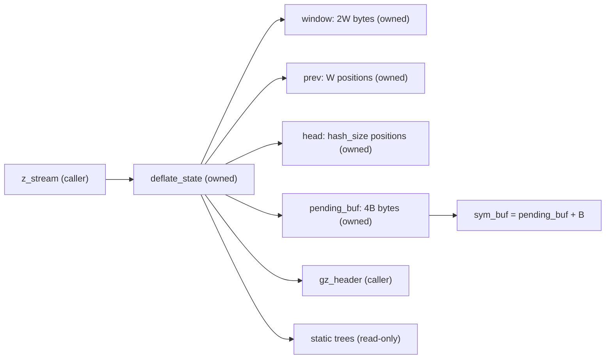
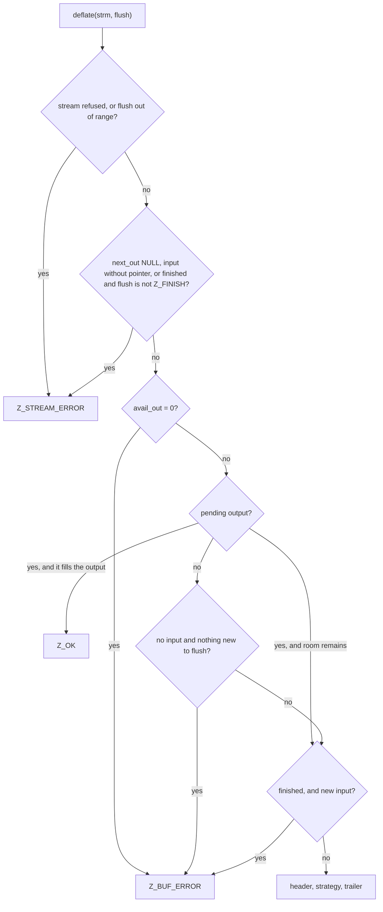
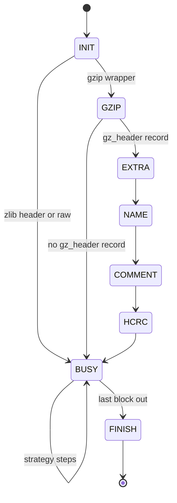

# Stream compression: why `deflate` is safe

Source: `zlib/deflate.c`. Translation: `ZlibF/Zlib/deflate.c.lean`.

`deflate` and the other `deflate*` functions are safe on every input, for every split of the
buffers, for every level, `memLevel`, `windowBits`, strategy, tuning and header, over every
permitted sequence of calls. The proof is one invariant of the compressor state and three
lemmas: every reachable state has the invariant, one more call from such a state is safe, and
`deflateEnd` frees everything. The hardest step is the buffer that pending output shares with
unread symbols; it is explained in [trees](trees.md#the-overlay-lemma-f9).

Related pages: [source notes for the compressor](deflate-source-notes.md) on how the
translation follows the C, and [the default-configuration engine](deflate-default-engine.md) on
earlier results for one configuration. The internal contracts of this file are `I-fw-*`,
`I-sh-*`, `I-hc-inv`, `I-lm-*` and `I-fp-*` in
[internal contracts](../spec/internal-contracts.md).

## Results

All theorems below are registered in `tests/audit/theorems.txt` and accepted on commit
`bde170e9` ([levels](README.md#status-levels)). Modules are under `ZlibF/Proof/`.

| Goal | What it says | Theorem | Module |
| --- | --- | --- | --- |
| `Goal.deflate_sequence_safety` | The sequence result; see below | `Zlib.Deflate.Universal.deflate_sequence_safety` | `public-deflate-goals.lean` |
| Thirteen goals, one per function: `deflate`, `deflateSetDictionary`, `deflateGetDictionary`, `deflateReset`, `deflateParams`, `deflateTune`, `deflateBound`, `deflateBound_z`, `deflatePending`, `deflateUsed`, `deflatePrime`, `deflateSetHeader`, `deflateEnd` | One call of that function on a reachable stream is safe | `StreamCallSafetyProof.deflate_safety` and the twelve others of the same form | `public-stream-call-safety.lean` |
| `Goal.deflateInit__safety`, `Goal.deflateInit2__safety` | Initialisation is safe for every argument `zlib.h` allows | `deflateInit__safety`, `deflateInit2__safety` | `public-init-safety.lean` |
| `Goal.deflateCopy_safety` | `deflateCopy` is safe | `deflate_copy_safety` | `public-deflate-copy.lean` |
| `Goal.deflate_refusal` | See [Refusals](#refusals) | `deflate_refusal` | `public-stream-refusal.lean` |
| `Goal.deflate_initialisation_domain` | The premises of the sequence goal can be met (non-vacuity) | `deflate_initialisation_domain_public` | `public-deflate-init-domain.lean` |

The goals are stated in `ZlibF/Spec/Safety/`.

**The sequence result** has three parts (`StreamSequenceSafety`,
`ZlibF/Spec/Public/Sequences.lean`), the same as for
[`inflate`](inflate.md#results): every reachable stream has the public invariant; one more
permitted call returns without a fault, keeps the invariant, changes only the stream record,
the blocks the stream owns and the caller ranges it was given, and changes the set of live
blocks exactly by what the stream gained or released; `deflateEnd` frees every block the stream
owns. `deflateEnd` returns `Z_OK`, or `Z_DATA_ERROR` when the stream was in `BUSY_STATE`; it
frees the blocks in both cases.

Two theorems are named `deflate_safety`. `StreamCallSafetyProof.deflate_safety` proves the
safety goal `Goal.deflate_safety`. `Zlib.Deflate.Universal.deflate_safety` proves the
functional goal `Goal.deflate`; see [Functional results](#functional-results).

## Refusals

A *refused* stream (`RefusedDeflate`) is `NULL`, or a readable record that the state check
`deflateStateCheck` rejects. `Goal.deflate_refusal` covers five functions: `deflate`,
`deflateSetDictionary`, `deflateParams`, `deflateGetDictionary` and `deflateCopy`. On a refused
stream each returns `Z_STREAM_ERROR` without a fault. `deflateCopy` sets the destination's
`state` field to `NULL`; the others leave the heap as it was.

A record whose `state` field holds a garbage pointer is outside this result; the row "Refused
streams" of [deviations](../deviations.md) says why. The other `deflate*` functions refuse in
their functional goals or in registered lemmas that are not required goals:
`deflatePrime_refused`, `deflateBound_nostate`, `deflateBound_z_nostate`, `deflateEnd_reject`,
`deflateReset_reject`.

## Assumptions

These are all the premises of the sequence goal and of the per-function goals
(`StreamCallDomain`). Each has a row in [deviations](../deviations.md).

| Premise | Says | Belongs to |
| --- | --- | --- |
| Reachable stream (`StreamReachable .deflate`) | The history starts with a successful `deflateInit2_` on a well-formed heap, with `zalloc` and `zfree` each `NULL` or the default function | every goal |
| Caller edits (`Rebuffer`) | Between calls the caller changes only `next_in`, `avail_in`, `next_out`, `avail_out` and memory the stream does not own | the history |
| `ByteObjectsFit` | Every byte object has fewer than `2^63` bytes | every call |
| `StreamBuffers` | The input and output ranges are readable and writable for their lengths, separate from each other, and outside the blocks the stream owns | `deflate`, `deflateParams` |
| `ActiveHeader` | While `deflate` writes an attached `gz_header`: the record and its `extra`, `name` and `comment` are readable, and `name` and `comment` end in a NUL. Input, output and the three fields are pairwise separate and outside the stream's blocks (`DeflateHeaderApart`). The caller has not shortened or removed a field that is partly written (`DeflateHeaderProgress`) | `deflate`, `deflateParams`, `deflateBound*` |
| Dictionary range (`CallerRange`) | The dictionary buffer is `NULL`, or readable (writable for `deflateGetDictionary`) and outside the stream's blocks | the two dictionary calls |
| `DeflateNotStarted` | No `deflate` call has started the stream since initialisation or reset | `deflatePrime`, `deflateSetHeader` |
| No direct `deflateResetKeep` | It is not one of the permitted calls. `zlib.h` lists it as undocumented, and after it the hash entries of the last two positions are stale ([finding](../findings/deflate-resetkeep-stale-hash/README.md)) | the history |

`zlib.h` asks for `deflatePrime` and `deflateSetHeader` before the first `deflate` call. The C
does not check it. On the real C, bits primed after symbols were recorded overwrite the symbol
buffer, and a header pointer set to `NULL` while the header is being written is dereferenced
(`tests/regression/deflate-history-domain`). The header premises have the same kind of reason
(`tests/regression/deflate-gzip-name-output`).

## Memory and sizes



The stream owns five blocks. The trees, the heap array and the depth array are inside the
state. The clause `good` of the invariant fixes these sizes (`DStInv`,
`ZlibF/Proof/deflate.c.base.lean`).

| Field | Value |
| --- | --- |
| `w_bits` | 9 to 15 (`deflateInit2_` turns a requested 8 into 9) |
| `W = w_size` | `2^w_bits`, so 512 to 32768 |
| `window_size` | `2W` |
| `hash_bits`, `hash_size` | `memLevel + 7`, `2^hash_bits` |
| `B = lit_bufsize` | `2^(memLevel + 6)`, so 128 to 32768 |
| `pending_buf_size` | `4B` |
| `sym_buf`, `sym_end` | `pending_buf + B`, `3(B - 1)` |

`W ≥ 512` matters: `MAX_DIST = W - 262`, and with a 256-byte window that subtraction would wrap.

## One `deflate` call

```c
int deflate(z_streamp strm, int flush) {
    /* entry checks */
    /* write the zlib or gzip header into pending_buf, if not yet written */
    if (strm->avail_in != 0 || s->lookahead != 0 || ...) {
        bstate = s->level == 0 ? deflate_stored(s, flush) : ...;   /* one of five strategies */
        ...                                                         /* flush markers */
    }
    /* write the trailer once the last block is out */
}
```



`deflate_call_full` (`deflate.c.universal-call-assemble.lean`) has one case for each exit of
this diagram. The header states form a chain:



The header stages are consecutive `if` statements, so one call can pass through several of
them. Each can also return early when the output fills, and the next call resumes there.

## The invariant

The invariant is `DInv` (`ZlibF/Proof/deflate.c.universal-invariant.lean`). It holds in every
reachable state, for every parameter. Two smaller sets of facts hold beside it between calls.

| Part | In plain words | Used by |
| --- | --- | --- |
| `good` | The stream record is readable and its `state` is a live deflate state that points back. The five blocks exist, are distinct, are writable and have the sizes of the table above. `pending_out` points into `pending_buf`, and the pending bytes fit. `sym_next` is a multiple of 3 and at most `sym_end`. The bit buffer holds `bi_valid ≤ 16` bits and nothing above them | every access |
| `alloc`, `globals` | The allocator is the default one. The static tables have their initial contents | `deflateEnd`, `deflateCopy`, the checksums |
| `shape` | Numeric facts about positions; see below | `fill_window`, the strategies, the block flush |
| `hashing` | The hash chains lead only to inserted positions; see below | `longest_match` |
| `symbols` | The symbol bytes in `sym_buf` and the tree frequencies describe one list of symbols. Every recorded distance is at most `W - 262`. While symbols are recorded, the pending bytes end at or below offset `B` | `compress_block`, the block flush |
| `HeaderInv` (between calls) | In a header state no symbol is recorded. In `EXTRA`, `NAME`, `COMMENT` and `HCRC` the `gz_header` pointer is not `NULL` | the header stages |
| `CallFacts` (between calls) | Right after a reset there is no lookahead and no symbol, and the block starts at `strstart`. In `FINISH_STATE` there is no symbol, no lookahead and no held bit | the entry cases of `deflate`, the trailer |

The sequence goal states the smaller public predicate `StreamInvariant`, which is `good` and
`alloc`.

### `shape`: positions and counters

The clause names are those of `Shape`.

| Clause | Says |
| --- | --- |
| `room` (**D**) | `strstart + lookahead ≤ window_size` |
| `insert`, `insertDone` | `insert ≤ strstart`. With three or more bytes of lookahead, `insert = 0` |
| `prevLength`, `matchLength` | Both are at most 258 |
| `pendingMatch` | A pending match (`match_length ≥ 3`) has a distance between 1 and `W - 262`, and `insert = 0` |
| `blockStart` | `block_start ≤ strstart` |
| `blockSpan` | At a nonzero level, `strstart - block_start ≤ 258 * (number of symbols) + 1` |
| `levelZero` | At level 0: `block_start ≥ 0`, no lookahead, no symbols |
| `highWater`, `windowInit` | `strstart + lookahead ≤ high_water ≤ window_size`: the window is written up to the end of the data |
| `biValid` | `bi_valid ≤ 7` |
| `cursor` | An empty pending buffer has `pending_out = pending_buf` |
| `symRoom` | `sym_next < sym_end`: one more symbol fits |
| `slides` | `matches ≤ 2`, and 0 at a nonzero level (level 0 uses the field to count window slides) |
| `lastFlush`, `headerFlush`, `trailer` | `last_flush` is between -2 and 5; before the header is written it is -2 or -1; a negative `wrap` occurs only in `FINISH_STATE` |

The remaining clauses (`matchAvailable`, `available`, `fastLazy`, `lazyPrev`, `lazyAvail`,
`lazyStart`, `symBlock`) describe the pending literal or match of `deflate_slow`, and say that
recorded symbols cover at least one byte of the block.

`block_start` can be negative. `fill_window` subtracts `W` from it at every slide, also in the
middle of a block. `blockSpan` bounds how far below `strstart` it can be: a block holds fewer
than `B ≤ 32768` symbols of at most 258 bytes each. So `block_start` stays far inside the range
of `long` (`block_start_low`), and the signed subtraction of the slide cannot overflow
(`block_start_slide_signed`).

### `hashing`: chains that can be followed

`deflateInit2_` does not initialise `prev`. The proof holds for every content of the slots that
were never written. The clause is about what can be *reached* (`HashChains`,
`ZlibF/Proof/deflate.c.engine.chains.lean`).

Start at `head[k]` and follow `p → prev[p & wmask]`. Stop at 0, and stop when the slot of `p`
may have been reused, that is when `p + W` is below the insertion frontier. Every nonzero
position `p` met on the way satisfies:

- `p` is below the frontier `chainTop = min(strstart - insert, strstart + lookahead - 2)`;
- its three bytes are inside the data, and they hash to `k`;
- `prev[p & wmask] < p`.

These are the facts **H1** and **H2** of the internal contract `I-hc-inv`. A slot that was never
written is never reached, so its content does not matter. The last line makes every walk
strictly decreasing.

At level 0 the tables are not maintained. After one stored slide the clause holds for the
tables as `slide_hash` would leave them (`SlidChains`); after more, nothing is claimed, and
`deflateParams` clears the hash before another strategy runs.

## Why each step keeps the invariant

`reachable_inv_of` (`deflate.c.universal-sequence-safety.lean`) proves by induction on the
history that every reachable state has `DInv`, `HeaderInv` and `CallFacts`.
`operation_step_of` (`deflate.c.universal-ops-dispatch.lean`) proves that one more call is safe
with its frame and ledger. `end_from_inv` (`deflate.c.universal-end.lean`) is `deflateEnd`.

| Step | Theorem | Why it holds |
| --- | --- | --- |
| `deflateInit2_` succeeds | `init2_inv`, `init2_header` | The state is zeroed, the four buffers are allocated with the sizes above, and `deflateReset` runs `lm_init`, which clears `head` and sets every position to 0. An empty window with a cleared `head` satisfies every clause |
| The caller edits the buffer fields | `DInv.rebuffer` | No clause mentions the four fields |
| `deflate` | `deflate_call_of`, `deflate_call_header`, `deflate_calls_of` | See below |
| `deflateReset` | `step_reset` | `lm_init` again |
| `deflateSetDictionary` | `step_setDictionary` | It feeds the dictionary through `fill_window` and inserts its positions, as the strategies do |
| `deflateParams` | `step_params` | It may run `deflate(strm, Z_BLOCK)` first. A change away from level 0 slides or clears the hash, according to `matches` |
| `deflatePrime` | `step_prime` | Permitted only before the first `deflate` call, when no symbol is recorded |
| `deflateSetHeader` | `step_setHeader` | Permitted only before the first `deflate` call, so `HeaderInv` cannot be broken in mid-header |
| `deflateTune`, `deflatePending`, `deflateUsed`, `deflateBound*`, `deflateGetDictionary` | `step_tune`, `step_pending`, `step_used`, `step_bound`, `step_bound_z`, `step_getDictionary` | They write tuning fields that no clause restricts, or only read |
| `deflateCopy` succeeds | `copy_inv` | Five new blocks get the contents of the old ones. `windowInit` is why copying `high_water` window bytes is enough |

### Inside one `deflate` call

**Header and trailer.** Every `put_byte` is preceded by a test of the room in `pending_buf`
that flushes when needed; the loops over `extra`, `name` and `comment` keep `gzindex` across a
return. `HeaderInv` gives the non-`NULL` `gz_header` in the four states that dereference it.

**`fill_window`** (`fill_window_inv`, `deflate.c.universal-window.lean`). D makes
`more = window_size - lookahead - strstart` a true difference. If `strstart ≥ 2W - 262` the
window slides: `W - more` bytes at `window + W` are copied to `window`, two ranges that do not
overlap, and `W` is subtracted from `strstart`, `match_start`, `block_start` and every table
entry.
`slide_hash` maps each entry `m` to `m - W`, or to 0 if `m < W`. It visits every slot, written
or not; for a reachable position the new value is its new position, in the same slot, because
subtracting `W` does not change `p & wmask`. Then input is copied to
`window + strstart + lookahead`, at most `more` bytes, and positions that were waiting
(`insert`) are inserted. D holds again, and `strstart < 2W - 262`.

**`longest_match`** (`longest_match_inserted`). It is called right after position `strstart`
was inserted, with a chain head `cur` such that `1 ≤ cur < strstart` and
`strstart - cur ≤ W - 262`.

- **F5, the chain walk.** Every position the loop reads is one of the reachable positions
  above. So the index into `prev` and the index into the window are in range, and the next
  position is smaller.
- **F6, the comparison.** The loop compares up to 258 bytes at `window + strstart` and at
  `window + cur`. The premise is `strstart + 262 ≤ window_size`. Both ways a strategy reaches
  the search give it: with `lookahead ≥ 262`, D; after a `fill_window`, its last conclusion.
  The comparison may read bytes beyond the lookahead. They are inside the window, and the
  returned length is cut to `lookahead`.

**Recording a symbol.** `_tr_tally` writes three bytes at `sym_buf + sym_next`. `symRoom` puts
them inside the symbol region. A match has length offset at most 255 and distance at most
`W - 262`, so the lookups in `_length_code` and `_dist_code` are in range. When the buffer is
full the strategy flushes.

**Flushing a block.** `FLUSH_BLOCK_ONLY` computes the block length `strstart - block_start` in
`long` and calls `_tr_flush_block`. It passes `window + block_start` as the source of a stored
block, or `NULL` when `block_start` is negative; with `NULL` the stored form is not chosen. `flush_block_only_safe` proves it safe for every
`memLevel`; the argument is on the [trees](trees.md) page. It needs an empty pending buffer and
`bi_valid ≤ 7` at entry. The strategies provide both.

**The five strategies.** `huff_spec_of`, `rle_spec_of`, `fast_spec_of`, `slow_spec_of` and
`stored_spec` (`deflate.c.universal-strategies.lean`, `-slow.lean`, `-stored-tail.lean`) prove that
each strategy returns and gives `DInv` back. At the head of every round of a strategy loop the
state has `DInv` and an empty pending buffer.

## Why the loops end

**Strategy loops** (`loopMeasure`, `deflate.c.universal-strategies.lean`). For `deflate_huff`,
`deflate_rle`, `deflate_fast` and `deflate_slow` the measure is

```
1 + 2 * (avail_in + lookahead)      while the loop runs;  0 once it has left
```

Every round leaves the loop or uses up at least one byte of lookahead. `fill_window` moves
bytes from the input to the lookahead and leaves the sum unchanged. The measure is below `2^35`,
far below the loop fuel of `2^64` (`loop_measure_bound`).

**`deflate_stored`.** Its first loop writes stored blocks straight to the output; its measure
is `avail_out` (`deflate.c.universal-stored-loop.lean`).

**`longest_match`.** The measure is the current position `cur_match`
(`deflate.c.engine.lmmain.lean`). The walk ends because positions strictly decrease, whatever
the chain budget is. This matters: `deflateTune` accepts `max_chain_length = 0`, and then
`--chain_length` wraps to a large value instead of reaching 0.

**Header loops** run over the bytes of `extra`, `name` and `comment`. The premises make these
finite ranges: `extra_len` bytes, and a string up to its NUL.

## Where the hard part is

- **The shared buffer.** `pending_buf` holds output from offset 0 and symbols from offset `B`.
  While a block is written, output grows towards symbols that are still to be read. That it
  never reaches them depends on the code lengths of the block, not only on sizes. This is fact
  F9; [trees](trees.md#the-overlay-lemma-f9) proves it for every `memLevel`.
- **Uninitialised `prev`.** The invariant cannot say "every slot is valid". It has to say which
  slots can be reached, and every operation that moves the window or the frontier has to keep
  that set under control.
- **`deflate_slow`.** It emits a match one step late. Between rounds the state holds a pending
  literal or a pending match that the other strategies never have; six clauses of `shape`
  exist for it.
- **Level changes.** `deflateParams` can switch between level 0, which ignores the hash tables,
  and the other levels, which rely on them.

## Readings of the C that no theorem states

- `deflateSetDictionary` goes through `read_buf`, which adds the dictionary length to
  `total_in`. The translation keeps the update. Whether a caller should read `total_in` as
  including the dictionary is **to confirm**.
- `deflateCopy` with the same record as source and destination is outside the goals: the copy
  case of a history and `Goal.deflateCopy_safety` take two different records
  (row "Copy destination" of [deviations](../deviations.md)). Whether `zlib.h` means to allow
  that call is **to confirm**.
- The size of `deflate_state` is 5968 bytes in this build. No Lean file or test states the
  number. **to confirm**.

More notes of this kind are in the [source notes](deflate-source-notes.md).

## Functional results

These say what the functions compute. They are registered, and they are not required for the
safety results.

| Result | Theorem | Module |
| --- | --- | --- |
| `Goal.deflate`: the full contract of one call, with progress, return codes, counters, frame and ownership. The safety proof of `compress*` uses it | `Zlib.Deflate.Universal.deflate_safety` | `public-deflate-goals.lean` |
| The full contracts `Goal.deflateInit_`, `Goal.deflateInit2_`, `Goal.deflateCopy`, `Goal.deflateEnd`, `Goal.deflateReset` and those of the query functions | `deflateInit_proof`, `deflateInit2_proof`, `deflate_copy_public`, `deflate_end_public`, `deflate_reset_public` and others | `public-deflate-*.lean` |
| Results for the default configuration only | see [the default-configuration engine](deflate-default-engine.md) | |

For the default configuration, `DeflateCore.correct` says that a completed stream decodes, by
the format specification, to the input that was accepted. For other configurations no theorem
says that the output of `deflate` decodes to its input. Earlier notes on what such a proof has
to cover are kept in the [history](../history/proof-functional-notes.md).
