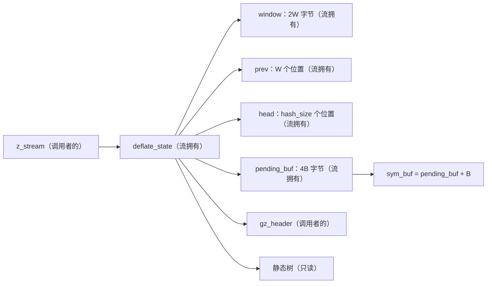
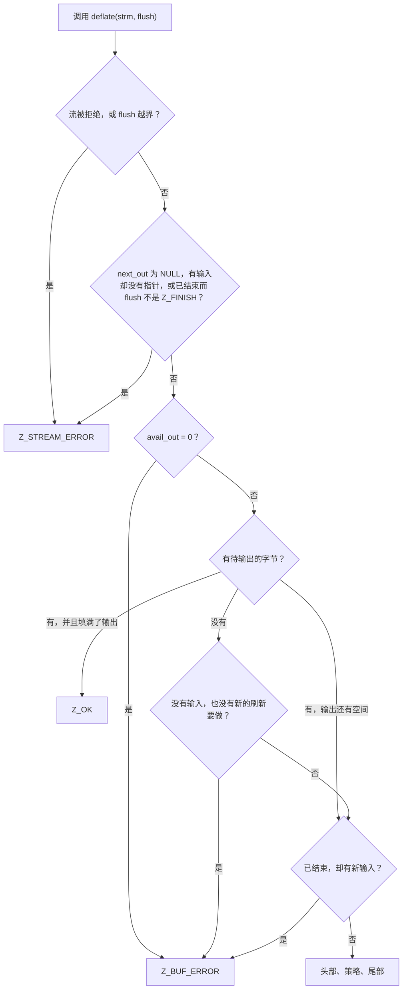
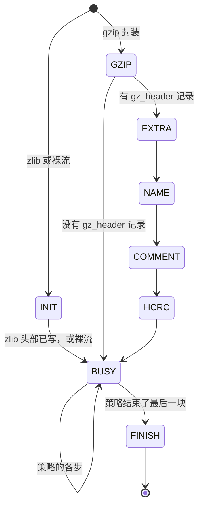

<!-- source-sha256: d9d8f6b4e0764e88b923ebd0e26d55b85f3531323df08afb8d31c2fea16a0d66 -->
# 流式压缩：`deflate` 为什么是安全的

本页讲的是 `zlib/deflate.c` 和它的翻译 `ZlibF/Zlib/deflate.c.lean`。

`deflate` 和其他 `deflate*` 函数，对任意输入、对缓冲区的任意切分、对任意的压缩级别、`memLevel`、`windowBits`、策略、调优参数和头部，在任意一串被允许的调用上，都是安全的。证明由压缩器状态的一个不变量和三条引理组成：每个可达状态都满足不变量；从这样的状态再做一次调用是安全的；`deflateEnd` 释放一切。最难的一步是待输出字节与未读符号共用的那个缓冲区：写一个块时，输出绝不能追上还没读的符号。本页和[树](trees.md#the-overlay-lemma-f9)页面把这条事实叫作 F9；树页面证明它。

相关页面：[压缩器的源码笔记](deflate-source-notes.md)说明翻译怎样跟随 C；[默认配置](deflate-default-engine.md)一页说明针对一种配置的功能结论。这个文件的内部契约是[内部契约](../spec/internal-contracts.md)中的 `I-fw-*`、`I-sh-*`、`I-hc-inv`、`I-lm-*` 和 `I-fp-*`；那里的 `I-pb-room` 涵盖 `deflate.h` 的宏 `put_byte`。

## 结论

这张表里的每个目标都已完成。

| 目标 | 内容 | 定理 |
| --- | --- | --- |
| `Goal.deflate_sequence_safety` | 序列结论，见下 | `Zlib.Deflate.Universal.deflate_sequence_safety` |
| 十三个目标，每个函数一个：`deflate`、`deflateSetDictionary`、`deflateGetDictionary`、`deflateReset`、`deflateParams`、`deflateTune`、`deflateBound`、`deflateBound_z`、`deflatePending`、`deflateUsed`、`deflatePrime`、`deflateSetHeader`、`deflateEnd` | 该函数拒绝被拒绝的流（[拒绝](#refusals)），并且在可达的流上调用一次该函数是安全的 | `StreamCallSafetyProof.deflate_safety` 以及形式相同的另外十二条 |
| `Goal.deflateInit__safety`、`Goal.deflateInit2__safety` | 对 `zlib.h` 允许的每一组参数，在使用默认分配器时，初始化都是安全的（`InitArguments`，见[假设](#assumptions)） | `deflateInit__safety`、`deflateInit2__safety` |
| `Goal.deflateCopy_safety` | `deflateCopy` 拒绝 `NULL` 参数和被拒绝的源，并且从可达的源复制是安全的 | `deflate_copy_safety` |
| `Goal.deflate_refusal` | 用一个命题陈述五个函数的拒绝；见[拒绝](#refusals) | `deflate_refusal` |
| `Goal.deflate_initialisation_domain` | 序列目标的前提可以被满足（非空性） | `deflate_initialisation_domain_public` |

**序列结论**有三部分（`StreamSequenceSafety`），与 [`inflate`](inflate.md#results) 的相同：每个可达的流都满足公开不变量；再做一次被允许的调用，调用返回且不出故障，保持不变量，只改动流记录、流拥有的块和交给它的调用者区域，存活块集合的变化恰好是流新得到或释放掉的块；`deflateEnd` 释放流拥有的每一个块。目标说 `deflateEnd` 返回 `Z_OK` 或 `Z_DATA_ERROR`，并且两种情况下它都释放了这些块。目标没有说返回的是哪一个；在 C 里，状态值原先是 `BUSY_STATE` 时结果是 `Z_DATA_ERROR`（`deflateEnd` 的最后一行）。

有两条定理都叫 `deflate_safety`。`StreamCallSafetyProof.deflate_safety` 证明安全目标 `Goal.deflate_safety`。`Zlib.Deflate.Universal.deflate_safety` 证明功能目标 `Goal.deflate`，见[功能结论](#functional-results)。

## 拒绝

*被拒绝*的流（`RefusedDeflate`）是 `NULL`，或者是下面几种可读的记录之一：它的 `zalloc`、`zfree` 或 `state` 字段是 `NULL`；或者它的 `state` 是一个存活的 deflate 状态，但这个状态的回指指针不指向这个记录，或者它的状态值不是状态检查 `deflateStateCheck` 接受的八个值之一（`INIT_STATE`、`GZIP_STATE`、`EXTRA_STATE`、`NAME_STATE`、`COMMENT_STATE`、`HCRC_STATE`、`BUSY_STATE`、`FINISH_STATE`）。

拒绝在两处陈述。十三个单函数目标各以它为第一个子句，`Goal.deflateCopy_safety` 有一个针对被拒绝的源的子句。`Goal.deflate_refusal` 用一个命题对五个函数再陈述一遍：`deflate`、`deflateSetDictionary`、`deflateParams`、`deflateGetDictionary` 和 `deflateCopy`。在被拒绝的流上，这十四个函数都返回，不出故障。

- 源流被拒绝时的 `deflateCopy` 返回 `Z_STREAM_ERROR`：目的流是一个可读的记录。它的 `state` 字段变成 `NULL`，其余都不变。
- `deflateBound` 和 `deflateBound_z` 不返回错误。与 C 一样，没有通过检查的流得到保守的上界：这个子句说的是，调用返回的值与 `sourceLen` 相同时对 `NULL` 流调用返回的值相同，并且堆保持原样。
- 其余十一个函数返回 `Z_STREAM_ERROR`，并让堆完全保持原样。通过指针报告结果的三个函数什么也不存入：`deflateGetDictionary` 不存入长度，`deflatePending` 两个计数都不存入，`deflateUsed` 不存入计数。

`zalloc` 和 `zfree` 已设置、而 `state` 字段里是垃圾指针、指向已释放状态的指针或指向 inflate 状态的指针的记录，不在这些子句之内；原因见[偏离记录](../deviations.md)中“被拒绝的流”一行。

拒绝子句是怎样证明的。五个子句就是 `deflate_refusal` 的各个子句。`deflateTune`、`deflatePending`、`deflateUsed` 和 `deflateSetHeader` 的子句是该函数功能目标的拒绝子句（`CheckedDeflate`）。`deflateEnd`、`deflateReset`、`deflatePrime`、`deflateBound` 和 `deflateBound_z` 的子句来自引理 `deflateEnd_reject`、`deflateReset_reject`、`deflatePrime_refused`、`deflateBound_nostate` 和 `deflateBound_z_nostate`。除 `deflatePrime_refused` 外，这些引理都是针对检查能够读取、且未初始化的流陈述的（`StreamDom`、`¬ DInitialised`）；`refused_dom` 和 `refused_not_initialised` 的 deflate 形式说明被拒绝的流就是这样的流。

## 假设

下表列出序列目标和十三个各函数目标的前提。它概括的是 Lean 定义 `StreamReachable`、`StreamOperation`、`StreamArguments`、`StreamSequenceSafety` 和 `StreamCallDomain`。完整的命题以这些定义为准。每条前提在[偏离记录](../deviations.md)中都有一行。

| 前提 | 内容 | 属于 |
| --- | --- | --- |
| 可达的流（`StreamReachable .deflate`） | 历史从一次返回 `Z_OK` 的 `deflateInit2_` 调用开始。那次调用运行在良构的堆上（`Fresh`、`Uniq`、`LibraryGlobals`：块编号的使用是一致的，静态表保持初始内容），作用于一个可读的流记录，它的 `zalloc` 和 `zfree` 各自是 `NULL` 或默认函数；`version` 参数的第一个字节可读并且是 `'1'`；`stream_size` 是 112。此后的每一步是调用者的一次修改、一次被允许的调用，或者一次返回 `Z_OK` 的 `deflateCopy`，它从一个可达的流复制到另一个可读的记录 | 每个目标 |
| 被允许的调用（`StreamOperation`） | 历史中的调用是各函数目标所对应的函数之一（`deflateEnd` 除外，共十二个），并且作用在这个流上。它满足自己的参数前提（下面各行），并且返回了；返回值不限 | 历史 |
| 调用者的修改（`Rebuffer`） | 两次调用之间，调用者只改 `next_in`、`avail_in`、`next_out`、`avail_out`，以及不属于流的内存，并且让堆保持良构 | 历史 |
| `ByteObjectsFit` | 每个字节对象都少于 `2^63` 字节 | 目标所说的那次调用所在的堆：序列目标的第二部分，以及除 `deflateEnd` 之外的每个函数目标。deflate 的历史不对更早的调用提这个要求 |
| `StreamBuffers` | 输入区域和输出区域各自是 `NULL`，或者在各自的长度内可读（输出区域：可写），并且在流拥有的块之外。两个区域互不重叠 | `deflate`、`deflateParams` |
| `ActiveHeader` | 在 `deflate` 写挂接的 `gz_header` 期间（状态值从 `GZIP_STATE` 到 `HCRC_STATE`）：记录可读且不归流所有，`extra` 在 `extra_len` 个字节内可读，`name` 和 `comment` 以 NUL 结尾（`HeaderMemory`）。输入、输出和这三个字段两两不重叠，这三个字段在流的块之外（`DeflateHeaderApart`）。对已经写了一部分的字段，调用者没有把它缩短或拿掉（`DeflateHeaderProgress`） | `deflate`、`deflateParams`、`deflateBound`、`deflateBound_z` |
| `DeflateHeaderLive` | 挂接的 `gz_header` 连同它的三个字段，在每个状态下都如 `HeaderMemory` 所说是可读的：头部写完之后，`deflateBound` 仍会读已设置的头部 | `deflateBound`、`deflateBound_z` |
| 字典区域（`CallerRange`） | 字典缓冲区是 `NULL`，或者在这次调用读写的那些字节内可读（对 `deflateGetDictionary` 要可写），并且在流的块之外 | `deflateSetDictionary`、`deflateGetDictionary` |
| `DeflateNotStarted` | 自初始化或重置以来，还没有 `deflate` 调用启动过这个流：状态值是 `INIT_STATE` 或 `GZIP_STATE` | `deflatePrime`、`deflateSetHeader` |
| 头部参数（`HeaderMemory`） | 传入的记录是 `NULL`，或者可读且不归流所有，它的 `extra` 在 `extra_len` 个字节内可读，`name` 和 `comment` 以 NUL 结尾 | `deflateSetHeader` |
| 不直接调用 `deflateResetKeep` | 它不在被允许的调用之列。`zlib.h` 把它列为未文档化的函数，而且在它之后，最后两个位置的哈希表项是过时的（[复现](../../tests/regression/deflate-resetkeep-stale-hash/README.md)） | 历史 |

`deflateReset`、`deflateTune`、`deflatePending` 和 `deflateUsed` 没有参数前提。`Goal.deflateEnd_safety` 只需要流是可达的。

“结论”表中的其他目标各有自己的前提：

- `Goal.deflateCopy_safety`：源是可达的，目的是一个可读的记录，并且不是源记录。命题里还写出了源的不变量和默认分配器；每个可达的流都具备这两点。
- 两个初始化目标（`InitArguments`）：堆是良构的；`strm` 是 `NULL`，或者是一个可读的记录，它的 `zalloc` 和 `zfree` 各自是 `NULL` 或默认函数；`version` 是 `NULL`，或者有一个字节可读。其余每个参数、记录的其余每个字段都是任意的。自定义分配器不在其内。
- `Goal.deflate_initialisation_domain`（`InitDomain`）：同上，另外要求记录的 `state` 字段是 `NULL`，版本字符串以 `'1'` 开头；参数是 `deflateInit2_` 接受的参数，五次分配都成功。
- `Goal.deflate_refusal`，以及每个单函数目标的拒绝子句和 `Goal.deflateCopy_safety` 的拒绝子句：流是被拒绝的；对 `deflateCopy`，目的是一个可读的记录，并且在 `Goal.deflateCopy_safety` 的子句里，源指针不是 `NULL`。

`zlib.h` 要求 `deflatePrime` 和 `deflateSetHeader` 在第一次 `deflate` 调用之前使用。C 并不检查这一点。在真实的 C 上，记录了符号之后再预置的位会覆盖符号缓冲区；在写头部的中途把头部指针设成 `NULL`，这个指针会被解引用。这两点都在 sanitizer 下用真实的 C 复现过。头部的各条前提也有同类的理由，同样复现过。

## 内存与大小



流拥有五个块。树、堆数组和深度数组在状态内部。不变量的子句 `good` 固定了这些大小（`DStInv`）。

| 字段 | 值 |
| --- | --- |
| `w_bits` | 9 到 15（请求 8 时 `deflateInit2_` 把它改成 9） |
| `W = w_size` | `2^w_bits`，即 512 到 32768 |
| `window_size` | `2W` |
| `hash_bits`、`hash_size` | `memLevel + 7`、`2^hash_bits` |
| `B = lit_bufsize` | `2^(memLevel + 6)`，即 128 到 32768 |
| `pending_buf_size` | `4B` |
| `sym_buf`、`sym_end` | `pending_buf + B`、`3(B - 1)` |

`W ≥ 512` 这一点很要紧：`MAX_DIST = W - 262`，窗口若只有 256 字节，这个减法就会回绕。

## 一次 `deflate` 调用

```c
int deflate(z_streamp strm, int flush) {
    /* 入口检查 */
    /* 如果还没写过，把 zlib 或 gzip 头部写进 pending_buf */
    if (strm->avail_in != 0 || s->lookahead != 0 || ...) {
        bstate = s->level == 0 ? deflate_stored(s, flush) : ...;   /* 五种策略之一 */
        ...                                                         /* 刷新标记 */
    }
    /* 最后一个块输出之后，写尾部 */
}
```



定理 `deflate_call_full` 对这张图的每个出口各有一个情形。头部状态构成一条链：



初始化和 `deflateReset` 都会运行 `deflateResetKeep`，由它设置最初的状态值：gzip 流（`wrap == 2`）是 `GZIP_STATE`，否则是 `INIT_STATE`。`deflate` 从不赋值 `GZIP_STATE`。裸流（`wrap == 0`）没有头部：`deflate` 立刻把它从 `INIT_STATE` 改成 `BUSY_STATE`。

头部的各个阶段是接连的 `if` 语句，所以一次调用可以经过其中好几个。输出填满时每个阶段也都可以提前返回，下一次调用从那里继续。

## 不变量

不变量是 `DInv`。它在每个可达状态下、对每一组参数都成立。另有两组较小的事实，即 `HeaderInv` 和 `CallFacts`，在两次调用之间与它一同成立。

| 部分 | 白话说明 | 用于 |
| --- | --- | --- |
| `good` | 流记录可读，它的 `state` 是一个存活的 deflate 状态，并且指回这个流；状态值是 `deflateStateCheck` 接受的八个值之一。五个块都存在，互不相同，可写，大小如上表。`level` 是 0 到 9，`strategy` 是 0 到 4，`wrap` 是 -2 到 2。`pending_out` 指向 `pending_buf` 内部，待输出的字节放得下。`sym_next` 是 3 的倍数，至多为 `sym_end`。位缓冲里有 `bi_valid ≤ 16` 位，更高的位全为零。三个树描述符指向状态里的树数组和静态树。堆里没有哪个块编号被用了两次，从下一个空闲编号起的编号都没有在用（`Uniq`、`Fresh`） | 每一次访问 |
| `alloc`、`globals` | 分配器是默认的。静态表保持初始内容 | `deflateEnd`、`deflateCopy`、校验和 |
| `shape` | 关于各个位置的数值事实，见下 | `fill_window`、各策略、块刷新 |
| `hashing` | 哈希链只通向插入过的位置，滚动哈希 `ins_h` 是最新的，见下 | `longest_match`、各处插入 |
| `symbols` | `sym_buf` 里的符号字节与树的频率描述的是同一个符号列表（`recorded`）。列表中每个距离至多是 `W - 262`；字面量的距离是 0，这个子句没有给出匹配距离的下界。块代价 `opt_len` 和 `static_len` 以及码长树的频率都是零（`clear`）。只要还记录着符号，待输出字节的末尾就不超过偏移 `B`（`below`） | `compress_block`、块刷新 |
| `HeaderInv`（调用之间） | 在从 `INIT_STATE` 到 `HCRC_STATE` 的六个头部状态下，没有记录任何符号。在 `EXTRA_STATE`、`NAME_STATE`、`COMMENT_STATE` 和 `HCRC_STATE` 下，`gz_header` 指针不是 `NULL` | 头部各阶段 |
| `CallFacts`（调用之间） | 只要 `last_flush = -2`（重置存入这个值，下一次 `deflate` 调用通过入口检查之后把它改掉）：没有预读数据，没有符号，没有待处理的字面量，`match_length ≤ 2`，`prev_length ≤ 2`，并且 `block_start = strstart`。在 `FINISH_STATE` 下：没有符号，没有预读数据，也没有留在缓冲里的位 | `deflate` 的入口情形、尾部 |

这张表和下面两张表都是概要。完整的命题是 Lean 定义：`DInv`、`Shape`、`Hashing`、`Symbols`、`HeaderInv` 和 `CallFacts`，以及 `good` 部分所用的 `DGood` 和 `DStInv`。

序列目标陈述的是较小的公开谓词 `StreamInvariant`，也就是 `good` 和 `alloc`。

### `shape`：位置与计数

子句名是 `Shape` 里的名字。

| 子句 | 内容 |
| --- | --- |
| `room`（**D**） | `strstart + lookahead ≤ window_size` |
| `insert`、`insertDone` | `insert ≤ strstart`。预读数据有三个字节或更多时，`insert = 0` |
| `prevLength`、`matchLength` | 两者都至多是 258 |
| `pendingMatch` | 待处理的匹配（`match_length ≥ 3`）的距离 `strstart - 1 - match_start` 在 1 到 `W - 262` 之间，长度至多是 `lookahead + 1`。另外 `insert = 0`，`strstart ≥ 1` |
| `blockStart` | `block_start ≤ strstart` |
| `blockSpan` | 级别非零时，`strstart - block_start ≤ 258 * (符号个数) + match_available`。`match_available` 是 0 或 1；`deflate_slow` 留着一个尚未记录的字面量时它是 1 |
| `levelZero` | 级别为 0 时：`block_start ≥ 0`，没有预读数据，没有符号 |
| `highWater`、`windowInit` | `strstart + lookahead ≤ high_water ≤ window_size`：窗口一直写到了数据的末尾 |
| `biValid` | `bi_valid ≤ 7` |
| `cursor` | 待输出缓冲为空时，`pending_out = pending_buf` |
| `symRoom` | `sym_next < sym_end`：还放得下一个符号 |
| `slides` | `matches ≤ 2`，级别非零时为 0（级别 0 用这个字段统计窗口滑动的次数） |
| `lastFlush`、`headerFlush`、`trailer` | `last_flush` 在 -2 到 5 之间；写头部之前它是 -2 或 -1；`wrap` 为负只出现在 `FINISH_STATE` |

其余子句（`matchAvailable`、`available`、`fastLazy`、`lazyPrev`、`lazyAvail`、`lazyStart`、`symBlock`）描述 `deflate_slow` 中待处理的字面量或匹配，并说明已记录的符号至少覆盖块中的一个字节。

`block_start` 可以是负的。每次滑动时 `fill_window` 都从它减去 `W`，在一个块的中间也是这样。`blockSpan` 限定了它能比 `strstart` 小多少：一个块里的符号少于 `B ≤ 32768` 个，每个至多 258 字节。所以级别非零时 `block_start ≥ -2^62`（`block_start_low`），远在 `long` 的范围之内，滑动时的有符号减法不会溢出（`block_start_slide_signed`）。级别为 0 时 `block_start` 不为负（`levelZero`）。

### `hashing`：可以沿着走的链

`deflateInit2_` 不初始化 `prev`。证明对那些从未写过的槽里的任意内容都成立。这个子句说的是能够*到达*什么（`HashChains`）。

设插入前沿为 `chainTop = min(strstart - insert, strstart + lookahead - 2)`：在它之上（含它本身）的位置都没有插入过。从 `head[k]` 出发，沿着 `p → prev[p & wmask]` 走。走到 0 就停；走到一个槽可能已被重用的位置 `p`，也就是 `p + W` 小于前沿时，也停。途中遇到的每个非零位置 `p`，只要它的槽还是它自己的（`chainTop ≤ p + W`），就满足：

- `p` 在前沿之下；
- 它的三个字节在数据之内，并且哈希到 `k`；
- `prev[p & wmask] < p`。

对途中遇到的、槽可能已被重用的位置，这个子句什么都不说，遍历也不从它继续往下走。这就是内部契约 `I-hc-inv` 描述的不变量。从未写过的槽永远不会被沿着走，所以里面是什么无关紧要。最后一条使每一次遍历都严格下降。

`chains` 是对 `matches = 0` 陈述的，而级别非零时总有 `matches = 0`（子句 `slides`）。级别为 0 时不维护这两张表。发生过一次存储块滑动之后（`matches = 1`），子句 `slid` 成立：这些事实对“`slide_hash` 处理之后会得到的表”成立（`SlidChains`）。滑动更多次之后就什么都不断言了，而 `deflateParams` 会在别的策略运行之前清空哈希表。

第三个子句 `rolling` 说：预读数据有三个字节或更多时，滚动哈希 `ins_h` 已经计入 `strstart` 处的头两个字节。在 `Z_HUFFMAN_ONLY` 和 `Z_RLE` 下不作这个断言，因为这两种策略不更新 `ins_h`。

## 每一步为什么保持不变量

`reachable_inv_of` 对历史做归纳，证明每个可达状态都满足 `DInv`、`HeaderInv` 和 `CallFacts`。`operation_step_of` 证明再做一次调用是安全的，并给出它可以改动的内存和存活块集合的变化。`end_from_inv` 对应 `deflateEnd`。

前两条定理的命题带有假设。`reachable_inv_of` 取一个记录 `SequenceFacts`，里面是关于 `deflate` 本身的三条事实：一次调用是安全的并保持 `DInv`，它保持 `HeaderInv`，它保持 `CallFacts`。`operation_step_of` 取其中第一条，以及 `deflateSetDictionary` 和 `deflateParams` 的步骤定理。这三条事实就是定理 `deflate_call_of`、`deflate_header_of` 和 `deflate_calls_of`，它们各自带着一个假设：F9 对最小的两个缓冲区成立（`TinyOverlay`）。`sequence_facts_of` 在这个假设之下把三者收进这个记录。定理 `deflate_sequence_safety` 是把 `deflate_sequence_safety_of` 应用到 `sequence_facts_of` 上，假设由 `tinyOverlayAt_128` 和 `tinyOverlayAt_256` 这两条共用缓冲区定理提供；它不再带任何假设。`sequence_facts` 是由同样两条定理构造的同一个记录，`deflateCopy` 的证明用的是它。

| 步骤 | 定理 | 为什么成立 |
| --- | --- | --- |
| `deflateInit2_` 成功 | `init2_inv`、`init2_header` | 状态被清零，四个缓冲区按上面的大小分配，`deflateReset` 运行 `lm_init`，它清空 `head` 并把每个位置置 0。空窗口加上清空的 `head` 满足每一个子句 |
| 调用者修改缓冲区字段 | `DInv.rebuffer` | 没有哪个子句提到这四个字段 |
| `deflate` | `deflate_call_of`、`deflate_header_of`、`deflate_calls_of` | 见下 |
| `deflateReset` | `step_reset` | 又是 `lm_init` |
| `deflateSetDictionary` | `step_setDictionary` | 它让字典经过 `fill_window`，并像各策略那样插入它的各个位置 |
| `deflateParams` | `step_params` | 它可能先运行 `deflate(strm, Z_BLOCK)`。离开级别 0 时，按 `matches` 的值滑动或清空哈希表 |
| `deflatePrime` | `step_prime` | 只允许在第一次 `deflate` 调用之前使用，那时没有记录任何符号 |
| `deflateSetHeader` | `step_setHeader` | 只允许在第一次 `deflate` 调用之前使用，所以 `HeaderInv` 不会在写头部的中途被破坏 |
| `deflateTune`、`deflatePending`、`deflateUsed`、`deflateBound*`、`deflateGetDictionary` | `step_tune`、`step_pending`、`step_used`、`step_bound`、`step_bound_z`、`step_getDictionary` | 它们写的是不受任何子句约束的调优字段，或者只读 |
| `deflateCopy` 成功 | `copy_inv` | 五个新块得到旧块的内容。只复制 `high_water` 个窗口字节就够了，原因是 `windowInit` |

### 一次 `deflate` 调用的内部

**头部与尾部。** 往 `pending_buf` 的写入，有的先检查空间，有的不检查。

- 检查的：`extra` 的复制循环，`name` 和 `comment` 的逐字节循环，以及头部 CRC 的两个字节。它们都拿 `pending` 与 `pending_buf_size` 比较；放不下时调用 `flush_pending`，如果仍有字节待输出就返回。这些循环在这样的返回前后保留 `gzindex`。
- 不检查的：zlib 头部（`putShortMSB`，二到六个字节），gzip 头部的固定部分（十个字节，带 `extra` 的长度时十二个），以及尾部（zlib 四个字节，gzip 八个）。它们放得下，是因为写它们时待输出缓冲是空的，而这个缓冲至少有 512 字节。对两种头部，这就是 `init_stage` 和 `t_gzip` 的前提 `pending = 0`。它是 `HeaderEntry` 的字段 `fresh`，而 `HeaderEntry` 是 `header_phase` 的入口条件：处于 `INIT_STATE` 或 `GZIP_STATE` 时，`deflate` 的入口要么已经排空了缓冲，要么已经返回。对尾部，这是 `trailer_step` 的前提：带 `Z_FINISH` 时，只有在已结束且没有待输出字节的流上才会走到尾部。

在解引用 `gz_header` 的四个状态里，`HeaderInv` 给出它不是 `NULL`。

**`fill_window`**（`fill_window_inv`）。D 使 `more = window_size - lookahead - strstart` 是真正的差。如果 `strstart ≥ 2W - 262`，窗口滑动：`window + W` 处的 `W - more` 个字节被复制到 `window`，这两段区域不重叠；`strstart`、`match_start`、`block_start` 和每个表项都减去 `W`。在模型里，某段区域越界或两段区域重叠时 `memcpy` 就出故障，所以一条说 `fill_window` 会返回的定理，就陈述了关于这次复制的这两点。`fill_window_inv` 是非零级别下的这样一条定理，各策略就是在非零级别下调用 `fill_window` 的。`deflateSetDictionary` 在任何级别都会调用它；那次调用由 `step_setDictionary` 涵盖。`slide_hash` 把每个表项 `m` 变成 `m - W`，`m < W` 时变成 0。它访问每一个槽，不管写没写过；对可达的位置，新值就是它的新位置，而且仍在同一个槽里，因为减去 `W` 不改变 `p & wmask`。然后把输入复制到 `window + strstart + lookahead`，至多 `more` 个字节，并把等待中的位置（`insert`）插入。D 重新成立，并且 `strstart < 2W - 262`。

**`longest_match`**（`longest_match_inserted`）。它在位置 `strstart` 刚插入之后被调用，链头 `cur` 满足 `1 ≤ cur < strstart` 和 `strstart - cur ≤ W - 262`。

- **F5，链的遍历。** 循环读到的每个位置都是上面所说的可达位置。所以 `prev` 的下标和窗口的下标都不越界，而且下一个位置更小。
- **F6，比较。** 循环在 `window + strstart` 和 `window + cur` 处至多比较 258 个字节。前提是 `strstart + 262 ≤ window_size`。策略走到搜索的两条路都能给出它：`lookahead ≥ 262` 时由 D 给出；经过 `fill_window` 之后由它的最后一条结论给出。比较可能读到预读数据之后的字节。这些字节在窗口之内，返回的长度会被截到 `lookahead`。

**记录一个符号。** 宏 `_tr_tally_lit` 和 `_tr_tally_dist` 在 `sym_buf + sym_next` 处写三个字节。`symRoom` 保证它们在符号区之内。匹配的长度偏移至多是 255，距离在 1 到 `W - 262` 之间，所以查 `_length_code` 和 `_dist_code` 不越界。上界由 `symbols` 的子句 `recorded` 保持。下界不是不变量的子句。它是符号记录引理 `tally_match_run` 的一个前提，各策略在记录匹配的地方提供它：`deflate_rle` 传入常数 1；`deflate_fast` 记录的是 `strstart - match_start`，这个匹配是 `longest_match_inserted` 在 `strstart` 之下找到的；`deflate_slow` 记录上一轮的匹配，子句 `pendingMatch` 保持它的距离至少是 1。缓冲区满了，策略就刷新。

**刷新一个块。** `FLUSH_BLOCK_ONLY` 用 `long` 计算块长 `strstart - block_start`，然后调用 `_tr_flush_block`。它把 `window + block_start` 作为存储块的源传进去，`block_start` 为负时传 `NULL`；只有源不是 `NULL` 时，`_tr_flush_block` 才会选存储形式。`flush_arguments_general` 在 `-2^62 ≤ block_start ≤ strstart ≤ window_size` 时证明了这段求值：减法不溢出（`flush_length_general`）；源是 `NULL`，或者是窗口里一段可读的区域，它与 `pending_buf` 分开，长度是块长。`flush_block_only_safe` 随后证明整个宏在级别为正时对每一个 `memLevel` 都安全。它的前提列在[树](trees.md#assumptions)页面上；其中有刚才给出的 `block_start` 的界、进入时待输出缓冲为空且 `bi_valid ≤ 7`，以及事实 F9 的余量。各策略在每次刷新处提供这些前提（`BlockReady`）。

**五种策略。** `huff_spec_of`、`rle_spec_of`、`fast_spec_of`、`slow_spec_of` 和 `stored_spec` 证明每种策略都会返回，并交还 `DInv`。在策略循环每一轮的开头，状态都满足 `DInv`，并且待输出缓冲为空。

## 循环为什么会结束

**策略循环**（`loopMeasure`）。对 `deflate_huff`、`deflate_rle`、`deflate_fast` 和 `deflate_slow`，度量是

```
1 + 2 * (avail_in + lookahead)      循环进行时；  离开循环后为 0
```

每一轮要么离开循环，要么至少用掉预读数据的一个字节。`fill_window` 把字节从输入搬到预读数据里，两者之和不变。度量小于 `2^35`，远小于 `2^64` 的循环燃料（`loop_measure_bound`）。

**`deflate_stored`。** 它唯一的循环把存储块直接写到输出；度量是 `avail_out`。

**`longest_match`。** 度量是当前位置 `cur_match`（`lm_loop_ok`）。遍历会结束，是因为位置严格下降，与链预算是多少无关。这一点有实际意义：`deflateTune` 接受 `max_chain_length = 0`，这时 `--chain_length` 会回绕成一个很大的值，而不是减到 0。

**头部循环**遍历 `extra`、`name` 和 `comment` 的字节。前提保证这些范围是有限的：`extra_len` 个字节，以及一个到 NUL 为止的字符串。

## 难点在哪里

- **共用缓冲区。** `pending_buf` 从偏移 0 起存放输出，从偏移 `B` 起存放符号。写一个块时，输出朝着还没读的符号增长。它永远追不上这些符号，这取决于块的码长，而不只是取决于大小。这就是事实 F9；[树](trees.md#the-overlay-lemma-f9)对每一个 `memLevel` 证明了它。
- **未初始化的 `prev`。** 不变量不能说“每个槽都有效”。它必须说明哪些槽能被到达，而每个移动窗口或前沿的操作，都得让这个集合保持在控制之下。
- **`deflate_slow`。** 它输出匹配要晚一步。在两轮之间，状态里留着一个待处理的字面量或匹配，这是其他策略没有的；`shape` 中有六个子句是为它而设的。
- **级别切换。** `deflateParams` 可以在级别 0 与其他级别之间切换，前者不管哈希表，后者依赖哈希表。

## 没有定理陈述的 C 解读

- `deflateSetDictionary` 经过 `read_buf`，后者把字典长度加到 `total_in` 上。翻译保留了这次更新。调用者是否应当把 `total_in` 理解为包含字典，**尚未由证明确认**。
- 用同一个记录既作源又作目的调用 `deflateCopy`，不在目标之内：历史中的复制情形和 `Goal.deflateCopy_safety` 取的都是两个不同的记录（见[偏离记录](../deviations.md)中“复制的目的流”一行）。`zlib.h` 是否有意允许这种调用，**尚未由证明确认**。
- 在本构建中 `deflate_state` 的大小是 5968 字节。没有哪个 Lean 文件或测试陈述这个数。**尚未由证明确认**。

更多这类笔记见[源码笔记](deflate-source-notes.md)。

## 功能结论

这些结论说的是函数算出了什么。前两行列出的目标已完成。它们不是安全结论所必需的。除了下面讲的往返，更多的功能结论不在计划内。

| 结论 | 定理 |
| --- | --- |
| `Goal.deflate`：一次调用的完整契约，包括进展、返回码、计数、帧和所有权。`compress*` 的安全证明用到它 | `Zlib.Deflate.Universal.deflate_safety` |
| 完整契约 `Goal.deflateInit_`、`Goal.deflateInit2_`、`Goal.deflateCopy`、`Goal.deflateEnd`、`Goal.deflateReset`、`Goal.deflateGetDictionary`、`Goal.deflatePending`、`Goal.deflateUsed`、`Goal.deflateTune` 和 `Goal.deflateSetHeader` | `deflateInit_proof`、`deflateInit2_proof`、`deflate_copy_public`、`deflate_end_public`、`deflate_reset_public`、`deflate_getdict_public`、`pending_public`、`used_public`、`tune_public`、`header_public` |
| 只针对默认配置的结论 | 见[默认配置](deflate-default-engine.md)一页 |

对默认配置，`DeflateCore.correct` 说明：已完成的流按格式规格解码，得到的就是被接受的输入。对其他配置，没有定理说 `deflate` 的输出能解码回它的输入。

默认 zlib 流的往返（用 `deflate` 压缩，用 `inflate` 解压，得回输入）未完成。有一条定理 `deflate_inflate_roundtrip` 证明了它的有条件形式。它取一段以 `Z_DEFAULT_COMPRESSION` 的 `deflateInit_` 开始的 `deflate` 历史，和一段以 `windowBits` 为 15 的 `inflateInit2_` 开始的 `inflate` 历史。两者都由调用者的修改和 `deflate`（或 `inflate`）调用组成，刷新值任意，缓冲区的切分任意；其中没有字典、重置或别的操作。如果两段历史的最后一次调用都返回了 `Z_STREAM_END`，并且 `inflate` 消耗的输入是 `deflate` 输出的一个前缀，那么 `inflate` 的输出就是 `deflate` 接受的输入。没有定理说两段历史都会到达 `Z_STREAM_END`，也没有定理陈述不带这个条件的往返。哪些在计划内，见[进度](../progress.md)。
