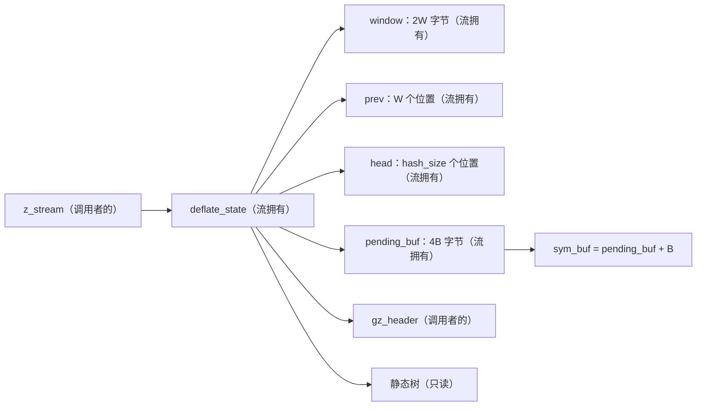
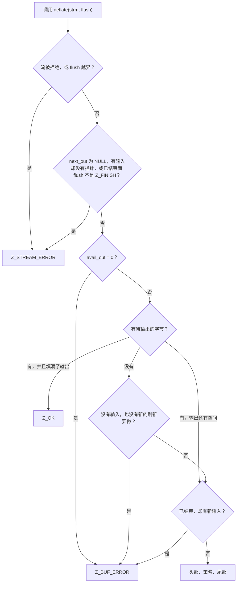
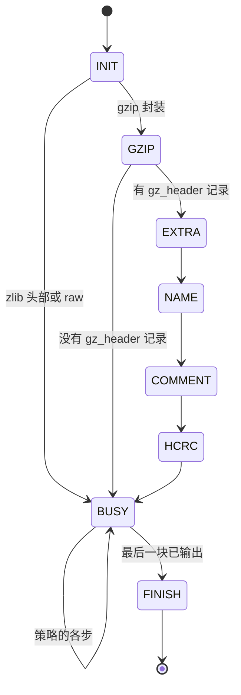

<!-- source-sha256: f75ea46cdd76fcd79c226fa770ca27e300ba17a81fc4b6ba338994532022575f -->
# 流式压缩：`deflate` 为什么是安全的

源文件：`zlib/deflate.c`。翻译：`ZlibF/Zlib/deflate.c.lean`。

`deflate` 和其他 `deflate*` 函数，对任意输入、对缓冲区的任意切分、对任意的压缩级别、`memLevel`、`windowBits`、策略、调优参数和头部，在任意一串被允许的调用上，都是安全的。证明由压缩器状态的一个不变量和三条引理组成：每个可达状态都满足不变量；从这样的状态再做一次调用是安全的；`deflateEnd` 释放一切。最难的一步是待输出字节与未读符号共用的那个缓冲区，见[树](trees.md#the-overlay-lemma-f9)。

相关页面：[压缩器的源码笔记](deflate-source-notes.md)说明翻译怎样跟随 C；[默认配置引擎](deflate-default-engine.md)说明早先针对一种配置得到的结论。这个文件的内部契约是[内部契约](../spec/internal-contracts.md)中的 `I-fw-*`、`I-sh-*`、`I-hc-inv`、`I-lm-*` 和 `I-fp-*`。

## 结论

下面的定理都已登记在 `tests/audit/theorems.txt` 中，并在提交 `bde170e9` 上已验收（[层级](README.md#status-levels)）。模块在 `ZlibF/Proof/` 下。

| 目标 | 内容 | 定理 | 模块 |
| --- | --- | --- | --- |
| `Goal.deflate_sequence_safety` | 序列结论，见下 | `Zlib.Deflate.Universal.deflate_sequence_safety` | `public-deflate-goals.lean` |
| 十三个目标，每个函数一个：`deflate`、`deflateSetDictionary`、`deflateGetDictionary`、`deflateReset`、`deflateParams`、`deflateTune`、`deflateBound`、`deflateBound_z`、`deflatePending`、`deflateUsed`、`deflatePrime`、`deflateSetHeader`、`deflateEnd` | 在可达的流上调用一次该函数是安全的 | `StreamCallSafetyProof.deflate_safety` 以及形式相同的另外十二条 | `public-stream-call-safety.lean` |
| `Goal.deflateInit__safety`、`Goal.deflateInit2__safety` | 对 `zlib.h` 允许的每一组参数，初始化都是安全的 | `deflateInit__safety`、`deflateInit2__safety` | `public-init-safety.lean` |
| `Goal.deflateCopy_safety` | `deflateCopy` 是安全的 | `deflate_copy_safety` | `public-deflate-copy.lean` |
| `Goal.deflate_refusal` | 见[拒绝](#refusals) | `deflate_refusal` | `public-stream-refusal.lean` |
| `Goal.deflate_initialisation_domain` | 序列目标的前提可以被满足（非空性） | `deflate_initialisation_domain_public` | `public-deflate-init-domain.lean` |

这些目标写在 `ZlibF/Spec/Safety/` 中。

**序列结论**有三部分（`StreamSequenceSafety`，`ZlibF/Spec/Public/Sequences.lean`），与 [`inflate`](inflate.md#results) 的相同：每个可达的流都满足公开不变量；再做一次被允许的调用，调用返回且不出故障，保持不变量，只改动流记录、流拥有的块和交给它的调用者区域，存活块集合的变化恰好是流新得到或释放掉的块；`deflateEnd` 释放流拥有的每一个块。`deflateEnd` 返回 `Z_OK`，流处于 `BUSY_STATE` 时返回 `Z_DATA_ERROR`；两种情况下它都释放了这些块。

有两条定理都叫 `deflate_safety`。`StreamCallSafetyProof.deflate_safety` 证明安全目标 `Goal.deflate_safety`。`Zlib.Deflate.Universal.deflate_safety` 证明功能目标 `Goal.deflate`，见[功能结论](#functional-results)。

## 拒绝

*被拒绝*的流（`RefusedDeflate`）是 `NULL`，或者是一个可读但被状态检查 `deflateStateCheck` 拒绝的记录。`Goal.deflate_refusal` 覆盖五个函数：`deflate`、`deflateSetDictionary`、`deflateParams`、`deflateGetDictionary` 和 `deflateCopy`。在被拒绝的流上，它们都返回 `Z_STREAM_ERROR`，不出故障。`deflateCopy` 把目的流的 `state` 字段置为 `NULL`；其余函数让堆保持原样。

`state` 字段里是垃圾指针的记录不在这个结论之内；原因见[偏离记录](../deviations.md)中“被拒绝的流”一行。其他 `deflate*` 函数的拒绝情形，在它们的功能目标里，或者在已登记但不属于必需目标的引理里：`deflatePrime_refused`、`deflateBound_nostate`、`deflateBound_z_nostate`、`deflateEnd_reject`、`deflateReset_reject`。

## 假设

下面是序列目标和各函数目标（`StreamCallDomain`）的全部前提。每一条在[偏离记录](../deviations.md)中都有一行。

| 前提 | 内容 | 属于 |
| --- | --- | --- |
| 可达的流（`StreamReachable .deflate`） | 历史从一次成功的 `deflateInit2_` 开始：堆是良构的，`zalloc` 和 `zfree` 各自是 `NULL` 或默认函数 | 每个目标 |
| 调用者的修改（`Rebuffer`） | 两次调用之间，调用者只改 `next_in`、`avail_in`、`next_out`、`avail_out`，以及不属于流的内存 | 历史 |
| `ByteObjectsFit` | 每个字节对象都少于 `2^63` 字节 | 每次调用 |
| `StreamBuffers` | 输入区域和输出区域在各自的长度内可读、可写，两者互不重叠，并且在流拥有的块之外 | `deflate`、`deflateParams` |
| `ActiveHeader` | 在 `deflate` 写挂接的 `gz_header` 期间：记录以及它的 `extra`、`name`、`comment` 可读，`name` 和 `comment` 以 NUL 结尾。输入、输出和这三个字段两两不重叠，并且在流的块之外（`DeflateHeaderApart`）。对已经写了一部分的字段，调用者没有把它缩短或拿掉（`DeflateHeaderProgress`） | `deflate`、`deflateParams`、`deflateBound*` |
| 字典区域（`CallerRange`） | 字典缓冲区是 `NULL`，或者可读（对 `deflateGetDictionary` 要可写）并且在流的块之外 | 两个字典调用 |
| `DeflateNotStarted` | 自初始化或重置以来，还没有 `deflate` 调用启动过这个流 | `deflatePrime`、`deflateSetHeader` |
| 不直接调用 `deflateResetKeep` | 它不在被允许的调用之列。`zlib.h` 把它列为未写入文档的函数，而且在它之后，最后两个位置的哈希表项是过时的（[发现](../findings/deflate-resetkeep-stale-hash/README.md)） | 历史 |

`zlib.h` 要求 `deflatePrime` 和 `deflateSetHeader` 在第一次 `deflate` 调用之前使用。C 并不检查这一点。在真实的 C 上，记录了符号之后再预置的位会覆盖符号缓冲区；在写头部的中途把头部指针设成 `NULL`，这个指针会被解引用（`tests/regression/deflate-history-domain`）。头部的各条前提也有同类的理由（`tests/regression/deflate-gzip-name-output`）。

## 内存与大小



流拥有五个块。树、堆数组和深度数组在状态内部。不变量的子句 `good` 固定了这些大小（`DStInv`，`ZlibF/Proof/deflate.c.base.lean`）。

| 字段 | 值 |
| --- | --- |
| `w_bits` | 9 到 15（请求 8 时 `deflateInit2_` 把它改成 9） |
| `W = w_size` | `2^w_bits`，即 512 到 32768 |
| `window_size` | `2W` |
| `hash_bits`、`hash_size` | `memLevel + 7`、`2^hash_bits` |
| `B = lit_bufsize` | `2^(memLevel + 6)`，即 128 到 32768 |
| `pending_buf_size` | `4B` |
| `sym_buf`、`sym_end` | `pending_buf + B`、`3(B - 1)` |

`W ≥ 512` 是有用处的：`MAX_DIST = W - 262`，窗口若只有 256 字节，这个减法就会回绕。

## 一次 `deflate` 调用

```c
int deflate(z_streamp strm, int flush) {
    /* 入口检查 */
    /* 如果还没写过，把 zlib 或 gzip 头部写进 pending_buf */
    if (strm->avail_in != 0 || s->lookahead != 0 || ...) {
        bstate = s->level == 0 ? deflate_stored(s, flush) : ...;   /* 五种策略之一 */
        ...                                                         /* 刷新标记 */
    }
    /* 最后一个块输出之后，写尾部 */
}
```



`deflate_call_full`（`deflate.c.universal-call-assemble.lean`）对这张图的每个出口各有一个情形。头部状态构成一条链：



头部的各个阶段是接连的 `if` 语句，所以一次调用可以经过其中好几个。输出填满时每个阶段也都可以提前返回，下一次调用从那里继续。

## 不变量

不变量是 `DInv`（`ZlibF/Proof/deflate.c.universal-invariant.lean`）。它在每个可达状态下、对每一组参数都成立。另有两组较小的事实，在两次调用之间与它一同成立。

| 部分 | 白话说明 | 用于 |
| --- | --- | --- |
| `good` | 流记录可读，它的 `state` 是一个存活的 deflate 状态，并且指回这个流。五个块都存在，互不相同，可写，大小如上表。`pending_out` 指向 `pending_buf` 内部，待输出的字节放得下。`sym_next` 是 3 的倍数，至多为 `sym_end`。位缓冲里有 `bi_valid ≤ 16` 位，这些位以上没有别的 | 每一次访问 |
| `alloc`、`globals` | 分配器是默认的。静态表保持初始内容 | `deflateEnd`、`deflateCopy`、校验和 |
| `shape` | 关于各个位置的数值事实，见下 | `fill_window`、各策略、块刷新 |
| `hashing` | 哈希链只通向插入过的位置，见下 | `longest_match` |
| `symbols` | `sym_buf` 里的符号字节与树的频率描述的是同一个符号列表。每个记录下来的距离至多是 `W - 262`。只要还记录着符号，待输出字节的末尾就不超过偏移 `B` | `compress_block`、块刷新 |
| `HeaderInv`（调用之间） | 处于头部状态时没有记录任何符号。在 `EXTRA`、`NAME`、`COMMENT` 和 `HCRC` 状态下，`gz_header` 指针不是 `NULL` | 头部各阶段 |
| `CallFacts`（调用之间） | 刚重置之后没有前瞻数据，没有符号，块从 `strstart` 开始。在 `FINISH_STATE` 下没有符号，没有前瞻数据，也没有留在缓冲里的位 | `deflate` 的入口情形、尾部 |

序列目标陈述的是较小的公开谓词 `StreamInvariant`，也就是 `good` 和 `alloc`。

### `shape`：位置与计数

子句名是 `Shape` 里的名字。

| 子句 | 内容 |
| --- | --- |
| `room`（**D**） | `strstart + lookahead ≤ window_size` |
| `insert`、`insertDone` | `insert ≤ strstart`。前瞻数据有三个字节或更多时，`insert = 0` |
| `prevLength`、`matchLength` | 两者都至多是 258 |
| `pendingMatch` | 待处理的匹配（`match_length ≥ 3`）的距离在 1 到 `W - 262` 之间，并且 `insert = 0` |
| `blockStart` | `block_start ≤ strstart` |
| `blockSpan` | 级别非零时，`strstart - block_start ≤ 258 * (符号个数) + 1` |
| `levelZero` | 级别为 0 时：`block_start ≥ 0`，没有前瞻数据，没有符号 |
| `highWater`、`windowInit` | `strstart + lookahead ≤ high_water ≤ window_size`：窗口一直写到了数据的末尾 |
| `biValid` | `bi_valid ≤ 7` |
| `cursor` | 待输出缓冲为空时，`pending_out = pending_buf` |
| `symRoom` | `sym_next < sym_end`：还放得下一个符号 |
| `slides` | `matches ≤ 2`，级别非零时为 0（级别 0 用这个字段统计窗口滑动的次数） |
| `lastFlush`、`headerFlush`、`trailer` | `last_flush` 在 -2 到 5 之间；写头部之前它是 -2 或 -1；`wrap` 为负只出现在 `FINISH_STATE` |

其余子句（`matchAvailable`、`available`、`fastLazy`、`lazyPrev`、`lazyAvail`、`lazyStart`、`symBlock`）描述 `deflate_slow` 中待处理的字面量或匹配，并说明已记录的符号至少覆盖块中的一个字节。

`block_start` 可以是负的。每次滑动时 `fill_window` 都从它减去 `W`，在一个块的中间也是这样。`blockSpan` 限定了它能比 `strstart` 小多少：一个块里的符号少于 `B ≤ 32768` 个，每个至多 258 字节。所以 `block_start` 远在 `long` 的范围之内（`block_start_low`），滑动时的有符号减法不会溢出（`block_start_slide_signed`）。

### `hashing`：可以沿着走的链

`deflateInit2_` 不初始化 `prev`。证明对那些从未写过的槽里的任意内容都成立。这个子句说的是能够*到达*什么（`HashChains`，`ZlibF/Proof/deflate.c.engine.chains.lean`）。

从 `head[k]` 出发，沿着 `p → prev[p & wmask]` 走。走到 0 就停；当 `p` 的槽可能已被重用，也就是 `p + W` 小于插入前沿时，也停。途中遇到的每个非零位置 `p` 都满足：

- `p` 在前沿 `chainTop = min(strstart - insert, strstart + lookahead - 2)` 之下；
- 它的三个字节在数据之内，并且哈希到 `k`；
- `prev[p & wmask] < p`。

这就是内部契约 `I-hc-inv` 的事实 **H1** 和 **H2**。从未写过的槽永远不会被到达，所以里面是什么无关紧要。最后一条使每一次遍历都严格下降。

级别为 0 时不维护这两张表。发生过一次存储块滑动之后，这个子句对“`slide_hash` 处理之后会得到的表”成立（`SlidChains`）；滑动更多次之后就什么都不断言了，而 `deflateParams` 会在别的策略运行之前清空哈希表。

## 每一步为什么保持不变量

`reachable_inv_of`（`deflate.c.universal-sequence-safety.lean`）对历史做归纳，证明每个可达状态都满足 `DInv`、`HeaderInv` 和 `CallFacts`。`operation_step_of`（`deflate.c.universal-ops-dispatch.lean`）证明再做一次调用是安全的，并给出它的帧和账本。`end_from_inv`（`deflate.c.universal-end.lean`）对应 `deflateEnd`。

| 步骤 | 定理 | 为什么成立 |
| --- | --- | --- |
| `deflateInit2_` 成功 | `init2_inv`、`init2_header` | 状态被清零，四个缓冲区按上面的大小分配，`deflateReset` 运行 `lm_init`，它清空 `head` 并把每个位置置 0。空窗口加上清空的 `head` 满足每一个子句 |
| 调用者修改缓冲区字段 | `DInv.rebuffer` | 没有哪个子句提到这四个字段 |
| `deflate` | `deflate_call_of`、`deflate_call_header`、`deflate_calls_of` | 见下 |
| `deflateReset` | `step_reset` | 又是 `lm_init` |
| `deflateSetDictionary` | `step_setDictionary` | 它让字典经过 `fill_window`，并像各策略那样插入它的各个位置 |
| `deflateParams` | `step_params` | 它可能先运行 `deflate(strm, Z_BLOCK)`。离开级别 0 时，按 `matches` 的值滑动或清空哈希表 |
| `deflatePrime` | `step_prime` | 只允许在第一次 `deflate` 调用之前使用，那时没有记录任何符号 |
| `deflateSetHeader` | `step_setHeader` | 只允许在第一次 `deflate` 调用之前使用，所以 `HeaderInv` 不会在写头部的中途被破坏 |
| `deflateTune`、`deflatePending`、`deflateUsed`、`deflateBound*`、`deflateGetDictionary` | `step_tune`、`step_pending`、`step_used`、`step_bound`、`step_bound_z`、`step_getDictionary` | 它们写的是不受任何子句约束的调优字段，或者只读 |
| `deflateCopy` 成功 | `copy_inv` | 五个新块得到旧块的内容。只复制 `high_water` 个窗口字节就够了，原因是 `windowInit` |

### 一次 `deflate` 调用的内部

**头部与尾部。** 每个 `put_byte` 之前都检查 `pending_buf` 里的空间，必要时先刷新；遍历 `extra`、`name` 和 `comment` 的循环在返回前后保留 `gzindex`。在解引用 `gz_header` 的四个状态里，`HeaderInv` 给出它不是 `NULL`。

**`fill_window`**（`fill_window_inv`，`deflate.c.universal-window.lean`）。D 使 `more = window_size - lookahead - strstart` 是真正的差。如果 `strstart ≥ 2W - 262`，窗口滑动：`window + W` 处的 `W - more` 个字节被复制到 `window`，这两段区域不重叠；`strstart`、`match_start`、`block_start` 和每个表项都减去 `W`。`slide_hash` 把每个表项 `m` 变成 `m - W`，`m < W` 时变成 0。它访问每一个槽，不管写没写过；对可达的位置，新值就是它的新位置，而且仍在同一个槽里，因为减去 `W` 不改变 `p & wmask`。然后把输入复制到 `window + strstart + lookahead`，至多 `more` 个字节，并把等待中的位置（`insert`）插入。D 重新成立，并且 `strstart < 2W - 262`。

**`longest_match`**（`longest_match_inserted`）。它在位置 `strstart` 刚插入之后被调用，链头 `cur` 满足 `1 ≤ cur < strstart` 和 `strstart - cur ≤ W - 262`。

- **F5，链的遍历。** 循环读到的每个位置都是上面所说的可达位置。所以 `prev` 的下标和窗口的下标都不越界，而且下一个位置更小。
- **F6，比较。** 循环在 `window + strstart` 和 `window + cur` 处至多比较 258 个字节。前提是 `strstart + 262 ≤ window_size`。策略走到搜索的两条路都能给出它：`lookahead ≥ 262` 时由 D 给出；经过 `fill_window` 之后由它的最后一条结论给出。比较可能读到前瞻数据之后的字节。这些字节在窗口之内，返回的长度会被截到 `lookahead`。

**记录一个符号。** `_tr_tally` 在 `sym_buf + sym_next` 处写三个字节。`symRoom` 保证它们在符号区之内。匹配的长度偏移至多是 255，距离至多是 `W - 262`，所以查 `_length_code` 和 `_dist_code` 不越界。缓冲区满了，策略就刷新。

**刷新一个块。** `FLUSH_BLOCK_ONLY` 用 `long` 计算块长 `strstart - block_start`，然后调用 `_tr_flush_block`。它把 `window + block_start` 作为存储块的源传进去，`block_start` 为负时传 `NULL`；传 `NULL` 时不会选存储形式。`flush_block_only_safe` 证明它对每一个 `memLevel` 都安全；论证在[树](trees.md)页面上。它要求进入时待输出缓冲为空且 `bi_valid ≤ 7`。各策略提供了这两点。

**五种策略。** `huff_spec_of`、`rle_spec_of`、`fast_spec_of`、`slow_spec_of` 和 `stored_spec`（`deflate.c.universal-strategies.lean`、`-slow.lean`、`-stored-tail.lean`）证明每种策略都会返回，并交还 `DInv`。在策略循环每一轮的开头，状态都满足 `DInv`，并且待输出缓冲为空。

## 循环为什么会结束

**策略循环**（`loopMeasure`，`deflate.c.universal-strategies.lean`）。对 `deflate_huff`、`deflate_rle`、`deflate_fast` 和 `deflate_slow`，度量是

```
1 + 2 * (avail_in + lookahead)      循环进行时；  离开循环后为 0
```

每一轮要么离开循环，要么至少用掉前瞻数据的一个字节。`fill_window` 把字节从输入搬到前瞻数据里，两者之和不变。度量小于 `2^35`，远小于 `2^64` 的循环燃料（`loop_measure_bound`）。

**`deflate_stored`。** 它的第一个循环把存储块直接写到输出；度量是 `avail_out`（`deflate.c.universal-stored-loop.lean`）。

**`longest_match`。** 度量是当前位置 `cur_match`（`deflate.c.engine.lmmain.lean`）。遍历会结束，是因为位置严格下降，与链预算是多少无关。这一点有实际意义：`deflateTune` 接受 `max_chain_length = 0`，这时 `--chain_length` 会回绕成一个很大的值，而不是减到 0。

**头部循环**遍历 `extra`、`name` 和 `comment` 的字节。前提保证这些范围是有限的：`extra_len` 个字节，以及一个到 NUL 为止的字符串。

## 难点在哪里

- **共享缓冲区。** `pending_buf` 从偏移 0 起存放输出，从偏移 `B` 起存放符号。写一个块时，输出朝着还没读的符号增长。它永远追不上这些符号，这取决于块的码长，而不只是取决于大小。这就是事实 F9；[树](trees.md#the-overlay-lemma-f9)对每一个 `memLevel` 证明了它。
- **未初始化的 `prev`。** 不变量不能说“每个槽都有效”。它必须说明哪些槽能被到达，而每个移动窗口或前沿的操作，都得让这个集合保持在控制之下。
- **`deflate_slow`。** 它输出匹配要晚一步。在两轮之间，状态里留着一个待处理的字面量或匹配，这是其他策略没有的；`shape` 中有六个子句是为它而设的。
- **级别切换。** `deflateParams` 可以在级别 0 与其他级别之间切换，前者不管哈希表，后者依赖哈希表。

## 没有定理陈述的 C 解读

- `deflateSetDictionary` 经过 `read_buf`，后者把字典长度加到 `total_in` 上。翻译保留了这次更新。调用者是否应当把 `total_in` 理解为包含字典，**尚未由证明确认**。
- 用同一个记录既作源又作目的调用 `deflateCopy`，不在目标之内：历史中的复制情形和 `Goal.deflateCopy_safety` 取的都是两个不同的记录（见[偏离记录](../deviations.md)中关于 `Goal.deflateCopy_safety` 的一行）。`zlib.h` 是否有意允许这种调用，**尚未由证明确认**。
- 在本构建中 `deflate_state` 的大小是 5968 字节。没有哪个 Lean 文件或测试陈述这个数。**尚未由证明确认**。

更多这类笔记见[源码笔记](deflate-source-notes.md)。

## 功能结论

这些结论说的是函数算出了什么。它们已登记，但不是安全结论所必需的。

| 结论 | 定理 | 模块 |
| --- | --- | --- |
| `Goal.deflate`：一次调用的完整契约，包括进展、返回码、计数、帧和所有权。`compress*` 的安全证明用到它 | `Zlib.Deflate.Universal.deflate_safety` | `public-deflate-goals.lean` |
| 完整契约 `Goal.deflateInit_`、`Goal.deflateInit2_`、`Goal.deflateCopy`、`Goal.deflateEnd`、`Goal.deflateReset`，以及各查询函数的完整契约 | `deflateInit_proof`、`deflateInit2_proof`、`deflate_copy_public`、`deflate_end_public`、`deflate_reset_public` 等 | `public-deflate-*.lean` |
| 只针对默认配置的结论 | 见[默认配置引擎](deflate-default-engine.md) | |

对默认配置，`DeflateCore.correct` 说明：已完成的流按格式规格解码，得到的就是被接受的输入。对其他配置，没有定理说 `deflate` 的输出能解码回它的输入。关于这样的证明需要涵盖什么，早先的笔记保存在[历史](../history/proof-functional-notes.md)中。
